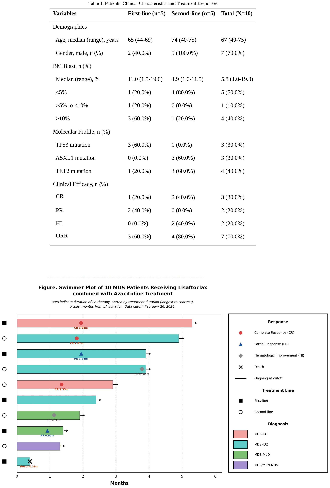

# EHA-3812-PB3081 原始摘要

来源：https://library.ehaweb.org/eha/2026/eha-2026/4209631/jihao.zhou.efficacy.and.safety.of.lisaftoclax.combined.with.azacitidine.in.html

检索日期：2026-10-23

## 原始作者名单

- Mengying Gao — Shenzhen People's Hospital, Department of Hematology, Shenzhen, China
- Lina Hu — Shenzhen People's Hospital, Department of Hematology, Shenzhen, China
- Huijun Li — Shenzhen People's Hospital, Department of Hematology, Shenzhen, China
- Jing Luo — Shenzhen People's Hospital, Department of Hematology, Shenzhen, China
- Xiaohua He — Shenzhen People's Hospital, Department of Hematology, Shenzhen, China
- Peng Ke — Shenzhen People's Hospital, Department of Hematology, Shenzhen, China
- Guangyang Weng — Shenzhen Second People’s Hospital, Department of Hematology, Shenzhen, China
- Suyun Wang — Shenzhen Longhua District Central Hospital, Department of Hematology, Shenzhen, China
- Qiuxia Wan — Shenzhen Longhua District Central Hospital, Department of Hematology, Shenzhen, China
- Heng Wang — Shenzhen Longhua District Central Hospital, Department of Hematology, Shenzhen, China
- Jihao Zhou — Shenzhen People's Hospital, Department of Hematology, Shenzhen, China

## 英文摘要

Abstract: EHA-3812 Short: PB3081

Title:  EFFICACY AND SAFETY OF LISAFTOCLAX COMBINED WITH AZACITIDINE IN TREATMENT OF PATIENTS WITH MYELODYSPLASTIC SYNDROME: A MULTICENTER RETROSPECTIVE STUDY

Type: Publication Only

Session title: Myelodysplastic syndromes - Clinical

Background: 

Myelodysplastic Syndrome (MDS) is a clonal hematopoietic disorder with poor prognosis. B-cell lymphoma 2 (BCL2) serves as a pivotal regulator of apoptotic pathways and is aberrantly overexpressed across diverse hematological malignancies. In a phase 1b study in high-risk MDS patients, the BCL2 inhibitor venetoclax plus azacitidine (AZA) induced a complete remission (CR) rate of 29.9%, and a modified OR (mOR) rate of 80.4%. However, in the subsequent phase 3 VERONA study, venetoclax plus AZA (VA) failed to improve overall survival (OS) compared to placebo plus AZA in newly diagnosed high-risk MDS patients. Lisaftoclax is a new oral BCL2 selective inhibitor. In a phase 1b study, lisaftoclax plus AZA (LA) induced a CR rate of 29% and a ORR rate of 64% in high-risk MDS patients. But the efficacy and safety of LA for MDS patients have not been evaluated in real-world practice.

Aims: 

To retrospectively observe the efficacy and safety of LA for MDS patients in the real-world practice.

Methods:

Patients with intermediate to high-risk MDS, including newly-diagnosed or relapsed/refractory  disease, were enrolled. LA was administered as lisaftoclax once daily orally from days 1 to 14 and AZA (75 mg/m2/day) from days 1 to 7 in repeated 28-day cycles.

Results:

A total of 10 MDS patients were enrolled. 5 patients were newly diagnosed, the other 5 were relapsed or refractory to first-line treatment. 3 patients had TP53 mutation. The median age is 67 (40-75) years. Baseline clinical characteristics of enrolled patients were shown in table 1. Treatment response was evaluable in 10 patients. The ORR was 70% of the total cohort, with 60% in the first-line and 80% in the second-line. 3 patients achieved CR, 1 in the first-line and 2 in the second-line. Partial remission (PR) was observed in 2 patients in the first-line. 2 patients achieved hematologic improvement (HI) in the second-line. 1 patient died of severe pneumonia in the first-line. The median time to achieve initial treatment response is 1.8 months. In the 4 patients previously received VA treatment, 1 patient achieved CR by LA as second-line treatment, which indicates that lisaftoclx may overcome venetoclax resistance. The preliminary treatment response of the total cohort is as shown in figure 1. Reported adverse effects in our cohort were generally manageable under active supportive treatment.

Summary/Conclusion: 

In our study, LA demonstrates promising therapeutic activity and acceptable toxicity in MDS patients in the real-world practice, in accordance with results reported in previous phase 1b Study. Considering that lisaftoclax exhibited similar efficacy but less toxicity than venetoclax, we believe LA regimen deserve further study in the field of MDS treatment.

Keyword(s):  MDS

## 原始附图

