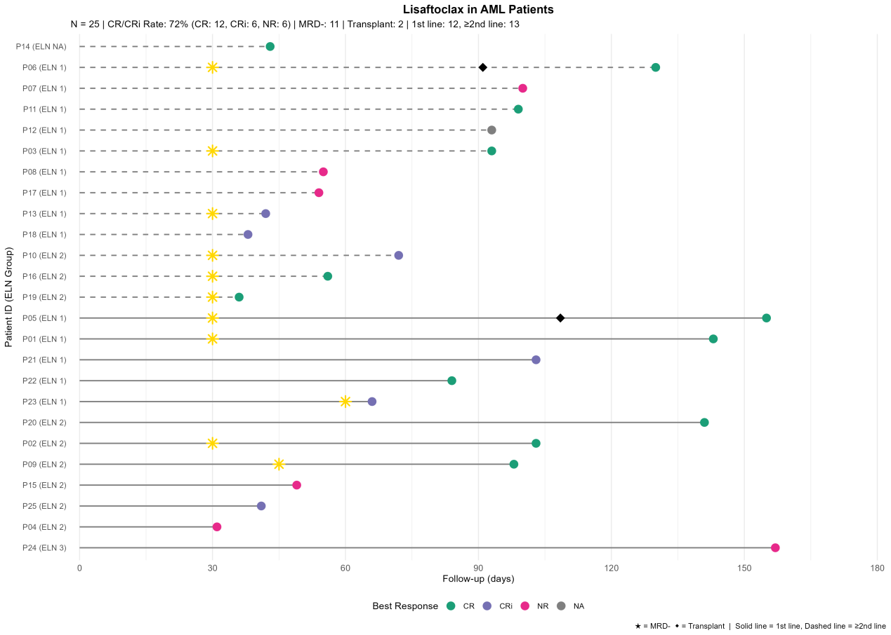

# EHA-5454-PF562 原始摘要

来源：https://library.ehaweb.org/eha/2026/eha-2026/4207550/chen.cao.real-world.efficacy.and.safety.of.lisaftoclax.in.myeloid.neoplasms.a.html?f=

检索日期：2026-10-23

## 原始作者名单

- Chen Cao — Qilu Hospital of Shandong University, , Jinan, China
- Ruijuan Wang — Nanyang Central Hospital, , Nanyang, China
- ZHAOXIA LIU — Affiliated Hospital of Shandong University of Traditional Chinese Medicine, , Jinan, China
- Changrong Wei — Linyi People's Hospital, , Linyi, China
- Qing Meng — Qilu Hospital of Shandong University, , Jinan, China
- Xinwen Jiang — Qilu Hospital, Shandong University, , Jinan, China
- Qingli Ji — Qilu Hospital of Shandong University, , Jinan, China
- Dongmei Hu — Qilu Hospital of Shandong University, , Jinan, China
- Minran Zhou — Qilu Hospital of Shandong University, , Jinan, China
- Ran Wang — Qilu Hospital of Shandong University, , Jinan, China
- Sai Ma — Qilu Hospital of Shandong University, , Jinan, China
- Chunyan Chen — Qilu Hospital of Shandong University, , Jinan, China

## 英文摘要

This abstract is embargoed until Thursday, June 11, 2026, 08:00 CEST.

Presentation during EHA2026:All (e)Poster presentations will be made available as of until Thursday, June 11, 2026, 08:00 CEST and will be accessible for on-demand viewing from June 17 to October 15, 2026 on the Congress platform.

Abstract: EHA-5454 Short: PF562

Title:  REAL-WORLD EFFICACY AND SAFETY OF LISAFTOCLAX IN MYELOID NEOPLASMS: A MULTICENTER STUDY

Type: Poster Presentation

Session title: Acute myeloid leukemia - Clinical

Background: 

Lisaftoclax, a novel BCL-2 inhibitor, has shown promising anti-tumor activity in preclinical studies and early-phase clinical trials for hematologic malignancies. However, real-world data regarding its efficacy and safety in patients with acute myeloid leukemia (AML), myelodysplastic syndromes (MDS), and chronic myelomonocytic leukemia (CMML) remain limited.

Aims: 

Therefore, this multicenter retrospective study aimed to evaluate the real-world efficacy and safety of lisaftoclax in patients with these myeloid neoplasms.

Methods:

This retrospective study enrolled AML, MDS, or CMML patients receiving lisaftoclax across four Chinese centers. All met 2022 WHO criteria. Data collected included baseline characteristics, mutations, responses, and adverse events. Efficacy endpoints: CR, CRi, MRD negativity. AML risk stratified by ELN 2024. Adverse events graded per CTCAE v5.0. Descriptive statistics used.

Results:

4.1 Baseline Characteristics

Thirty patients enrolled: median age 63 years (26–77); 60% male. AML: 25 (83%), MDS: 3 (10%), CMML: 2 (7%). AML risk: low 15, intermediate 9, high 1. Firstline: 12 (48%); laterline: 13 (52%). Common mutations: DNMT3A (33%), RUNX1 (30%), ASXL1 (27%), NPM1 (20%), FLT3 (20%). HMR mutations: 43%.

4.2 AML Efficacy

CR/CRi rate was 72% (18/25): 12 CR, 6 CRi, 6 NR. Lowrisk: 87% (13/15), intermediaterisk: 67% (6/9), highrisk: no response. MRD negativity: 61% (11/18). Firstline: 75% (9/12), laterline: 69% (9/13). Among 5 lowrisk patients with pretreatment CRi or MRD positivity, 2 (40%) achieved deeper responses (CRi to CR, MRD positivity to MRD negativity).

4.3 MDS/CMML Efficacy

MDS: 2/3 achieved CRi (67%). CMML: 1 stable disease, 1 progression.

4.4 Mutation Analysis

NPM1mutated (n=6): 100% CR/CRi. IDH2mutated (n=6): 83%. DNMT3Amutated (n=10): 70%. FLT3mutated (n=6): 67%. RUNX1mutated (n=9): 56%. ASXL1mutated (n=8): 50%. NRASmutated (n=5): 60%.

4.5 Safety

Anygrade TEAEs: 87% (26/30). Hematologic: thrombocytopenia (57%), anemia (53%), neutropenia (47%). Grade≥3: 47% (14/30): thrombocytopenia (27%), anemia (23%), neutropenia (20%). Nonhematologic: febrile pneumonia (27%), liver dysfunction (23%), renal impairment (17%). Two AML patients transplanted; one death.

Summary/Conclusion: 

Lisaftoclax showed 72% CR/CRi in AML, with lowrisk patients benefiting most (87%). MRD negativity (61%) correlated with response depth; 40% of pretreatment CRi or MRD positivity patients achieved deeper responses. MDS showed 67% CRi rate. NPM1 and IDH2 mutations predicted high response; RUNX1 and ASXL1 mutations had lower responses. Safety was manageable, with expected hematologic toxicities. Limitations: small sample, short followup, retrospective design.Lisaftoclax demonstrates promising efficacy (72% CR/CRi in AML) and manageable safety. ELN lowrisk and NPM1mutated patients derived greatest benefit. The swimmer plot supports its clinical utility.

Keyword(s):  Minimal residual disease (MRD) | BCL2 | Acute myeloid leukemia

## 原始附图

