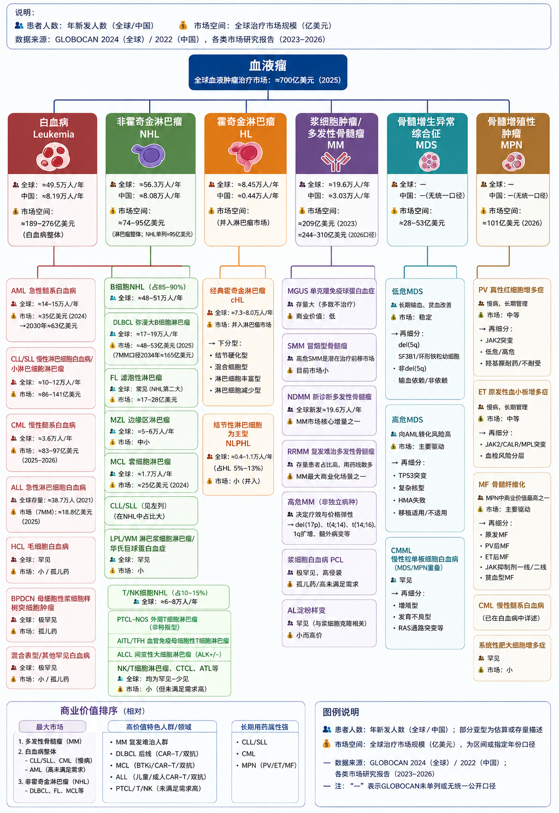

## 血液疾病

肿瘤分为实体瘤和血液瘤，血液瘤下面又分为几个大类，分别是淋巴瘤、浆细胞肿瘤、白血病。

| 子类               | 占比 | 核心细分                                         |
| ------------------ | ---- | ------------------------------------------------ |
| 淋巴瘤             | ~51% | 霍奇金淋巴瘤（HL）、非霍奇金淋巴瘤（NHL，占90%） |
| 白血病             | ~36% | ALL、AML、CLL、CML                               |
| 浆细胞肿瘤         | ~13% | 多发性脊髓瘤（MM）                               |
| 其他（MDS、MPN等） | —    | 骨髓增生异常综合征、骨髓增殖性肿瘤               |

## 概述

1、武田何时行权，大概率要Polaris-2（经治CML-CP）数据读出。Polaris-2 正式 III 期数据预计 **2027 年上半年** 读出（入组 2026 年完成 + 6 个月随访）

2、Lisaftoclax 的 GLORA-4 临床，针对 MDS 适应症，CR 数据预计 2027 年 6 月左右读出，OS 可能要等到 2029 年。（2025 年 8 月完成入组，Venetoclax 是入组 27 个月，随访 28 个月，死亡事件数 66%）

亚盛医药（Ascentage Pharma）是一家专注于细胞凋亡通路的全球化创新药企，公司由杨大俊、王少萌、郭明三位科学家于2009年创立，拥有全球唯一覆盖Bcl-2、IAP、MDM2-p53三条细胞凋亡通路的临床产品管线。

## **三期临床**

| 研究名称  | 产品       | 适应症          | 设计                            | 监管状态          | 关键进展                        |
| :-------- | :--------- | :-------------- | :------------------------------ | :---------------- | :------------------------------ |
| POLARIS-1 | 奥雷巴替尼 | 新诊断Ph+ ALL   | 联合低强度化疗 vs 伊马替尼+化疗 | FDA/EMA/CDE已批准 | MRD阴性CR率约65%                |
| POLARIS-2 | 奥雷巴替尼 | 经治CML-CP      | 奥雷巴替尼 vs 博舒替尼          | FDA已批准         | 预计2026年提交NDA               |
| POLARIS-3 | 奥雷巴替尼 | SDH缺陷型GIST   | 单臂/随机                       | CDE已批准         | 中位PFS 25.7个月                |
| GLORA     | APG-2575   | BTKi经治CLL/SLL | +BTKi vs 标准治疗               | FDA已许可         | 全球首个FDA许可的APG-2575 III期 |
| GLORA-2   | APG-2575   | 初治CLL/SLL     | +阿卡替尼 vs FCR                | CDE已批准         | 与阿斯利康合作                  |
| GLORA-3   | APG-2575   | 新诊断AML       | +AZA vs 安慰剂+AZA              | CDE已批准         | 针对老年/体弱患者               |
| GLORA-4   | APG-2575   | 新诊断中高危MDS | +AZA vs 安慰剂+AZA              | FDA/EMA/CDE已批准 | 全球首个MDS领域Bcl-2 III期      |

## **早期管线**

| 管线资产 | 核心靶点/机制        |  临床阶段  | 关键适应症             | 核心临床数据                                                 | 监管资格/差异化定位                                          |
| :------- | :------------------- | :--------: | :--------------------- | :----------------------------------------------------------- | :----------------------------------------------------------- |
| APG-115  | MDM2-p53 PPI         |  Phase II  | 黑色素瘤/ACC/儿童肉瘤  | 联合帕博利珠单抗ORR 24.1%（黑色素瘤）；ACC ORR 20.0%/DCR 96.0%；联合APG-2575儿童实体瘤ORR 30%/DCR 80% | 6项FDA ODD + 2项RPD + 1项FTD；中国首个临床MDM2抑制剂；星光计划纳入 |
| APG-2449 | FAK/ALK/ROS1         | Phase III  | ALK+ NSCLC（2L/1L）    | 2L ALK+ ORR 45.5%/mPFS 13.6个月；颅内ORR 75.0%；1L ALK+ ORR 78.6% | 2项CDE注册III期；优于lorlatinib的CNS安全性；FAK抑制克服旁路耐药 |
| APG-1252 | Bcl-2/Bcl-xL（前药） | Phase I/II | EGFR-TKI耐药NSCLC/SCLC | 联合奥希替尼ORR 80.8%（初治）；TP53+EGFR共突变ORR 87.5%      | FDA ODD（SCLC）；NCI CRADA合作；前药设计降低血小板毒性       |
| APG-3288 | BTK PROTAC降解       |  Phase I   | R/R B细胞恶性肿瘤      | 临床前：优于NX-2127/BGB-16673的降解效力与选择性              | FDA+CDE双IND；中国首个自主研发BTK降解剂；克服C481S等耐药突变 |
| APG-5918 | EED抑制剂            |  Phase I   | 实体瘤/NHL/贫血        | 临床前：KARPAS-422完全肿瘤消退；IC50 = 1.2 nM                | FDA+CDE双IND；中国首个临床EED抑制剂；PRC2全面抑制            |
| APG-1387 | 双价IAP拮抗剂        | Phase I/II | 胰腺癌/CHB             | 联合AG化疗3/15例PR（胰腺癌）；HBV小鼠模型HBsAg完全清除且停药无复发 | 全球首个IAP用于CHB临床；双价设计区别于单体IAP抑制剂          |

## GLORA系列

| 维度      | GLORA-1                                          | GLORA-2                          | GLORA-3                   | GLORA-4                                              |
| --------- | ------------------------------------------------ | -------------------------------- | ------------------------- | ---------------------------------------------------- |
| NCT       | NCT06104566                                      | NCT06319456                      | NCT06389292               | NCT06641414                                          |
| 适应症    | BTKi 经治 ≥12 月、未达 CR 的 CLL/SLL             | 初治 CLL/SLL                     | 初治老年/不适合强化疗 AML | 初治中高危 MDS（HR-MDS）                             |
| 试验组    | 2575 + BTKi（acala/zanu/ibru）                   | 2575 + acalabrutinib（固定疗程） | 2575 + AZA                | 2575 600mg D1–14 + AZA                               |
| 对照组    | BTKi 单药                                        | 免疫化疗（FCR/BR）               | 安慰剂 + AZA              | 安慰剂 + AZA                                         |
| 盲法      | 开放标签随机 1:1                                 | 开放标签随机                     | 双盲安慰剂对照 1:1        | 双盲安慰剂对照                                       |
| 分层      | del(17p)/TP53                                    | —                                | —                         | —                                                    |
| 样本量    | ~440                                             | ~344                             | ~486                      | 464–490                                              |
| 主要终点  | PFS（IRC，iwCLL 2018）                           | PFS                              | OS                        | CR 率 + OS（双主要终点）                             |
| 启动      | 2023-10/12                                       | 2024-04（CDE 2023-10 批准）      | 2024-04/06                | FDA/EMA 2025-08、CDE 2024-08 许可                    |
| 中心 / PI | 18 国 126 中心；全球 PI M. Davids（Dana-Farber） | —                                | —                         | 全球 PI Garcia-Manero（MD Anderson）；中国 PI 黄晓军 |
| 入组进度  | 预计 2026 完成                                   | 80–90%                           | 80–90%                    | 登记完成预计 2029-12                                 |
| 预计读出  | 2026–2027（保守 2028Q2–Q3）                      | 2027-08 至 2028 末               | ~2028                     | CR ~2029；OS 2029–2030                               |

## GLORA-4入排标准

| 类别 | 条件                                                         |
| ---- | ------------------------------------------------------------ |
| 纳入 | 初治 MDS；骨髓原始细胞 <20%；IPSS-R >3 分（中危/高危/极高危）；ECOG ≤2；预期生存 ≥3 个月；肝肾等器官功能允许治疗 |
| 排除 | 治疗相关 MDS；由 MPN 演变的 MDS；MDS/MPN 重叠（含 CMML）；严重骨髓纤维化；既往接受过 MDS 抗肿瘤治疗或移植 |

设计逻辑：初治、高危 MDS 全人群随机 → 2575+AZA vs Pbo+AZA → 比较 CR 与 OS。患者可以是"初治但极高危"，类似刚确诊、却已具晚期生物学特征的肿瘤患者。

## 对标Ven

| 2575 研究           | 对标 Ven 试验                                        | 复制程度               | Ven 关键结局                                                 | 解读                                                         |
| ------------------- | ---------------------------------------------------- | ---------------------- | ------------------------------------------------------------ | ------------------------------------------------------------ |
| GLORA-3（AML）      | VIALE-A（Ven+Aza vs Pbo+Aza）                        | 高度复制               | 最终 OS（中位随访 43.2 月）：mOS 14.7 vs 9.6 月，HR 0.58，P<0.001；2 年 OS 37.5% vs 16.9% | 最直接的"模板"，且是明确成功的标杆                           |
| GLORA-4（MDS）      | VERONA（Ven+Aza vs Pbo+Aza）                         | 高度复制（加了双终点） | mOS 22.2 vs 21.7 月，HR 0.91，P=0.38，未达主要终点；mORR 76.2% vs 57.7% | 最重要的负面参照：同一路线在 MDS 已失败一次。赌安全性优势翻盘 |
| GLORA-2（初治 CLL） | CLL14；最接近为 GLOW（固定疗程 ibru+Ven vs Clb+Obi） | 部分借鉴               | GLOW 约 67 月随访：PFS HR 0.273；66 月 PFS 51.7% vs 18.1%    | 不同 BTKi、对照亦不完全相同，但最接近"BTKi+BCL-2 固定疗程替代化疗"的验证 |
| GLORA-1（经治 CLL） | MURANO（固定疗程 Ven+R vs BR）                       | 走了不同路线           | 7 年最终分析：mPFS 54.7 vs 17.0 月；7 年 OS 69.6% vs 51.0%，HR 0.53 | 改用 BTKi 联合，差异化竞争。公开资料中没有等价的"BTKi 上加药 vs 继续 BTKi"Ven 随机 III 期 |

结论：髓系（AML/MDS）基本是抄 Venetoclax 的作业；CLL 领域走了差异化——Venetoclax 在 2013–2015 年设计注册 III 期时，BTKi 尚未成为一线标准。
