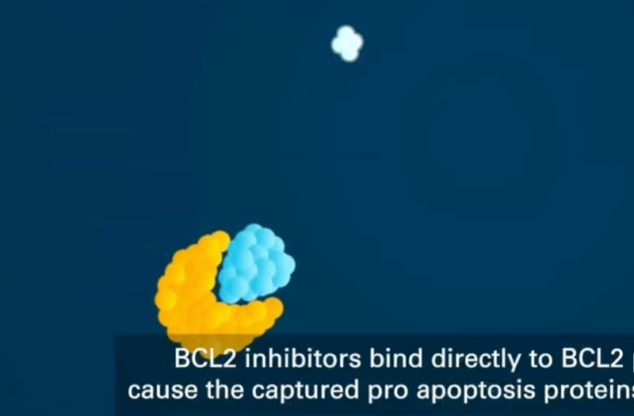

## 血液系统框架

各种血细胞最初的来源都是**造血干细胞**，造血干细胞分化为**髓系祖细胞**和**淋巴系祖细胞**。

髓系祖细胞继续分化出红细胞、粒系（中性粒细胞）、巨噬细胞、巨核细胞（血小板是其胞质碎片），这部分主要负责**先天免疫和供氧**。淋巴系祖细胞继续分化出B细胞、T细胞、NK细胞。这部分主要负责**适应性免疫**。

正常的造血过程：造血干细胞 → 增殖 → 分化成熟 → 红细胞、白细胞、血小板


## MDS & BCL-2i

MDS是

1、造血干细胞异常 → 产生不了正常成熟血细胞（无效造血）

结果：

- 红细胞生成失败 → 贫血（Hb下降）
- 中性粒细胞生成失败 → 感染（ANC下降）
- 血小板生成失败 → 出血（PLT下降）

2、异常克隆细胞逃避调控 → 在骨髓里扩张

结果：

异常造血细胞克隆，挤压正常造血细胞，这也是为什么后期的MDS会向AML转化（sAML和AML不一样）


先来看一下BCL-2抑制剂（BCL-2 inhibitor，BCL-2i）生效过程（流程图+动画），这个后续会解释。

```
BCL-2 抑制剂进入细胞
    ↓
高亲和力结合 BCL-2 的 BH3 沟槽
    ↓
竞争性地把 BIM 从 BCL-2:BIM 复合物中置换出来
    ↓
游离 BIM 转位至线粒体外膜，激活 BAX/BAK
    ↓
多个BAX/BAK结合成蛋白复合体（寡聚化），给线粒体打孔 → 线粒体外膜通透化MOMP（之后不可逆）
    ↓
位于线粒体内外膜之间的细胞色素c被释放，进入细胞质
 	↓
细胞色素c + Apaf-1 → 组装成凋亡小体
	↓
7个被激活的 Apaf-1 彼此组装 → 形成环状（轮状）的凋亡小体
	↓
caspase-9 → caspase-3/7 级联激活（caspase是执行凋亡的蛋白酶，能切割其他蛋白质）
    ↓
细胞凋亡执行
```


<video src="./img/bcl2acceptprogress.mp4"/>

细胞凋亡分为外源性通路和内源性通路，就是外部杀死和内部自杀，BCL-2 家族主要调控的是内源性通路。

正常细胞在检测到自己该死时，会启动内部的自杀程序。BCL-2是一种抗凋亡蛋白，它通过“锁住”促凋亡信号（BIM），让细胞逃脱内部自杀系统，一直存活。当细胞异常高表达BCL-2时，就会一直不死，不断累积，形成肿瘤。

这一机制在血液肿瘤中尤其突出。慢性淋巴细胞白血病/小淋巴细胞淋巴瘤（CLL/SLL）的肿瘤细胞通常高度依赖 BCL-2过表达，来抑制线粒体凋亡途径；急性髓系白血病（AML）和骨髓增生异常综合征（MDS）中则常同时存在 BCL-2、MCL-1、BCL-xL 等多条抗凋亡通路。多发性骨髓瘤中带有 t(11;14) 的一部分患者，也可能表现出更强的 BCL-2 依赖。


### 0. BCL-2基因

BCL-2 过表达是染色体t(14;18)易位导致的，18号染色体上的BCL2基因被易位到14号的免疫球蛋白重链基因座（IgH）附近，IgH（增长因子）是B细胞中用来驱动抗体重链的大量表达。易位后，这些IgH转而驱动BCL2基因，使其转录持续升高，因而造成BCL-2蛋白过表达。

> PS: BCL2指 DNA 上的 BCL2 基因，BCL-2指该基因编码的蛋白质名称，即BCL-2 蛋白


### 1. BCL-2家族（蛋白）

> BCL-2只是BCL-2家族的一员。

| 家族成员      | 代表蛋白                  | 功能                               |
| :------------ | :------------------------ | :--------------------------------- |
| 抗凋亡蛋白    | BCL-2、BCL-xL、MCL-1      | 扣押促凋亡蛋白，维持线粒体外膜完整 |
| 促凋亡蛋白    | BAX、BAK                  | 在线粒体外膜打孔，触发 MOMP        |
| BH3-only 蛋白 | BIM、BID、BAD、PUMA、NOXA | 感知细胞应激，释放/激活 BAX/BAK    |

BCL-2家族可分为**促凋亡蛋白**和**抗凋亡蛋白**，它们共享一个特征性的BH结构域，BH结构与是BCL-2家族蛋白中的氨基酸序列，其决定了BCL-2家族成员之间如何结合，以控制线粒体凋亡，主要有BH1、BH2、BH3、BH4。抗凋亡蛋白有BH1〰️4，促凋亡蛋白有BH1〰️3，BH3-only只有BH3。

```
完整 BCL-2 蛋白
├─ BH4：帮助维持抗凋亡作用
├─ BH3：参与构成结合沟槽
├─ BH2：参与构成结合沟槽
├─ BH1：参与构成结合沟槽
├─ ....
```


**抗凋亡 BCL-2 蛋白**表面有一个由其 BH1、BH2、BH3 等区域共同形成的BH3 结合沟槽，用来结合（“锁住”） BH3-only 蛋白的 BH3 α 螺旋。可以把 BH3-only 蛋白理解为“死亡指令的传递者”。BH3-only蛋白被锁住后，就无法向下游释放信号，细胞就无法产生内源性凋亡，肿瘤细胞就可以一直存活。

> BH3结合沟槽的命名方式是按结合的对象命名，非组成的对象命名


BCL-2抑制剂（也称BH3模拟物）做的是模拟BH3-only蛋白上的关键 α 螺旋，占据抗凋亡蛋白表面的BH3结合沟槽，竞争性的置换被BCL-2锁住的BIM，以Lisaftoclax为例：

```
lisaftoclax + BCL-2:BIM  →  lisaftoclax:BCL-2 + 游离BIM 
```




BCL-2抑制剂不仅会进入肿瘤细胞，也会进入正常表达 BCL-2 的细胞，只是因为某些肿瘤细胞对 BCL-2 的生存依赖特别强，抑制了之后，肿瘤细胞更容易凋亡。正常细胞（主要是正常B细胞、成熟中性粒细胞）也会受影响。


### 3. 置换之后

游离 BIM （动图中蓝色物质）转位至线粒体外膜，激活 BAX/BAK，当足够多的 BAX/BAK 被激活并在膜上形成孔道后，细胞色素 c 进入胞质，与 Apaf-1 形成凋亡小体，继而激活 caspase-9 和 caspase-3/7。这个过程通常具有阈值特征：越过阈值后，凋亡会进入难以逆转的执行阶段。

```
BCL-2 抑制剂进入细胞
    ↓
高亲和力结合 BCL-2 的 BH3 沟槽
    ↓
竞争性地把 BIM 从 BCL-2:BIM 复合物中置换出来
    ↓
游离 BIM 转位至线粒体外膜，激活 BAX/BAK
    ↓
多个BAX/BAK结合成蛋白复合体（寡聚化），给线粒体打孔 → 线粒体外膜通透化MOMP（之后不可逆）
    ↓
位于线粒体内外膜之间的细胞色素c被释放，进入细胞质
 	↓
细胞色素c + Apaf-1 → 组装成凋亡小体
	↓
7个被激活的 Apaf-1 彼此组装 → 形成环状（轮状）的凋亡小体
	↓
caspase-9 → caspase-3/7 级联激活（caspase是执行凋亡的蛋白酶，能切割其他蛋白质）
    ↓
细胞凋亡执行
```

真正的临界事件叫作线粒体外膜通透化（MOMP），在这之前，仍有变数。比如：

1、游离的BIM仍有可能被MCL-1、BCL-xL扣押

2、BAX 或 BAK 基因缺失、失活突变或表达很低

这个阈值特性，解释了为什么 BCL-2 抑制剂的效应与峰浓度（Cmax）密切相关：药物需要在短时间内释放足够量的 BIM，激活足够多的 BAX/BAK，才能跨越凋亡阈值。


### 4. 耐药和联用

CLL/SLL对BCL-2抑制线粒体凋亡通路这一路径高度依赖，而AML、MDS可借助MCL-1和BCL-xL，继续拦截游离的BIM，单药敏感性通常较低，联用多通路抑制更能深度缓解。故几个适应症理论上BCL-2i的药效是CLL/SLL > AML > MDS。


**耐药**

BCL-2抑制剂也并非永久有效，也可能遇到**结合点位突变**（G101V）、**MCL-1/BCL-xL代偿**、**TP53 异常**，以及更复杂的**基因组改变**都有可能导致BCL-2耐药。

**BCL-2 突变**：如 **G101V、F104L** 等 gatekeeper 突变，改变 BH3 沟槽结构，降低药物结合亲和力

**MCL-1 上调**：BCL-2 被抑制后，细胞可通过上调 MCL-1 代偿性维持存活。AML 尤其容易通过这条通路逃逸。

**TP53 缺失/突变**：p53 是 BAX 的转录激活因子，TP53 异常会削弱凋亡下游执行


**联用**

1、BTKi + BCL-2i

在 CLL/SLL 中，BTK 抑制剂和 BCL-2 抑制剂是两条互补的路线。BTKi切断 B 细胞受体（BCR）信号，阻止细胞接收“活下去”的外部指令，BCL-2 i解除细胞内部的“不死机制”，直接触发凋亡。

两者联合，相当于“断粮 + 按死刑按钮”，实现更深的缓解、更短的固定疗程，并可能达到微小残留病灶（MRD）阴性。

目前临床上的主要联合方案包括：Venetoclax + 伊布替尼/阿可替尼、Lisaftoclax + 阿可替尼（GLORA 系列）、Sonrotoclax + 泽布替尼（CELESTIAL 系列）。

在髓系肿瘤中，BCL-2i常与去甲基化药物（阿扎胞苷AZA）联合，前者促凋亡，后者恢复分化能力。


2、BCL-2 + MDM2–p53 等

多凋亡靶点联用会放大毒性，可能出现毒性盖过生存获益的情况，目前相关临床大多都在早期，所以像BCL-2抑制剂的设计思路，从最开始的追求疗效，到联用时代的追求安全。

这也是亚盛凋亡靶点联用最大的场景（ps：亚盛拥有全球唯一覆盖Bcl-2、IAP、MDM2-p53三条细胞凋亡通路的临床产品管线），不过我的投资可能等不到这一天了。

