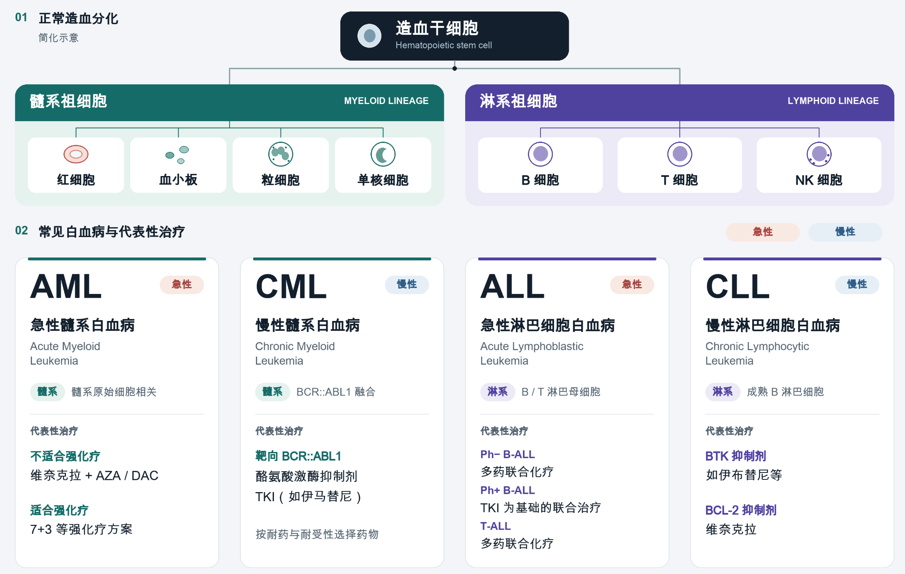
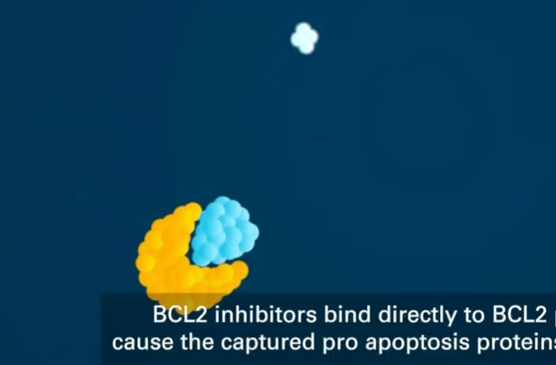

每个重仓的股票我都会写篇文章，但亚盛不算是重仓，买到现在仓位在13%左右，未来也不会再加了。或许亚盛会涨到重仓，这是我买过的远期赔率最高的标的了，先提前写点吧。

康方现在的仓位也到25%了，但由于ak112的鳞癌队列确定性比较大，基本能过，后续有时间就写，没时间就算了。

亚盛的APG-2575（利沙托克拉，Lisaftoclax）在MDS适应症上（GLOAR-4 全球Ⅲ期临床）比较不确定，这段时间打算仔细研究一下。大致会有3～5篇，年底能写完就行，内容是：BCL-2和MDS（本篇）、Lisaftoclax分子设计、从药理机制和过往临床看GLORA-4。

我写起来有点困难，可能时间会拉的很长，也是仅作学习笔记。我不是很喜欢写这种科普文章，没太大价值，这篇就当是留个痕，毕竟现在亚盛也算是低位。所有的研究完再写会很晚，万一发出的时候已经涨起来了就很无聊。

如果对亚盛感兴趣，可以看看下面这几篇，我大概率也不会比他写的更好了。

> HR-MDS
>
> 加菲如意，公众号：研究进化论[亚盛医药思考系列（1）：HR-MDS](https://mp.weixin.qq.com/s/ZazMxnrPIMrenIEDgnRbqA)
>
> ...


> 亚盛披露利沙托克拉处于 **4 项全球注册 III 期**（GLORA 系列），覆盖 CLL/SLL（一线、经治）与高危 MDS、AML。


在讲BCL-2和MDS这类内容前，我们先对血液有个大致的框架。

各种血细胞最初的来源都是**造血干细胞**，造血干细胞分化为**髓系祖细胞**和**淋巴系祖细胞**。

髓系祖细胞继续分化出红细胞、粒系（中性粒细胞）、巨噬细胞、巨核细胞（血小板是其胞质碎片），这部分主要负责**先天免疫和供氧**。淋巴系祖细胞继续分化出B细胞、T细胞、NK细胞。这部分主要负责**适应性免疫**。

正常的造血过程：造血干细胞 → 增殖 → 分化成熟 → 红细胞、白细胞、血小板



MDS是

1、造血干细胞异常 → 产生不了正常成熟血细胞（无效造血）

结果：

- 红细胞生成失败 → 贫血（Hb下降）
- 中性粒细胞生成失败 → 感染（ANC下降）
- 血小板生成失败 → 出血（PLT下降）

2、异常克隆细胞逃避调控 → 在骨髓里扩张

结果：

异常造血细胞克隆，挤压正常造血细胞，这也是为什么后期的MDS会向AML转化（sAML和AML不一样）


先来看一下BCL-2抑制剂（BCL-2 inhibitor，BCL-2i）生效过程（流程图+动画），这个后续会解释。

```
BCL-2 抑制剂进入细胞
    ↓
高亲和力结合 BCL-2 的 BH3 沟槽
    ↓
竞争性地把 BIM 从 BCL-2:BIM 复合物中置换出来
    ↓
游离 BIM 转位至线粒体外膜，激活 BAX/BAK
    ↓
多个BAX/BAK结合成蛋白复合体（寡聚化），给线粒体打孔 → 线粒体外膜通透化MOMP（之后不可逆）
    ↓
位于线粒体内外膜之间的细胞色素c被释放，进入细胞质
 	↓
细胞色素c + Apaf-1 → 组装成凋亡小体
	↓
7个被激活的 Apaf-1 彼此组装 → 形成环状（轮状）的凋亡小体
	↓
caspase-9 → caspase-3/7 级联激活（caspase是执行凋亡的蛋白酶，能切割其他蛋白质）
    ↓
细胞凋亡执行
```


<video src="./img/bcl2acceptprogress.mp4"/>

细胞凋亡分为外源性通路和内源性通路，就是外部杀死和内部自杀，BCL-2 家族主要调控的是内源性通路。

正常细胞在检测到自己该死时，会启动内部的自杀程序。BCL-2是一种抗凋亡蛋白，它通过“锁住”促凋亡信号（BIM），让细胞逃脱内部自杀系统，一直存活。当细胞异常高表达BCL-2时，就会一直不死，不断累积，形成肿瘤。

这一机制在血液肿瘤中尤其突出。慢性淋巴细胞白血病/小淋巴细胞淋巴瘤（CLL/SLL）的肿瘤细胞通常高度依赖 BCL-2过表达，来抑制线粒体凋亡途径；急性髓系白血病（AML）和骨髓增生异常综合征（MDS）中则常同时存在 BCL-2、MCL-1、BCL-xL 等多条抗凋亡通路。多发性骨髓瘤中带有 t(11;14) 的一部分患者，也可能表现出更强的 BCL-2 依赖。


### 0. BCL-2基因

BCL-2 过表达是染色体t(14;18)易位导致的，18号染色体上的BCL2基因被易位到14号的免疫球蛋白重链基因座（IgH）附近，IgH（增长因子）是B细胞中用来驱动抗体重链的大量表达。易位后，这些IgH转而驱动BCL2基因，使其转录持续升高，因而造成BCL-2蛋白过表达。

> PS: BCL2指 DNA 上的 BCL2 基因，BCL-2指该基因编码的蛋白质名称，即BCL-2 蛋白


### 1. BCL-2家族（蛋白）

> BCL-2只是BCL-2家族的一员。

| 家族成员      | 代表蛋白                  | 功能                               |
| :------------ | :------------------------ | :--------------------------------- |
| 抗凋亡蛋白    | BCL-2、BCL-xL、MCL-1      | 扣押促凋亡蛋白，维持线粒体外膜完整 |
| 促凋亡蛋白    | BAX、BAK                  | 在线粒体外膜打孔，触发 MOMP        |
| BH3-only 蛋白 | BIM、BID、BAD、PUMA、NOXA | 感知细胞应激，释放/激活 BAX/BAK    |

BCL-2家族可分为**促凋亡蛋白**和**抗凋亡蛋白**，它们共享一个特征性的BH结构域，BH结构与是BCL-2家族蛋白中的氨基酸序列，其决定了BCL-2家族成员之间如何结合，以控制线粒体凋亡，主要有BH1、BH2、BH3、BH4。抗凋亡蛋白有BH1〰️4，促凋亡蛋白有BH1〰️3，BH3-only只有BH3。

```
完整 BCL-2 蛋白
├─ BH4：帮助维持抗凋亡作用
├─ BH3：参与构成结合沟槽
├─ BH2：参与构成结合沟槽
├─ BH1：参与构成结合沟槽
├─ ....
```


**抗凋亡 BCL-2 蛋白**表面有一个由其 BH1、BH2、BH3 等区域共同形成的BH3 结合沟槽，用来结合（“锁住”） BH3-only 蛋白的 BH3 α 螺旋。可以把 BH3-only 蛋白理解为“死亡指令的传递者”。BH3-only蛋白被锁住后，就无法向下游释放信号，细胞就无法产生内源性凋亡，肿瘤细胞就可以一直存活。

> BH3结合沟槽的命名方式是按结合的对象命名，非组成的对象命名


BCL-2抑制剂（也称BH3模拟物）做的是模拟BH3-only蛋白上的关键 α 螺旋，占据抗凋亡蛋白表面的BH3结合沟槽，竞争性的置换被BCL-2锁住的BIM，以Lisaftoclax为例：


```
lisaftoclax + BCL-2:BIM  →  lisaftoclax:BCL-2 + 游离BIM 
```




BCL-2抑制剂不仅会进入肿瘤细胞，也会进入正常表达 BCL-2 的细胞，只是因为某些肿瘤细胞对 BCL-2 的生存依赖特别强，抑制了之后，肿瘤细胞更容易凋亡。正常细胞（主要是正常B细胞、成熟中性粒细胞）也会受影响。


### 3. 置换之后

游离 BIM （动图中蓝色物质）转位至线粒体外膜，激活 BAX/BAK，当足够多的 BAX/BAK 被激活并在膜上形成孔道后，细胞色素 c 进入胞质，与 Apaf-1 形成凋亡小体，继而激活 caspase-9 和 caspase-3/7。这个过程通常具有阈值特征：越过阈值后，凋亡会进入难以逆转的执行阶段。

```
BCL-2 抑制剂进入细胞
    ↓
高亲和力结合 BCL-2 的 BH3 沟槽
    ↓
竞争性地把 BIM 从 BCL-2:BIM 复合物中置换出来
    ↓
游离 BIM 转位至线粒体外膜，激活 BAX/BAK
    ↓
多个BAX/BAK结合成蛋白复合体（寡聚化），给线粒体打孔 → 线粒体外膜通透化MOMP（之后不可逆）
    ↓
位于线粒体内外膜之间的细胞色素c被释放，进入细胞质
 	↓
细胞色素c + Apaf-1 → 组装成凋亡小体
	↓
7个被激活的 Apaf-1 彼此组装 → 形成环状（轮状）的凋亡小体
	↓
caspase-9 → caspase-3/7 级联激活（caspase是执行凋亡的蛋白酶，能切割其他蛋白质）
    ↓
细胞凋亡执行
```

真正的临界事件叫作线粒体外膜通透化（MOMP），在这之前，仍有变数。比如：

1、游离的BIM仍有可能被MCL-1、BCL-xL扣押

2、BAX 或 BAK 基因缺失、失活突变或表达很低

这个阈值特性，解释了为什么 BCL-2 抑制剂的效应与峰浓度（Cmax）密切相关：药物需要在短时间内释放足够量的 BIM，激活足够多的 BAX/BAK，才能跨越凋亡阈值。


### 4. 耐药和联用

CLL/SLL对BCL-2抑制线粒体凋亡通路这一路径高度依赖，而AML、MDS可借助MCL-1和BCL-xL，继续拦截游离的BIM，单药敏感性通常较低，联用多通路抑制更能深度缓解。故几个适应症理论上BCL-2i的药效是CLL/SLL > AML > MDS。


**耐药**

BCL-2抑制剂也并非永久有效，也可能遇到**结合点位突变**（G101V）、**MCL-1/BCL-xL代偿**、**TP53 异常**，以及更复杂的**基因组改变**都有可能导致BCL-2耐药。

**BCL-2 突变**：如 **G101V、F104L** 等 gatekeeper 突变，改变 BH3 沟槽结构，降低药物结合亲和力

**MCL-1 上调**：BCL-2 被抑制后，细胞可通过上调 MCL-1 代偿性维持存活。AML 尤其容易通过这条通路逃逸。

**TP53 缺失/突变**：p53 是 BAX 的转录激活因子，TP53 异常会削弱凋亡下游执行


**联用**

1、BTKi + BCL-2i

在 CLL/SLL 中，BTK 抑制剂和 BCL-2 抑制剂是两条互补的路线。BTKi切断 B 细胞受体（BCR）信号，阻止细胞接收“活下去”的外部指令，BCL-2 i解除细胞内部的“不死机制”，直接触发凋亡。

两者联合，相当于“断粮 + 按死刑按钮”，实现更深的缓解、更短的固定疗程，并可能达到微小残留病灶（MRD）阴性。

目前临床上的主要联合方案包括：Venetoclax + 伊布替尼/阿可替尼、Lisaftoclax + 阿可替尼（GLORA 系列）、Sonrotoclax + 泽布替尼（CELESTIAL 系列）。

在髓系肿瘤中，BCL-2i常与去甲基化药物（阿扎胞苷AZA）联合，前者促凋亡，后者恢复分化能力。


2、BCL-2 + MDM2–p53 等

多凋亡靶点联用会放大毒性，可能出现毒性盖过生存获益的情况，目前相关临床大多都在早期，所以像BCL-2抑制剂的设计思路，从最开始的追求疗效，到联用时代的追求安全。

这也是亚盛凋亡靶点联用最大的场景（ps：亚盛拥有全球唯一覆盖Bcl-2、IAP、MDM2-p53三条细胞凋亡通路的临床产品管线），不过我的投资可能等不到这一天了。


## AZA作用机制

<svg viewBox="0 0 680 720" width="100%" role="img" font-size="11px">
    <rect width="100%" height="100%" fill="#f2f2f2" />
    <title>Azacitidine dual-pathway mechanism and clinical response mapping</title>
    <desc>Diagram showing how azacitidine acts on both Pathway A (effective hematopoiesis restoration) and Pathway B
        (blast clearance) at clinical doses, with AZA-001 trial response rates overlaid.</desc>
    <defs>
        <marker id="arrow" viewBox="0 0 10 10" refX="8" refY="5" markerWidth="6" markerHeight="6"
            orient="auto-start-reverse">
            <path d="M2 1L8 5L2 9" fill="none" stroke="context-stroke" stroke-width="1.5" stroke-linecap="round"
                stroke-linejoin="round" />
        </marker>
    </defs>
    <rect x="0" y="0" width="680" height="720" fill="transparent" /> <text  x="340" y="28"
        text-anchor="middle">AZA 作用机制：剂量决定通路</text> <text  x="340" y="46"
        text-anchor="middle">标准临床剂量下，通路 A 效应远超通路 B</text>
    <line x1="40" y1="58" x2="640" y2="58" stroke="#D3D1C7" stroke-width="0.5" /> <text  x="50"
        y="80">给药剂量</text>
    <rect x="50" y="88" width="250" height="40" rx="8" fill="#F1EFE8" stroke="#B4B2A9" stroke-width="0.5" /> <text
         x="175" y="106" text-anchor="middle" dominant-baseline="central">高剂量 (150-400 mg/m²)</text> <text
         x="175" y="120" text-anchor="middle" dominant-baseline="central">1960s-1980s 早期研究</text>
    <rect x="380" y="88" width="250" height="40" rx="8" fill="#E1F5EE" stroke="#1D9E75" stroke-width="0.5" /> <text
         x="505" y="106" text-anchor="middle" dominant-baseline="central" fill="#085041">标准临床剂量 (75 mg/m² ×
        7d)</text> <text  x="505" y="120" text-anchor="middle" dominant-baseline="central" fill="#0F6E56">FDA
        批准方案 · 现行标准</text>
    <line x1="175" y1="128" x2="175" y2="160" stroke="#888780" stroke-width="0.5" marker-end="url(#arrow)" />
    <line x1="505" y1="128" x2="505" y2="160" stroke="#1D9E75" stroke-width="0.5" marker-end="url(#arrow)" /> <text
         x="50" y="152">主要机制</text>
    <rect x="50" y="160" width="250" height="56" rx="8" fill="#FAECE7" stroke="#D85A30" stroke-width="0.5" /> <text
         x="175" y="180" text-anchor="middle" dominant-baseline="central" fill="#712B13">直接细胞毒性</text> <text
         x="175" y="198" text-anchor="middle" dominant-baseline="central" fill="#993C1D">RNA + DNA 损伤 →
        广泛凋亡</text>
    <rect x="380" y="160" width="250" height="56" rx="8" fill="#E6F1FB" stroke="#378ADD" stroke-width="0.5" /> <text
         x="505" y="180" text-anchor="middle" dominant-baseline="central" fill="#0C447C">表观遗传重编程 (主)</text>
    <text  x="505" y="198" text-anchor="middle" dominant-baseline="central" fill="#185FA5">DNMT1 捕获降解 →
        去甲基化</text>
    <line x1="175" y1="216" x2="175" y2="250" stroke="#888780" stroke-width="0.5" marker-end="url(#arrow)" />
    <line x1="505" y1="216" x2="505" y2="250" stroke="#378ADD" stroke-width="0.5" marker-end="url(#arrow)" /> <text
         x="50" y="242">作用通路</text>
    <rect x="50" y="250" width="250" height="56" rx="8" fill="#FAECE7" stroke="#D85A30" stroke-width="0.5" /> <text
         x="175" y="270" text-anchor="middle" dominant-baseline="central" fill="#712B13">通路 B (克隆清除)</text>
    <text  x="175" y="288" text-anchor="middle" dominant-baseline="central" fill="#993C1D">无差别杀伤增殖期细胞</text>
    <rect x="380" y="250" width="250" height="56" rx="8" fill="#E1F5EE" stroke="#1D9E75" stroke-width="0.5" /> <text
         x="505" y="266" text-anchor="middle" dominant-baseline="central" fill="#085041">通路 A + 通路 B +
        免疫调节</text> <text  x="505" y="282" text-anchor="middle" dominant-baseline="central"
        fill="#0F6E56">沉默基因再表达 → 分化恢复</text> <text  x="505" y="296" text-anchor="middle"
        dominant-baseline="central" fill="#0F6E56">CTA 上调 → T 细胞识别增强</text>
    <line x1="175" y1="306" x2="175" y2="340" stroke="#888780" stroke-width="0.5" marker-end="url(#arrow)" />
    <line x1="505" y1="306" x2="505" y2="340" stroke="#1D9E75" stroke-width="0.5" marker-end="url(#arrow)" /> <text
         x="50" y="332">临床疗效</text>
    <rect x="50" y="340" width="250" height="80" rx="8" fill="#FAECE7" stroke="#D85A30" stroke-width="0.5" /> <text
         x="175" y="358" text-anchor="middle" dominant-baseline="central" fill="#993C1D">高剂量试验（已弃用）</text>
    <text  x="175" y="378" text-anchor="middle" dominant-baseline="central" fill="#712B13">CR
        较高，但毒性死亡极高</text> <text  x="175" y="398" text-anchor="middle" dominant-baseline="central"
        fill="#993C1D">OS 无获益 → 退出临床</text>
    <rect x="380" y="340" width="250" height="80" rx="8" fill="#E6F1FB" stroke="#378ADD" stroke-width="0.5" /> <text
         x="505" y="356" text-anchor="middle" dominant-baseline="central" fill="#0C447C">AZA-001 试验
        (n=179)</text> <text  x="505" y="372" text-anchor="middle" dominant-baseline="central"
        fill="#185FA5">OS 24.5 月 vs 15.0 月 (CCR)</text> <text  x="505" y="388" text-anchor="middle"
        dominant-baseline="central" fill="#185FA5">首个延长 OS 的 MDS 药物</text> <text  x="505" y="404"
        text-anchor="middle" dominant-baseline="central" fill="#185FA5">List 2008 · Fenaux 2009</text>
    <line x1="505" y1="420" x2="505" y2="450" stroke="#378ADD" stroke-width="0.5" marker-end="url(#arrow)" /> <text
         x="50" y="442">疗效拆解</text>
    <rect x="50" y="455" width="580" height="130" rx="12" fill="#F1EFE8" stroke="#B4B2A9" stroke-width="0.5" /> <text
         x="70" y="476" fill="#2C2C2A">AZA-001 各疗效终点拆解</text> <text  x="70" y="491">HI 远超 CR →
        临床获益主要来自通路 A</text>
    <rect x="70" y="500" width="100" height="68" rx="6" fill="#E1F5EE" stroke="#1D9E75" stroke-width="0.5" /> <text
         x="120" y="518" text-anchor="middle" dominant-baseline="central" fill="#0F6E56">HI (血液学改善)</text>
    <text  x="120" y="542" text-anchor="middle" dominant-baseline="central" fill="#085041">49%</text> <text
         x="120" y="560" text-anchor="middle" dominant-baseline="central" fill="#0F6E56">通路 A</text>
    <rect x="190" y="500" width="100" height="68" rx="6" fill="#E6F1FB" stroke="#378ADD" stroke-width="0.5" /> <text
         x="240" y="518" text-anchor="middle" dominant-baseline="central" fill="#185FA5">PR (部分缓解)</text>
    <text  x="240" y="542" text-anchor="middle" dominant-baseline="central" fill="#0C447C">12%</text> <text
         x="240" y="560" text-anchor="middle" dominant-baseline="central" fill="#185FA5">A+B 混合</text>
    <rect x="310" y="500" width="100" height="68" rx="6" fill="#FAECE7" stroke="#D85A30" stroke-width="0.5" /> <text
         x="360" y="518" text-anchor="middle" dominant-baseline="central" fill="#993C1D">CR (完全缓解)</text>
    <text  x="360" y="542" text-anchor="middle" dominant-baseline="central" fill="#712B13">17%</text> <text
         x="360" y="560" text-anchor="middle" dominant-baseline="central" fill="#993C1D">通路 B</text>
    <rect x="430" y="500" width="100" height="68" rx="6" fill="#F1EFE8" stroke="#888780" stroke-width="0.5" /> <text
         x="480" y="518" text-anchor="middle" dominant-baseline="central" fill="#5F5E5A">SD (稳定)</text> <text
         x="480" y="542" text-anchor="middle" dominant-baseline="central" fill="#444441">49%</text> <text
         x="480" y="560" text-anchor="middle" dominant-baseline="central" fill="#5F5E5A">含获益</text> <text
         x="570" y="520" dominant-baseline="central" fill="#5F5E5A">总有效率</text> <text  x="570"
        y="542" text-anchor="middle" dominant-baseline="central" fill="#2C2C2A">51%</text> <text  x="570"
        y="560" text-anchor="middle" dominant-baseline="central" fill="#5F5E5A">CR+PR+HI</text>
    <line x1="340" y1="595" x2="340" y2="620" stroke="#B4B2A9" stroke-width="0.5" />
    <rect x="50" y="625" width="580" height="80" rx="12" fill="#EEEDFE" stroke="#534AB7" stroke-width="0.5" /> <text
         x="70" y="646" fill="#3C3489">关键发现：HI 是 AZA 延长 OS 的主要驱动</text> <text  x="70" y="664"
        fill="#3C3489">AZA-001 多因素分析（PMC3696610）：</text> <text  x="70" y="680" fill="#3C3489">以 HI 为最佳疗效的患者（未达
        CR/PR），死亡风险仍降低 93%（vs CCR）</text> <text  x="70" y="696" fill="#3C3489">"CR is sufficient but not
        necessary to prolong OS" — List 2008</text>
</svg>


作用：改变异常细胞的生物学状态

生效过程：

1. 只有进入细胞周期的细胞才会被AZA影响
   1. 阿扎胞苷必须被细胞摄取并掺入RNA或DNA
   2. DNA去甲基化尤其依赖细胞进入S期、复制DNA
2. 去甲基化不是一个瞬间完成的
   1. 阿扎胞苷使DNMT失活，减少新生DNA上的甲基化标记，随后才会逐步改变一批与分化、细胞周期、凋亡和肿瘤抑制有关的基因表达
   2. 从DNA甲基化改变，到蛋白表达改变，再到细胞分化和骨髓结构改善，中间存在明显时间差
   3. 临床研究中，部分基因的去甲基化改变是在治疗3–5个周期后才与血液学缓解对应
3. 每个周期的去甲基化效应可能部分回退，需要持续修正
4. 骨髓改善后，外周血指标还需要时间才能体现
   1. 阿扎胞苷也会损伤正在增殖的正常造血祖细胞，前1–2个周期可能出现血细胞下降、输血需求增加，看起来像病情没有改善
   2. 随着异常造血逐渐受控、有效造血恢复，净效果才转为血细胞上升，所以早期血细胞下降并不必然代表无效
5. 早期骨髓抑制会暂时掩盖药效
6. 首次缓解以后继续加深，是因为首次缓解只是“刚刚越过标准线”

这个过程需要一定的时间，主要为：

第一个周期，异常细胞开始受影响，但已成熟血细胞寿命还没结束。

第二、三周期，异常克隆持续受压力，更多细胞进入分化/死亡；开始出现血象改善

第四、六周期，骨髓生态逐渐改变，正常造血开始恢复


# 结尾

上述提到的机制/原理，在后续的讨论中很多会用到，比如：

1、药物在短时间内激活足够的BAX/BAK触发MOMP，本身是个阈值事件，或许是Lisaftoclax可能依赖Cmax的原因，而依靠Cmax的杀伤方式，就不需要单次持续压制BCL-2，毒性会远小于AUC

2、Cmax机制还可以支持药物半衰期短的设计，这样药物在血液中停留时间短，对代谢的影响较少，更容易和其他药物联用

3、安全性+无DDI可成为某些领域的基石药物，这带来的销售空间是巨大的

4、MDS中以AZA为骨架，Venetoclax的Ⅲ期临床（ven+aza vs aza）中出现了减量，最后以失败告终，主要是Venetoclax毒性太强，而MDS患者本身骨髓就很脆弱，双重抑制带来的毒性改过了OS获益。所以选择一个低毒性无DDI，不影响AZA用量的药物显得尤为重要

------


若MDS临床做出显著获益，亚盛可以给到至少700亿HKD市值，当前135亿HKD。

尽管APG-2575是近20年来在MDS领域最有可能成药的BCL-2抑制剂，但其临床依然面临着诸多的不确定性


# 用药

再说用药，主要是两类，一个恢复造血干细胞的分化能力，另一个是促进肿瘤细胞凋亡。前者用去甲基化药物，如阿扎胞苷（AZA），后者用BCL-2抑制剂，如维奈克拉（Ven），亚盛的利沙托克拉（APG-2575，Lisaftoclax）也属于这一类。需要注意的是，MDS的治疗应当以AZA为骨架，而非BCL-2抑制剂，正如前文所述，血象的改善远比肿瘤的缩小重要。本文仅简单介绍MDS，后续临床及用药放到GLORA-4相关文章详述。


> 

