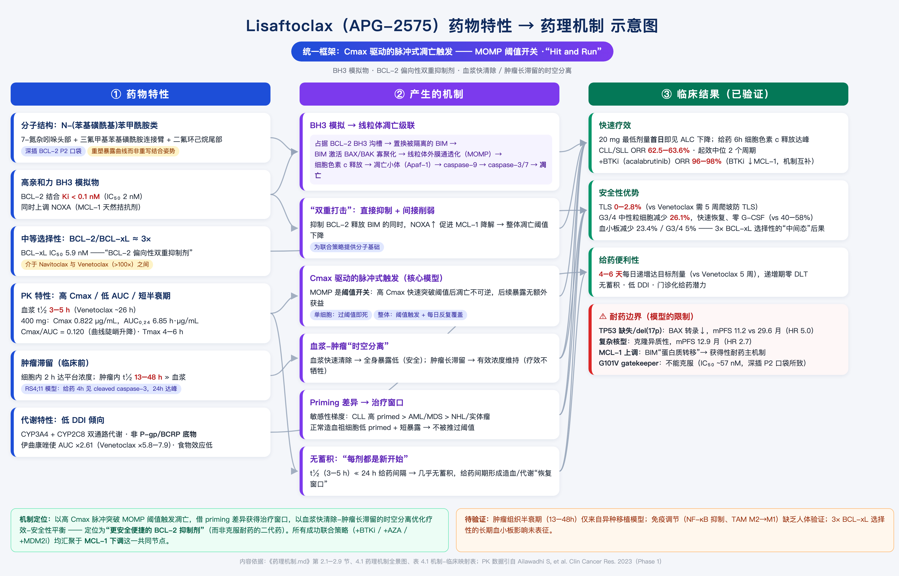

本文所有的特征都是围绕着2575的安全性来写的。

keyword：无DDI、半衰期短、药效力短、凋亡特性（Cmax触发，AUC维持）、药物在肿瘤和血液中浓度差异

[快了鼠鼠——从BCL-2到亚盛医药的APG2575](https://xueqiu.com/2693678800/330594845)

[Current Advances and Future Strategies for BCL-2 Inhibitors: Potent Weapons against Cancers](https://www.mdpi.com/2072-6694/15/20/4957)


如何证伪?


Lisaftoclax 以**高 Cmax、短血浆半衰期和短 ramp-up**换取更便捷、潜在更可控的 BCL-2 抑制方案

核心模型为：药物快速达到足以跨越线粒体凋亡阈值的峰浓度，释放 BIM 并激活 BAX/BAK，触发不可逆的 MOMP；随后短血浆暴露限制正常组织持续受药，肿瘤组织滞留则可能维持疗效。该模型可解释早期 ALC 下降、0% TLS、4–6 天 ramp-up 及相对可控的血液学毒性。

现有数据支持其在 CLL/SLL 中的活性和联合治疗潜力，但 TP53 缺失/突变、复杂核型及 MCL-1 上调仍是关键疗效边界。



Lisaftoclax 的全部药理学特征——高疗效速度、低 TLS、4–6 天快速爬坡、可控的骨髓毒性、中等程度的血小板减少——都可以由**三个前因**推出：

1. **高 Cmax**（足以突破线粒体凋亡阈值）
2. **短血浆半衰期 3–5 h / 低 AUC**（暴露呈脉冲式，给药间期有恢复窗口）
3. **对 BCL-xL 的选择性只有约 3 倍**（不是高选择性药物）

前两条构成一个**「疗效靠 Cmax、安全靠低 AUC」的解耦论证**：不是简单的"短半衰期所以 TLS 低"，而是把疗效变量和毒性变量分别挂在 PK 曲线的两个不同属性上（峰值 vs 面积）。这个论证本身自洽，且 Phase 1/1b 的五项预测全部得到验证。第三条则是这个设计的代价，也是它与 venetoclax、sonrotoclax 的关键分野。

> **阅读提示：不要停在分子层面解释一切。** 分子层只回答"为什么会死"，真正决定临床形态的是 PK 层（暴露形状）和细胞层（priming 差异）。本文按五层递进组织，每一层都指向同一批临床结局。


# 分子特征


lisaftoclax与venetoclax在P2口袋结合区域存在结构差异。Venetoclax的氯苯基深插入P2口袋底部，正是这一区域受G101V突变的"knock-on"效应影响最为显著。APG-2575采用二氟环己烷（difluorocyclohexane）尾部结构替代venetoclax的氯苯基，P2口袋结合模式更为浅表。理论上，这种差异化的结合模式可能降低G101V突变对亲和力的影响，但目前尚无公开的APG-2575与G101V突变BCL-2的晶体结构或表面等离子体共振（surface plasmon resonance, SPR）数据直接验证这一假设。相比之下，sonrotoclax（BGB-11417）的P2口袋浅结合策略已通过1.80 Å高分辨率晶体结构获得完整验证。APG-2575在单药克服BCL-2突变方面的能力目前仍属推测性，需更多结构生物学数据支撑。


APG-2575（lisaftoclax）与venetoclax在P2口袋结合区域存在结构差异。Venetoclax的氯苯基深插入P2口袋底部，正是这一区域受G101V突变的"knock-on"效应影响最为显著。APG-2575采用二氟环己烷（difluorocyclohexane）尾部结构替代venetoclax的氯苯基，P2口袋结合模式更为浅表。理论上，这种差异化的结合模式可能降低G101V突变对亲和力的影响，但目前尚无公开的APG-2575与G101V突变BCL-2的晶体结构或表面等离子体共振（surface plasmon resonance, SPR）数据直接验证这一假设。相比之下，sonrotoclax（BGB-11417）的P2口袋浅结合策略已通过1.80 Å高分辨率晶体结构获得完整验证。APG-2575在单药克服BCL-2突变方面的能力目前仍属推测性，需更多结构生物学数据支撑。

Sonrotoclax（BGB-11417）是当前二代BCL-2抑制剂中抗耐药证据最充分的竞争者。其分子设计的核心创新在于采用7-氮杂螺[3.5]壬烷连接臂和(S)-2-(2-异丙基苯基)吡咯烷基团，形成"浅而广"的P2口袋结合模式——异丙基苯基位于P2口袋入口处，与F112形成edge-to-face π-π相互作用、与M115形成硫-π相互作用，而不深入P2口袋底部，从而完全规避G101V突变引起的空间位阻。功能验证显示，sonrotoclax在G101V异种移植模型中50 mg/kg诱导106%肿瘤生长抑制（tumor growth inhibition, TGI）并持续至第46天，而venetoclax同剂量仅61% TGI。对D103Y突变的亲和力高125倍于venetoclax，对A113G、V156D和R129L突变的亲和力亦高35-83倍。


# 疾病特征

慢性淋巴细胞白血病（CLL）中，BCL-2过表达是最强的抗凋亡驱动因素，BCL-2高表达导致BIM被隔离，使得CLL成为BCL-2抑制剂最敏感的适应症。各BCL-2抑制剂也在CLL适应症中展示出最好的治疗效果。

急性髓系白血病（AML），AML的异质性显著高于CLL，单核细胞分化亚型（CD14+/CD64+）依赖MCL-1而非BCL-2，导致对Venetoclax耐药。

骨髓增生异常综合征（MDS）中，高危患者原始细胞BCL-2过表达，但TP53突变和复杂核型等不良遗传削弱了BCL-2抑制的普遍有效性。

不同适应症对BCL-2抑制剂敏感性梯度为：CLL>AML>MDS


# 半衰期短

Lisaftoclax和Sonrotoclax都是短半衰期的药物（3～6h），为什么Sonrotoclax爬坡方案是每周一次，而Lisaftoclax可以做到每日一次

> 既然 PK 相似，**爬坡快慢主要是 TLS（肿瘤溶解综合征）风险管理策略和临床开发路径的选择，而非药代动力学决定的**。
>
> 亚盛的论证逻辑是：短半衰期 + 高 Cmax + 低总暴露（AUC）→ BCL-2 抑制是 Cmax 驱动的，快速触发凋亡阈值后药物迅速清除，血浆滞留有限 → TLS 风险低 → 因此**敢**做 5 天日爬坡。其 I 期在剂量高至 1200 mg 时未观察到 TLS（后续 1b/2 期 176 例中有 5 例 TLS，2.8%，均可快速恢复并继续用药）。
>
> 百济则选择了保守的每周爬坡——同样短半衰期，但没有押注在压缩爬坡上，而是靠效价和疗效数据竞争。
>
> 所以「日爬坡」是 lisaftoclax 刻意打造的差异化卖点（缩短约 1 个月住院/监测期，减轻患者和医疗系统负担），不是 sonrotoclax 做不到，而是两家的开发取舍不同。


真的不是Sonrotoclax做不到吗？

>  真正影响爬坡速度的是什么？——不是药物清除速度，而是肿瘤消减动力学？半衰期决定的是两次给药之间药物洗脱多干净，爬坡需要解决的是，每增加一次用量，肿瘤被杀死细胞释放的内容是，机体能否代谢掉。
>
>  更强的BCL-2i会导致更快更多的凋亡， 即释放出更多细胞裂解物 ，TLS风险更高。


你说的是哪篇论文（BCL-2 抑制剂的杀伤是 Cmax 驱动的——这一点亚盛自己的论文明确写了）

> **Ailawadhi S, Chen Z, Huang B, Paulus A, Collins MC, Fu L, et al.** "Novel BCL-2 Inhibitor Lisaftoclax in Relapsed or Refractory Chronic Lymphocytic Leukemia and Other Hematologic Malignancies: First-in-Human Open-Label Trial." *Clinical Cancer Research*, 2023.
> DOI: [10.1158/1078-0432.CCR-22-3321](https://doi.org/10.1158/1078-0432.CCR-22-3321)
>
> 即亚盛 APG-2575 的**全球首次人体（FIH）I 期试验**论文，句子出现在 **Discussion 部分**。

原文

> "Mechanistically, BCL-2 inhibitors rapidly achieve a mitochondrial threshold that triggers apoptosis; thus, **their effects are driven by Cmax**.⁵ Lisaftoclax was designed as a potent and efficacious BCL-2 inhibitor with a unique pharmacokinetic profile, including a high Cmax and a shorter t½ (3–5 hours) compared to venetoclax (26 hours),²⁵ resulting in a high Cmax but relatively low systemic exposure."

同一篇论文在讨论 BH3 profiling 结果时又重复了一次：

> "...indicating that the antileukemic activity of lisaftoclax depends on BCL-2 priming and on-target disruption of BCL-2 complex, **a Cmax-dependent phenomenon**."


> 1. **这句话带引用标记 ⁵**——也就是说 "Cmax 驱动" 这个机制主张**不是亚盛的原创发现，是引用他人文献**（应为 venetoclax 的 PK/PD 或暴露-反应研究）。亚盛是在**援引**这个前提来支撑自己的设计逻辑，而非自己证明的。我没有核实文献 5 的具体出处。

> 2. **我用它来反驳亚盛，逻辑上要小心。** 亚盛的完整论证不是「短半衰期降低 TLS」这么简单，而是：高 Cmax 保证**疗效**（Cmax 驱动杀伤），短 t½ + 低 AUC 降低**累积毒性和血浆滞留**。这是一个「疗效靠 Cmax、安全靠低 AUC」的解耦论证，本身是自洽的。

> 我的批评应当限定为：**这套论证不足以解释急性 TLS 的减少**，因为急性 TLS 来自 Cmax 驱动的那一次杀伤，低 AUC 帮不上忙。亚盛把 TLS 安全性也归因于 "limited plasma residence and exposure"（原文如此）——这一步归因是我认为薄弱的地方。

> 3. **注意作者构成**：Zi Chen、Lei Fu 等多位作者是亚盛雇员及持股人（前一轮搜索到的 ASH 摘要披露栏可见）。这不否定数据，但「日爬坡更方便、更 user-friendly」属于**公司自身的解读性主张**，不是独立第三方结论。


2. **"未观察到 TLS"是 52 例的 I 期结果**，样本量小。后续 1b/2 期扩至 176 例时出现 5 例 TLS（2.8%，2 例临床 + 3 例实验室）——**I 期的零 TLS 不可外推**。
3. **PK 变异极大（CV 72%）**，这对一个宣称"靠 Cmax 驱动疗效、靠低 AUC 保证安全"的机制论证是个隐患：如果个体间 Cmax 差 3 倍，那么"精确落在治疗窗内"的说法就站不住。论文没有讨论这一点。
4. **将安全性归因于"limited plasma residence and exposure"是薄弱环节**（前几轮已讨论）：急性 TLS 由 Cmax 驱动的那一次杀伤造成，低 AUC 帮不上忙。
5. **利益披露**：多位作者（Zi Chen、Lei Fu 等）为亚盛雇员及持股人。数据本身有同行评议背书，但"user friendly"这类解读性表述属公司立场


# 靶点和凋亡特征

*对BCL-xL的抑制*

Lisaftoclax 是 BH3 模拟物，通过占据 BCL-2 的 BH3 结合槽，置换被隔离的促凋亡蛋白（主要为 BIM），继而激活 BAX/BAK、诱发线粒体外膜通透化（MOMP），启动 caspase 级联反应并执行凋亡。

其生化特征为 BCL-2 偏向、但仍保留 BCL-xL 抑制活性：BCL-2 IC50 约 2 nM，BCL-xL IC50 约 5.9 nM，MCL-1 IC50 >5,000 nM。因此，它更接近“BCL-2 偏向性双重抑制剂”，而非 venetoclax 式的高度 BCL-2 选择性抑制剂。细胞实验中，其对 BCL-2 与 BCL-xL 依赖细胞均有功能性活性。

# Cmax脉冲式凋亡模型

快速达到有效细胞内浓度，触发肿瘤细胞凋亡

本报告的统一假设是：BCL-2 抑制的关键不是持续累积暴露，而是短时间内跨越凋亡阈值的峰浓度。MOMP 属于阈值型、不可逆事件；一旦足量 BIM 被释放并形成 BAX/BAK 孔道，后续维持高浓度的边际收益可能有限。

> 高Cmax，低AUC，没有持续压制，BIM为什么不被其他BCL-2拦截

肿瘤组织滞留（约 13–48 小时）大于血液滞留，血浆半衰期约 3–5 小时(venetoclax 约 26 小时)

肿瘤滞留数据目前主要来自临床前模型


# 安全性

BCL-xL 在巨核细胞和血小板生存中重要。Lisaftoclax 约 3 倍的 BCL-2/BCL-xL 选择性提示存在血小板减少风险；但其短半衰期可能降低持续 BCL-xL 抑制，从而部分抵消这一风险。现有早期综合数据中，≥3 级血小板减少约 13.5%，仍需长期暴露数据确认。

对于 venetoclax 常见的 BCL-2 G101V 耐药突变，Lisaftoclax 的生化 IC50 约 57 nM、细胞 IC50 约 61 nM，活性并不显示其具有明确的耐药覆盖优势。因此，其主要竞争价值在安全性、给药便利性和联合方案，而非 G101V 克服能力。MCL-1 上调仍是最重要的旁路耐药机制。


# 血液与肿瘤浓度特性


细胞内进入更快、血液中停留更短、半衰期更快

至于 **P2 口袋**，可以把 BCL‑2 的疏水沟槽想成几格凹槽，P1、P2、P3、P4 是其中的不同“卡位”。Venetoclax 的一部分基团会较深地插入 P2；而 Sonrotoclax 的相应基团停在 P2 入口附近，位置更靠近 α4 螺旋，并形成额外的疏水、π–π 和水桥氢键相互作用。

APG‑2575 的卖点偏“PK 与细胞摄取”；Sonrotoclax 的卖点偏“P2 口袋新姿势与 G101V 耐药覆盖”

### 肿瘤滞留：血浆-肿瘤时空分离

**现象**：临床前 RS4;11 荷瘤小鼠模型中，给药后 **2 小时**达肿瘤细胞内平台浓度，肿瘤内滞留 **13–48 小时**，远长于血浆 t½（3–5 h）。

**可能机制**（均未验证）：

- 肿瘤微环境的高蛋白结合率（药物与肿瘤细胞内蛋白形成可逆结合）
- 较低的清除率（肿瘤组织血流灌注与药物代谢酶活性低于血浆）
- 细胞内隔室化（intracellular compartmentalization）导致的药物滞留

**这个特征在论证中的位置**：它是"短血浆暴露为何不牺牲疗效"这一问题的候选答案——即血浆浓度在给药后 12 小时内已降至低位时，肿瘤内浓度仍维持在有效范围，持续抑制 BCL-2。

> **⚠️ 关键限制：该数据完全来自异种移植模型，不能等同于人体组织 PK 结论。** 种属差异使外推高度不确定。若要坐实这一论证环节，需要人体组织 PK 研究（手术样本 / 骨髓活检的药物浓度测定）。**在此之前，"肿瘤滞留维持药效"只能作为假设而非事实引用。**


# Cmax

**APG‑2575 的直接凋亡机制是靶点占领**——药物在细胞内结合 BCL‑2、破坏 BCL‑2:BIM 复合物，继而启动 BAX/BAK、线粒体外膜通透化和 caspase 凋亡；**较高的 Cmax 是帮助它在短时间内达到足够靶点占领的一种 PK 设计特征**。 

```
高 Cmax → 更快/更高的细胞内游离药物浓度 → BCL‑2 占领超过凋亡阈值 → BIM 释放 → BAX/BAK → 凋亡111111111111
```

但中间两个限定很重要：

- 不是总血药浓度 Cmax 本身“按下死亡按钮”，而是**肿瘤细胞内的游离药物浓度与 BCL‑2 占领率**；
- 是否进入凋亡还取决于肿瘤对 BCL‑2 的依赖、BIM 储量、MCL‑1/BCL‑XL 的替代保护，以及暴露持续时间，不能只看 Cmax。

APG‑2575 确实被设计为“**高 Cmax、短半衰期、低累积**”：临床中约 3–5 小时半衰期，且没有明显多次给药累积。这个特征的策略含义是“快速有效打击 + 缩短全身暴露窗口”，而不是已经证明存在一个普适的、仅由 Cmax 决定的凋亡开关。


# 耐药

Sonrotoclax和Lisaftoclax耐药能力区别（尤其是处理各种突变）？=> 分子结构差异

耐药的代价、分子设计与安全性、DDI

1、BCL-2靶点突变：G101V、D103Y、F104C

2、MCL-1上调：NF-κB驱动的代偿性表达，覆盖面远超BCL-2基因突变，MCL-1取代被抑制的BCL-2接管BH3-only蛋白的隔离功能

3、BAX/BIM通路缺陷：效应器层面的凋亡阻断；PUMA（p53 upregulated modulator of apoptosis）的表观遗传沉默

4、 微环境耐药：CD40信号与骨髓基质保护

**表1. Venetoclax获得性耐药机制分类**

| 耐药类别   | 具体机制         | 关键分子事件            | 出现频率             | 可逆性           | 疾病背景 |
| :--------- | :--------------- | :---------------------- | :------------------- | :--------------- | :------- |
| 靶点突变   | BCL-2 G101V      | P2口袋亲和力↓180倍      | ~46% (CLL进展)       | 不可逆           | CLL为主  |
| 靶点突变   | BCL-2 D103Y      | P4口袋直接破坏          | ~3%                  | 不可逆           | CLL      |
| 靶点突变   | BCL-2 F104C/L    | P2口袋亲和力↓14-1,389倍 | 低频                 | 不可逆           | CLL      |
| 代偿上调   | NF-κB→MCL-1转录  | c-REL结合MCL1启动子     | ~100% (持续治疗复发) | 大部分可逆       | CLL/AML  |
| 基因扩增   | MCL-1(1q21)扩增  | MCL-1表达稳定上调       | ~5%                  | 不可逆           | CLL      |
| 效应器突变 | BAX功能缺失      | 错义/移码/剪接突变      | ~17% (AML复发)       | 不可逆           | AML      |
| 表观遗传   | PUMA启动子甲基化 | CpG岛甲基化→PUMA沉默    | ~20%                 | 可逆(去甲基化药) | AML      |
| 代谢重编程 | OXPHOS依赖增加   | 脂肪酸氧化驱动OXPHOS    | ~35%                 | 部分可逆         | CLL/AML  |
| 微环境     | CD40/NF-κB信号   | BCL-XL/MCL-1上调        | ~30%                 | 可逆(离开微环境) | CLL      |


# Noxa上调

> Lisaftoclax 抑制 BCL‑2 → BIM 被释放并转向线粒体 → 线粒体受压/凋亡信号增强 → NOXA 增加 → 抑制 MCL‑1 → 更彻底地启动 BAX/BAK 凋亡

BIM–BAX/BAK 通路启动后，线粒体功能下降、膜电位受损、ATP 生成降低；这不是外界的化疗/缺氧本身，而是药物触发的**细胞内线粒体应激**。在一些肿瘤细胞中，这会通过应激相关转录和蛋白稳定性调控，使 NOXA 增多。  

但要注意：**“Lisaftoclax 为什么一定会上调 NOXA”的精确上游通路，在该研究中并未被完整证明。** 因此最严谨的表述是“观察到与凋亡和线粒体压力相关的 NOXA 增加”，而不是已证明 “Lisaftoclax 直接诱导某一个特定转录因子，从而产生 NOXA”。

Noxa 是另一种 BH3-only 促凋亡蛋白，尤其可中和抗凋亡蛋白 MCL-1。它增加后，相当于减少了肿瘤细胞借 MCL-1“绕开”BCL-2 抑制的机会，因此可协同放大凋亡。其上调更可能是药物暴露后的细胞应激/凋亡程序的一部分，而非利托沙克拉已被证实直接靶向 Noxa。

**MOMP、细胞色素 c 释放、caspase-3/7 上升**

这是线粒体凋亡通路被真正推过“不可逆阈值”的结果。细胞色素 c 外泄后会启动 caspase 级联反应，最终拆解细胞内蛋白和 DNA 修复系统，使细胞进入程序性死亡。

**氧耗（OCR）、储备呼吸与 ATP 下降**

更合理的解读是：线粒体膜受损和凋亡启动后，线粒体功能随之崩解，因而呼吸和 ATP 生成降低。它们主要是凋亡过程的伴随/下游表现，不能简单理解成该药首先是“线粒体呼吸链抑制剂”。

| 机制                         | 2575 vs Venetoclax                                         |
| :--------------------------- | :--------------------------------------------------------- |
| **细胞摄取速度**             | 更快，RPMI8226细胞内浓度高1.44-1.61倍；KMS-11高1.46-1.92倍 |
| **细胞色素c释放**            | 更强                                                       |
| **caspase-3/7活化**          | 骨髓瘤和WMG中显著更高                                      |
| **凋亡诱导率**               | 骨髓瘤 72.92% vs 37.04%；WMG 60.20% vs 50.00%              |
| **MOMP（线粒体外膜通透化）** | 更显著增加                                                 |
| **BIM蛋白水平**              | 2小时内快速显著增加，6小时后下降                           |
| **Noxa蛋白水平**             | 1-6小时内显著升高（**Venetoclax对此无显著影响**）          |
| **BIM线粒体转位**            | 线粒体中BIM积累更多                                        |

与Venetoclax相比，2575有两个关键结构改造：

-  二甲基基团	-> 环丁基环
-  四氢-2H-吡喃基团 -> 1,4-二氧六环

这两个位置的修饰是2575所有差异化药理效应的**根本物质基础**。构效关系研究表明这两个位置可以改造且不影响对BCL-2的高亲和力结合，这赋予了2575独特的理化性质。

结构改造最直接的结果是**更快的细胞摄取速率**。2575进入肿瘤细胞后约2小时胞内浓度即达平台期，且在各时间点都高于Venetoclax。**这是下游一系列增强效应的第一推动力**——更多的药物分子更快地到达线粒体靶点，意味着：更高效地解离BCL-2:BIM复合物；更快达到触发凋亡所需的线粒体阈值浓度；

2575不仅进入细胞更快，其**解离BCL-2:BIM复合物的效率也可能更强**，释放出更多的游离BIM。

这是2575与Venetoclax最显著的分子层面差异之一。Noxa是BH3-only促凋亡蛋白，能**选择性中和MCL-1**（另一种抗凋亡蛋白）。2575上调Noxa意味着即使在MCL-1有一定表达的情况下，也能通过Noxa来"解除"MCL-1的保护作用，这可能是2575在耐药模型中表现更优的原因之一。


**3. NOXA 增加为何会让杀伤更强？**

NOXA 主要是 **MCL‑1 的拮抗者**。当 Lisaftoclax 把 BCL‑2 这道“生存防线”解除后，NOXA 再去抑制 MCL‑1，相当于继续拆除另一道防线；BIM、BAX/BAK 就更容易推动细胞凋亡。MCL‑1 保护常是 BCL‑2 抑制剂耐药的重要来源，因此 NOXA 增加在机制上可放大药效。

```
BCL-2被抑制
      ↓
细胞感受到死亡压力
      ↓
激活p53、FOXO、ATF4等应激通路
      ↓
Noxa转录增加
      ↓
MCL-1下降
      ↓
增强凋亡

部分释义：p53、FOXO、ATF4等应激通路导致转录增加：

p53 → Noxa典型路径：
DNA损伤 / 强烈细胞压力 -> p53稳定化 ->  p53进入细胞核 -> 结合PMAIP1(Noxa)启动子 -> Noxa↑
P53的任务是检查细胞是否值得继续存活。如果损伤严重，p53会启动PUMA、Noxa、Bax促凋亡基因

ATF4 → Noxa（这是细胞压力过大时的“自毁程序”。）
ATF4主要响应：
内质网压力
氨基酸缺乏
蛋白折叠压力

蛋白压力
 ↓
PERK-eIF2α通路
 ↓
ATF4↑
 ↓
Noxa↑
 ↓
促进凋亡

FOXO → Noxa
FOXO感知：
氧化压力
营养状态
能量状态

氧化应激
 ↓
FOXO进入核
 ↓
Noxa↑
 ↓
线粒体凋亡增加

Noxa不是普通的凋亡蛋白，它是细胞感受到“活不下去”时，被各种压力传感器叫出来的执行辅助因子。
```


# BCL-2 priming 决定敏感性梯度与治疗窗

从基因表达层面，到SLL/CLL、AML、MDS的BCL-2失控的原理

> CLL/SLL：不肯死
>
> AML：幼稚细胞疯狂扩增 + 不分化
>
> **MDS：造血工厂质量失控，做了很多废品**

**BCL-2 失控的本质，是细胞把“不要凋亡”的信号开得太强，导致本该死亡的异常血液细胞继续存活；不同疾病里，BCL-2 被抬高的原因不同。**

从基因表达层面看，正常路径是：BCL2 基因 DNA→ 转录成 BCL2 mRNA→ 翻译成 BCL-2 蛋白→ BCL-2 在线粒体外膜上抑制凋亡


如果调控失衡：

BCL2 mRNA 增多、或 BCL2 mRNA 不再被 miRNA 压制、或 BCL-2 蛋白更稳定、或细胞更依赖 BCL-2

→ BCL-2 抗凋亡能力增强 → 肿瘤细胞不容易死


CLL/SLL 里，BCL-2 失控主要是“刹车丢了 + 生存信号增强”。

del(13q14)

→ miR-15a / miR-16-1 减少

→ 对 BCL2 mRNA 的抑制减弱

→ BCL-2 蛋白升高

→ CLL/SLL 细胞不容易凋亡

再加上：BCR 信号、淋巴结微环境、CD40L、BAFF、IL-4 →  给 CLL/SLL 细胞持续生存信号


所以 CLL/SLL 的特点是：**细胞不一定疯狂增殖，但特别“不肯死”。**


**AML**

AML 里，BCL-2 失控更像是“白血病干/祖细胞把 BCL-2 当成保命系统”。

AML 细胞，尤其是白血病干细胞，常常高度依赖线粒体抗凋亡机制：

AML 白血病干细胞 → 氧化磷酸化依赖较强 → 线粒体凋亡阈值被 BCL-2 抬高 → 细胞更难被清除


很多 AML 并不是因为 `BCL2` 基因易位，而是因为：分化阻滞、转录程序异常、FLT3 / RAS / IDH / NPM1 等突变背景、骨髓微环境生存信号

共同把细胞推向：BCL-2、MCL-1、BCL-XL 等抗凋亡蛋白依赖

所以 AML 里说 BCL-2，重点常是：**白血病细胞对 BCL-2 有功能依赖**，这就是 venetoclax 在 AML 中有效的基础。


**MDS**

MDS 比较复杂，因为它有阶段差异。

低危/早期 MDS 常见特点是：

无效造血
→ 造血细胞容易凋亡
→ 血细胞生成不足


但到了高危 MDS，或向 AML 转化时，情况会变成：

异常克隆获得生存优势

→ 抗凋亡机制增强

→ BCL-2 / MCL-1 等上调或依赖增强

→ 异常造血克隆更容易存活和扩增


所以 MDS 的逻辑是：早期：细胞死得太多，导致无效造血；高危/进展期：异常克隆越来越会逃避死亡


CLL/SLL 的 BCL-2 失控主要来自 miR-15a/16-1 缺失和微环境生存信号；AML 的 BCL-2 失控主要表现为白血病干/祖细胞对线粒体抗凋亡机制的依赖；MDS 则从早期无效造血的高凋亡状态，逐渐演变为高危克隆依赖 BCL-2/MCL-1 等抗凋亡通路而逃避死亡。


### priming 概念

**Priming（线粒体敏化/预备状态）**指细胞线粒体**距离凋亡阈值的接近程度**。高 primed 细胞表达较高水平的促凋亡蛋白（BIM、BID、PUMA），这些蛋白被抗凋亡蛋白隔离，形成"定时炸弹"状态——只需释放隔离即可触发凋亡。

**检测方法**：BH3 profiling 功能性检测，将合成 BH3 肽暴露于分离的线粒体，定量评估 priming 状态。

### 5.2 肿瘤类型的敏感性梯度

这是 lisaftoclax 疗效呈现明确适应症差异的根本原因：

| 肿瘤类型              | Priming 状态 | 依赖谱                        | 单药疗效       | 机制解释                                                     |
| :-------------------- | :----------- | :---------------------------- | :------------- | :----------------------------------------------------------- |
| **CLL/SLL**           | 最高         | 主要依赖 BCL-2                | ORR 62.5–63.6% | BAD 肽在 0.05 μM 即可诱导 25–50% 线粒体细胞色素 c 释放，而其他 BH3 肽在 5 μM 下诱导效率远低——证明 BCL-2 是 CLL 细胞的主导抗凋亡蛋白 |
| **AML/MDS**           | 中等         | BCL-2 与 MCL-1 依赖性**共存** | 单药有限       | 需联合：+AZA 后 ORR 提升至 64%（AZA 通过上调 NOXA 促 MCL-1 降解，增强 BCL-2 依赖性） |
| **NHL 亚型 / 实体瘤** | 低           | 更强的 MCL-1、BCL-xL 代偿     | 单药不敏感     | 释放 BIM 后被代偿性抗凋亡蛋白重新隔离                        |

**关键推论**：高 priming 状态**降低了触发 MOMP 所需的暴露阈值**。这正是"为什么短暴露（低 AUC）的 lisaftoclax 在 CLL 中仍能产生显著活性"的细胞层答案——它与 §3 的 Cmax 假设是互补而非重复的解释。

### 5.3 治疗窗的细胞学基础

**正常造血祖细胞的低 priming 状态构成 lisaftoclax 的治疗窗**：它们虽也表达 BCL-2，但 priming 水平低，且有 MCL-1 等替代抗凋亡蛋白的补偿机制。

**短半衰期进一步放大了这个窗口**：短暂的 Cmax 脉冲不足以推动低 primed 的正常细胞越过凋亡阈值，但对高 primed 的癌细胞已足够。这一"**primed 状态差异性**"是 BH3 模拟物类药物安全性的通用基础，不限于 lisaftoclax。


# 低TLS

TLS 的发生取决于两个变量：**单次给药后的肿瘤细胞杀伤速度**，以及**药物持续暴露导致的累积代谢负荷**。前者 lisaftoclax 并不低（高 Cmax 意味着杀伤快），真正的差异在后者。

- **Lisaftoclax**：即使单次 Cmax 触发大量凋亡，药物在 24 小时内已基本清除，不会造成持续扩大的细胞溶解。下一剂给药前，肾脏有足够时间清除第一波凋亡释放的钾、磷、尿酸。**TLS 发生率 <2%**（Ph1 n=52 为 0%）。
- **Venetoclax**：长半衰期意味着首剂后药物持续存在数天，持续 BCL-2 抑制导致连续细胞溶解，代谢负荷累积。早期开发中因快速递增导致 **TLS 死亡事件**，被迫将起始剂量下调并改为 **5 周每周递增**方案。

**② 中性粒细胞快速恢复**

中性粒细胞减少是 BCL-2 抑制剂的**类效应**：粒细胞前体（promyelocyte、myelocyte，约 myeloblast 至 metamyelocyte 阶段）表达 BCL-2 并依赖其存活，BCL-2 抑制触发前体凋亡，导致成熟中性粒细胞产出减少。

机制差异在于**恢复窗口**：lisaftoclax 每日给药后 Cmax 迅速下降，两次给药之间存在药物浓度低于有效抑制水平的窗口期，骨髓造血干细胞可在此窗口内分化为中性粒前体并正常成熟；venetoclax 的持续暴露不给这个窗口，使计数难以恢复。

|                      | Lisaftoclax              | Venetoclax                            |
| :------------------- | :----------------------- | :------------------------------------ |
| G3/4 中性粒减少      | **26.1%**（6/23 可评估） | 40–50%                                |
| G-CSF / 剂量调整需求 | 0（无需）                | 36–41% 的接受者，约占 G3/4 患者的 75% |
| 感染事件             | 未观察到相关后遗症       | 72% 经历感染                          |

**③ 无蓄积**

t½ 远短于 24 h 给药间隔，几乎无蓄积（venetoclax 蓄积比 0.8–1.6，多次给药后暴露显著增加）。这直接降低长期毒性风险与 DDI 严重程度，并提高停药后的可控性。

**④ 由 ①③ 直接推出的临床操作优势：快速爬坡**

爬坡方案：**D1 20 mg → D2 50 → D3 100 → D4 200 → D5 400 mg**，4–6 天达目标剂量（vs venetoclax 5 周每周递增）。

- **药理学基础**："每剂都是新开始"——前日药物已基本清除，不会因蓄积导致不可预测的暴露叠加。
- **爬坡期 TLS 监测**：基线、给药后 6–8 h、24 h 采血。
- **实际结果**：Ph1 52 例 CLL 患者零 TLS；5 名 TLS 高风险患者完成快速爬坡后 ALC 下降 **89–99%** 而无 TLS 证据。
- **卫生经济学延伸**：更短的递增周期减少了住院监测 TLS 的时间与负担。Venetoclax 因 TLS 黑框警告需住院监测，在基层医院和社区医疗中心构成资源瓶颈；在中国 DRG/DIP 支付改革背景下，门诊化给药的报销优势更为突出。

# DDI

### 多通路代谢 + 非转运体底物

**先厘清两套"清除关卡"**：

- **CYP3A4、CYP2C8** 是**代谢酶**，负责把药物化学分解。
- **P-gp、BCRP** 是**外排转运蛋白**，主要把药物泵回肠腔或排出细胞。
- **"底物"**表示药物会被这套系统处理；**"抑制剂"**表示药物会堵住这套系统。这是两个必须分开的方向。

**Lisaftoclax 的代谢特征**：

- 主要由 **CYP3A4 + CYP2C8 双通路**代谢
- **不是 P-gp / BCRP 底物**
- t½ 约 5 h

**因此，以泊沙康唑（同时抑制 CYP3A4 与 P-gp）为例：**

- P-gp 抑制**基本无直接影响**——lisaftoclax 不走 P-gp；
- CYP3A4 抑制**仍然有影响**；
- CYP2C8 可能提供一条未被堵住的替代通路，故不像单一依赖 CYP3A4 的药物那样容易出现极端暴露升高。

**但绝不能写成"泊沙康唑不影响 APG-2575"。** 健康受试者中，强 CYP3A 抑制剂**伊曲康唑**使 lisaftoclax：

- **Cmax 增至约 1.82 倍**
- **AUC 增至约 2.61 倍**

即 **DDI 相对较小，但绝非没有**。**中国说明书仍建议避免与强效 CYP3A 抑制剂或诱导剂合用。**

**与 venetoclax 对比：**

|                     | Lisaftoclax            | Venetoclax                                                   |
| :------------------ | :--------------------- | :----------------------------------------------------------- |
| 代谢通路            | CYP3A4 + CYP2C8        | 主要 CYP3A4                                                  |
| 转运体底物          | 非 P-gp / BCRP         | **是** P-gp、BCRP 底物                                       |
| 强 CYP3A 抑制剂影响 | 伊曲康唑 AUC **×2.61** | 酮康唑 AUC **+540%（即 ×6.4）**；利托那韦 **+690%（即 ×7.9）** |
| 爬坡期合用限制      | 说明书建议避免         | CLL/SLL 起始及爬坡期**属禁忌**                               |
| 食物效应            | 远低于 venetoclax      | 高脂餐使 Cmax 增 **3–5 倍**                                  |

> **表述精度提示**："增加 690%" ≠ "增加 7.9 倍"。前者的含义是最终暴露为原来的 7.9 倍。原始资料中这两种表达常被混用。
>
> **适应症差异提示**：强 CYP3A 抑制剂在 **CLL/SLL** 起始及爬坡期属禁忌；**AML** 的管理方案不同（常规联用唑类抗真菌药并做剂量调整），不能笼统写成"所有患者爬坡期都禁用"。

**联合方案的实测 DDI：**

- **+ acalabrutinib**：无临床显著 DDI。acalabrutinib 总活性组分（acalabrutinib + 活性代谢物 ACP-5862）暴露变化 **<6%**。
- **+ 利妥昔单抗**：无 DDI。但这不构成"优势"——利妥昔单抗是单克隆抗体，本就不经 CYP 代谢，无 CYP 型 DDI 属预期结果。

**必须保留的三条严谨性限定：**

1. **短半衰期本身不能证明强抑制剂造成的 AUC 增幅一定小。** DDI 幅度主要取决于：CYP3A4 占总清除的比例、CYP2C8 等替代通路的容量、肠道首过效应、抑制剂的强度与持续时间、药物治疗窗。且泊沙康唑等抑制剂持续给药时，抑制不会因底物半衰期短而自动消失。
2. **DDI 的两个方向必须分开**：Sonrotoclax 的尾部结构优化（trans-(1r,4r)-4-(氨甲基)-1-甲基环己烷-1-醇）降低的是它**作为"肇事药"抑制其他药物代谢**的能力，**不等于**它**作为"受害药"不被 CYP3A 抑制剂影响**。
3. **不宜概括为"全面超越 venetoclax 的代谢安全性"。** 现有资料只支持"新一代药物在部分药代特征上有所改进"这一较弱结论。

**可以安全下的表述**：

> Lisaftoclax 的多通路代谢与非 P-gp/BCRP 底物特征，在机制上减少了转运体介导的 DDI，并使强 CYP3A 抑制剂造成的暴露增幅相对较小（×2.6 vs ×5.8–7.9）；短半衰期有助于减少蓄积并提高停药后的可控性。但伊曲康唑仍可使其 AUC 增至约 2.6 倍，现行说明书仍建议避免与强 CYP3A 抑制剂合用。

**现实意义**：血液肿瘤患者常规使用唑类抗真菌药预防和治疗侵袭性真菌感染，这是 venetoclax 临床管理中的真实痛点，也是社区医疗广泛采用 BCL-2 抑制剂的先决条件之一。


# PK/PD


# 数据验证

| 编号   | 临床特征           | 机制前因                  | 推导逻辑                                            | 预期表现                                  |
| :----- | :----------------- | :------------------------ | :-------------------------------------------------- | :---------------------------------------- |
| **P1** | 快速疗效           | 高 Cmax 突破 MOMP 阈值    | 高 primed CLL 细胞 + 高 Cmax → 快速 BIM 释放 → MOMP | ALC 给药后 6 h 开始下降；最低剂量即有活性 |
| **P2** | 低 TLS 风险        | 短 t½ → 脉冲式暴露        | 脉冲杀伤 + 清除窗口 → 代谢负荷可控                  | TLS 发生率 <5%                            |
| **P3** | 短 ramp-up         | 无蓄积（t½ ≪ 24 h）       | 每剂都是"新开始" → 可每日递增                       | 4–6 天达目标剂量                          |
| **P4** | 中性粒细胞快速恢复 | 低 AUC → 骨髓暴露时间有限 | 给药间期恢复窗口内造血再生 → 无需 G-CSF             | G3/4 中性粒减少 <30%                      |
| **P5** | 血小板减少居中     | BCL-xL 选择性仅 3 倍      | 残余 BCL-xL 抑制 → 巨核细胞可检测受损               | 介于 navitoclax 与 venetoclax 之间        |

|  编号  | 机制预测                                                  | Phase 1/1b 实测数据                                          | 状态 |
| :----: | :-------------------------------------------------------- | :----------------------------------------------------------- | :--: |
| **P1** | 高 Cmax → 快速阈值突破 → 早期 ALC 下降                    | 20 mg 最低剂量、给药首日即观察到 ALC 下降；给药后 6 h 起下降；BH3 profiling 显示 C1D1 6 h 细胞色素 c 释放达峰 |  ✅   |
| **P2** | 短 t½ → 脉冲式杀伤 → 低 TLS                               | TLS 发生率 **0%**（n=52）；扩大样本 **3%**（5/176），均为轻中度 |  ✅   |
| **P3** | 无蓄积 → 每日递增安全 → 短 ramp-up                        | 4–6 天安全达目标剂量；44 例递增期患者**零 DLT**；MTD 在最高测试剂量 1200 mg 仍未达到 |  ✅   |
| **P4** | 低 AUC → 有限骨髓暴露 → 低中性粒减少 + 快速恢复           | G3/4 中性粒减少 **26.1%**（6/23）；**零 G-CSF 需求**；零感染后遗症 |  ✅   |
| **P5** | BCL-xL 3 倍选择性 → 残余血小板抑制 → 介于 VEN 与 NAV 之间 | 任何级别 **28.8%**（15/52），G3/4 **13.5%**（7/52）；Ph1b/2 汇总（n=176）任何级别 **23.4%**，G3/4 **5%**；未导致治疗中断 |  ✅   |


# 复杂核心

## 为什么tp53特别是双等位突变、复杂核型的MDS患者在临床中难以缓解

机制 1：凋亡通路彻底失活——化疗和靶向药共同的命门

p53 是细胞凋亡的"总开关"。几乎所有化疗药物的杀癌机制最终都要经过 p53 → BAX/PMAIP1 → 线粒体 → caspase 这条凋亡通路：

**双等位 TP53 失活后，这条通路从头到尾断裂了：**

- p53 不存在 → BAX 不被上调
- p53 不存在 → PMAIP1（NOXA）不被上调
- BAX 表达本身就降低（TP53 缺失直接导致 BAX 转录减少）
- 线粒体孔无法形成 → 细胞色素 C 不释放 → caspase 不激活

> **结果**：DNA 损伤信号到达了，但"死刑执行器"（BAX/BAK）无人启动。癌细胞"收到了死刑判决书但没有刽子手来执行"。

CRISPR 全基因组筛选（Cancer Discov 2019）直接证实：TP53、BAX、PMAIP1 三个基因的敲除**都导致 venetoclax 耐药**——它们正是 p53 凋亡通路的核心节点。

### 机制 2：基因组不稳定 → 复杂核型 → 多重耐药同时涌现

p53 的另一个核心功能是维持基因组稳定性——它在 DNA 损伤时暂停细胞周期（G1/S 检查点），给修复系统时间修复 DNA。如果修复不了，才启动凋亡。

**双等位 TP53 失活后，两道防线全部丧失：**

1. **G1/S 检查点消失** → 带有 DNA 损伤的细胞不停复制 → 突变不断累积
2. **凋亡清除消失** → 严重基因组损伤的细胞不被淘汰 → 染色体异常代代传递

这导致一个灾难性后果——**染色质碎裂（chromothripsis）**：

> 一次性大规模染色体断裂 → 随机重新拼接 → 一步形成数十个染色体异常

数据显示，**35% 的 TP53 突变 MDS/AML 发生染色质碎裂**，最常累及 5 号、17 号、21 号染色体。这不是渐进式的基因突变积累，而是"染色体地震"——一次事件就产生大量异常。

复杂核型（≥3 个无关染色体异常）因此形成，通常包括：

- **5 号染色体缺失（-5/del5q）**：丢失 RPS14、APC、CTNNA1 等抑癌基因
- **7 号染色体缺失（-7/del7q）**：丢失 EZH2、CUTL1 等
- **17 号染色体缺失（-17/del17p）**：TP53 本身丢失（正反馈恶性循环）
- **复杂单体性核型（monosomal karyotype）**

这些染色体异常各自携带不同的耐药基因缺失，**多重耐药机制同时涌现**——不是对一个药耐药，而是对几乎所有药都耐药。

### 机制 3：白血病干细胞对 HMA 固有耐药——TP53 克隆"清不掉"

Fred Hutchinson 癌症中心的前瞻性研究（PMC5451346）提供了最直接的分子证据。他们对移植后复发、接受 AZA 治疗的 MDS/AML 患者进行了连续骨髓采样和突变追踪：

| 患者         | TP53 突变 VAF 变化         | 临床反应 |
| :----------- | :------------------------- | :------- |
| AZA 应答者   | 突变克隆**消失**（VAF→0）  | 有效     |
| AZA 无应答者 | TP53 突变 VAF **几乎不变** | 无效     |

> 原文结论："Mutations in TP53 remained unchanged over the course of treatment, suggesting that clones with TP53 mutations were refractory to azacitidine."

**这意味着 AZA 治疗后即使骨髓原始细胞降到 < 5%（形态学 mCR），TP53 突变克隆仍然原封不动地潜伏着——这是"假性缓解"。** 形态学上看不到原始细胞了，但 TP53 驱动的白血病干细胞一个都没少。

这也解释了为什么 TP53 突变 MDS 的缓解极其短暂——所谓的"缓解"从一开始就不是真正的清除，只是暂时压低了原始细胞计数。

### 机制 4：Venetoclax 逃逸——初始有效但快速失效

Venetoclax 通过抑制 BCL-2 → 释放 BAX/BAK → 线粒体凋亡。这条路看起来不依赖 p53，应该对 TP53 突变有效。但实际情况远更复杂。

**TP53 缺失通过两条机制导致 venetoclax 逃逸：**

**4a. BAX/BAK 激活阈值升高**

p53 直接调控 BAX 的转录。TP53 双等位缺失 → BAX 基础表达降低 → **触发线粒体凋亡所需的 BAX/BAK 寡聚化阈值升高**。

Venetoclax 能暂时抑制 BCL-2、释放少量 BAX，但量不够 → 线粒体膜孔打不开 → 凋亡不触发。初期可能因为残余 BAX 量够用而有效，但随着 TP53 突变克隆获得竞争优势，耐药克隆逐渐主导 → **逃逸**。

**4b. 代谢重编程——OXPHOS 依赖转换**

TP53 突变 AML 细胞表现出**氧化磷酸化（OXPHOS）增强**和白血病干细胞群富集。BCL-2 抑制主要靶向依赖糖酵解的原始细胞，而 TP53 突变的 LSC 依赖 OXPHOS 生存 → venetoclax 打不到它们。

此外，TP53 突变细胞还通过**上调一碳代谢**抵抗阿糖胞苷诱导的死亡，提供更强的抗氧化能力和活性氧管理。

**临床数据直接验证：**

| 指标              | multi-hit TP53 | single-hit TP53 | 野生型  |
| :---------------- | :------------- | :-------------- | :------ |
| Ven+HMA 的 CR/CRi | **38%**        | 63%             | 67%     |
| RFS（无复发生存） | **7.9 月**     | —               | 19.3 月 |
| OS                | **5.9 月**     | —               | 16.6 月 |

### 机制 5：免疫微环境逃逸——"免疫特权"表型

TP53 突变不仅改变了癌细胞本身，还重塑了整个骨髓免疫微环境（PMC7731792）：

| 免疫变化             | 机制                             | 后果                    |
| :------------------- | :------------------------------- | :---------------------- |
| **HSC 表面 PD-L1 ↑** | p53缺失→miR-34a↓→MYC↑→PD-L1转录↑ | 癌细胞"隐身"于T细胞     |
| **细胞毒性T细胞 ↓**  | OX40+ CD8+ T 细胞减少            | 抗肿瘤免疫第一线削弱    |
| **辅助性T细胞 ↓**    | Th 细胞减少                      | 免疫协调能力下降        |
| **NK 细胞 ↓**        | ICOS+ 和 4-1BB+ NK 细胞减少      | 先天免疫监视削弱        |
| **Treg ↑**           | ICOShigh/PD-1- Treg 扩张         | 免疫抑制增强            |
| **MDSC ↑**           | 髓系来源抑制细胞扩张             | 释放颗粒酶B杀伤红系前体 |

> 原文结论："The microenvironment of TP53 mutant MDS and sAML has an **immune-privileged, evasive phenotype**."

这个免疫逃逸表型有两个严重后果：

1. **削弱 GVL 效应** → 移植后复发率极高（即使异基因造血干细胞移植也难以控制）
2. **为免疫治疗提供靶点** → 抗 PD-L1 等免疫检查点抑制剂正在 TP53 突变 MDS 中探索

### 机制 6：治疗压力下克隆清扫——越治越选出来 TP53

这是最"阴险"的机制——**治疗本身在正向选择 TP53 突变克隆**。

因为 TP53 突变细胞具有凋亡抗性和基因组不稳定带来的高适应性，任何治疗压力（化疗、HMA、venetoclax）都会**优先杀死敏感克隆，留下 TP53 突变克隆**。

临床证据：

- 来那度胺治疗 del(5q) MDS 时，TP53 突变克隆被选择出来并快速进展为 AML
- HMA 治疗中 TP53 VAF 的动态变化比基线 TP53 状态更能预测预后
- Jaiswal 等的 CHIP 研究显示：携带 TP53 突变的克隆造血个体，在接受化疗后发展 t-MN 的风险增加 **10 倍**——化疗直接"激活"了潜伏的 TP53 克隆

> **治疗像一个筛子**：敏感的克隆被筛掉了，TP53 突变这个最危险的克隆反而被"筛"到了最上面。越治，TP53 克隆占比越高，疾病越难治。


以上 6 大机制叠加后，形成了对现有三大治疗手段的全面耐药：

| 治疗手段       | 耐药机制                                              | 临床数据                        |
| :------------- | :---------------------------------------------------- | :------------------------------ |
| **HMA**        | 机制3（克隆不清除）+ 机制1（凋亡失效）                | CR 10-25%，OS 8-12 月           |
| **Venetoclax** | 机制4（BAX阈值↑+OXPHOS逃逸）+ 机制1                   | multi-hit CR/CRi 38%，OS 5.9 月 |
| **异基因移植** | 机制5（GVL削弱）+ 机制3（LSC残留）+ 机制6（克隆清扫） | 3 年 OS 23%，复发率 >50%        |

> 移植虽然是唯一可能治愈的手段，但只有 7-18% 的 TP53 突变 MDS 患者能走到移植这一步——因为前两重困境导致绝大多数患者根本无法达到移植所需的缓解深度。

<svg viewBox="0 0 680 720" width="100%" role="img" font-size="11px">
    <rect width="100%" height="100%" fill="#f2f2f2" />
    <title>TP53双等位突变与复杂核型MDS多维耐药机制</title>
    <desc>展示TP53 multi-hit与复杂核型导致MDS治疗难治的6大机制：凋亡通路失活、基因组不稳定、白血病干细胞耐药、venetoclax逃逸、免疫逃逸、克隆清扫</desc>
    <defs>
        <marker id="arrow" viewBox="0 0 10 10" refX="8" refY="5" markerWidth="6" markerHeight="6"
            orient="auto-start-reverse">
            <path d="M2 1L8 5L2 9" fill="#fff" stroke="context-stroke" stroke-width="1.5" stroke-linecap="round"
                stroke-linejoin="round" />
        </marker>
    </defs>
    <text x="340" y="28" text-anchor="middle">TP53 multi-hit + 复杂核型 MDS：6大耐药机制</text> <text class="ts"
        x="340" y="46" text-anchor="middle">中位 OS 仅 8.7 月（mono-allelic: 30 月；野生型: 42 月）</text>
    <line x1="40" y1="58" x2="640" y2="58" stroke="#000" stroke-width="0.5" /> <text x="40"
        y="76">核心突变事件</text>
    <g>
        <rect x="40" y="84" width="270" height="52" rx="8" /> <text x="50" y="103"
            fill="#fff">等位基因1: 错义突变</text> <text x="50" y="121" fill="#fff">DNA结合域(R175/R248/R273) →
            p53错误折叠</text>
    </g> <text x="130" y="152" text-anchor="middle">+</text>
    <g>
        <rect x="40" y="158" width="270" height="52" rx="8" /> <text x="50" y="177"
            fill="#fff">等位基因2: 17p缺失 / cnLOH</text> <text x="50" y="195" fill="#fff">杂合性缺失 →
            野生型p53完全丧失</text>
    </g>
    <path d="M175 215 L175 235" stroke="#E24B4A" stroke-width="1.5" fill="#fff" marker-end="url(#arrow)" />
    <g>
        <rect x="40" y="240" width="270" height="44" rx="8" /> <text x="175" y="258"
            text-anchor="middle" fill="#fff" dominant-baseline="central">双等位TP53失活 → p53功能归零</text> <text class="ts"
            x="175" y="274" text-anchor="middle" fill="#fff" dominant-baseline="central">"基因组守护者"彻底丧失</text>
    </g>
    <line x1="320" y1="262" x2="370" y2="262" stroke="#EF9F27" stroke-width="1.5" fill="#fff"
        marker-end="url(#arrow)" /> <text x="345" y="256" text-anchor="middle" fill="#fff">触发</text> <text
        x="345" y="272" text-anchor="middle" fill="#fff">6大机制</text>
    <g>
        <rect x="375" y="84" width="265" height="52" rx="8" /> <text x="385" y="103"
            fill="#fff">机制1: 凋亡通路彻底失活</text> <text x="385" y="121" fill="#fff">p53→BAX/PMAIP1轴断裂 →
            化疗无法触发凋亡</text>
    </g>
    <g>
        <rect x="375" y="144" width="265" height="52" rx="8" /> <text x="385" y="163"
            fill="#fff">机制2: 基因组不稳定→复杂核型</text> <text x="385" y="181"
            fill="#fff">染色质碎裂(35%)→5/7/17号染色体缺失→多药耐药</text>
    </g>
    <g>
        <rect x="375" y="204" width="265" height="52" rx="8" /> <text x="385" y="223"
            fill="#fff">机制3: LSC对HMA固有耐药</text> <text x="385" y="241" fill="#fff">TP53 VAF治疗中不变 →
            克隆无法清除</text>
    </g>
    <g>
        <rect x="375" y="264" width="265" height="52" rx="8" /> <text x="385" y="283"
            fill="#fff">机制4: Venetoclax逃逸</text> <text x="385" y="301"
            fill="#fff">BAX/BAK激活阈值↑→初始有效但快速逃逸</text>
    </g>
    <g>
        <rect x="375" y="324" width="265" height="52" rx="8" /> <text x="385" y="343"
            fill="#fff">机制5: 免疫微环境逃逸</text> <text x="385" y="361" fill="#fff">PD-L1↑ + Treg↑ + NK/T细胞↓
            → 免疫特权</text>
    </g>
    <g>
        <rect x="375" y="384" width="265" height="52" rx="8" /> <text x="385" y="403"
            fill="#fff">机制6: 治疗压力下克隆清扫</text> <text x="385" y="421" fill="#fff">TP53克隆被正向选择 →
            取代其他克隆</text>
    </g>
    <line x1="40" y1="460" x2="640" y2="460" stroke="#000" stroke-width="0.5" /> <text x="40"
        y="478">临床结局：三重困境</text>
    <g>
        <rect x="40" y="488" width="190" height="100" rx="8" /> <text x="50" y="508"
            fill="#fff">HMA疗效极差</text> <text x="50" y="526" fill="#fff">CR率 10-25%</text> <text class="ts"
            x="50" y="544" fill="#fff">VAF>40%: OS 4-7月</text> <text x="50" y="562"
            fill="#fff">TP53克隆不被清除</text> <text x="50" y="580" fill="#fff">→ 假性缓解</text>
    </g>
    <g>
        <rect x="245" y="488" width="190" height="100" rx="8" /> <text x="255" y="508"
            fill="#fff">Venetoclax逃逸</text> <text x="255" y="526" fill="#fff">multi-hit
            CR/CRi仅38%</text> <text x="255" y="544" fill="#fff">(vs single-hit 63%)</text> <text class="ts"
            x="255" y="562" fill="#fff">RFS 7.9月(vs wt 19.3月)</text> <text x="255" y="580" fill="#fff">OS
            5.9月(vs wt 16.6月)</text>
    </g>
    <g>
        <rect x="450" y="488" width="190" height="100" rx="8" /> <text x="460" y="508"
            fill="#fff">移植后仍高复发</text> <text x="460" y="526" fill="#fff">3年OS仅23%</text> <text class="ts"
            x="460" y="544" fill="#fff">(vs 非TP53 40-50%)</text> <text x="460" y="562"
            fill="#fff">复发率>50%</text> <text x="460" y="580" fill="#fff">GVL效应被削弱</text>
    </g>
    <line x1="40" y1="608" x2="640" y2="608" stroke="#000" stroke-width="0.5" /> <text x="40"
        y="626">关键数据对比（n=3324, Bernard et al.）</text>
    <g>
        <rect x="40" y="636" width="185" height="68" rx="8" fill="#000" stroke="#639922" stroke-width="0.5" /> <text
            x="50" y="656" fill="#fff">TP53 野生型</text> <text x="50" y="674" fill="#fff">中位OS: 3.5年
            (42月)</text> <text x="50" y="692" fill="#fff">AML转化率: 低</text>
    </g>
    <g>
        <rect x="240" y="636" width="185" height="68" rx="8" fill="#000" stroke="#EF9F27" stroke-width="0.5" /> <text
            x="250" y="656" fill="#fff">TP53 单等位</text> <text x="250" y="674" fill="#fff">中位OS:
            2.5年 (30月)</text> <text x="250" y="692" fill="#fff">≈ 野生型预后</text>
    </g>
    <g>
        <rect x="440" y="636" width="200" height="68" rx="8" /> <text x="450" y="656"
            fill="#fff">TP53 multi-hit</text> <text x="450" y="674" fill="#fff">中位OS: 8.7月</text> <text
            x="450" y="692" fill="#fff">AML转化率高 + 化疗CR仅10%</text>
    </g>
</svg>


# 论文

为你精选了 **8 篇**覆盖 **BCL-2i 全景综述、APG-2575（Lisaftoclax）机制与临床深度分析、以及 Venetoclax 髓系关键临床与耐药复盘** 的核心论文，按“先看全局综述 → 再拆 APG-2575 差异化 → 最后对照 Venetoclax 髓系得失”的阅读顺序排列：

### 一、BCL-2i 全景综述（靶点演进、耐药机制与二代药物）

1. **二代 BCL-2i 与耐药克服机制全景综述（2026）**
   - **文献**：*When Targeted Therapy Falls Short: Unraveling Resistance Mechanisms to BTKi and Venetoclax in CLL*（[PMC12935742](https://pmc.ncbi.nlm.nih.gov/articles/PMC12935742/)）
   - **核心价值**：系统梳理了维奈克拉结合口袋的点突变（**G101V、D103Y、A113、V156** 破坏氢键但保留 BCL-2 抗凋亡功能）、向 MCL-1/BCL-xL 依赖漂移以及 BAX/BAK 孔道受损机制，并对比了二代 BCL-2i（**Lisaftoclax、Sonrotoclax**）与 BCL-2/BCL-xL 蛋白降解剂（PROTAC，如 DT2216）的破局策略。
2. **髓系肿瘤（聚焦高危 \*TP53\* 突变）BCL-2i 耐药深度综述（2026）**
   - **文献**：*Mechanistic overview and suggested strategies to overcome BCL-2 inhibitor resistance in TP53-mutated AML*（[PMC13038875](https://pmc.ncbi.nlm.nih.gov/articles/PMC13038875/)）
   - **核心价值**：从单细胞多组学视角拆解髓系肿瘤对维奈克拉耐药的深层机制——包括**单核细胞分化谱系逃逸**（CD34+ 原始细胞转向低表达 BCL-2、高依赖 MCL-1 的 CD16+ 单核细胞）、凋亡执行蛋白 **BAX 失活突变**（约见于 17% 复发患者）、髓系获得性 *BCL2* 突变（D103E/F104L/V148L）及脂肪酸氧化代谢重编程。
3. **髓系靶向药与二代 BCL-2i 横向综述（2026）**
   - **文献**：*Targeted Therapy in Acute Myeloid Leukemia: Current Approaches and Emerging Directions*（[PMC13028391](https://pmc.ncbi.nlm.nih.gov/articles/PMC13028391/)）
   - **核心价值**：横向对比了一代 Venetoclax、双抑制剂 Navitoclax（因 BCL-xL 抑制诱发剂量限制性血小板减少）与二代选择性 BCL-2i（Lisaftoclax 在维奈克拉耐药 AML 中展现 29.2% ORR、Sonrotoclax 等），同时梳理了 BCL-2i 与 IDH1/2、FLT3 抑制剂联合的转化逻辑。

### 二、APG-2575（Lisaftoclax）机制与临床深度论文

1. **APG-2575 临床前分子设计、BH3 谱分析与头对头药理研究（\*Clinical Cancer Research\*, 2022）**
   - **文献**：Deng J, Paulus A, Fang DD, et al. *Lisaftoclax (APG-2575) Is a Novel BCL-2 Inhibitor with Robust Antitumor Activity in Preclinical Models of Hematologic Malignancy*. *Clin Cancer Res*. 2022;28(24):5455-5468.（[AACR Clinical Cancer Research](https://aacrjournals.org/clincancerres/article/28/24/5455/711449/Lisaftoclax-APG-2575-Is-a-Novel-BCL-2-Inhibitor)）
   - **核心价值**：APG-2575 最核心的机制奠基论文（亚盛联合密歇根大学 Shaomeng Wang、Dana-Farber Anthony Letai 团队）。通过 BH3 profiling 和复合物定量证实其高亲和力（Ki < 0.1 nmol/L），能选择性解离 **BCL-2:BIM** 而不误伤 **BCL-xL:BIM**，并展示了其与 Venetoclax 在原代样本及多瘤种模型中的头对头活性和药代差异。
2. **APG-2575 非经典免疫微环境重塑机制研究（PMC, 2023）**
   - **文献**：*The BCL-2 inhibitor APG-2575 resets tumor-associated macrophages toward the M1 phenotype, promoting a favorable response to anti-PD-1 therapy via NLRP3 activation*.（[PMC10757718](https://pmc.ncbi.nlm.nih.gov/articles/PMC10757718/)）
   - **核心价值**：跳出传统线粒体凋亡路径，通过单细胞测序揭示 APG-2575 可直接结合 NF-κB p65 激活 **NLRP3 炎症小体**，将免疫抑制型 M2 巨噬细胞重极化为促炎 M1 型，上调 CCL5/CXCL10 招募活化 CD8+ T 细胞，为 BCL-2i 联合免疫治疗提供了新的机制依据。
3. **APG-2575 全球首次人体（FIH）I 期临床与 PK/PD 深度分析（\*Clinical Cancer Research\*, 2023）**
   - **文献**：Ailawadhi S, Chanan-Khan A, Chen Z, et al. *Novel BCL-2 Inhibitor Lisaftoclax in Relapsed or Refractory Chronic Lymphocytic Leukemia and Other Hematologic Malignancies: First-in-Human Open-Label Trial*. *Clin Cancer Res*. 2023.（[PMC10330157](https://pmc.ncbi.nlm.nih.gov/articles/PMC10330157/)）
   - **核心价值**：首次系统披露 APG-2575 的人体 PK/PD 特征、单药血液学毒性与疗效（ORR 63.6%），并验证了其“每日快速递增给药（daily ramp-up）”在控制肿瘤溶解综合征（TLS）方面的可行性（与 Venetoclax 的 5 周爬坡形成对比）。*(延伸阅读：2026年6月发表的中国 I 期论文 [PubMed 42000210](https://pubmed.ncbi.nlm.nih.gov/42000210/) 及 ASH 2025 髓系联合 AZA 数据 [Blood 2025 Abstract 1641](https://ashpublications.org/blood/article/146/Supplement 1/1641/554187/Results-of-the-APG2575AU101-Study-of-lisaftoclax))。*

### 三、Venetoclax 髓系关键临床与深度反思论文

1. **Venetoclax + AZA 治疗初治 HR-MDS 的 Ib 期奠基论文（\*Blood\*, 2025）**
   - **文献**：Garcia JS et al. *Efficacy and safety of venetoclax plus azacitidine for patients with treatment-naive higher-risk MDS*. *Blood*. 2025;145(11):1126.（[Blood 2025](https://ashpublications.org/blood/article/145/11/1126/534406/Efficacy-and-safety-of-venetoclax-plus-azacitidine)）
   - **核心价值**：正式发表了确立 HR-MDS 14 天维奈克拉联合 AZA 方案（RP2D）的关键 Ib 期数据（n=107，mOR 80.4%、CR 29.9%、mOS 26.0 个月），是理解“为何单臂 Ib 期极其惊艳、但随机双盲 III 期 VERONA 却未能跑出 OS 获益”的最佳对照文本。
2. **Venetoclax + HMA 在 HR-MDS 中的国际多中心 IWG 2023 深度分析（\*Blood Cancer Journal\*, 2026）**
   - **文献**：Bewersdorf JP, Kewan T, Zeidan AM, et al. *Outcomes of patients with higher-risk myelodysplastic syndromes/neoplasms treated with hypomethylating agents + venetoclax—an analysis from the International Consortium for MDS (icMDS) VALIDATE database*. *Blood Cancer J*. 2026;16(1):155.（[PubMed 42373605](https://pubmed.ncbi.nlm.nih.gov/42373605/)；[AAMDS 摘要](https://www.aamds.org/research-article/outcomes-patients-higher-risk-myelodysplastic-syndromesneoplasms-treated)）
   - **核心价值**：横跨 9 国 31 个中心（n=1,907），首次用 **IWG 2023 中心双人评估**剖析了 HMA+Ven 对比 HMA 单药的真实世界表现——证实联合方案显著提升 cCR（48.8% vs 27.7%，P < 0.001）但未提升严格 CR（17.1% vs 11.7%，P = 0.16）及全人群 OS（HR 0.83，P = 0.15），并精准锁定 ***TP53\* 野生型**（OS HR 0.47，P = 0.002）和**桥接移植**为真正获益人群。

如果你想重点精读其中某一篇（比如把第 4 篇 APG-2575 vs Venetoclax 的临床前 PK/亲和力数据，或第 2 篇髓系耐药机制拆成结构化笔记），直接告诉我编号即可。


这 8 篇论文虽然涵盖基础药理、早期临床与大规模真实世界复盘，但整体高度聚焦于 **5 个核心议题**：

1. **选择性与药代动力学（PK）的“平衡术”**（论文 3、4、6）
   - 如何在保持对 BCL-2 超高亲和力（解离 BCL-2:BIM）的同时，避开 BCL-xL 抑制引发的剂量限制性血小板减少；以及二代药物（APG-2575、Sonrotoclax）如何通过调整半衰期和给药爬坡方式（如 APG-2575 的每日阶梯递增 vs Venetoclax 的 5 周爬坡），降低肿瘤溶解综合征（TLS）与持续骨髓抑制风险。
2. **BCL-2i 耐药的四层分子逃逸路径**（论文 1、2）
   - **靶点自身突变**：BCL-2 结合口袋点突变（CLL 中的 G101V/D103Y，以及髓系中新发现的 D103E/F104L/V148L）直接削弱药物结合亲和力。
   - **抗凋亡代偿漂移**：肿瘤细胞下调 BCL-2 依赖，转而高表达 **MCL-1** 或 **BCL-xL** 逃避凋亡。
   - **下游凋亡执行障碍**：*TP53* 双等位失活或凋亡打孔蛋白 **BAX 失活突变**（见于约 17% 复发 AML），即便上游松开 BCL-2 也无法触发线粒体通透化（MOMP）。
   - **谱系可塑性与代谢重编程**：CD34+ 原始细胞向单核细胞（CD16+）分化逃逸，并伴随脂肪酸氧化等线粒体代谢重塑。
3. **“非经典”联合机制与二代药物的差异化破局**（论文 1、3、5）
   - 探讨如何用联合策略或新分子绕开耐药：包括二代 BCL-2i 对部分维奈克拉耐药/突变人群的再激活潜力、BCL-2/BCL-xL PROTAC 降解剂（利用血小板低表达特定 E3 连接酶实现减毒），以及 APG-2575 通过激活巨噬细胞 NLRP3 将 M2 重极化为 M1、从而协同免疫治疗的微环境新机制。
4. **HR-MDS 中“高缓解率 vs 零生存获益”的转化断层**（论文 7、8）
   - 重点复盘为什么 Venetoclax+AZA 在单臂 Ib 期（论文 7）能跑出 80% 缓解率和 26 个月中位 OS，到了随机 III 期（VERONA）和大规模真实世界队列（论文 8）却卡在“**IWG 2023 cCR 显著提高，但严格 CR 和全人群 OS 无统计学获益**”，核心归因于高龄骨髓储备差、持续骨髓抑制导致 AZA 减量中断，以及早期单臂研究的选择偏倚。
5. **精准人群筛选与临床定位重塑**（论文 2、8）
   - 明确 BCL-2i 在髓系肿瘤中不应再走“全人群通吃”路线，而是聚焦真正能把深度缓解转化为生存获益的亚群——包括 ***TP53\* 野生型**、**IDH1/2 或剪接体突变敏感亚群**，以及将 HMA+BCL-2i 明确定位为**异基因造血干细胞移植（allo-HSCT）前的快速减瘤桥接方案**。