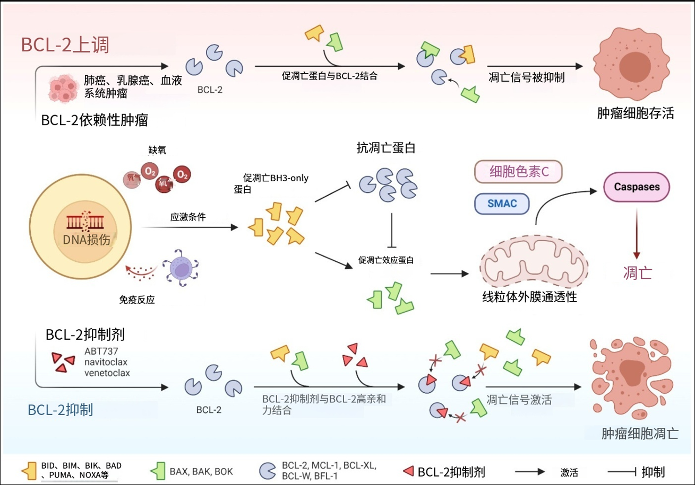
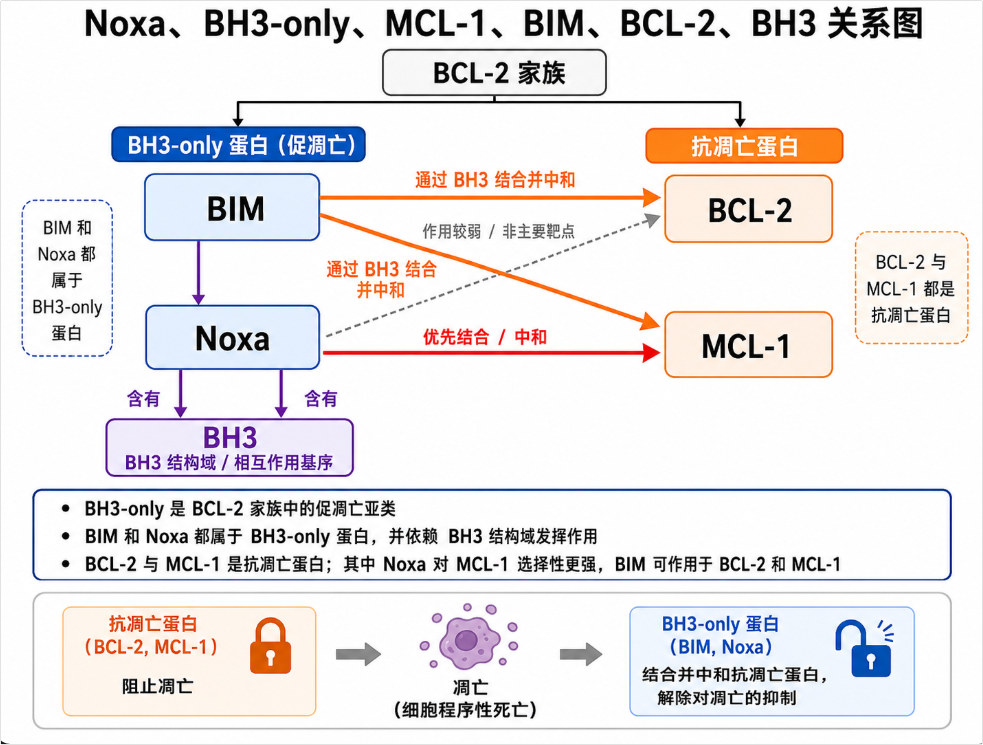

## 我还是不能理解你说的能撑开窗口的维度是「时间」，不是「亲和力」，这是动力学窗口（schedule），不是亲和力窗口（affinity）。它半衰期短，那杀完了细胞，不是也可以有时间让正常髓系祖细胞恢复吗


这是个好问题，而且指向了一个真实的混淆点：**「短半衰期」和「间歇给药」看起来都是"给恢复时间"，但它们作用在两个完全不同的时间尺度上，而且不能互相替代。**

先让我核实一个对比数据。

你的直觉不能算错——短半衰期**确实**有帮助，但它是二阶效应。核心问题在于：**你想逃的那个毒性，它自己的时钟是几小时还是几周。**

|                          | 时间尺度          | 短半衰期能管吗       |
| ------------------------ | ----------------- | -------------------- |
| 血药浓度的涨落           | **小时**（4–6 h） | 能，这就是它的作用域 |
| 粒细胞生成流水线走完一遍 | **约 10–14 天**   | 管不着               |

中性粒细胞的产出不是一个"开关"，是一条流水线：

```
静止 HSC → CMP → GMP → 早幼粒 → 中幼粒 → 晚幼粒 → 带状核 → 成熟中性粒细胞
└──────────── 约 10–14 天 ────────────┘
```

而循环中成熟中性粒细胞的半衰期只有 **7–10 小时**。

所以：**今天的血中性粒细胞数，是 10–14 天前装进流水线的那一批的产出。** 你今晚把药清干净了，明天早上的中性粒细胞数一点都不会因此变好——它取决于两周前那一批的命运。

#### 二、决定性的一点：凋亡不可逆

这是你的推理里缺的那块。

对一个**可逆占据型**靶点（比如激酶抑制剂阻断增殖信号），药物清除 → 信号恢复 → **什么都没损失**。短半衰期直接等于"给了恢复时间"。

但 BCL-2 抑制的终点是**细胞死亡**。第 3 小时在 Cmax 被杀死的那个 GMP，不会在第 20 小时药物清空的时候活回来。

> **占据率是可逆的，死亡是吸收态。药理效应清零了，但生物学损伤留在账上。**

这类药的正确类比不是"受体阻断剂"，而是**化疗/放疗**——伤害按**暴露事件次数累加**。

#### 三、一个玩具模型（示意，非真实数据）

设单次每日脉冲杀掉 BCL-2 依赖祖细胞池的比例 f。短半衰期把 f 从 30% 降到 15%，看着是腰斩了。连续给药 28 天：

| 单次杀伤 f       | 28 天后存活分数         |
| ---------------- | ----------------------- |
| 0.30             | 0.70²⁸ ≈ **1.3 × 10⁻⁵** |
| 0.15（短半衰期） | 0.85²⁸ ≈ **1.1 × 10⁻²** |

改善了 800 倍，**但两个都是流水线抽干**。

换成 10 天给药 / 18 天停药：

|               |                                    |
| ------------- | ---------------------------------- |
| f=0.15，10 天 | 0.85¹⁰ ≈ **0.20**（20% 存活）      |
| 随后 18 天    | ≈ 一个完整的粒细胞生成周期，够重建 |

数学结构是这样的：

- **降低单次杀伤（亲和力/半衰期）→ 改变指数的底数 → 线性级改善**
- **减少脉冲次数（给药天数）→ 改变指数本身 → 指数级改善**

指数永远赢。**这就是"时间维度"和"亲和力维度"不对等的原因。**

#### 四、短半衰期到底保护了什么

它保护的是**储备（reservoir）**，不是**产出（output）**。

- 静止期 HSC 相对不依赖 BCL-2（更偏 MCL-1/BCL-xL，且未被 BIM"预激"）→ 每日脉冲杀不掉它们 → 骨髓不会被永久清空。短半衰期在这里帮忙。
- 但把一个存活的 HSC 变成一个循环中性粒细胞，需要走完那 10–14 天的旅程，而**整条旅程都穿过 BCL-2 依赖区**。你每天开一枪，每一批试图通关的细胞都在半路被打掉。

> **短半衰期让种子活下来；只有足够长的无药走廊，种子才能真的走到终点。**

#### 五、为什么"排期"能撬到真实的不对称性，而"亲和力"撬不到

一句话：**不对称性存在于时间轴上，不存在于浓度轴上。**

- 浓度轴：一个 AML 原始细胞和一个正常 GMP，BCL-2 就是同一个蛋白，结构一样，亲和力一样。**这里没有任何差异可以利用。** 提高效力，两条曲线一起左移，比值不动。
- 时间轴：正常造血**有静止干细胞储备 + 有一套定义清楚的约两周再生程序**；缓解期的白血病克隆已被压到低负荷，其再生动力学与之不同。**这是一个真实存在的差异。**

药物设计的铁律是：**你只能利用真实存在的差异。** AML 里 BCL-2 的差异不存在，再生动力学的差异存在。所以排期是唯一接得上力的杠杆。

#### 六、经验检验：这个实验已经做过了

这不是理论推演。sonrotoclax **就是那个短半衰期分子**。如果你的假设成立，它在 AML 的骨髓抑制应该明显优于 venetoclax。

|                           | ven+aza（VIALE-A, n=283） | sonro+aza（TN unfit AML, n=79）      |
| ------------------------- | ------------------------- | ------------------------------------ |
| ≥3 级中性粒细胞减少       | 42%                       | **88.6%**\*                          |
| ≥3 级发热性中性粒细胞减少 | 42%                       | （含在上面）                         |
| ≥3 级血小板减少           | 45%                       | **64.6%**\*                          |
| ≥3 级感染                 | 64%（任意级 84%）         | 48.1%                                |
| 治疗相关死亡              | —                         | 2 例（贫血；中性粒细胞减少性脓毒症） |

\* sonrotoclax 用的是**合并术语**（中性粒细胞减少 + 计数降低 + 发热性 + 粒细胞缺乏 + 中性粒细胞减少性脓毒症/感染），会显著抬高数字；VIALE-A 是分列术语。人群、随访、剂量队列也都不同。

**所以跨试验直接比较不可靠——但也正因如此，可以下一个稳健的结论：短半衰期没有换来任何量级上的骨髓抑制优势。** 没有变好，就足以否证"短半衰期能解决问题"。

#### 七、反向的证据：VIALE-A 自己就在用排期这个杠杆

同一篇 NEJM 里：

> 因中性粒细胞减少而**中断给药者占 53%**；≥2 次因计数恢复而中断者占 15%。

也就是说，ven+aza 在真实世界里**本来就靠缩短暴露天数活着**——只不过是被动的、非计划的中断（临床实践后来演化出主动的 21 天 / 14 天方案）。BeOne 在 103 研究里做的（10/14/21/28 天四种时长）就是把这件事从被动变主动、系统化搜索。

而且被动中断比主动排期更糟——它同时打掉剂量强度。这大概就是那条容易读反的观察的机制：

> ">14 天给药队列的多次减量 / 因复发停药比例最高"

不是"给久了导致复发"，而是**给久了 → 严重血细胞减少 → 被迫减量和中断 → 实际剂量强度掉下来 → 复发**。上一轮我把这句话框成"窗口两头都堵"，说得太对称了，这里更准确的表述是：**给药时长存在一个最优点，越过它是自伤。**

---

#### 一句话总纲

> **要匹配药物性质和你想逃的那个毒性的时钟。**
>
> - **TLS 的时钟 = 小时**（肿瘤在首剂后数小时内崩解）→ 半衰期是对的杠杆 → sonrotoclax 在 CLL 真的赢。
> - **骨髓抑制的时钟 = 两周**（粒细胞生成流水线的转运时间）→ 排期是唯一的杠杆 → 半衰期在 AML 基本无用。

同一个分子性质，在两个适应症里价值差一个量级。这也是第一个问题里"治疗窗由正常骨髓定"的完整含义：**限速环节不在你的分子上，而在别人的时钟上。**


## 为什么AML里Venetoclax能成药，但MDS不行，这两个疗效和安全性的边界不是一样的吗？

疗效侧：为什么边界不一样

1. **治疗目标细胞群不同**。AML 骨髓被 ≥20%（常 >50%）的原始细胞占满，这群增殖中的 blast 高度 BCL-2 依赖——杀死它们就完成了疾病减负，残存正常 HSC 可以重建骨髓。这是"清场重建"逻辑。
2. **MDS 的病根是造血干细胞层级，不是后代细胞**。Colla 团队（MD Anderson，*Nat Med* 2022 + *Nat Commun* 2024）的系列研究把这个讲透了：MDS 的 HSC 层级有两种架构——**CMP 型**干细胞 BCL-2 依赖，Ven 能杀；**GMP 型**（粒-单核偏向）存活依赖已切换到 **TNFα/NF-κB 通路**，Ven 天然无效。所以 Ven+AZA 清掉的是敏感的克隆后代（→ mOR↑、输血独立↑），但**疾病 initiating 的干细胞克隆活下来了**（→ CR 不升、OS 不变）。更糟的是，复发时常见 **STAG2/RUNX1 突变克隆获得性扩增，把层级从 CMP 型重编程为 GMP 型**——即 Ven 治疗本身在选择耐药架构。
3. **分子背景更敌对**。HR-MDS 中 TP53 突变 ~21.6%（VERONA 基线）、ASXL1 ~31.8%、RUNX1 ~19.3%——TP53 突变对 BCL-2 抑制是**内在耐药**；而 AML 中 Ven 最敏感的 NPM1/IDH1/2 突变亚群在 MDS 里占比很低。
4. **衔接你已有的框架**：这和你之前梳理的"AZA 单药对 MDS 有效、BCL-2 单药无效、MCL1 抑制须先于 BCL2"是同一个逻辑链条的下游。MDS 克隆的 BCL-2 依赖本身就不稳定（部分亚克隆转向 MCL1/NF-κB 存活），AZA 对 MCL1 的下调在 MDS 这种异质克隆中不足以制造稳定的合成致死窗口。

安全性侧：边界同样不一样

- MDS 的**定义性特征就是基线血细胞减少**（无效造血：骨髓高增殖但高凋亡），患者中位年龄 72 岁，残存正常造血本就脆弱且与恶性克隆物理混杂。
- 在 AML 里，深度骨髓抑制的代价被"清场后造血重建"对冲；在 MDS 里，**克隆没根除，骨髓就没有重建的资本**——Ven 的无差别促凋亡打到正常祖细胞就是纯损失。VERONA 的毒性数字（≥3级中性粒细胞减少 76.9%、78.8% 剂量中断）反映的正是这个不对称：**疗效上限更低，毒性下限更高，治疗窗两头被挤**。

一句话总结

AML 里 Venetoclax 是"除草后土壤还能长回庄稼"；MDS 里是"杂草和苗根连在一起，除草剂只杀死了杂草的叶子，根（干细胞层级）换了条存活通路继续长，苗还先被药死了"。

**对 Lisaftoclax 的启示**：亚盛在 MDS 的布局要面对的就是 VERONA 这堵墙——单纯的"更好的 BCL-2 抑制剂"解决不了层级异质性问题。值得跟踪的差异化路径是：Lisaftoclax 更短半衰期能否带来更浅的慢性骨髓抑制（安全端）、以及在 MDS 中与 MCL1 通路干预的序贯/联合设计（疗效端）。这两点是否成立，目前**无头对头数据，标记为待验证假设**。


### 核心逻辑：不是"打开"，是"释放"

Venetoclax 做的事可以概括为一句话：

> **抢占 BCL-2 的疏水沟槽，把被扣押的促凋亡蛋白挤出牢房。**

---

### 第一步：理解癌细胞里的"人质劫持"局面

在癌细胞（尤其是 CLL）中：

```
正常情况下 BCL-2 的沟槽里关着谁？
                          BIM
                           │
    ┌──────────────────────┐│
    │       BCL-2          ▼│
    │  ┌──────────────────┐ │
    │  │ 疏水沟槽（锁孔）  │ │
    │  │  BIM BH3 插在里面 │ │  ← 被扣押，无法行动
    │  └──────────────────┘ │
    └──────────────────────┘
              │
              ▼
        BIM 动弹不得
              │
              ▼
    无法激活 BAX/BAK → 无法打孔 → 细胞不死
```

BCL-2 高度过表达 → 大量 BIM 被扣押在沟槽里 → 凋亡通路被"刹车踩死"。

---

### 第二步：Venetoclax 登场 — "假钥匙"竞争

Venetoclax 是一个 **BH3 模拟物（BH3 mimetic）**——它长得像 BIM 的 BH3 结构域。

```
Venetoclax 的 BH3 模拟结构 vs 天然 BIM BH3：

BIM BH3 核心序列：   ...h₁-s-X-X-h₂-X-X-h₃-s-D-X-h₄...
                        │          │          │
                       疏水残基    必为Leu    疏水残基
                       
Venetoclax：设计成比天然 BIM 对沟槽的亲和力更高
```

**竞争替换过程：**

```
     ┌──────────────────────┐
     │       BCL-2          │
     │  ┌──────────────┐    │     Venetoclax（更高亲和力）
     │  │ 疏水沟槽      │◄───│──────────────────────────────
     │  │ BIM 占着 🔒   │    │     "让开，我比它贴得更紧"
     │  └──────────────┘    │
     └──────────────────────┘
              │
              ▼
     BIM 被挤出沟槽 → 释放！
```

---

### 第三步：释放后的连锁反应

被释放的 BIM 恢复自由身后：

```
BIM（自由） ──激活──► BAX/BAK ──构象变化──► 寡聚化
                                                  │
                                                  ▼
                                          在线粒体外膜打孔
                                                  │
                                                  ▼
                                    细胞色素 c 漏出到胞浆
                                                  │
                                                  ▼
                              Caspase-9 → Caspase-3/7 级联
                                                  │
                                                  ▼
                                            细胞凋亡 💀
```

---

### 一个精准的类比

| 场景              | 对应         |
| ----------------- | ------------ |
| BCL-2 的疏水沟槽  | 手铐         |
| BIM（促凋亡蛋白） | 被铐住的警察 |
| Venetoclax        | 万能钥匙     |

> **BCL-2 用手铐铐住了警察 BIM，癌细胞因此无法被"执法"。Venetoclax 这把钥匙插进去，手铐开了，警察 BIM 被放出来 → 叫上 BAX/BAK 特警队 → 在线粒体膜上破门 → 癌细胞伏法。**

---

### 关键细节：为什么 Venetoclax 能做到"更高亲和力"？

回顾上一轮讨论的**四个疏水口袋 P1-P4**：

```
BCL-2 疏水沟槽内部结构（剖面）：

  ╔════╗ ╔════╗ ╔════╗ ╔════╗
  ║ P1 ║ ║ P2 ║ ║ P3 ║ ║ P4 ║   ← 四个疏水口袋
  ╚════╝ ╚════╝ ╚════╝ ╚════╝
    ▲      ▲      ▲      ▲
    │      │      │      │
    ▼      ▼      ▼      ▼
  BIM 天然 BH3：P1+P2+P3 主要结合，亲和力中等
  Venetoclax：  P2+P4 精准锁定，亲和力 sub-nM 级（约 1000 倍于天然）
```

Venetoclax 通过 **基于结构的理性设计（NMR 片段筛选 + 药物化学优化）**，精确匹配了 BCL-2 沟槽的 P2 和 P4 口袋，实现了远超天然 BIM BH3 的结合力。这就是它能"挤掉"BIM 的物理化学基础。

---

### 一句话总结

> **Venetoclax 不是直接"打开"促凋亡蛋白，而是作为一把比原装钥匙更契合锁孔的假钥匙，插入 BCL-2 的疏水沟槽（BH1-BH3 形成），把被扣押的天然促凋亡蛋白 BIM 挤出去。释放后的 BIM 激活 BAX/BAK 在线粒体膜上打孔，启动凋亡级联，癌细胞死亡。**


BCL-2家族同时存在抗凋亡蛋白和促凋亡蛋白，谁的声音大，谁决定命运，本身是一个**动态竞争系统**。促凋亡蛋白如：BIM、BAX、BAK、Noxa、PUMA，致力于线粒体外膜通透化。抗凋亡蛋白如：BCL-2、MCL-1，致力于阻止线粒体损伤。BIM可以结合MCL-1和BCL-2两个靶点，Noxa更偏向MCL-1。


| 蛋白类别       | 代表成员 | BH结构域 | 主要功能                            | 血液肿瘤表达特征                              |
| :------------- | :------- | :------- | :---------------------------------- | :-------------------------------------------- |
| 抗凋亡蛋白     | BCL-2    | BH1-BH4  | 隔离BH3-only蛋白和BAX/BAK，抑制MOMP | t(14;18)易位导致过表达；CLL/AML均高表达       |
|                | BCL-XL   | BH1-BH4  | 功能冗余替代BCL-2                   | 淋巴结微环境中CD40信号上调                    |
|                | MCL-1    | BH1-BH4  | 半衰期~30 min，快速响应生存信号     | Venetoclax治疗后NF-κB驱动上调，为主要代偿机制 |
| 促凋亡效应蛋白 | BAX      | BH1-BH3  | MOMP执行者，线粒体外膜孔道形成      | 功能缺失突变见于17% venetoclax复发AML         |
|                | BAK      | BH1-BH3  | 与BAX功能冗余                       | 受BCL-XL和MCL-1双重调控                       |
| BH3-only蛋白   | BIM      | BH3-only | 强效凋亡激活剂                      | 被BCL-2隔离，表达水平影响venetoclax敏感性     |
|                | PUMA     | BH3-only | p53下游效应分子                     | 启动子甲基化介导venetoclax耐药                |
|                | NOXA     | BH3-only | 选择性结合MCL-1                     | MDM2抑制剂可上调NOXA                          |

> BH3-only 蛋白是一类促凋亡的 BCL‑2 家族蛋白。它们共同特点是：通常只保留一个关键的 **BH3 结构域**，没有完整的 BCL‑2 蛋白折叠；这个 BH3 片段在需要时形成 α 螺旋，插入 BCL‑2、BCL‑XL、MCL‑1 等抗凋亡蛋白的疏水沟槽。
>
> 常见成员包括：BIM、BID、PUMA、NOXA、BAD、BIK、BMF、HRK。
>
> 作用可以简单理解为“把细胞的死亡开关推向开启”：
>
> **解除刹车**：BAD、NOXA 等占据 BCL‑2 类蛋白的疏水沟槽，让其不能再抑制 BAX/BAK。
>
> **直接点火**：BIM、截短 BID（tBID）、PUMA 等还可直接促进 BAX/BAK 激活。
>
> **执行结果**：BAX/BAK 在线粒体外膜聚集并形成孔道，释放细胞色素 c，随后启动 caspase 级联反应，使细胞发生内源性凋亡


冗余、高可用：当BCL-2被药物抑制时，MCL-1和BCL-XL可快速接管其功能，这是venetoclax获得性耐药的主要分子基础。MCL-1因其极短的蛋白半衰期成为最动态的代偿节点——单细胞多组学分析显示所有venetoclax复发CLL患者均存在NF-κB驱动的MCL-1上调

BH3-only蛋白的表达水平直接决定肿瘤细胞对BCL-2抑制剂的敏感性，PUMA的表观遗传沉默可使细胞获得耐药而不依赖BCL-2基因突变


BH3-only蛋白是细胞应激的分子传感器，不同成员会接收不同应激通路的信号，并把这些信号转换为对 BCL‑2 凋亡网络的调控。如：

**PUMA、NOXA**：常由 DNA 损伤后的 p53 诱导表达。

**BIM**：可在生长因子撤除、PI3K–AKT 信号降低或内质网应激时增加/被激活。

**BAD**：受存活信号相关的磷酸化调控。

**BID**：可被死亡受体通路中的 caspase‑8 切割为活性的 tBID。

它们本质上是一个“压力输入 → 线粒体凋亡输出”的转换层：轻度或短暂应激时，抗凋亡蛋白仍能压住信号；当应激足够强或持续足够久，BH3-only 蛋白累积并占据 BCL‑2 的沟槽，最终释放/激活 BAX 和 BAK，让受损细胞有序退出

> https://www.nature.com/articles/cdd2017186


CLL常依赖BCL-2 → Venetoclax有效，多发性骨髓瘤常依赖MCL-1 → MCL-1抑制剂成为重要方向，一些淋巴瘤同时依赖BCL-2/MCL-1 → 需要组合策略

> 线粒体：平时负责给细胞供能（产生ATP），受到损伤时会释放死亡信号，让细胞自毁
>
> 正常情况下，线粒体内部细胞色素C被锁住，细胞正常存活，但如果细胞决定死亡，则会释放Cytochrome c，激活Caspase，导致细胞凋亡
>
> 线粒体外膜可以理解成一道门，打开则Cyt C出来
>
> 外膜 |  Cyt C | 线粒体


Lisaftoclax半衰期约 **3-5小时**，论文强调其“血浆停留时间有限、系统暴露较低”。BCL-2抑制剂杀细胞很快，如果药物持续高暴露时间长，理论上更容易造成持续、集中性的肿瘤细胞裂解。Lisaftoclax更像是高峰值触发凋亡、但不长时间滞留。

BCL-2 失控的是细胞把“不要凋亡”的信号开得太强，导致本该死亡的异常血液细胞继续存活；不同疾病里，BCL-2 被抬高的原因不同。2575作为BCL-2抑制剂（BH3模拟剂），通过结合抗凋亡蛋白抑制其活性和功能，从而促进细胞凋亡。

短半衰期+双通路代谢带来良好的安全性和适用性，无DDI，少TLS。

```
Lisaftoclax
    ↓
竞争性结合 BCL-2 蛋白 BH3 疏水槽
    ↓
置换 BCL-2:BIM 复合物 → 释放 BIM 蛋白
    ↓
释放 BAX/BAK 促凋亡蛋白
    ↓
线粒体外膜通透化 (MOMP)
    ↓
细胞色素 c 释放 → Caspase-9 → Caspase-3/7 级联激活
    ↓
PARP 切割 → 凋亡执行


化学式：
1、lisaftoclax + BCL-2:BIM  →  lisaftoclax:BCL-2 + 游离 BIM 
2、游离 BIM → 激活 BAX/BAK → 线粒体外膜通透化（MOMP） → 细胞色素 c / caspase → 凋亡

部分释义：
BIM：负责“发出死亡命令、解除刹车”，不直接制造线粒体孔洞，主要作用是调节其他BCL-2家族成员
BAX/BAK：负责“执行死亡动作、打穿线粒体膜”
MOMP（mitochondrial outer membrane permeabilization，线粒体外膜通透化）
MOMP通常被认为是线粒体凋亡不可逆的关键步骤


细胞受到严重压力
        ↓
   BH3-only蛋白激活
        ↓
 ┌─────────────┐
 │             │
BIM/Noxa      （其他BH3-only）
 │
 │ 抑制BCL-2/MCL-1
 ↓
释放BAX/BAK
 ↓
BAX/BAK在线粒体外膜打孔
 ↓
Cytochrome c释放
 ↓
Caspase激活
 ↓
细胞凋亡
```

| 类型         | 代表蛋白        | 作用                     |
| ------------ | --------------- | ------------------------ |
| 抗凋亡蛋白   | BCL-2、MCL-1    | 关闭死亡开关             |
| BH3-only蛋白 | BIM、Noxa、PUMA | 解除刹车/发出信号        |
| 执行蛋白     | BAX、BAK        | 打开线粒体，释放死亡因子 |

BIM和Noxa都是BH3-only，但有所区别

BIM比较晚能，既可以中和MCL-1，也能中和BCL-2，触发BAX/BAK。Noxa更偏向MCL-1。


为什么Lisaftoclax实验中出现了Noxa上调，但Venetoclax没有？

核心原因通常不是BCL-2本身，而是**药物触发的应激反馈不同**。Lisaftoclax可能诱导更强的应激反应，细胞受到药物压力后，会通过转录程序补偿。Venetoclax主要是用自身的BH3置换BIM

```
BCL-2被抑制
      ↓
细胞感受到死亡压力
      ↓
激活p53、FOXO、ATF4等应激通路
      ↓
Noxa转录增加
      ↓
MCL-1下降
      ↓
增强凋亡

部分释义：p53、FOXO、ATF4等应激通路导致转录增加：

p53 → Noxa典型路径：
DNA损伤 / 强烈细胞压力 -> p53稳定化 ->  p53进入细胞核 -> 结合PMAIP1(Noxa)启动子 -> Noxa↑
P53的任务是检查细胞是否值得继续存活。如果损伤严重，p53会启动PUMA、Noxa、Bax促凋亡基因

ATF4 → Noxa（这是细胞压力过大时的“自毁程序”。）
ATF4主要响应：
内质网压力
氨基酸缺乏
蛋白折叠压力

蛋白压力
 ↓
PERK-eIF2α通路
 ↓
ATF4↑
 ↓
Noxa↑
 ↓
促进凋亡

FOXO → Noxa
FOXO感知：
氧化压力
营养状态
能量状态

氧化应激
 ↓
FOXO进入核
 ↓
Noxa↑
 ↓
线粒体凋亡增加

Noxa不是普通的凋亡蛋白，它是细胞感受到“活不下去”时，被各种压力传感器叫出来的执行辅助因子。
```


BCL-2耐药：

```
正常情况：
Venetoclax占据BCL-2
↓
BIM释放
↓
BIM激活BAX/BAK
↓
凋亡


耐药情况1：
MCL-1 ↑↑
↓
MCL-1抓住BIM
↓
BIM无法激活BAX/BAK
↓
不凋亡


耐药情况2：BIM不足
BCL-2抑制
↓
没有足够BIM释放
↓
BAX/BAK无法启动
↓
耐药


其他耐药：BAX/BAK坏了、其他抗凋亡蛋白补位（BCL-2家族还有BCL-xL、BCL-W，也可以MCL-1 + BCL-xL继续压制BAX/BAK）
```


Lisaftoclax机制反映到临床数据会有什么表现？在具体的适应症如CLL/SLL、AML、MDS中，有何不同？

1. 更高缓解率（ORR、CR）、更深缓解（MRD阴性）

2. 对高MCL-1患者更有效

3. 对Venetoclax耐药患者仍有效

4. 更少出现治疗早期失败

5. 对TP53突变CLL

   p53无法激活—> PUMA/Noxa下降，如果Lisaftoclax本身能诱导Noxa（非完全依赖p53），理论上可能改善。

6. 因为AML和CLL完全不同。AML细胞两种依赖（BCL-2、MCL-1）都有，尤其是干细胞样AML和复发AML更容易依赖MCL-1。若Lisaftoclax增加Noxa，则理论上会有更多的AML细胞进入凋亡，且延长缓解时间（PFS、RFS）。在Venetoclax失败患者中，通常MCL-1补偿+BCL-xL补偿，可能仍有效

7. MDS比AML复杂，MDS本身细胞处于半死亡状态，很多异常克隆，增殖不强，但逃逸凋亡。若Lisaftoclax上调Noxa，则可能导致更深的CR、更低的残留病灶

重点注意Venetoclax耐药患者和MCL-1高表达患者，临床指标主要是减少残留细胞逃逸方向，可以看DoR、PFS、OS


绕过MCL-1

- BCL-xL升高

  BAX/BAK缺陷

  TP53异常

  线粒体代谢改变


细胞凋亡当浓度达到一定值时，会变得不可逆。这种BIM结合的数量，一方面和药的结合力相关，一方面和药物浓度相关。


真正要测“是否容易被推过阈值”，研究者通常看 BH3 profiling、BCL-2:BIM 共沉淀/置换、BAX/BAK 激活、线粒体膜电位或 cytochrome c 释放，以及单细胞 Annexin V/caspase 阳性比例。


[快了鼠鼠——从BCL-2到亚盛医药的APG2575](https://xueqiu.com/2693678800/330594845)

利托沙克拉（lisaftoclax，APG-2575）的核心药理是：**选择性解除肿瘤细胞依赖的 BCL-2“刹车”，恢复线粒体凋亡。**

机制链可以理解为：

抑制 BCL-2 → 释放/增强 BIM 等促凋亡信号 → 激活 BAX/BAK → 线粒体外膜通透化（MOMP）→ 细胞色素c释放 → caspase-3/7 激活 → PARP切割与细胞凋亡


**破坏 BCL-2:BIM 复合物**

BCL-2 原本会“扣住”促凋亡蛋白 BIM，使肿瘤细胞逃避免死。利托沙克拉作为 BH3 模拟剂占据 BCL-2 的结合槽，解离 BCL-2:BIM 复合物 → 释放促凋亡蛋白BIM。这是最直接、最确定的主机制。

**BIM 增加并转位到线粒体**

药物处理后，BIM 蛋白增加，且更多 BIM 从胞浆进入线粒体；这会推动 BAX/BAK 聚集、在线粒体膜上打孔。其原因可能是 BCL-2 对 BIM 的“封存”被解除，并伴随细胞应激后的促凋亡信号增强。

不过要注意：论文证明了这一现象与凋亡增强相关，**并未完全证明 APG-2575 是如何直接令 BIM 表达升高的**。

**Noxa 增加**

Noxa 是另一种 BH3-only 促凋亡蛋白，尤其可中和抗凋亡蛋白 MCL-1。它增加后，相当于减少了肿瘤细胞借 MCL-1“绕开”BCL-2 抑制的机会，因此可协同放大凋亡。其上调更可能是药物暴露后的细胞应激/凋亡程序的一部分，而非利托沙克拉已被证实直接靶向 Noxa。

**MOMP、细胞色素 c 释放、caspase-3/7 上升**

这是线粒体凋亡通路被真正推过“不可逆阈值”的结果。细胞色素 c 外泄后会启动 caspase 级联反应，最终拆解细胞内蛋白和 DNA 修复系统，使细胞进入程序性死亡。

**氧耗（OCR）、储备呼吸与 ATP 下降**

更合理的解读是：线粒体膜受损和凋亡启动后，线粒体功能随之崩解，因而呼吸和 ATP 生成降低。它们主要是凋亡过程的伴随/下游表现，不能简单理解成该药首先是“线粒体呼吸链抑制剂”。

| 机制                         | 2575 vs Venetoclax                                         |
| :--------------------------- | :--------------------------------------------------------- |
| **细胞摄取速度**             | 更快，RPMI8226细胞内浓度高1.44-1.61倍；KMS-11高1.46-1.92倍 |
| **细胞色素c释放**            | 更强                                                       |
| **caspase-3/7活化**          | 骨髓瘤和WMG中显著更高                                      |
| **凋亡诱导率**               | 骨髓瘤 72.92% vs 37.04%；WMG 60.20% vs 50.00%              |
| **MOMP（线粒体外膜通透化）** | 更显著增加                                                 |
| **BIM蛋白水平**              | 2小时内快速显著增加，6小时后下降                           |
| **Noxa蛋白水平**             | 1-6小时内显著升高（**Venetoclax对此无显著影响**）          |
| **BIM线粒体转位**            | 线粒体中BIM积累更多                                        |

与Venetoclax相比，2575有两个关键结构改造：

-  二甲基基团	-> 环丁基环
-  四氢-2H-吡喃基团 -> 1,4-二氧六环

这两个位置的修饰是2575所有差异化药理效应的**根本物质基础**。构效关系研究表明这两个位置可以改造且不影响对BCL-2的高亲和力结合，这赋予了2575独特的理化性质。

结构改造最直接的结果是**更快的细胞摄取速率**。2575进入肿瘤细胞后约2小时胞内浓度即达平台期，且在各时间点都高于Venetoclax。**这是下游一系列增强效应的第一推动力**——更多的药物分子更快地到达线粒体靶点，意味着：更高效地解离BCL-2:BIM复合物；更快达到触发凋亡所需的线粒体阈值浓度；

2575不仅进入细胞更快，其**解离BCL-2:BIM复合物的效率也可能更强**，释放出更多的游离BIM。

这是2575与Venetoclax最显著的分子层面差异之一。Noxa是BH3-only促凋亡蛋白，能**选择性中和MCL-1**（另一种抗凋亡蛋白）。2575上调Noxa意味着即使在MCL-1有一定表达的情况下，也能通过Noxa来"解除"MCL-1的保护作用，这可能是2575在耐药模型中表现更优的原因之一。


https://www.mdpi.com/2072-6694/15/20/4957






| 证据               | 内容                                                         | 指向                                 |
| :----------------- | :----------------------------------------------------------- | :----------------------------------- |
| 剂量-效应脱钩      | 最低剂量组 20 mg（AUC₀₋₂₄ 仅 0.261 h·μg/mL）即观察到 ALC 下降 | AUC 累积假说下该剂量不应有可测效应   |
| 时间同步           | ALC 反应在首次给药后 **6 小时**即可检测，与 Tmax（4–6 h）高度一致 | 药效峰值与药代峰值同步               |
| BH3 profiling      | BAD 肽诱导的细胞色素 c 释放与 ALC 正常化时间**呈负相关**     | BCL-2 复合物解离越充分，ALC 恢复越快 |
| BH3 profiling 动态 | BIM 肽诱导的细胞色素 c 释放在 C1D1 给药后 **6 h 出现短暂峰值**，随后下降，至 C1D28 显著降低 | 与 Cmax 出现时间吻合                 |
| 跨药对比           | Lisaftoclax AUC 仅为 venetoclax 的约 21%，但 CLL ORR 处于同一数量级（62.5% vs 79%） | 疗效不随 AUC 等比例下降              |


数据来源综合：Ailawadhi S, et al. *Clin Cancer Res.* 2023；Cancer Network ASCO 2021；CLL Society 2025。

#### P1 的判别价值：20 mg 最低剂量即有效，区分了两个竞争假说

ALC 动态是 BCL-2 抑制剂 PD 的核心生物标志物。**"20 mg、给药首日即观察到 ALC 下降"这一观察直接区分了两个竞争性假说**：

- **AUC 累积假说**：20 mg 剂量的 AUC₀₋₂₄ 仅 0.261 h·μg/mL，理论上不足以产生可检测的生物学效应 → **被证伪**。
- **Cmax 阈值假说**：即使该剂量的 Cmax 仅 0.039 μg/mL，也足以**部分**触发 BCL-2 依赖的凋亡通路 → **与观察一致**。

这与 MOMP 的全或无（all-or-none）性质一致：一旦游离药物浓度超过释放 BIM / 激活 BAX 所需的阈值，即触发不可逆的 caspase 级联。

#### P4 的三个管理案例：说明"恢复模式"比"发生率"更重要

- 1 例 400 mg 组患者在 C1 出现 G3 中性粒减少，暂停用药 8 天后自行恢复至 1.15×10⁹/L，**无需 G-CSF 或其他干预**即可继续治疗。
- 1 例 1200 mg 组患者经历 G3 中性粒减少但**无需停药或生长因子支持**，计数稳定维持并持续治疗至 C10。

**关键差异不在发生率（26.1% vs 40–50%），而在恢复模式**：lisaftoclax 组在无 G-CSF 支持下快速恢复并稳定维持，且中性粒减少的相关后遗症（发热、感染）未被观察到。

#### P5 的解读：验证成功恰恰说明代价存在

3 倍选择性预测的"中间态"血小板减少发生率被精确观察到——残余的 BCL-xL 抑制活性足以对巨核细胞产生**可检测但可控**的影响，未达到导致治疗中断的严重程度。短半衰期降低了持续 BCL-xL 抑制的时间，部分抵消风险。

> **⚠️ 口径待核**：原始资料中 venetoclax 的血小板减少 36% 一处标为 "G3/4"、另一处标为 "任何级别"，二者不可能同时成立。在核实前，**不应做"lisaftoclax 血小板减少优于 venetoclax"的对比结论**——若 36% 是 venetoclax 的 G3/4 值，则 lisaftoclax 13.5% 确实更低；若 36% 是任何级别，则 lisaftoclax 的 28.8%/23.4% 只是接近而非优于。

#### P3 的历史对照

Venetoclax 的历史经验形成强烈反差：早期开发中在较高起始剂量下发生 **TLS 死亡事件**，被迫将起始剂量下调至 20 mg 并引入 **5 周每周递增**方案。Lisaftoclax 在 8 个剂量队列、44 例递增期患者中零 DLT。

### 6.2 Phase 2 注册研究（APG2575CC201, NCT05147467）

#### 研究人群：BCL-2 抑制剂开发史上最难的 CLL 人群之一

| 参数                | APG2575CC201<br/>(Lisaftoclax) | M14-032<br/>(Venetoclax) | MURANO<br/>(Venetoclax-R) |
| :------------------ | :----------------------------- | :----------------------- | :------------------------ |
| 样本量              | 77 例（72 例可评估）           | 91 例                    | 389 例                    |
| 中位年龄            | 63 岁（37–84）                 | 67 岁                    | 64 岁                     |
| 中位既往线数        | 3 线（1–10）                   | 5 线（1–12）             | 1 线                      |
| BTKi 耐药比例       | **87%**                        | 74%                      | 2.6%                      |
| BTKi + 化疗双重失败 | **45.5%**                      | 未报告                   | 不适用                    |
| del(17p)/TP53 突变  | 39%                            | 49% del(17p)             | 27% del(17p)              |
| 复杂核型            | 42.9%                          | 未报告                   | 7.2%（≥5 CNA）            |
| IGHV 未突变         | 53.2%                          | 86%                      | 68.3%                     |
| ECOG ≥2             | 31.2%                          | 未报告                   | 未报告                    |
| 给药方案            | 600 mg QD，5 天递增            | 400 mg QD，5 周递增      | 400 mg QD，5 周递增 + R   |

缩写：CNA 拷贝数异常；R rituximab；QD 每日一次。

**这一人群特征的双重意义**：
- **作为机制验证场景**：45.5% 的双重失败率和 87% 的 BTKi 耐药比例意味着这些患者在 BCR 信号通路抑制和化学免疫治疗两条独立路径后均已进展，理论上仅保留凋亡调控通路（BCL-2 抑制）作为有效靶点。若 BCL-2 抑制确为独立作用通路，此类患者仍应获益——这是一个近乎"纯净"的机制检验。
- **作为亚组分析基础**：高危遗传学的高比例为 TP53/复杂核型亚组分析提供了充足检验效力。

#### 疗效读数

| 指标                 | Phase 1（n=22 可评估）    | Phase 2（n=77，72 可评估） |
| :------------------- | :------------------------ | :------------------------- |
| ORR                  | **63.6%**（14 PR，无 CR） | **62.5%**                  |
| mPFS                 | —                         | **23.89 个月**             |
| 30 个月 OS 率        | —                         | **78%**                    |
| 淋巴结/脾脏缩小 ≥70% | 42.9%（9/21）             | —                          |
| 中位起效时间（TTR）  | **2 个周期**（范围 2–8）  | —                          |

> **口径澄清**：Ph1 的 63.6% 与 Ph2 的 62.5% 是**两个不同研究、不同样本量**的读数，不是同一数字的两种写法。原资料中二者混用，此处已分开标注。

#### TTR 与 ALC 动态：支持"快速凋亡触发"而非"累积暴露"

中位 TTR 为 **2 个周期**（venetoclax 为 2–3 个周期，相当）。机制上，BCL-2 抑制剂通过直接释放 BIM / 激活 BAX/BAK 触发 caspase 级联，细胞在数小时内进入凋亡程序，**无需基因转录或蛋白质合成的时间延迟**。因此疗效显现速度主要取决于肿瘤负荷和药物达到 MOMP 阈值的能力，而非累积暴露时间。

ALC 提供更精细的时间分辨率：
- **56%** 的患者在 4–6 天 ramp-up 结束时 ALC 已恢复正常
- C1 结束时升至 **58%**
- C2 结束时达 **65%**

ALC 在首次给药后 24 小时内的快速下降是肿瘤细胞对 Cmax 的**即时响应**，这一早期 PD 信号预测了后续的影像学缓解。

### 6.3 给药节律：无蓄积特性使间歇给药成为可选项

**R/R AML 数据对照**：

| 方案                                   | ORR     | CR        |
| :------------------------------------- | :------ | :-------- |
| **14 天间歇给药**（14 天开 / 14 天关） | **50%** | **37.5%** |
| 28 天持续给药                          | 39%     | 28%       |

**间歇给药优化假说**：持续 BCL-2 抑制可能（a）增加对正常造血干细胞的毒性（中性粒细胞减少），（b）驱动 MCL-1 / BCL-xL 代偿性上调。间歇给药则允许正常造血恢复窗口、减少代偿机制激活、维持肿瘤细胞对 BCL-2 抑制的"成瘾性"。

> 注意：这与 §3 的 Cmax 驱动假设在方向上一致（都主张"持续暴露非必需"），但**证据级别较弱**（小样本、非随机对照），且 (b) 的代偿上调假说未有直接生物标志物证据。

---

## 7. 边界条件与耐药机制

Phase 2 数据揭示了 Cmax 驱动模型的**解释边界**。初始模型假设疗效主要取决于 Cmax 是否突破 MOMP 阈值，但**未充分考虑下游凋亡执行通路的完整性**。

### 7.1 TP53 缺失 / del(17p)：最强负向预测因子

**机制**：p53 是 **BAX 的转录激活因子**。TP53 缺失时 BAX 基线转录降低，即使 BIM/PUMA 被成功释放，也不足以突破 MOMP 阈值。

**关键澄清**：这**不是 BCL-2 靶点失效**，而是**下游凋亡执行通路被削弱**。药物仍在正确地做它该做的事，只是"下游产能不足"。

**数据**：
- Phase 2：mPFS **11.2 vs 29.6 个月**（HR **5.0**, P=.018）
- Phase 1 小样本：3 例 del(17p)/TP53 突变患者中 2 例达 PR，ORR **66.7%**（N=3，仅供参考）

**但并非完全无效**：在 BTKi + 化疗双重失败后仍有约 1 年的 PFS。这初步证实了 BCL-2 抑制剂**绕过 TP53 直接作用于线粒体凋亡通路下游节点**的理论优势——即使 p53 功能缺失，释放的 BIM/PUMA 仍可在一定程度上激活 BAX/BAK，完成**不完全但可测量**的凋亡级联。

**对模型的修正**：Cmax 驱动的 BCL-2 抑制能触发凋亡级联的**启动**，但 TP53 缺失限制该级联的**充分执行**，导致疗效"打折扣"。因此模型需要补充 **TP53 状态作为疗效修饰因子**。临床推论：TP53/del(17p) 患者可能需要更强的联合策略（+BTKi 下调 MCL-1，或 +HMA 上调 NOXA）以补偿 p53 功能缺失，而非单纯依赖单药的 Cmax 脉冲。

### 7.2 复杂核型（CK）：独立预后因子

**数据**：高 CK（≥5 种异常）mPFS **12.9 vs 25.7 个月**（HR **2.7**, P=.001）

**机制**：基因组不稳定性驱动的**克隆异质性**——非 BCL-2 依赖的亚克隆在治疗压力下被选择性扩增。

**与 TP53 的分工**（这是理解两个因子为何独立的关键）：
- **TP53 限制凋亡通量的「深度」**——同一个克隆里，能死掉多少
- **CK 限制靶向治疗的「广度」**——有多少克隆根本不吃这一招

### 7.3 MCL-1 上调：获得性耐药主机制

**标志**：BIM 从 BCL-2 向 MCL-1 的"**蛋白质转移**"——药物把 BIM 从 BCL-2 上赶下来，但 MCL-1 把它接走了。

**上游驱动**：
- RAS/MAPK 通路 → 增强 MCL-1 稳定性
- PI3K-AKT 通路 → 磷酸化稳定化

**这是对所有 BCL-2 抑制剂的类效应意义的耐药机制**，不是 lisaftoclax 特有问题。§2.4 所述的 NOXA 上调是 lisaftoclax 对此的部分内建对冲。

### 7.4 联合用药的统一设计原则

AML/MDS 数据提供了关键验证：**所有成功的联合策略都通过不同的上游机制，汇聚于同一个下游节点**——降低 MCL-1 功能或增强 BCL-2 依赖性。

| 联合方案                    | 上游机制                            | 报道疗效                              |
| :-------------------------- | :---------------------------------- | :------------------------------------ |
| **+ BTKi**（acalabrutinib） | 抑制 MCL-1 转录 → 增强 BCL-2 依赖性 | ORR 96.6%；venetoclax 经治 CLL 达 86% |
| **+ HMA**（azacitidine）    | 上调 NOXA → 促进 MCL-1 降解         | AML+AZA ORR 64%；R/R AML ORR 43.2%    |
| **+ MDM2 抑制剂**           | p53 激活 → 上调 NOXA 转录           | 临床前克服耐药                        |

> **口径待核**：原资料中 "ORR 43.2%" 同时被标注为"AML/MDS 单药疗效"与"R/R AML + HMA 联合"，二者不可能同指。引用前需回溯原始文献确认给药方案。

**统一原则**：
> **联合药物必须能够降低 MCL-1 功能，或增加 BCL-2 priming。**

该原则具有跨适应症的普适性——从 CLL 到 AML 再到 MDS，**MCL-1 是 BCL-2 抑制剂联合策略的共同汇聚节点**。这也是评估任何新联合方案是否合理的第一性检验标准。

### 7.5 G101V gatekeeper 突变：lisaftoclax 的明确短板

**背景**：G101V 是 venetoclax 的经典获得性耐药突变，约 **43.5%** 的 venetoclax 临床进展病例可检出。

| 药物            | 对 G101V 的活性                      | 判读                   |
| :-------------- | :----------------------------------- | :--------------------- |
| Venetoclax      | IC50 ~25–29 nM                       | 已显著减弱             |
| **Lisaftoclax** | 生化 IC50 **~57 nM**（细胞 ~161 nM） | **比 venetoclax 更差** |
| Sonrotoclax     | IC50 **0.34 nM**                     | 真正覆盖 G101V         |

**必须纠正的一个常见误读**：Lisaftoclax 在 venetoclax 经治患者中确实观察到活性（AML ORR 31.8%；CLL 联合 acalabrutinib 达 86%），但这**不是**因为它能克服 G101V。真实原因有两条：

1. **耐药机制异质性**——并非所有 venetoclax 进展患者都携带 G101V（约 56% 不携带）；
2. **联合药物的 MCL-1 下调贡献**——86% 这个数字来自联合 acalabrutinib，不是单药活性。

**结论**：lisaftoclax 与 venetoclax 均不能克服 gatekeeper 突变。在"覆盖 venetoclax 耐药"这一维度上，真正有结构性优势的是 sonrotoclax。

---

## 8. 尚未验证的部分（引用时必须标注的缺口）

|  #   | 缺口                               | 现状                                                         | 坐实所需证据                                                 |
| :--: | :--------------------------------- | :----------------------------------------------------------- | :----------------------------------------------------------- |
|  1   | **Cmax 驱动假设本身**              | 由临床形态反推的解释框架，与数据一致但未被直接证明           | §3.4 的四类实验，尤其是"等 AUC / 不等 Cmax"的头对头设计      |
|  2   | **肿瘤组织半衰期**                 | 13–48 h 完全来自异种移植模型，种属差异使外推不确定           | 人体组织 PK 研究（手术样本 / 骨髓活检浓度测定）              |
|  3   | **免疫调节等非经典功能**           | 临床前提示 NF-κB 抑制、TAM M2→M1 极化、pDC 杀伤降低 I 型干扰素，或可增强抗 PD-1/PD-L1 联合敏感性 | 人体生物标志物数据；目前不应作为联合免疫治疗的机制依据引用   |
|  4   | **3 倍 BCL-xL 选择性的长期安全性** | 累积性血小板功能影响在数月至数年长期给药场景（固定疗程 CLL、慢性病管理）中**尚未充分表征** | 长期随访的血小板功能学（非仅计数）数据                       |
|  5   | **AML 联合场景的血液学毒性叠加**   | AML 联合 AZA 时 ≥3 级血小板减少升至 **50–61%**（骨髓毒性叠加），远高于 CLL 单药 | 需区分"药物固有毒性"与"联合方案 + 疾病本身骨髓抑制"的贡献    |
|  6   | **3 倍选择性的可观测替代指标**     | 目前只有血小板计数这一粗指标；无法区分"巨核细胞受抑"与"血小板破坏" | 巨核细胞集落形成、血小板寿命、TPO 水平、血小板功能（聚集/活化标志） |

### 内部口径待核清单

引用本文数据前需回溯原始文献核实的三处矛盾：

1. **Venetoclax 血小板减少 36%** 一处标为 G3/4、一处标为任何级别（影响 §6.1 P5 的对比结论）。
2. **ORR 43.2%** 一处标为 AML/MDS 单药、一处标为 R/R AML + HMA 联合（影响 §7.4 的联合增益幅度计算）。
3. **1200 mg 剂量组 PK 倒挂**（Cmax/AUC 低于 1000 mg），与"剂量比例性"表述冲突（见 §4.2）。

另有两处已在正文中统一，此处备注：
- Lisaftoclax 血浆 t½ 原文分别写作 "3–5 h"、"3–6 h"、"约 6 h"，本文统一采用 **3–5 h**（Ph1 全剂量实测范围 2.84–6.10 h）。
- CLL ORR 原文 62.5% 与 63.6% 混用，本文已分别归属 Phase 2 与 Phase 1


# BCL-2抑制剂在AML/MDS中的血液学毒性与恢复时间

---

## bcl-2 在 aml、mds 中的不良反应主要有哪些（细胞层面），这些比如血小板、中性粒细胞的减少，需要多久恢复

医学药理问题，我先核实几个关键数据（尤其 MDS 领域的 VERONA 研究和减量恢复时间），再给你整理。

#### 一、先分清两类"细胞层面"的损伤机制

BCL-2 抑制剂（venetoclax 为代表）在 AML/MDS 里的血液学毒性，**不是**经典细胞毒药物的 DNA 损伤型骨髓抑制，而是**在靶但脱肿瘤（on-target off-tumor）的凋亡诱导**。理解这一点直接决定了"恢复要多久"。

| 细胞谱系             | 主要抗凋亡蛋白依赖        | Ven 的直接影响               |
| -------------------- | ------------------------- | ---------------------------- |
| 淋巴细胞（B/T/NK）   | **BCL-2 高度依赖**        | 最强、最直接，且恢复最慢     |
| 单核/巨噬            | BCL-2 + MCL-1             | 明显减少                     |
| 早期红系祖细胞       | BCL-2                     | 中度，贫血                   |
| 中性粒前体/髓系祖    | BCL-2 + MCL-1             | 中度直接 + 与 HMA 叠加后显著 |
| **成熟巨核/血小板**  | **BCL-xL 依赖，非 BCL-2** | **几乎无直接杀伤**           |
| 造血干细胞（LT-HSC） | 相对不依赖 BCL-2          | 相对豁免 → 这是可逆的关键    |

两个重要推论：

1. **血小板下降不是 ven 的直接药理毒性。** 与 navitoclax（BCL-xL/BCL-2 双抑）不同——后者给药后数小时内即出现剂量依赖性血小板骤降（循环血小板存活靠 BCL-xL）。Ven 高度选择 BCL-2，正是为了规避这一点。AML/MDS 中观察到的血小板减少，主要来自**基础疾病的巨核发育异常 + 阿扎胞苷/地西他滨的作用 + 骨髓微环境整体受抑**。
2. **由于干细胞池相对保留、且 ven 半衰期仅约 26 小时，停药后髓系恢复通常较快**（不像烷化剂/氟达拉滨那种数月的干细胞损耗）。真正"慢"的是淋巴细胞。

---

#### 二、临床上实际看到的不良反应（细胞层面）

##### AML（ven + 阿扎胞苷，VIALE-A 量级）

- **中性粒细胞减少** ≥3 级约 40%+；**发热性中性粒细胞减少约 40%+**（这是最主要的临床后果）
- **血小板减少** ≥3 级约 45%
- **贫血** ≥3 级约 25–30%
- **白细胞/淋巴细胞减少**：淋巴细胞减少几乎普遍，但常被忽略不报
- 说明书明确写：**≥95% 的 AML 患者基线中性粒细胞计数会恶化**
- 感染：肺炎、菌血症/脓毒症为主；长期用药 + 唑类抗真菌 → 侵袭性真菌感染
- **TLS**（急性细胞裂解事件）：AML 中需 3 天爬坡（100→200→400mg）+ 起始前 WBC < 25×10⁹/L，规范执行后发生率约 1–2%

##### MDS（ven + 阿扎胞苷）

- ≥3 级中性粒细胞减少、血小板减少各约 40–50%，发热性中性粒细胞减少约 30–45%，量级与 AML 相仿或更重
- **需要注意的背景**：III 期 **VERONA 研究（ven+阿扎胞苷 vs 阿扎胞苷，高危 MDS）未达到 OS 主要终点**（尽管 CR 率提高）。因此在 MDS 中，这些细胞毒性属于"**代价确定、生存获益未证实**"，风险收益权衡与 AML 不同，目前仍非标准一线。
- MDS 患者基线血小板/中性粒细胞往往已低、骨髓储备差、常有 HMA 治疗史 → **恢复显著慢于新诊断 AML**

##### 非血液的细胞层面

- 无脱发、无严重口腔黏膜炎（非细胞毒机制）
- 腹泻/恶心常见，但主要非细胞损伤性
- 无心脏毒性、无分化综合征

---

#### 三、恢复需要多久（这是关键部分）

##### 1. 周期内的自然节律

- **第 1 周期最深**：谷底通常在 **d14–21**
- 常规做法：**C1 d21–28 复查骨髓**。若骨髓原始细胞已清除（<5%）而外周计数未恢复 → 这是**药物性抑制而非疾病**，应停 ven 等待
- 多数患者计数在 **d28–35** 恢复到可开始下一周期

##### 2. 停药后髓系恢复的实际速度

- Ven 半衰期约 26h，约 5 天体内清除
- **骨髓原始细胞已清除、储备尚可的情况下：ANC 从 <0.5 恢复到 ≥0.5–1.0 通常需 7–14 天**（停 ven 后计算）
- 加 G-CSF 可缩短，通常 3–7 天见效（骨髓已证实缓解后使用无争议）
- **血小板恢复常略慢于中性粒细胞：多为 1–3 周**；有基础巨核发育异常者（MDS、MDS 转化 AML、既往 HMA 失败）可达 **3–6 周，甚至不能完全恢复到基线**

##### 3. 说明书的"7 天规则"（这是官方给出的时间标准）

| 情形                                         | 处理                                                         |
| -------------------------------------------- | ------------------------------------------------------------ |
| **缓解前**出现 4 级中性粒细胞减少/血小板减少 | **一般不中断** ven+HMA（认为是疾病所致），建议做骨髓评估     |
| **缓解后**首次出现且**持续 ≥7 天**           | 延迟下一周期，监测血常规，恢复到 **1–2 级**后原剂量恢复      |
| 缓解后**再次**出现且持续 ≥7 天               | 延迟周期 + **后续每周期 ven 用药时长缩短 7 天**（如 28 天 → 21 天） |

即：**"7 天"是判定阈值，"恢复到 1–2 级"是重启条件**，实际等待期常为额外 1–2 周，周期长度被拉长到 **35–42 天**。反复发生者进一步缩短到 21 天 → 14 天 → （MDS 中常用）7–14 天。

##### 4. 淋巴细胞/免疫细胞的恢复：数量级完全不同

- 这是 ven 最"在靶"的毒性，也最容易被忽略
- **B 细胞、CD4⁺ T 细胞、NK 细胞的恢复需要数月（约 3–12 个月）**，说明书要求"**避免活疫苗直至 B 细胞计数恢复**"
- 临床后果：长期用药者机会性感染风险持续存在（真菌、病毒），部分中心加 PJP/抗病毒预防
- 因此"血象恢复了"≠"免疫恢复了"

##### 5. 恢复被拖长的常见可纠正原因

- **唑类抗真菌未减量**：泊沙康唑需把 ven 降到 **70mg/d**，其他强 CYP3A 抑制剂降到 **100mg/d**；未减量意味着暴露量成倍升高（酮康唑使 AUC ↑约 540%），是"恢复异常缓慢"最常见的可纠正原因
- 缓解后仍坚持满 28 天用药 → 累积抑制，周期越往后延迟越久
- 未及时做骨髓区分"疾病残留"与"药物抑制"
- 既往 HMA 失败/MDS 背景/骨髓纤维化 → 储备不足，需接受更短的 ven 疗程

---

#### 四、一句话总结

- **中性粒细胞减少**：最主要毒性，几乎人人发生；停药后典型 **7–14 天**恢复（加 G-CSF 更快），是可逆的
- **血小板减少**：多为疾病 + HMA + 骨髓抑制共同结果，而非 ven 对血小板的直接杀伤（那是 BCL-xL 的事）；恢复 **1–3 周**，MDS/储备差者可达 **3–6 周或不完全恢复**
- **淋巴细胞减少**：真正的在靶毒性，恢复以**月**计
- 管理核心不是"减剂量"，而是**缩短每周期 ven 的用药天数**（28→21→14→7），配合骨髓评估区分疾病与药毒，以及严格执行唑类合并用药的剂量下调

以上为文献与说明书层面的整理，供理解机制和时间尺度用；具体患者的停药、延迟、G-CSF/TPO 受体激动剂使用与疗程缩短决策，需由主诊团队结合骨髓形态、感染状态和缓解深度判断。

---

## 既然血小板、中性粒细胞、B 细胞等都需要至少数周的时间恢复，为什么 BCL-2 抑制剂可以连续周给药

这个问题问到了要点上，但里面有一处需要先拆开：**我上面给的"恢复时间"不是"重建造血系统所需的时间"，而是"生产管道的通过时间"。** 这两者混淆了，就会觉得连续给药不可能。

---

#### 一、核心区别：节流（throttling）vs. 烧厂房（ablation）

经典细胞毒药物（阿糖胞苷、烷化剂）之所以**必须**间歇给药，是因为它们损伤的是 DNA/干细胞池本身——厂房被烧了，必须停下来重建，重建需要数周，这是**强制性的休息期**。

BCL-2 抑制剂不同。三个基因层面的证据说明它动不了"厂房"：

| 证据                                                         | 含义                               |
| ------------------------------------------------------------ | ---------------------------------- |
| **Bcl2 敲除小鼠**（Veis 1993）：淋巴细胞大量凋亡、多囊肾、毛发脱色，但**髓系造血基本正常** | BCL-2 对髓系造血非必需             |
| **Mcl1 条件性敲除**（Opferman 2005）：HSC 池被彻底清空       | 干细胞存活靠 **MCL-1**，不靠 BCL-2 |
| **Bcl-x 缺失**：血小板寿命由 BCL-xL 半衰期决定               | 血小板存活靠 **BCL-xL**            |

所以 ven 做的事情是：**把髓系扩增仓（progenitor 层）的产出速率下调**，同时保留了干细胞池。这是节流阀，不是拆机器。节流阀可以一直踩着不放；被烧掉的厂房不行。

#### 二、"7–14 天恢复"其实是管道排空时间，不是重建时间

粒细胞生成的骨髓通过时间本身就是 **7–10 天**（原始粒细胞 → 成熟中性粒细胞），加上储备池释放。所以：

- 停 ven 后 7–14 天 ANC 回升 = **管道里重新填满一批细胞的时间**
- 这条管道在连续给药期间**一直在运转**，只是吞吐量降低了，它不需要"重启"
- 换句话说：**恢复慢，不等于需要停药才能恢复**。需要停药重建 ≠ 需要停药让存量细胞周转

再加一条关键的药理事实：**循环中的成熟中性粒细胞和血小板不依赖 BCL-2 存活**（中性粒细胞半衰期 7–8 小时，靠 MCL-1 自然衰减；血小板靠 BCL-xL）。所以 ven 不会像 navitoclax 那样几小时内把外周血细胞打下去，它只能通过降低产出速率**缓慢**压低计数——效应是渐进的，也因此是**有平台的**。

#### 三、为什么会形成平台，而不是无限下降

三个机制叠加：

1. **稳态被重置，而非单调耗竭。** 干细胞池未受损 → 产出速率降低但不为零 → 计数下降到一个新的、更低的平衡点后趋于稳定。
2. **稳态逃逸。** 计数下降 → 内源性 G-CSF/TPO 升高 → 祖细胞上调 MCL-1/BCL-xL → **对 BCL-2 抑制的依赖性下降**。这是一个负反馈式的自我保护。
3. **疾病清除带来的净正效应。** 这是临床上最重要的一条：

$$\text{计数变化} = \underbrace{\text{骨髓从白血病侵占中解放}}_{\text{正}} - \underbrace{\text{BCL-2 在靶抑制}}_{\text{负}}$$

**第 1 周期负项占主导**（所以谷底最深，所以说明书写"缓解前一般不要中断"——此时低计数主要是疾病，不是药）；**缓解之后正项开始占主导**，很多患者在**继续服 ven 的同时**血象逐步改善甚至正常化。CLL 里这一点更明显：连续每日给药数年，中性粒细胞计数往往随疾病负荷下降而回升。

#### 四、疗效侧的要求：不连续就不行

即使能间歇，也有强理由不间歇：

- **凋亡是阈值 + 时间依赖事件**。需要持续占据 BCL-2、把 BIM 维持在解离状态之上。半衰期 26h → 必须每日给药才能维持谷浓度。
- **AML 原始细胞可快速上调 MCL-1 逃逸**。间歇暴露 = 亚阈值刺激 = 主动筛选耐药克隆。
- **与 HMA 的协同有时间窗要求**：阿扎胞苷/地西他滨上调 NOXA/BIM、下调 MCL-1，需要与 ven 暴露**在时间上重叠**才成立。
- 顺带说明：AML 的 3 天爬坡（100→200→400mg）**只为防 TLS**，与疗效无关，这也是它比 CLL 的 5 周爬坡快得多的原因。

#### 五、不同谱系的"可耐受阈值"完全不同——这是被忽略的一点

"需要恢复"和"必须恢复"是两件事：

- **ANC、PLT 有硬性功能阈值**：ANC<0.5 → 感染致死风险；PLT<10–20 → 出血风险。**所以只有这两个触发停药规则。**
- **淋巴细胞没有短期硬阈值**。B 细胞耗竭数月是**被接受的慢性状态**，用抗感染预防、必要时 IVIG 管理，而不是靠停药解决。CLL 里治疗 2 年 B 细胞归零是治疗目标本身。

所以我上面说的"淋巴细胞恢复要数月"，恰恰不是连续给药的障碍——它是设计上被容忍的。

#### 六、但必须承认：临床实践其实已经在离开"连续 28 天"

这是这个问题最诚实的答案。说明书写"每 28 天周期连续给药"，很大程度上是**注册试验设计的遗留**，而不是被优化过的生物学最优方案：

- 说明书自己内置了递进式缩短规则：**28 → 21 天**，反复发生再往下
- 真实世界广泛使用 **C1 21 天 / C2 起 14 天**，MDS 中甚至 7–14 天；多个回顾性系列提示疗效基本保留而血液学毒性明显减轻
- 与强化化疗联用时（FLAG-Ida+ven、CAVEAT），ven **一开始就被限制在 7–14 天**，理由正是计数恢复问题
- MDS 中 VERONA 未达 OS 终点，让"连续满疗程的代价是否值得"这个问题在 MDS 里更加突出

也就是说：**连续给药在药理上是可行的（因为干细胞池保留 + 稳态可重置），但"28 天满疗程"在临床上并不是最优的，正在被更短的疗程取代。** 累积抑制确实存在——长期用药者周期延迟逐渐加重就是证据，而这正是说明书要写递进缩短规则的原因。

---

**一句话**：连续给药可行，是因为 BCL-2 抑制是**可逆的速率节流**而非干细胞层面的破坏，停药后 7–14 天的"恢复"只是管道周转时间而非重建时间；而真正需要月级恢复的淋巴细胞，本就没有必须恢复的短期阈值。但"连续 28 天"本身正在被临床实践修正为更短的疗程。

---

## 在 AML 和 MDS 中，毒性是否相同

让我先核实一下 VERONA 的给药方案和安全性数据，这对比较很关键。

#### 一句话答案

**发生率的数字很接近，但毒性的性质、成因和后果完全不同。** 而且有一个被普遍忽略的关键事实使这个结论更强。

---

#### 一、最有力的证据：剂量并不对等

这是判断"是否相同"最干净的一刀：

|                        | AML（VIALE-A / 说明书） | MDS（VERONA, NCT04401748, n=531） |
| ---------------------- | ----------------------- | --------------------------------- |
| Ven 剂量               | 400 mg                  | 400 mg                            |
| **每周期用药天数**     | **28 天（连续）**       | **14 天（d1–14）**                |
| 阿扎胞苷               | 75 mg/m² d1–7           | 75 mg/m² d1–7                     |
| ≥3 级中性粒/血小板减少 | 约 40–50%               | **大体同一量级**                  |

**MDS 只用了一半的 ven 暴露量，却换来了相当的血细胞减少率。** 按单位暴露折算，MDS 骨髓对 BCL-2 抑制的耐受性明显更差。而且注意：MDS 方案的 14 天不是后来因毒性而缩短的，是**III 期研究一开始就这样设计的**——研发方在设计阶段就已经知道 MDS 骨髓扛不住 28 天。

---

#### 二、决定性的机制差异：净效应方程在 MDS 里失去了正项

回到上一轮提到的方程：

$$\text{计数变化} = \underbrace{\text{清除克隆 → 骨髓被"腾空"}}_{\text{正项}} - \underbrace{\text{BCL-2 在靶抑制}}_{\text{负项}}$$

**AML**：骨髓被 20–90% 的原始细胞塞满，正常造血被物理性挤占。杀掉这些原始细胞 → 骨髓空间和微环境被释放 → 残留的多克隆正常造血可以重新扩增。**正项很大，缓解后计数常恢复甚至正常化。**

**MDS**：

- 原始细胞只有 5–19%，**根本没有多少"空间"可腾**
- 更根本的是：**在 MDS 里，克隆本身就是造血。** 患者血液中的红细胞、粒细胞、血小板绝大部分来自这个异常克隆（无效造血，但仍在产出）。杀掉克隆细胞 = **直接移除产出者**，而背后往往没有一个健全的多克隆储备来接替
- 恢复多克隆造血需要克隆被真正压制 + 正常干细胞重新占优，这个过程以**多个周期（HMA 通常需 4–6 周期）**计，不是几周

所以：**AML 的骨髓抑制是"清场后重建"，有明确的翻身点；MDS 的骨髓抑制更接近"净损失"，翻身点更晚、更不确定。**

---

#### 三、逐项对照

| 维度               | AML                                    | MDS                                                          | 差异性质                                            |
| ------------------ | -------------------------------------- | ------------------------------------------------------------ | --------------------------------------------------- |
| **基线储备**       | 常已重度减少，但多为疾病急性挤占       | 基线 PLT<50、ANC<0.8 常见且**长期存在**；输血依赖、铁过载、部分有骨髓纤维化 | **地板更低**：同样的绝对降幅在 MDS 直接跨过危险阈值 |
| **TLS**            | 需 WBC<25×10⁹/L、3 天爬坡、密集监测    | 原始细胞<20%、WBC 低 → **基本非问题**                        | AML 独有的急性风险                                  |
| **血小板恢复**     | 缓解后多可较好恢复                     | 巨核发育异常是疾病本身 → 恢复慢、**常不能回到基线**          | 质的差别，非程度差别                                |
| **达到获益的时间** | 中位约 1 个周期即见反应，CR/CRi 约 65% | 反应更慢、CR 率更低                                          | MDS 在"危险区"停留更久才可能拿到回报                |
| **周期延迟/停药**  | 缓解后逐步减少                         | 更易累积、更易出现>42 天的长期低下                           | MDS 更倾向不可逆                                    |
| **不治疗的后果**   | 数周至数月致死                         | 中位 OS 约 1.5 年，多为门诊管理                              | **同样毒性的可接受度完全不同**                      |

---

#### 四、一个常被忽略的框架差异：毒性与疗效是否在同一根轴上

这可能是最重要的区别：

- **AML**：疗效终点是缓解率、总生存。毒性（血细胞减少）是**达成目标的代价**，在另一根轴上。
- **MDS**：治疗目标本身就包含**血液学改善（HI）和摆脱输血依赖**——VERONA 的次要终点里明确写着 HI-platelet / HI-neutrophil / HI-erythroid 和 transfusion independence。

也就是说，**在 MDS 中，药物的毒性和药物想达成的疗效落在同一个测量维度上，直接相互抵消。** 一个把血小板打到 20 的药，很难同时被认为改善了血小板。这不是量的问题，是设计上的内在矛盾。

再叠加一层：**MDS 患者常以移植为最终目标**（VERONA 纳入了移植可行者），治疗相关的中性粒细胞减少性感染会直接推迟或取消移植——这是 AML 不适合强化治疗人群里不存在的损失。

---

#### 五、分子背景不同 → 毒性轨迹不同

同一个药在两个病里遇到的克隆不一样：

- **AML 富集 NPM1、IDH1/2** → 对 ven 高度敏感 → 快速缓解 → 快速计数恢复 → 毒性是**自限的**
- **HR-MDS 富集 TP53、复杂核型** → ven 反应差 → 打了骨髓但没清掉克隆 → **毒性发生了，获益没来**，长期低下的典型来源
- **单核系表型 / CMML** 依赖 MCL-1 而非 BCL-2 → ven 原发耐药（VERONA 因此**排除了 CMML、MDS/MPN、t-MDS**，等于把最容易"只有毒性没有疗效"的人群先剔除了）

---

#### 六、最后落到风险收益的判决

这是无法回避的结论：

- **AML**：VIALE-A 证明了 OS 获益（ven+aza vs aza）。相似量级的血液学毒性 → **有明确回报，代价可接受**，因此是标准治疗。
- **MDS**：VERONA **未达到 OS 主要终点**。相似量级的血液学毒性 —— 而且是在只用了一半 ven 天数的前提下 —— **回报未被证实**。

所以严格地说：

> **细胞层面的毒性谱系是同一套（在靶 BCL-2 抑制），发生率数字接近；但 MDS 中的毒性发生在更低的基线、更弱的自我修复能力、更慢的获益到达、与疗效同轴相消、以及未经证实的生存获益之上。用一半的剂量换来同等的毒性——这本身就说明它们不相同。**

实践含义：**不要把 AML 的 ven 使用经验直接搬到 MDS。** 在 MDS 中疗程要更短（14 天甚至更短）、基线血细胞和骨髓储备的评估要更严、移植路径要优先保护，且需要清楚这是循证等级明显较弱的选择。

以上为文献层面的比较，具体患者的方案选择需由主诊团队结合分子分型、移植计划与骨髓储备判断。

---

## BCL-2 抑制剂在杀死肿瘤细胞和杀死正常细胞时，是否是相似的，还是肿瘤细胞更容易被杀死？或者是不同疾病，比如 AML、MDS ，不同疾病的肿瘤更容易被杀死

#### 短答

**肿瘤细胞明确更容易被杀死，但选择性完全不来自药物本身。** Ven 对 BCL-2 的结合亲和力（Ki < 0.01 nM）在肿瘤细胞和正常细胞里**一模一样**——它不是突变特异性抑制剂。全部治疗窗都来自**细胞所处的凋亡状态差异**。而这个差异在不同疾病、不同分子亚型、甚至不同正常细胞谱系之间，差得非常远——有些情况下窗口极大，有些情况下接近零，个别情况下甚至是**反的**。

---

#### 一、选择性的两个独立来源

治疗窗 = 装载量差 × 冗余度差，**两者必须同时有利**才存在窗口。

**① 凋亡预激（apoptotic priming / 装载量）**

肿瘤细胞因为携带致癌应激（MYC 激活、复制压力、非整倍体、DNA 损伤），持续产生激活型 BH3-only 蛋白（BIM、BID、PUMA）。它能活下来，唯一办法是**上调 BCL-2 把这些"扣押"起来**。

于是形成了一种被动的成瘾状态：BCL-2 上装满了随时可以引爆的货物。Ven 只要把 BIM 从 BCL-2 上顶下来，游离的激活物立刻超过阈值 → MOMP → caspase 激活 → **数小时内死亡**（这正是说明书写"首剂后 6–8 小时即可出现 TLS 实验室异常"的原因）。

正常细胞的 BCL-2 上基本是"空载"的。阻断它，没有货物释放，什么也不会发生。

**② 冗余（redundancy / 备份）**

释放出来的 BIM 若能被 MCL-1 或 BCL-xL 接住，仍然不死。正常细胞通常有充足备份，肿瘤细胞常常单一依赖 BCL-2。

> **一句话概括：Ven 不是"识别"肿瘤细胞，而是"引爆"那些自己已经把炸药装好、只用 BCL-2 当保险栓的细胞。**

---

#### 二、不同疾病的窗口大小差异极大

| 疾病/亚型                                  | BCL-2 依赖来源                                               | 单药活性                                               | 治疗窗             |
| ------------------------------------------ | ------------------------------------------------------------ | ------------------------------------------------------ | ------------------ |
| **CLL**                                    | 13q14 缺失 → miR-15a/16-1 丢失 → **BCL-2 大量过表达**；超高预激 | ORR **>70–80%**                                        | **极大**           |
| **AML: IDH1/2 突变**                       | 2-HG 抑制细胞色素 c 氧化酶，降低凋亡阈值                     | 单药 ORR ~33%                                          | 好                 |
| **AML: NPM1 突变 / 原始（primitive）表型** | BCL-2 高表达，依赖 OXPHOS                                    | —                                                      | 好                 |
| **AML 整体（R/R，单药）**                  | 异质，常共表达 MCL-1                                         | 单药 ORR **仅约 19%**（Konopleva, Cancer Discov 2016） | **窄，需药物制造** |
| **HR-MDS**                                 | 见下节                                                       | 未确立                                                 | **很窄**           |
| **单核系 AML / CMML**                      | **BCL-2 低、MCL-1 高**（Pei, Cancer Discov 2020）            | 原发耐药                                               | **≈0 或倒挂**      |
| **FLT3-ITD / RAS 通路突变**                | STAT5、MAPK 稳定 MCL-1                                       | 差                                                     | 很窄               |

**关键推论：AML 的治疗窗不是天然的，是被药物人为造出来的。** 单药 ORR 只有 19% 说明 AML 原始细胞本身的 BCL-2 依赖并不充分。HMA（阿扎胞苷/地西他滨）的作用是**上调 NOXA 中和 MCL-1**，把细胞的依赖强行掰向 BCL-2 —— 这才是 ven+HMA 协同的分子本质。

但代价是：**阿扎胞苷同样作用于正常祖细胞。** 所以被拓宽的窗口只是部分拓宽 —— 这就解释了为什么 CLL 里 ven 可以连续服药数年而 AML/MDS 里血液学毒性如此突出。

---

#### 三、MDS 是特殊的：窗口可能是倒挂的

这是最需要单独讲的一点，也直接回答了上一轮的问题。

HR-MDS 存在一个**双向不利的预激格局**：

**（1）克隆侧：抗凋亡**
MDS 从低危向高危、向 sAML 演进的过程，本身就伴随**从"凋亡过度"转向"凋亡抵抗"**，BCL-2/BCL-xL 上调。所以 HR-MDS 的原始细胞并不特别容易被杀。

**（2）残余造血侧：已经在凋亡**
MDS 的核心病理是**无效造血**——骨髓增生活跃却外周血细胞低，原因正是**髓内前体细胞（尤其红系）凋亡过度**。也就是说，MDS 患者的正常/克隆性前体细胞**本来就处在高度预激状态**。

于是：

$$\text{AML：} \quad \underbrace{\text{原始细胞高预激}}_{\text{易杀}} \;\gg\; \underbrace{\text{正常祖细胞低预激}}_{\text{耐受}} \quad \Rightarrow \text{窗口成立}$$

$$\text{HR-MDS：} \quad \underbrace{\text{原始细胞凋亡抵抗}}_{\text{难杀}} \;\;\text{vs}\;\; \underbrace{\text{残余前体已高凋亡}}_{\text{易杀}} \quad \Rightarrow \text{梯度被压平甚至反向}$$

**（3）还有一层不是药理学而是结构性的问题**

即使药理选择性完好，MDS 的临床治疗窗也会崩塌，因为——**在 MDS 里克隆就是造血本身**。患者血中的血细胞绝大部分由这个异常克隆产出。"精准地只杀克隆"在 AML 里意味着腾出空间让正常造血回来；在 MDS 里意味着**直接拆掉唯一在运转的生产线**，而背后往往没有多克隆储备接替。

> **药理选择性 ≠ 临床治疗窗。** MDS 是这两者分离的教科书案例。

---

#### 四、"正常细胞"不是一个整体：选择性是分谱系的

这一点常被忽略，但它解释了上两轮讨论的全部毒性模式。**不能笼统说"对正常细胞选择性好"**：

| 正常细胞                 | 存活依赖                                           | Ven 的选择性       | 临床表现                                   |
| ------------------------ | -------------------------------------------------- | ------------------ | ------------------------------------------ |
| 循环成熟中性粒细胞       | MCL-1（半衰期 7–8h 自然周转）                      | **极好**           | 无急性骤降                                 |
| 循环血小板               | **BCL-xL**                                         | **极好**           | 不像 navitoclax 那样数小时崩盘             |
| 长期造血干细胞 LT-HSC    | **MCL-1**（Opferman, Science 2005）                | **好**             | 可逆的结构基础                             |
| 髓系祖细胞               | BCL-2 + MCL-1                                      | **中等/偏差**      | 中性粒细胞减少                             |
| 早期红系祖细胞           | BCL-2                                              | 差                 | 贫血                                       |
| **正常 B / T / NK 细胞** | **BCL-2 高度依赖**（Bcl2⁻/⁻ 小鼠淋巴细胞大量凋亡） | **几乎没有选择性** | **淋巴细胞减少几乎 100% 发生，且不可避免** |

对淋巴细胞而言，"肿瘤 vs 正常"的区分**在生物学上根本不成立**——正常 B/T 细胞对 BCL-2 的依赖与 CLL 细胞是同一性质的，只是程度不同。所以 CLL 治疗中 B 细胞归零既是毒性也是疗效；而在 AML/MDS 中，它是纯粹的、无法通过任何优化规避的附带损失。这就是为什么淋巴细胞恢复需要数月，且没有任何剂量策略能改变。

---

#### 五、窗口是动态的，而且会单向关闭

这是临床上最有实际意义的一点：

- **可以被拓宽**：HMA 上调 NOXA → 依赖转向 BCL-2（这就是联合方案的意义）
- **可以被人为压窄**：唑类抗真菌未减量 → ven 暴露成倍升高（酮康唑使 AUC ↑约 540%）→ 药物浓度越过正常细胞的阈值，而肿瘤侧早已饱和 → **纯粹增加毒性、不增加疗效**
- **会随时间关闭**：耐药机制包括 MCL-1 上调、单核系亚克隆演化、BAX 获得性突变。而这些机制**只改变肿瘤侧，不改变正常细胞侧**

$$\Rightarrow \textbf{复发时的典型局面：毒性全部保留，疗效全部消失。}$$

这也是为什么在 ven 治疗失败后继续加压往往是错的——不是剂量不够，是窗口已经不在了。

---

#### 六、总结

1. **是的，肿瘤细胞明显更容易被杀死**，但原因是"它自己把炸药装好了"，不是药物能识别它。
2. **窗口大小按疾病排序**：CLL ≫ IDH/NPM1 突变型 AML > AML 整体 > HR-MDS > 单核系 AML/CMML/FLT3-ITD（可能为零或倒挂）。
3. **AML 的窗口是 HMA 人为制造出来的**（单药 ORR 仅 19%），代价是 HMA 同样打正常祖细胞。
4. **HR-MDS 的窗口最差**，且是双重原因：预激梯度被压平（抵抗性克隆 + 已高凋亡的残余前体），加上克隆本身就是造血这一结构性困境。这比"MDS 患者更虚弱"要根本得多，也更好地解释了为什么只用一半剂量仍产生同等毒性。
5. **对正常细胞的选择性是分谱系的**：成熟血小板/中性粒细胞/HSC 保护良好（靠 BCL-xL/MCL-1），髓系祖细胞中等，**淋巴细胞几乎无保护**。

以上为机制层面的整理，涉及具体患者的方案选择与分子分型解读，请由主诊团队判断。

---

## 如果我用 BCL-2 抑制剂作用在 MDS 适应症上，像 Lisaftoclax 那样，半衰期短，药效和 Venetoclax 差不多，会发生什么（在患者细胞层面）

这是个很好的药理学问题。让我先核实 lisaftoclax 的 PK 参数和 MDS 项目现状，再做机制推演。

#### 0. 先把已知事实钉住

Lisaftoclax（APG-2575，Ascentage）的关键 PK/PD 特征，来自其 first-in-human 和 phase 1b/2：

| 事实                                                         | 来源                                      |
| ------------------------------------------------------------ | ----------------------------------------- |
| **"limited plasma residence and systemic exposure"** 但 **"elicited rapid clearance of malignant cells"** | FIH, Clin Cancer Res 2023 (PMID 37074726) |
| 爬坡从 ven 的 5 周缩短为 **5–7 天**                          | Phase 1b/2, Med 2025 (PMID 41109219)      |
| CLL 中 **TLS 仍发生 2.8%**（2 临床 + 3 实验室）              | 同上                                      |
| CLL 中 **≥3 级中性粒细胞减少 30.1%**，血小板减少 8.5%        | 同上                                      |
| CLL 单药 ORR 63.6–67.4%                                      | 两项研究                                  |

**没有可用的 MDS 数据。** 以下是机制推演，不是已验证的结论——我会在最后给出可证伪的预测。

---

#### 一、你的直觉里有一个隐含假设需要先检验

隐含逻辑大概是：*半衰期短 → 总暴露低 → 骨髓抑制轻 → 适合本来就血细胞低的 MDS。*

**这个推理在"暴露"到"杀伤"这一步断了。** 原因：

BCL-2 抑制的杀伤是 **Cmax 驱动，不是 AUC 驱动**：

1. 结合是快速平衡事件，占据度几乎瞬时跟随血药浓度
2. MOMP（线粒体外膜通透化）在单细胞水平是**全或无、不可逆的**——细胞一旦跨过阈值，撤药救不回来
3. 因此杀伤发生在峰值期，随后的谷值**不能撤销已经发生的死亡**

**Lisaftoclax 自己的数据就是这个论点的证据**："系统暴露有限、血浆驻留短"，但"恶性细胞快速清除"，而且 **TLS 仍然发生了 2.8%**。如果杀伤是 AUC 驱动的，低 AUC 就不该有 TLS。

> **结论：短半衰期显著降低了 AUC，但没有等比例降低杀伤。** CLL 中 ≥3 级中性粒细胞减少仍有 30.1%——这不是一个"减毒"的数字。

还要补一条：**治疗剂量下 BCL-2 占据已接近饱和**（这也是 S65487 那类 BCL2/BIM 复合体解离 PK/PD 建模在量化的东西）。所以"用短半衰期换更高 Cmax"也拿不到额外杀伤——占据饱和之后再升浓度只增加脱靶。

---

#### 二、短半衰期的真实作用：它是一个"预激程度高通滤波器"

脉冲式占据（高峰 + 谷值）不是**整体减毒**，而是**按预激程度筛选**：

| 细胞状态                     | 峰值期          | 谷值期                                                       | 净结果                   |
| ---------------------------- | --------------- | ------------------------------------------------------------ | ------------------------ |
| **高预激**（BCL-2 装满 BIM） | 立即 MOMP、死亡 | 已死，无关                                                   | **完全不被豁免**         |
| **边缘预激**（需持续压力）   | 未跨阈值        | 重新扣押 BIM，**并转录适应**（上调 MCL-1/BCL-xL、下调 NOXA/BIM） | **被豁免，且变得更耐受** |

所以问题变成一句话：**这个筛子在 MDS 里选中了哪一边？**

---

#### 三、在 MDS 里，筛子选错了边

回到上一轮建立的 HR-MDS 预激格局——这是关键：

$$\underbrace{\text{HR-MDS 原始细胞克隆}}_{\text{凋亡抵抗，BCL-2/BCL-xL 上调，BIM 装载低}} \quad \text{vs} \quad \underbrace{\text{残余红系/髓系前体}}_{\textbf{无效造血，髓内凋亡本已过度 = 高预激}}$$

**在 MDS 里，高预激的那一侧不是肿瘤，是残余造血。**

于是脉冲式暴露的预期后果是**反的**：

| 细胞群                  | 预激状态                 | 短半衰期的预期效应                        |
| ----------------------- | ------------------------ | ----------------------------------------- |
| **红系前体 / 无效造血** | **高**（MDS 病理核心）   | **不被豁免** → 贫血、输血依赖照旧         |
| **正常 B/T/NK 细胞**    | **高**（BCL-2 高度依赖） | **不被豁免** → 淋巴细胞耗竭照旧           |
| 髓系祖细胞              | 边缘                     | **部分豁免** → 中性粒细胞减少可能真的减轻 |
| LT-HSC                  | 低（MCL-1 依赖）         | 本来就豁免，无变化                        |
| 成熟血小板              | BCL-xL 依赖              | 本来就豁免，无变化                        |
| **HR-MDS 原始细胞克隆** | **低/抵抗**              | **被豁免** → **抗克隆疗效丢失**           |

**净效果：毒性谱被重塑而非等比例减轻，而疗效被优先牺牲。治疗窗可能变窄，不是变宽。**

而最要命的一点：**MDS 的核心疗效终点恰好落在"不被豁免"的那一侧。** VERONA 的次要终点里写着 HI-erythroid 和 transfusion independence——如果红系毒性是峰值驱动的，短半衰期不会改善它，但抗克隆效力会下降。你会得到一个"血象没改善、克隆也没清掉"的组合。

---

#### 四、最大的风险不是毒性，是耐药选择

这是我认为最值得担心的一点：

**谷值期 = 克隆的适应窗口。**

- 亚阈值的间歇性 BCL-2 压力是诱导适应性耐药的教科书条件：MCL-1、BCL-xL 上调
- 更糟的是**亚克隆筛选**：它会富集本来就不依赖 BCL-2 的群体
  - AML 里 = 单核系漂移（Pei, Cancer Discov 2020：单核系 AML BCL-2 低、MCL-1 高）
  - MDS 里 = **TP53 突变、复杂核型、RAS 通路亚克隆**
- 结果：**施加了选择压力但没有实现清除**

$$\Rightarrow \textbf{有毒性 + 无疗效 + 推动克隆演化，可能加速向 sAML 转化}$$

这比单纯"疗效差一点"严重得多。而且它有一个不对称性：耐药机制只改变肿瘤侧，不改变正常细胞侧——所以窗口是**单向关闭**的。

---

#### 五、一个必须承认的反向论证

我不应该把这个推演讲成单向的。有一条真实的反驳：

**如果阿扎胞苷已经通过持续上调 NOXA 中和了 MCL-1，冗余臂就被持续禁用了；此时每日一次的脉冲式 BCL-2 阻断可能就足够把细胞推过阈值。** 也就是说，联合 HMA 时，"持续占据"的必要性可能被 HMA 部分替代。

但这个反驳有边界：它只对**已有 BIM 装载**的细胞成立。凋亡抵抗的 HR-MDS 原始细胞 BIM 装载低——MCL-1 被中和了，但没有货物可释放，仍然不死；这类细胞需要时间累积应激。

**所以真正的预测是：短半衰期药物在 MDS 里的表现会比 venetoclax 更强烈地依赖分子分型，患者间异质性更大。** 预激充分的（IDH/NPM1 样、原始表型）可能表现良好；凋亡抵抗的（TP53/复杂核型）会只剩毒性。

---

#### 六、短半衰期的宣传优势，在 MDS 这个适应症上大部分失效

这一点需要说得直白：

| 宣称优势                                 | 在 MDS 里是否成立                                            |
| ---------------------------------------- | ------------------------------------------------------------ |
| **降低 TLS、缩短爬坡**                   | **基本无关。** MDS 原始细胞 <20%、WBC 低，TLS 本来就不是问题（VERONA 无需 AML 式管理）。**最大卖点在这个适应症上失去意义。** 而且 CLL 中 TLS 仍有 2.8%，说明优势本身也是相对的 |
| **停药后恢复更快**                       | **大部分是幻觉。** 恢复时间由骨髓通过时间（7–10 天粒细胞生成）主导，不是药物清除。从约 5 天洗脱缩到约 1 天，在 7–14 天的恢复里只省 4 天 |
| **唑类抗真菌管理更灵活**                 | **真实优势。** 发热性中性粒细胞减少时启停方便，这在 AML/MDS 人群里有实际价值 |
| **急性事件（出血/手术/感染）可快速撤药** | **真实优势**                                                 |
| **门诊便利、依从性**                     | 真实但边际                                                   |

##### 而且它引入了一个新风险：PK 变异性被放大

短半衰期 + 峰值驱动杀伤 = **峰谷比大** = 对食物效应、服药时间、依从性、CYP3A 状态高度敏感。参照 venetoclax 的食物效应量级（低脂餐 AUC ↑3.4×、高脂餐 ↑5.2×），一个峰值驱动的药在这种变异下，**个体间毒性会更不可预测**。在基线血小板 <50、ANC <0.8 的 MDS 人群里，不可预测本身就是危险。

---

#### 七、可证伪的预测（如果真要推这个开发）

如果我上面的推演成立，应该观察到这一组特征性表现：

1. **mCR/ORR 尚可，但 HI（尤其 HI-E）和输血独立性不改善** ← 这是最关键的判别信号。注意 mCR 可以在血象恶化的情况下达成，所以**不能只看 mCR**
2. ≥3 级中性粒细胞减少略轻于 ven+aza，但**贫血和输血依赖无改善**
3. 淋巴细胞减少幅度与 ven 无差异
4. **复发/进展时单核系表型、MCL-1 高表达、RAS 通路/TP53 亚克隆富集**
5. **谷浓度**与抗克隆疗效正相关，而**峰浓度**与红系毒性正相关（两者可分离）
6. 患者间疗效离散度大于 ven

应该做的关键实验：**dynamic BH3 profiling 直接测同一患者骨髓中克隆 vs 残余前体的预激差。** 如果这个差是平的或倒挂的，就不该在 HR-MDS 里赌脉冲式给药。

---

#### 八、总结

> **短半衰期改变的是"暴露的形状"，不是"选择性的方向"。**

- 在 **CLL** 里改形状有利：肿瘤位于超高预激侧，峰值驱动的杀伤正好命中它，而主要安全瓶颈（TLS）恰恰是 AUC/持续暴露相关的——所以降 AUC 保 Cmax 是一笔好交易。这就是 lisaftoclax 在 CLL 成立的原因。
- 在 **HR-MDS** 里，预激梯度本身是平的甚至倒挂的。**改变暴露形状不会创造出一个不存在的梯度**；它只会把杀伤更多地压向高预激的残余造血（红系、淋巴），同时给凋亡抵抗的克隆留出转录适应和亚克隆演化的窗口。
- 更根本的是：**MDS 的困境不是药代动力学问题。** 上一轮那个结构性事实没有变——在 MDS 里克隆就是造血本身，任何 BCL-2 抑制剂，无论半衰期长短，杀掉克隆都等于拆掉唯一在运转的生产线。半衰期是在解一个不是瓶颈的问题。

以上为基于公开 PK/PD 数据的机制推演，非已验证结论；lisaftoclax 在 MDS 的实际表现需要临床数据回答。

