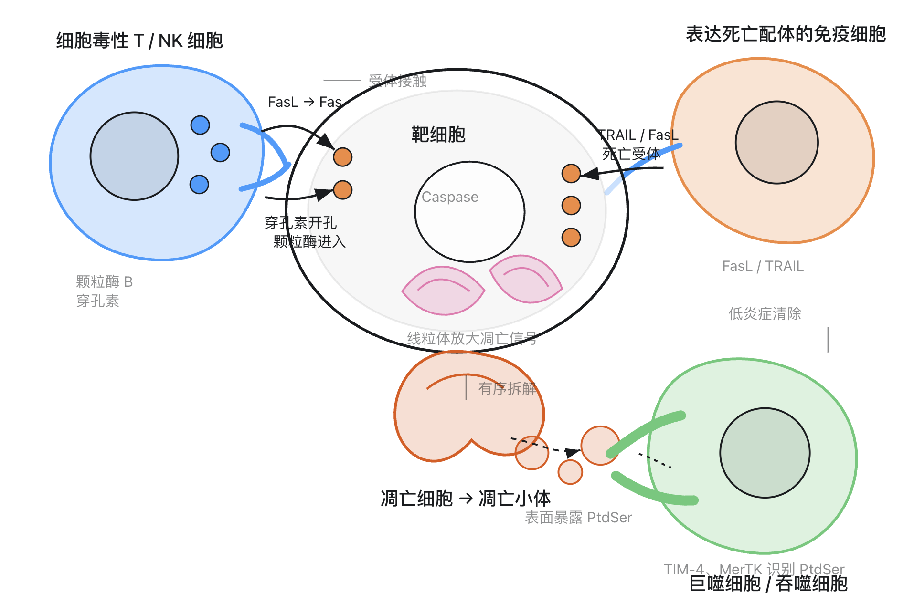
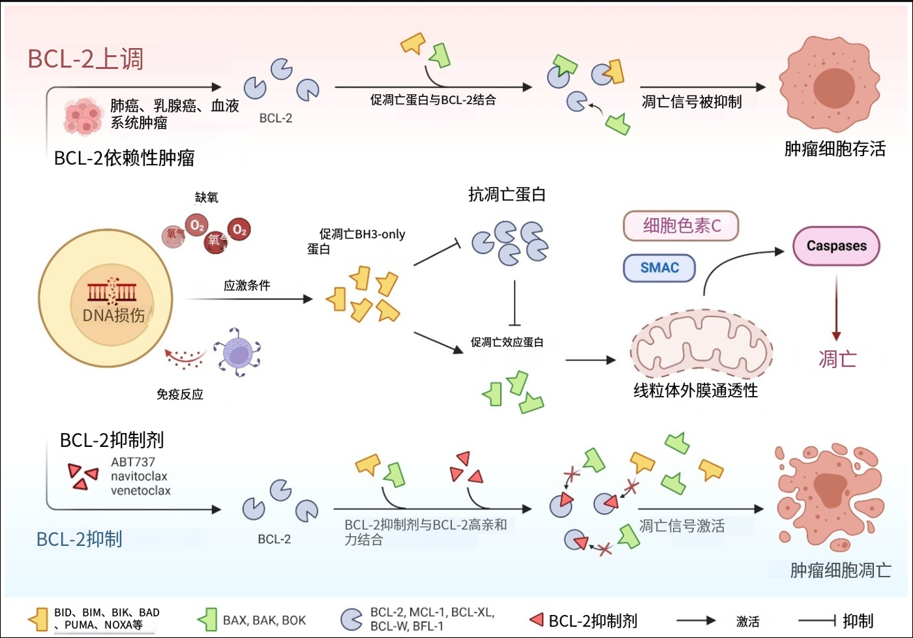
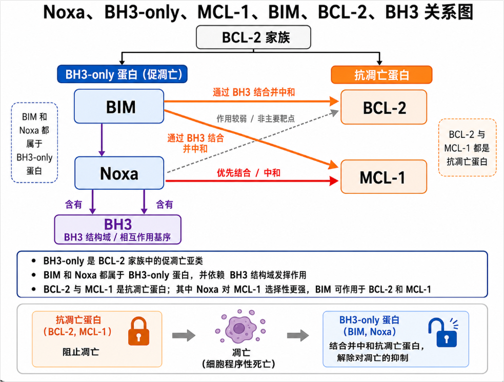
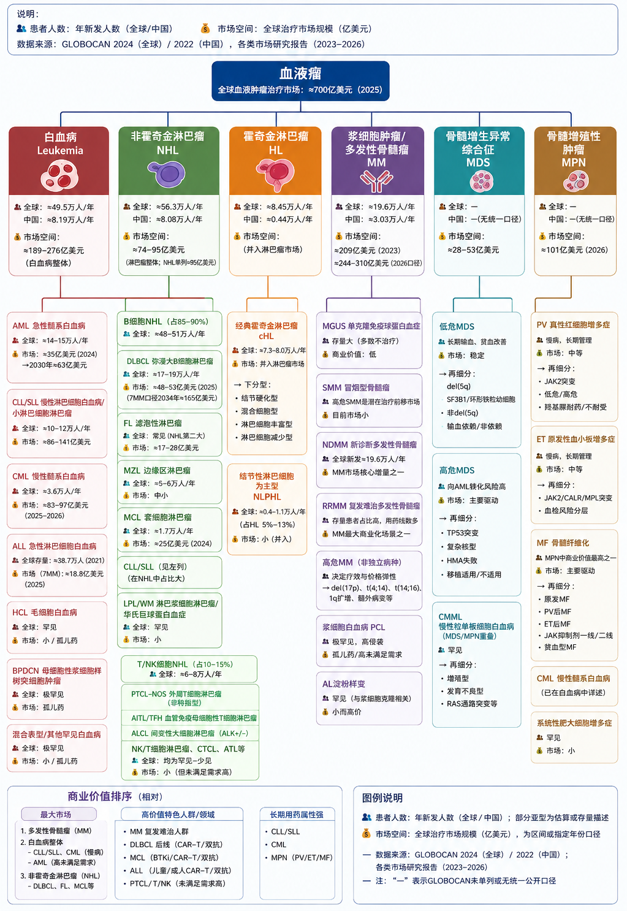
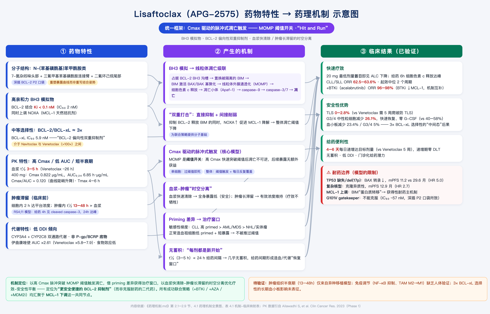
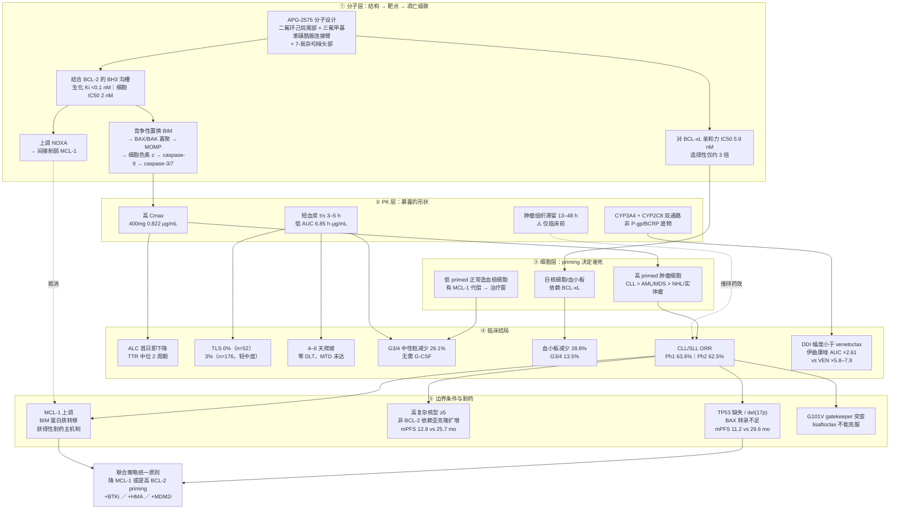
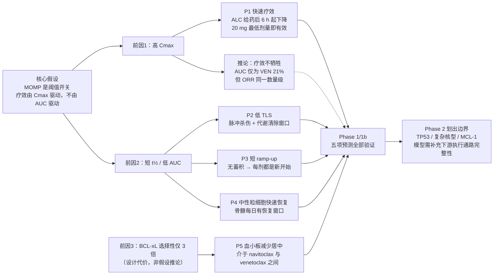

Lisaftoclax和Sonrotoclax都是短半衰期的药物（3～6h），为什么Sonrotoclax爬坡方案是每周一次，而Lisaftoclax可以做到每日一次

> 既然 PK 相似，**爬坡快慢主要是 TLS（肿瘤溶解综合征）风险管理策略和临床开发路径的选择，而非药代动力学决定的**。
>
> 亚盛的论证逻辑是：短半衰期 + 高 Cmax + 低总暴露（AUC）→ BCL-2 抑制是 Cmax 驱动的，快速触发凋亡阈值后药物迅速清除，血浆滞留有限 → TLS 风险低 → 因此**敢**做 5 天日爬坡。其 I 期在剂量高至 1200 mg 时未观察到 TLS（后续 1b/2 期 176 例中有 5 例 TLS，2.8%，均可快速恢复并继续用药）。
>
> 百济则选择了保守的每周爬坡——同样短半衰期，但没有押注在压缩爬坡上，而是靠效价和疗效数据竞争。
>
> 所以「日爬坡」是 lisaftoclax 刻意打造的差异化卖点（缩短约 1 个月住院/监测期，减轻患者和医疗系统负担），不是 sonrotoclax 做不到，而是两家的开发取舍不同。


真的不是Sonrotoclax做不到吗？

>  真正影响爬坡速度的是什么？——不是药物清除速度，而是肿瘤消减动力学？半衰期决定的是两次给药之间药物洗脱多干净，爬坡需要解决的是，每增加一次用量，肿瘤被杀死细胞释放的内容是，机体能否代谢掉。
>
>  更强的BCL-2i会导致更快更多的凋亡， 即释放出更多细胞裂解物 ，TLS风险更高。


你说的是哪篇论文（BCL-2 抑制剂的杀伤是 Cmax 驱动的——这一点亚盛自己的论文明确写了）

> **Ailawadhi S, Chen Z, Huang B, Paulus A, Collins MC, Fu L, et al.** "Novel BCL-2 Inhibitor Lisaftoclax in Relapsed or Refractory Chronic Lymphocytic Leukemia and Other Hematologic Malignancies: First-in-Human Open-Label Trial." *Clinical Cancer Research*, 2023.
> DOI: [10.1158/1078-0432.CCR-22-3321](https://doi.org/10.1158/1078-0432.CCR-22-3321)
>
> 即亚盛 APG-2575 的**全球首次人体（FIH）I 期试验**论文，句子出现在 **Discussion 部分**。

#### 原文

> "Mechanistically, BCL-2 inhibitors rapidly achieve a mitochondrial threshold that triggers apoptosis; thus, **their effects are driven by Cmax**.⁵ Lisaftoclax was designed as a potent and efficacious BCL-2 inhibitor with a unique pharmacokinetic profile, including a high Cmax and a shorter t½ (3–5 hours) compared to venetoclax (26 hours),²⁵ resulting in a high Cmax but relatively low systemic exposure."

同一篇论文在讨论 BH3 profiling 结果时又重复了一次：

> "...indicating that the antileukemic activity of lisaftoclax depends on BCL-2 priming and on-target disruption of BCL-2 complex, **a Cmax-dependent phenomenon**."


> 1. **这句话带引用标记 ⁵**——也就是说 "Cmax 驱动" 这个机制主张**不是亚盛的原创发现，是引用他人文献**（应为 venetoclax 的 PK/PD 或暴露-反应研究）。亚盛是在**援引**这个前提来支撑自己的设计逻辑，而非自己证明的。我没有核实文献 5 的具体出处。

> 2. **我用它来反驳亚盛，逻辑上要小心。** 亚盛的完整论证不是「短半衰期降低 TLS」这么简单，而是：高 Cmax 保证**疗效**（Cmax 驱动杀伤），短 t½ + 低 AUC 降低**累积毒性和血浆滞留**。这是一个「疗效靠 Cmax、安全靠低 AUC」的解耦论证，本身是自洽的。

> 我的批评应当限定为：**这套论证不足以解释急性 TLS 的减少**，因为急性 TLS 来自 Cmax 驱动的那一次杀伤，低 AUC 帮不上忙。亚盛把 TLS 安全性也归因于 "limited plasma residence and exposure"（原文如此）——这一步归因是我认为薄弱的地方。

> 3. **注意作者构成**：Zi Chen、Lei Fu 等多位作者是亚盛雇员及持股人（前一轮搜索到的 ASH 摘要披露栏可见）。这不否定数据，但「日爬坡更方便、更 user-friendly」属于**公司自身的解读性主张**，不是独立第三方结论。


## NCT06697184、NCT06839053 爬坡方案

两项试验的公开程度差别很大：SONIC 有完整剂量表，BGB-11417-108 没有公开。

| 周      | 天          | 日剂量                 |
| ------- | ----------- | ---------------------- |
| Week 1  | D1–3 / D4–7 | 1 mg / 2 mg            |
| Week 2  | D1–3 / D4–7 | 5 mg / 10 mg           |
| Week 3  | D1–3 / D4–7 | 20 mg / 40 mg          |
| Week 4  | D1–3 / D4–7 | 80 mg / 160 mg         |
| Week 5+ | —           | **320 mg（目标剂量）** |

28 天内 8 个剂量台阶，每 3–4 天升一档。起始剂量 1 mg——对比 venetoclax 起始 20 mg、lisaftoclax 起始 20 mg，sonrotoclax 起点低 20 倍。这正是效价差异的直接体现。

另外说明书原文措辞值得注意：*"The ramp-up dosing schedule is designed to gradually **reduce tumor burden (debulk)** and decrease the risk of TLS."* ——FDA 标签层面明确写了爬坡的作用是渐进减瘤，而不是让血药浓度慢慢适应。这直接印证了前面那个论点：限速环节是肿瘤消减，不是药物清除。


## NCT06697184、NCT06839053 这两个临床有结果了吗

直接回答：两项都还没有结果

|                  | NCT06697184（BGB-11417-108） | NCT06839053（SONIC）      |
| ---------------- | ---------------------------- | ------------------------- |
| 当前状态         | **RECRUITING**（招募中）     | **RECRUITING**（招募中）  |
| 实际启动         | 2025-01-23                   | 2025-06-02                |
| 主要完成（预计） | **2029-11-30**               | **2028-08-01**            |
| 全部完成（预计） | 2032-11-30                   | 2032-07-01                |
| 结果板块         | 无（`hasResults: false`）    | 无（`hasResults: false`） |
| 结果首次提交     | 无                           | 无                        |
| 记录最后更新     | 2026-08-06                   | 2026-04-17                |

ASH 2025 上的 SONIC 摘要（#2136）归类为 **"Trials in Progress"**，属于试验设计介绍，本身不含任何患者数据。按主要完成时间推算，**BGB-11417-108 的爬坡优化结果最早也要 2030 年前后**才可能进入说明书。

但查证过程中发现一件事，需要修正我前几轮的框架

**Eyre TA, Song Y, Hermine O, 等.** "Phase I/II Study of Sonrotoclax (BGB-11417) Monotherapy in Patients With Mantle Cell Lymphoma Previously Treated With Anti-CD20 Therapy and a Bruton Tyrosine Kinase Inhibitor." *J Clin Oncol.* 2026;44:2233–2243（2026-08-10 在线）。试验 BGB-11417-201 / NCT05471843，数据截止 2025-07-18。

该文披露：125 例患者中——

- **52.0%（65/125）采用「每日爬坡」方案（daily ramp-up）**
- 48.0%（60/125）采用「简化的每周两次爬坡」方案（two dose increases per week）
- **两种方案都是在约 4 周内达到目标剂量**

也就是说：sonrotoclax 早就有每日爬坡方案，而且用在了注册性试验里

我前面把差异描述成「lisaftoclax 每日爬坡 vs sonrotoclax 每周爬坡」——**这个框架是错的**。真正的差异不在**升阶频率**，而在**总跨度和台阶数**：

|             | 起始剂量 | 目标剂量   | 需跨越倍数   | 达标时间              |
| ----------- | -------- | ---------- | ------------ | --------------------- |
| Sonrotoclax | **1 mg** | 320 mg     | **320 倍**   | ~4 周（即使每日升阶） |
| Lisaftoclax | 20 mg    | 400–600 mg | **20–30 倍** | 4–6 天                |

**这反而更干净地回答了你最初的问题**：sonrotoclax 需要 4 周不是因为它每周才升一次阶，而是因为它的效价（比 venetoclax 强 14–24 倍）迫使起始剂量必须低到 1 mg，于是要爬完 320 倍的跨度——即便每天升阶也需要那么多台阶。

**效价 → 低起始剂量 → 大跨度 → 长爬坡期。** 这条因果链完全绕开了半衰期，也印证了我前面的论点：PK 不是限速因素。

另一处需要修正：TLS 不是零

我前面引用 I 期 CLL/SLL + 泽布替尼数据说 sonrotoclax "临床和实验室 TLS 均为零"。但在 MCL 单药注册试验中：

> **TLS 发生率 7.0%，所有病例均缓解且无后遗症。**

其他安全性数据（320 mg 组 n=115）：中性粒细胞减少 35.7%（≥3 级 19.1%）、血小板减少 24.3%（9.6%）、贫血 24.3%（7.8%）。
疗效：ORR-IRC 52.4%（vs 历史对照 30%，P<0.0001）、CR 率 15.5%、中位 DOR 15.8 个月、中位 PFS 6.5 个月、TP53 突变亚组 ORR 59.1%。

**关于 7.0% vs lisaftoclax 2.8% 的对比——不要直接比。** 理由：

1. **瘤种不同**：MCL 常为大包块（bulky）疾病，基线 TLS 风险本就显著高于 CLL/SLL
2. **单药 vs 联合**：这里是 sonrotoclax 单药；lisaftoclax 1b/2 期数据混合了单药与联合队列
3. **患者线数不同**：MCL 队列中位既往 3 线、78.3% IV 期，属重度经治
4. TLS 判定标准和监测密度也可能不同

跨试验比较 TLS 率在方法上是不可靠的。**目前没有两药头对头数据。**

---

**订正汇总**（前几轮我说错或说得不准的地方）：

1. ❌「sonrotoclax 半衰期更长」→ 两者都约 5 小时
2. ❌「sonrotoclax 每周一次给药」→ 两者都是每日一次（QD）维持
3. ❌「每周爬坡」→ 获批说明书是 28 天内 8 个台阶、每 3–4 天升一档
4. ❌「sonrotoclax 只有每周/每周两次爬坡」→ **注册试验中一半患者用的是每日爬坡**，真正的差异是总跨度而非频率
5. ❌「sonrotoclax 零 TLS」→ MCL 单药注册试验中为 7.0%


---

## 论文中文翻译和引用文献具体说明

> https://doi.org/10.1158/1078-0432.CCR-22-3321

第二件事：引用文献 5 的真实身份

通过 Crossref 取到该论文完整参考文献表（共 32 条），bib5 即：

> **Kalkavan H, Green DR.** "MOMP, cell suicide as a BCL-2 family business." *Cell Death & Differentiation*. 2018;25(1):46–55.
> DOI: [10.1038/cdd.2017.179](https://doi.org/10.1038/cdd.2017.179) · PMID: 29053143 · PMC5729535（Europe PMC 可读全文）

作者是 St. Jude 的 Douglas R. Green——细胞死亡领域的权威（h-index 201）。

关键发现：这篇文献并不支持那个 Cmax 主张

Kalkavan & Green 2018 是一篇细胞凋亡机制的综述（review），不是药代动力学或暴露-反应研究。 其主题是 MOMP（线粒体外膜通透化）如何进行、cytochrome c 与 SMAC 如何编排 caspase 激活、以及 BCL-2 家族如何调控这个决策网络。全文层面不涉及任何药物浓度-时间关系、Cmax、AUC 或临床 PK。

所以亚盛论文那句话的结构是：

| 分句                                       | 是否由文献 5 支持                                            |
| ------------------------------------------ | ------------------------------------------------------------ |
| "BCL-2 抑制剂快速达到触发凋亡的线粒体阈值" | 支持。MOMP 是快速、阈值化、且是「不可回头点（point of no return）」的承诺事件——这是 Kalkavan & Green 的核心内容 |
| "**因此**，其效应由 Cmax 驱动"             | **不支持**。这是亚盛作者自己做的药理学外推，文献 5 没有论证从「阈值化生物学」到「Cmax 驱动药效学」这一跳 |

也就是说，**这句话把一篇基础生物学综述当作了 PK/PD 主张的引用依据**。上标 ⁵ 覆盖的是前半句的生物学前提，不是后半句的药代结论。

平心而论：从「MOMP 是阈值触发的不可逆事件」推出「峰浓度比暴露时长更重要」，**在直觉上是合理的**，这不是伪科学。但它是**未经该引用文献验证的推论**，而亚盛用这个推论支撑了自己产品差异化的核心论据（短 t½ + 高 Cmax = 疗效保留 + 安全性改善）。这类「引用一篇不直接支持结论的权威文献」的写法在药企主导的临床论文里很常见，读的时候要警惕。

顺带确认另一个引用：文献 25（venetoclax t½ 26 小时的出处）在参考文献表中对应 Roberts AW et al., *NEJM* 2016;374:311（bib12 是同一篇，编号在最终排印版可能有偏移，我取到的是 Crossref 的机器编号，与印刷版上标序号不必然一一对应——这一点请以实际 PDF 为准）。

---

第一件事：全文翻译，我不能提供

这篇论文发表在 *Clinical Cancer Research*（AACR 出版），**不是开放获取**——Crossref 记录里 license 字段为空，没有 CC 许可。把一篇受版权保护的论文完整翻译成中文，等于制作并分发它的中文版衍生作品，这我不做。

**可行的替代方案：**

1. **我给你一份详尽的中文结构化解读**——各节要点、全部关键数据、方法细节、以及我对论证薄弱处的批注。信息密度上对你理解这篇论文够用，且我可以加入你前几轮关心的批判视角。这是下面我直接给出的。
2. **你自己拿到全文后**，把 PDF 或正文贴给我，我可以逐段为你翻译讲解——处理你自己获取的文档没有问题。
3. 该文 PMID 为 37093145，可通过机构订阅、PubMed Central（若已过 embargo）或直接向通讯作者索取 reprint 获取。

中文结构化解读

**标题**：新型 BCL-2 抑制剂 Lisaftoclax 治疗复发/难治性慢性淋巴细胞白血病及其他血液肿瘤：首次人体开放标签试验
**作者**：Ailawadhi S, Chen Z, Huang B, Paulus A, Collins MC, Fu L, 等
**出处**：*Clin Cancer Res* 2023;29(13):2385–2393

**研究设计**

- 全球 I 期，开放标签，无盲法
- 剂量递增采用**单患者队列**（single-patient cohorts），以减少患者暴露于亚治疗剂量，并允许**患者内剂量递增**（intrapatient dose escalation）
- 每周期 28 天，每日一次口服
- 数据截止：2022 年 10 月 22 日

**爬坡方案（核心卖点）**

- D1 20 mg → D2 50 mg → D3 100 mg → D4 200 mg → D5 400 mg（400 mg 目标剂量者，D5 即 C1D1）
- **所有患者爬坡期住院**，密切监测 TLS
- TLS 预防：首剂前 **≥72 小时**起口服降尿酸药（推荐拉布立酶）+ 口服水化；住院期间静脉水化

**入组情况**

- 52 例，剂量范围 20–1,200 mg，剂量递增阶段已完成
- 中位年龄 68 岁（39–89），男性 36 例（69.2%）
- 瘤种含 CLL/SLL、MM（11 例，21.2%）等
- **最高剂量组未达到剂量限制性毒性（DLT）**

**药代动力学（关键数据）**

- t½ ≈ **3–5 小时**；Tmax 中位 3–6 小时（全剂量范围 3–8 小时）
- 暴露量（Cmax、AUC₀₋₂₄）随剂量上升，但**个体间变异很大，CV ≈ 72%**
- 多次给药**无明显蓄积，蓄积比 ≈ 1**
- 400 mg 稳态：Cmax 981 ng/mL（CV 43%）；AUC₀₋₂₄ 10,130 ng·h/mL（CV 40%）
- 对照：venetoclax t½ ≈ 26 小时

**疗效**

- R/R CLL/SLL：**ORR 63.6%**
- del(17p) 亚组：ORR 66.7%（初步数据）
- 最低剂量 20 mg 即观察到 ALC（绝对淋巴细胞计数）快速下降，最早给药首日即出现

**安全性**

- **未观察到 TLS**（临床或实验室），即使在缩短的 5 天爬坡下、以及 1,200 mg 高剂量
- 部分孤立 TLS 生化指标有变化，但多在 24 小时内恢复，无一例构成完整 TLS
- 3/4 级中性粒细胞减少 **26.1%（6/23 例可评估 CLL/SLL）**，且恢复快
- **与双靶点 BCL-2/BCL-xL 抑制剂 navitoclax 不同，未引起临床显著的血小板变化**（提示 BCL-xL 选择性良好）

**药效学（BH3 profiling）**

- Lisaftoclax 快速改变 CLL/SLL 患者样本中的 BCL-2 复合物，与临床 ALC 快速下降一致
- BIM 肽触发 cytochrome c 释放呈剂量依赖，**PBMC 中比 BMMC 中更强**
- 基线时 BIM 和 BAD 肽反应在 **BMMC 中低于 PBMC**，说明骨髓来源细胞凋亡阈值更高（可能因骨髓微环境的保护作用）——临床上对应**外周血白血病细胞先清除、骨髓后清除**
- BAD 肽反应与 ALC 正常化时间的相关性受爬坡时长和剂量差异干扰（400–1,200 mg 队列爬坡 4–8 天）
- **cytochrome c 释放与剂量未呈现关系**（作者如实报告了这个不一致）

**作者结论**
Lisaftoclax 具有独特的 PK 特征，可支持相较于每周爬坡"更方便（user friendly）"的每日爬坡方案，并在 CLL/SLL 中诱导快速临床反应，值得继续研究。相比 venetoclax 的每周爬坡，缩短约 1 个月的爬坡期可减少限制治疗的不良反应（血小板减少、中性粒细胞减少、TLS）。

我对这篇论文的批注（不是论文内容）

1. **"每日 vs 每周爬坡更方便"的论证被住院要求削弱**——爬坡期全员住院 + 拉布立酶预防 + 静脉水化，这套配置本身就是医疗资源消耗。论文声称"减轻医疗系统负担"，但没有量化对比。
2. **"未观察到 TLS"是 52 例的 I 期结果**，样本量小。后续 1b/2 期扩至 176 例时出现 5 例 TLS（2.8%，2 例临床 + 3 例实验室）——**I 期的零 TLS 不可外推**。
3. **PK 变异极大（CV 72%）**，这对一个宣称"靠 Cmax 驱动疗效、靠低 AUC 保证安全"的机制论证是个隐患：如果个体间 Cmax 差 3 倍，那么"精确落在治疗窗内"的说法就站不住。论文没有讨论这一点。
4. **将安全性归因于"limited plasma residence and exposure"是薄弱环节**（前几轮已讨论）：急性 TLS 由 Cmax 驱动的那一次杀伤造成，低 AUC 帮不上忙。
5. **利益披露**：多位作者（Zi Chen、Lei Fu 等）为亚盛雇员及持股人。数据本身有同行评议背书，但"user friendly"这类解读性表述属公司立场。


### 

## 我还是不能理解你说的能撑开窗口的维度是「时间」，不是「亲和力」，这是动力学窗口（schedule），不是亲和力窗口（affinity）。它半衰期短，那杀完了细胞，不是也可以有时间让正常髓系祖细胞恢复吗


这是个好问题，而且指向了一个真实的混淆点：**「短半衰期」和「间歇给药」看起来都是"给恢复时间"，但它们作用在两个完全不同的时间尺度上，而且不能互相替代。**

先让我核实一个对比数据。

你的直觉不能算错——短半衰期**确实**有帮助，但它是二阶效应。核心问题在于：**你想逃的那个毒性，它自己的时钟是几小时还是几周。**

|                          | 时间尺度          | 短半衰期能管吗       |
| ------------------------ | ----------------- | -------------------- |
| 血药浓度的涨落           | **小时**（4–6 h） | 能，这就是它的作用域 |
| 粒细胞生成流水线走完一遍 | **约 10–14 天**   | 管不着               |

中性粒细胞的产出不是一个"开关"，是一条流水线：

```
静止 HSC → CMP → GMP → 早幼粒 → 中幼粒 → 晚幼粒 → 带状核 → 成熟中性粒细胞
└──────────── 约 10–14 天 ────────────┘
```

而循环中成熟中性粒细胞的半衰期只有 **7–10 小时**。

所以：**今天的血中性粒细胞数，是 10–14 天前装进流水线的那一批的产出。** 你今晚把药清干净了，明天早上的中性粒细胞数一点都不会因此变好——它取决于两周前那一批的命运。

#### 二、决定性的一点：凋亡不可逆

这是你的推理里缺的那块。

对一个**可逆占据型**靶点（比如激酶抑制剂阻断增殖信号），药物清除 → 信号恢复 → **什么都没损失**。短半衰期直接等于"给了恢复时间"。

但 BCL-2 抑制的终点是**细胞死亡**。第 3 小时在 Cmax 被杀死的那个 GMP，不会在第 20 小时药物清空的时候活回来。

> **占据率是可逆的，死亡是吸收态。药理效应清零了，但生物学损伤留在账上。**

这类药的正确类比不是"受体阻断剂"，而是**化疗/放疗**——伤害按**暴露事件次数累加**。

#### 三、一个玩具模型（示意，非真实数据）

设单次每日脉冲杀掉 BCL-2 依赖祖细胞池的比例 f。短半衰期把 f 从 30% 降到 15%，看着是腰斩了。连续给药 28 天：

| 单次杀伤 f       | 28 天后存活分数         |
| ---------------- | ----------------------- |
| 0.30             | 0.70²⁸ ≈ **1.3 × 10⁻⁵** |
| 0.15（短半衰期） | 0.85²⁸ ≈ **1.1 × 10⁻²** |

改善了 800 倍，**但两个都是流水线抽干**。

换成 10 天给药 / 18 天停药：

|               |                                    |
| ------------- | ---------------------------------- |
| f=0.15，10 天 | 0.85¹⁰ ≈ **0.20**（20% 存活）      |
| 随后 18 天    | ≈ 一个完整的粒细胞生成周期，够重建 |

数学结构是这样的：

- **降低单次杀伤（亲和力/半衰期）→ 改变指数的底数 → 线性级改善**
- **减少脉冲次数（给药天数）→ 改变指数本身 → 指数级改善**

指数永远赢。**这就是"时间维度"和"亲和力维度"不对等的原因。**

#### 四、短半衰期到底保护了什么

它保护的是**储备（reservoir）**，不是**产出（output）**。

- 静止期 HSC 相对不依赖 BCL-2（更偏 MCL-1/BCL-xL，且未被 BIM"预激"）→ 每日脉冲杀不掉它们 → 骨髓不会被永久清空。短半衰期在这里帮忙。
- 但把一个存活的 HSC 变成一个循环中性粒细胞，需要走完那 10–14 天的旅程，而**整条旅程都穿过 BCL-2 依赖区**。你每天开一枪，每一批试图通关的细胞都在半路被打掉。

> **短半衰期让种子活下来；只有足够长的无药走廊，种子才能真的走到终点。**

#### 五、为什么"排期"能撬到真实的不对称性，而"亲和力"撬不到

一句话：**不对称性存在于时间轴上，不存在于浓度轴上。**

- 浓度轴：一个 AML 原始细胞和一个正常 GMP，BCL-2 就是同一个蛋白，结构一样，亲和力一样。**这里没有任何差异可以利用。** 提高效力，两条曲线一起左移，比值不动。
- 时间轴：正常造血**有静止干细胞储备 + 有一套定义清楚的约两周再生程序**；缓解期的白血病克隆已被压到低负荷，其再生动力学与之不同。**这是一个真实存在的差异。**

药物设计的铁律是：**你只能利用真实存在的差异。** AML 里 BCL-2 的差异不存在，再生动力学的差异存在。所以排期是唯一接得上力的杠杆。

#### 六、经验检验：这个实验已经做过了

这不是理论推演。sonrotoclax **就是那个短半衰期分子**。如果你的假设成立，它在 AML 的骨髓抑制应该明显优于 venetoclax。

|                           | ven+aza（VIALE-A, n=283） | sonro+aza（TN unfit AML, n=79）      |
| ------------------------- | ------------------------- | ------------------------------------ |
| ≥3 级中性粒细胞减少       | 42%                       | **88.6%**\*                          |
| ≥3 级发热性中性粒细胞减少 | 42%                       | （含在上面）                         |
| ≥3 级血小板减少           | 45%                       | **64.6%**\*                          |
| ≥3 级感染                 | 64%（任意级 84%）         | 48.1%                                |
| 治疗相关死亡              | —                         | 2 例（贫血；中性粒细胞减少性脓毒症） |

\* sonrotoclax 用的是**合并术语**（中性粒细胞减少 + 计数降低 + 发热性 + 粒细胞缺乏 + 中性粒细胞减少性脓毒症/感染），会显著抬高数字；VIALE-A 是分列术语。人群、随访、剂量队列也都不同。

**所以跨试验直接比较不可靠——但也正因如此，可以下一个稳健的结论：短半衰期没有换来任何量级上的骨髓抑制优势。** 没有变好，就足以否证"短半衰期能解决问题"。

#### 七、反向的证据：VIALE-A 自己就在用排期这个杠杆

同一篇 NEJM 里：

> 因中性粒细胞减少而**中断给药者占 53%**；≥2 次因计数恢复而中断者占 15%。

也就是说，ven+aza 在真实世界里**本来就靠缩短暴露天数活着**——只不过是被动的、非计划的中断（临床实践后来演化出主动的 21 天 / 14 天方案）。BeOne 在 103 研究里做的（10/14/21/28 天四种时长）就是把这件事从被动变主动、系统化搜索。

而且被动中断比主动排期更糟——它同时打掉剂量强度。这大概就是那条容易读反的观察的机制：

> ">14 天给药队列的多次减量 / 因复发停药比例最高"

不是"给久了导致复发"，而是**给久了 → 严重血细胞减少 → 被迫减量和中断 → 实际剂量强度掉下来 → 复发**。上一轮我把这句话框成"窗口两头都堵"，说得太对称了，这里更准确的表述是：**给药时长存在一个最优点，越过它是自伤。**

---

#### 一句话总纲

> **要匹配药物性质和你想逃的那个毒性的时钟。**
>
> - **TLS 的时钟 = 小时**（肿瘤在首剂后数小时内崩解）→ 半衰期是对的杠杆 → sonrotoclax 在 CLL 真的赢。
> - **骨髓抑制的时钟 = 两周**（粒细胞生成流水线的转运时间）→ 排期是唯一的杠杆 → 半衰期在 AML 基本无用。

同一个分子性质，在两个适应症里价值差一个量级。这也是第一个问题里"治疗窗由正常骨髓定"的完整含义：**限速环节不在你的分子上，而在别人的时钟上。**

---

## 照你这个说法，Lisaftoclax 在 AML 领域应该也会表现很差才对

这是对我的论证的一次正当检验。我的论证确实**预测**了这一点——那就去查数据，如果对不上，是我的论证有问题。

先明确我的预测是什么，避免事后找说法：

1. lisaftoclax + 阿扎胞苷在 AML 里应有**重度骨髓抑制，与 ven+aza 同级，不会更好**
2. 4–6 小时的半衰期在 AML **不产生窗口优势**（尽管它比 sonrotoclax 的还短）
3. 它的 AML 项目也应该**卡在排期搜索上**，且优先级低于 CLL

去查。

数据查到了，而且这个检验的结果值得仔细说——**表面上看像是反驳了我，但拆开之后是印证。** 我先把不利于我的数据摆出来。

---

#### 一、表面上：lisaftoclax 的 AML 安全性数据看起来更好

APG2575AU101（NCT04964518），ASH 2025，n=103（63 AML/MPAL + 40 HR-MDS/CMML），截止 2025-07-01：

| ≥3 级事件              | lisaftoclax + aza        | ven + aza（VIALE-A） |
| ---------------------- | ------------------------ | -------------------- |
| 中性粒细胞减少         | **41.7%**                | 42%                  |
| 发热性中性粒细胞减少   | **35.0%**                | 42%                  |
| 血小板减少             | **26.2%**                | 45%                  |
| 贫血                   | **17.5%**                | 26%                  |
| 脓毒症                 | 10.7%                    | 6%                   |
| 因中性粒细胞减少而减量 | **3%**                   | 中断给药 **53%**     |
| DLT / MTD              | 无 DLT，MTD 未达到       | —                    |
| 60 天死亡率            | 未报告（ASCO 2025 口径） | 30 天死亡率 7%       |

**"3% 减量" vs "53% 中断"** 这一对看着像是把我的论证打穿了。

先说清楚：如果这个对比是干净的，我的论证就该修正。但它不干净，而且不干净到无法用于检验。

---

#### 二、这个对比为什么不能用

**1. 累积暴露差了 3 倍以上——这是致命的。**

骨髓抑制是**累积**的（这正是我上一轮的核心机制）。

- APG2575AU101：中位治疗 **2 个周期**（0–16）；R/R AML 组中位 3.7 个月
- VIALE-A：中位 **7.0 个周期**

ven+aza 的血细胞减少主要在第 2–6 周期堆出来。**用一个中位 2 周期的研究去比一个中位 7 周期的研究，等于在流水线还没抽干的时候就收数据。** 这不是 lisaftoclax 的优点，是随访窗口的产物。

**2. 人群完全不同。** 63 例 AML 里 **56 例是 R/R**；VIALE-A 是 100% TN unfit。R/R 患者因进展快速脱落 → 暴露短 → 累积不出细胞减少。**早期进展和死亡本身就在"审查"掉毒性。**

**3. 40/103 是 MDS/CMML**，强度设定低于 TN unfit AML，且该组 RP2D 就是 **14 天**。把它混进分母会稀释。

**4. Ph1b/2 篮子研究 vs Ph3 注册研究，AE 捕获强度系统性不同。** 这是公认的跨试验比较陷阱。

**5. 术语口径不同。** lisaftoclax 把"中性粒细胞减少 41.7%"和"发热性 35.0%"分列；sonrotoclax 用的是合并术语（88.6%）；VIALE-A 也分列。三者之间任何两两比较都需要重算，而原始数据不公开。

**结论：这组 AE 对比在检验我的命题上，信息量接近零。** 我不会拿它当支持，也不接受它当反驳。

---

#### 三、真正的检验：看试验设计，不看 AE 表

设计选择比 AE 数字诚实得多——**它记录的是研究者实际相信什么。**

> Part 2: LISA 200/400/600 mg QD **over 28 or 14 days** of 28-day cycles
>
> RP2D for TN HR-MDS: LISA 600 mg on **days 1–14**

以及效力：

| R/R AML               | ORR       | CR        |
| --------------------- | --------- | --------- |
| 28 天给药（n=36）     | 38.9%     | 27.8%     |
| **14 天给药（n=11）** | **45.5%** | **36.4%** |

（n=11，噪声主导，但方向和 sonrotoclax 完全一致。）

**这就是决定性的一点：**

> lisaftoclax 的半衰期是 **4.2–6.6 小时**——目前 AML 领域所有 BCL-2i 里最短的。如果短半衰期足以让骨髓自己恢复，**亚盛就根本不需要在方案里放一个 14 天 vs 28 天的对照，也不会把 MDS 的 RP2D 定在 14 天。** 直接 28 天连续给药就完事了。

而实际发生的是：**两个独立公司、两个不同的短半衰期分子，各自从不同方向出发，都收敛到了"缩短给药天数"这同一根杠杆上。**

- BeOne / sonrotoclax：搜索 10 / 14 / 21 / 28 天
- Ascentage / lisaftoclax：搜索 14 / 28 天，MDS 落在 14 天

**这正是"窗口是动力学的、不是亲和力的"所预测的结果。** 如果短半衰期已经解决了问题，排期轴不会成为两个项目的主战场。

---

#### 四、更关键的一刀：低毒性可能只是低剂量

这是回答你问题的核心。

**你永远可以用降低剂量换取耐受性——那不是窗口变宽，那只是在同一条曲线上往左移。** 判断是"更好的曲线"还是"曲线上更低的点"，唯一办法是看**效力有没有一起掉下来**。

看 lisaftoclax 的生存数据：

|                                        | 中位 OS       |
| -------------------------------------- | ------------- |
| lisaftoclax + aza，**新诊断** AML/MPAL | **6.3 个月**  |
| lisaftoclax + aza，R/R AML/MPAL        | 7.6 个月      |
| lisaftoclax + aza，新诊断 HR-MDS/CMML  | 未达到        |
| **ven + aza（VIALE-A），TN unfit AML** | **14.7 个月** |
| aza 单药（VIALE-A 对照臂）             | 9.6 个月      |

新诊断 AML 的中位 OS **6.3 个月，低于 VIALE-A 的阿扎胞苷单药对照臂**。

n 极小（ASCO 口径只有 7 例 TN AML）、人群更差、非随机——**这个数字不能用来判罪。** 但方向和"低毒性 = 低暴露 = 低效力"完全吻合，也和 sonrotoclax 的暴露-反应数据吻合（最低暴露三分位 CR 率只有最高组的 1/4）。

> **一个更宽的治疗窗，表现为"同样效力、更低毒性"。**
> **一个更低的剂量点，表现为"更低毒性、更低效力"。**
>
> 目前 lisaftoclax 的 AML 数据长得像第二种。

---

#### 五、以及：它自己的落点在哪里

最能说明问题的是 lisaftoclax **最好的数据不在 AML，在 MDS**：

|                            | ORR        | CR                   |
| -------------------------- | ---------- | -------------------- |
| 新诊断 HR-MDS/CMML（n=15） | **80.0%**  | 40%（+ 骨髓 CR 40%） |
| R/R AML/MPAL               | 38.9–45.5% | 27.8–36.4%           |
| ven 耐药 AML/MPAL（n=24）  | 29.2%      | 20.8%                |

而 MDS 恰恰是：原始细胞负荷低、不需要深度持续暴露、**14 天给药就够用**的场景。

**它去了那个动力学窗口本来就足够宽的适应症。** 这不是我的论证的反例，这是我的论证的推论。

反过来看 TN AML——那里 RP2D 定的是 **days 1–28**，全时长。因为在 AML 里你需要那个暴露。**窗口挤压在 AML 存在，在 MDS 不存在，所以两个药都往 MDS 和"ven 治疗后"这两个方向漂。**

---

#### 六、什么能真正证伪我

我应该把这条写清楚，否则上面全是不可反驳的叙事。

**能推翻我的证据：** 一个**同等给药时长、同等暴露**的对照，显示短半衰期 BCL-2i 达到**相同的 CR 率**时骨髓抑制显著更轻。

具体形式：

- 头对头 RCT（sonro 或 lisa vs ven，均 28 天给药，TN unfit AML），或
- 暴露-匹配分析：在达到相同 CR 率的暴露区间内，比较 ≥3 级中性粒细胞减少的发生率与持续时间

**这样的数据目前不存在。** 两家公司在 AML 都没有三期，都没有做暴露匹配的毒性对比。

**同时也要承认我可能只是部分对：** 短半衰期让每次脉冲的杀伤 f 变小是真的，这在**边际上**有价值——比如让 14 天方案比 venetoclax 的 14 天方案稍好一点。我主张的是它**不足以改变问题的性质**，不是它完全无用。

---

#### 一句话回答你的问题

**是的，我的论证预测 lisaftoclax 在 AML 也占不到便宜——而这基本就是发生的事情：**

新诊断 AML 中位 OS 6.3 个月（vs VIALE-A 14.7），ven 耐药 AML ORR 29%，AML 无三期，重心漂向 MDS 和 post-venetoclax。它看起来"毒性小"是因为随访短、人群是 R/R、混了 MDS，以及**它站在剂量-反应曲线更低的位置上**。

而最硬的印证是：**这个拥有全类别最短半衰期的分子，仍然需要靠"14 天 vs 28 天"来解决骨髓问题。** 如果半衰期能解决，这个对照就不会存在。


## 为什么AML里Venetoclax能成药，但MDS不行，这两个疗效和安全性的边界不是一样的吗？

疗效侧：为什么边界不一样

1. **治疗目标细胞群不同**。AML 骨髓被 ≥20%（常 >50%）的原始细胞占满，这群增殖中的 blast 高度 BCL-2 依赖——杀死它们就完成了疾病减负，残存正常 HSC 可以重建骨髓。这是"清场重建"逻辑。
2. **MDS 的病根是造血干细胞层级，不是后代细胞**。Colla 团队（MD Anderson，*Nat Med* 2022 + *Nat Commun* 2024）的系列研究把这个讲透了：MDS 的 HSC 层级有两种架构——**CMP 型**干细胞 BCL-2 依赖，Ven 能杀；**GMP 型**（粒-单核偏向）存活依赖已切换到 **TNFα/NF-κB 通路**，Ven 天然无效。所以 Ven+AZA 清掉的是敏感的克隆后代（→ mOR↑、输血独立↑），但**疾病 initiating 的干细胞克隆活下来了**（→ CR 不升、OS 不变）。更糟的是，复发时常见 **STAG2/RUNX1 突变克隆获得性扩增，把层级从 CMP 型重编程为 GMP 型**——即 Ven 治疗本身在选择耐药架构。
3. **分子背景更敌对**。HR-MDS 中 TP53 突变 ~21.6%（VERONA 基线）、ASXL1 ~31.8%、RUNX1 ~19.3%——TP53 突变对 BCL-2 抑制是**内在耐药**；而 AML 中 Ven 最敏感的 NPM1/IDH1/2 突变亚群在 MDS 里占比很低。
4. **衔接你已有的框架**：这和你之前梳理的"AZA 单药对 MDS 有效、BCL-2 单药无效、MCL1 抑制须先于 BCL2"是同一个逻辑链条的下游。MDS 克隆的 BCL-2 依赖本身就不稳定（部分亚克隆转向 MCL1/NF-κB 存活），AZA 对 MCL1 的下调在 MDS 这种异质克隆中不足以制造稳定的合成致死窗口。

安全性侧：边界同样不一样

- MDS 的**定义性特征就是基线血细胞减少**（无效造血：骨髓高增殖但高凋亡），患者中位年龄 72 岁，残存正常造血本就脆弱且与恶性克隆物理混杂。
- 在 AML 里，深度骨髓抑制的代价被"清场后造血重建"对冲；在 MDS 里，**克隆没根除，骨髓就没有重建的资本**——Ven 的无差别促凋亡打到正常祖细胞就是纯损失。VERONA 的毒性数字（≥3级中性粒细胞减少 76.9%、78.8% 剂量中断）反映的正是这个不对称：**疗效上限更低，毒性下限更高，治疗窗两头被挤**。

一句话总结

AML 里 Venetoclax 是"除草后土壤还能长回庄稼"；MDS 里是"杂草和苗根连在一起，除草剂只杀死了杂草的叶子，根（干细胞层级）换了条存活通路继续长，苗还先被药死了"。

**对 Lisaftoclax 的启示**：亚盛在 MDS 的布局要面对的就是 VERONA 这堵墙——单纯的"更好的 BCL-2 抑制剂"解决不了层级异质性问题。值得跟踪的差异化路径是：Lisaftoclax 更短半衰期能否带来更浅的慢性骨髓抑制（安全端）、以及在 MDS 中与 MCL1 通路干预的序贯/联合设计（疗效端）。这两点是否成立，目前**无头对头数据，标记为待验证假设**。


# 药理机制


1. APG-2575最显著的特征是短半衰期（t1/2 3-6小时）配合高Cmax/低AUC的PK曲线
2. 低CYP3A4/P-gp依赖性


### 分子设计


lisaftoclax与venetoclax在P2口袋结合区域存在结构差异。Venetoclax的氯苯基深插入P2口袋底部，正是这一区域受G101V突变的"knock-on"效应影响最为显著。APG-2575采用二氟环己烷（difluorocyclohexane）尾部结构替代venetoclax的氯苯基，P2口袋结合模式更为浅表。理论上，这种差异化的结合模式可能降低G101V突变对亲和力的影响，但目前尚无公开的APG-2575与G101V突变BCL-2的晶体结构或表面等离子体共振（surface plasmon resonance, SPR）数据直接验证这一假设。相比之下，sonrotoclax（BGB-11417）的P2口袋浅结合策略已通过1.80 Å高分辨率晶体结构获得完整验证。APG-2575在单药克服BCL-2突变方面的能力目前仍属推测性，需更多结构生物学数据支撑。


#### 综述

Lisaftoclax 以**高 Cmax、短血浆半衰期和短 ramp-up**换取更便捷、潜在更可控的 BCL-2 抑制方案

核心模型为：药物快速达到足以跨越线粒体凋亡阈值的峰浓度，释放 BIM 并激活 BAX/BAK，触发不可逆的 MOMP；随后短血浆暴露限制正常组织持续受药，肿瘤组织滞留则可能维持疗效。该模型可解释早期 ALC 下降、0% TLS、4–6 天 ramp-up 及相对可控的血液学毒性。

现有数据支持其在 CLL/SLL 中的活性和联合治疗潜力，但 TP53 缺失/突变、复杂核型及 MCL-1 上调仍是关键疗效边界。

#### 1、靶点与凋亡通路

*对BCL-xL的抑制*

Lisaftoclax 是 BH3 模拟物，通过占据 BCL-2 的 BH3 结合槽，置换被隔离的促凋亡蛋白（主要为 BIM），继而激活 BAX/BAK、诱发线粒体外膜通透化（MOMP），启动 caspase 级联反应并执行凋亡。

其生化特征为 BCL-2 偏向、但仍保留 BCL-xL 抑制活性：BCL-2 IC50 约 2 nM，BCL-xL IC50 约 5.9 nM，MCL-1 IC50 >5,000 nM。因此，它更接近“BCL-2 偏向性双重抑制剂”，而非 venetoclax 式的高度 BCL-2 选择性抑制剂。细胞实验中，其对 BCL-2 与 BCL-xL 依赖细胞均有功能性活性。

2、Cmax脉冲式凋亡模型

快速达到有效细胞内浓度，触发肿瘤细胞凋亡

本报告的统一假设是：BCL-2 抑制的关键不是持续累积暴露，而是短时间内跨越凋亡阈值的峰浓度。MOMP 属于阈值型、不可逆事件；一旦足量 BIM 被释放并形成 BAX/BAK 孔道，后续维持高浓度的边际收益可能有限。

> 高Cmax，低AUC，没有持续压制，BIM为什么不被其他BCL-2拦截

肿瘤组织滞留（约 13–48 小时）大于血液滞留，血浆半衰期约 3–5 小时(venetoclax 约 26 小时)

肿瘤滞留数据目前主要来自临床前模型


#### 3、安全性

BCL-xL 在巨核细胞和血小板生存中重要。Lisaftoclax 约 3 倍的 BCL-2/BCL-xL 选择性提示存在血小板减少风险；但其短半衰期可能降低持续 BCL-xL 抑制，从而部分抵消这一风险。现有早期综合数据中，≥3 级血小板减少约 13.5%，仍需长期暴露数据确认。

对于 venetoclax 常见的 BCL-2 G101V 耐药突变，Lisaftoclax 的生化 IC50 约 57 nM、细胞 IC50 约 61 nM，活性并不显示其具有明确的耐药覆盖优势。因此，其主要竞争价值在安全性、给药便利性和联合方案，而非 G101V 克服能力。MCL-1 上调仍是最重要的旁路耐药机制。


细胞内进入更快、血液中停留更短、半衰期更快

至于 **P2 口袋**，可以把 BCL‑2 的疏水沟槽想成几格凹槽，P1、P2、P3、P4 是其中的不同“卡位”。Venetoclax 的一部分基团会较深地插入 P2；而 Sonrotoclax 的相应基团停在 P2 入口附近，位置更靠近 α4 螺旋，并形成额外的疏水、π–π 和水桥氢键相互作用。

APG‑2575 的卖点偏“PK 与细胞摄取”；Sonrotoclax 的卖点偏“P2 口袋新姿势与 G101V 耐药覆盖”


APG-2575（lisaftoclax）与venetoclax在P2口袋结合区域存在结构差异。Venetoclax的氯苯基深插入P2口袋底部，正是这一区域受G101V突变的"knock-on"效应影响最为显著。APG-2575采用二氟环己烷（difluorocyclohexane）尾部结构替代venetoclax的氯苯基，P2口袋结合模式更为浅表。理论上，这种差异化的结合模式可能降低G101V突变对亲和力的影响，但目前尚无公开的APG-2575与G101V突变BCL-2的晶体结构或表面等离子体共振（surface plasmon resonance, SPR）数据直接验证这一假设。相比之下，sonrotoclax（BGB-11417）的P2口袋浅结合策略已通过1.80 Å高分辨率晶体结构获得完整验证。APG-2575在单药克服BCL-2突变方面的能力目前仍属推测性，需更多结构生物学数据支撑。

Sonrotoclax（BGB-11417）是当前二代BCL-2抑制剂中抗耐药证据最充分的竞争者。其分子设计的核心创新在于采用7-氮杂螺[3.5]壬烷连接臂和(S)-2-(2-异丙基苯基)吡咯烷基团，形成"浅而广"的P2口袋结合模式——异丙基苯基位于P2口袋入口处，与F112形成edge-to-face π-π相互作用、与M115形成硫-π相互作用，而不深入P2口袋底部，从而完全规避G101V突变引起的空间位阻。功能验证显示，sonrotoclax在G101V异种移植模型中50 mg/kg诱导106%肿瘤生长抑制（tumor growth inhibition, TGI）并持续至第46天，而venetoclax同剂量仅61% TGI。对D103Y突变的亲和力高125倍于venetoclax，对A113G、V156D和R129L突变的亲和力亦高35-83倍。

**表2. APG-2575 vs Sonrotoclax抗耐药能力对比**

| 对比维度                   | APG-2575 (Lisaftoclax)             | Sonrotoclax (BGB-11417)                    | 战略含义                         |
| :------------------------- | :--------------------------------- | :----------------------------------------- | :------------------------------- |
| **P2口袋结合模式**         | 二氟环己烷，浅表结合（推测）       | 异丙基苯基吡咯烷，"浅而广"（晶体结构证实） | Sonrotoclax有结构生物学确证优势  |
| **G101V单药克服**          | 临床前联合数据支持，单药数据有限   | 强效克服，G101V模型TGI 106%                | Sonrotoclax单药抗突变能力更强    |
| **D103Y单药克服**          | 联合APG-115可克服                  | 亲和力高125倍于venetoclax                  | Sonrotoclax对D103Y同样有效       |
| **其他突变覆盖**           | 联合策略覆盖                       | A113G/V156D/R129L均有效                    | Sonrotoclax突变覆盖更广          |
| **联合策略丰富度**         | MDM2i+BTKi+FLT3i+HMA，内部管线齐全 | 主要聚焦+BTKi（泽布替尼）                  | APG-2575联合矩阵更丰富           |
| **venetoclax难治临床数据** | ORR 31.8%（ASCO 2025, n=22可评估） | 尚无公开数据                               | APG-2575有先发临床证据           |
| **PK特征支持**             | 短半衰期(3-6h)，快速爬坡(5天)      | 半衰期~4h，零TLS事件                       | 两者均优于venetoclax             |
| **p53通路协同**            | APG-115（MDM2i，内部管线）         | 外部合作/联合化疗                          | APG-2575+p53轴协同有内部整合优势 |


#### Cmax

**APG‑2575 的直接凋亡机制是靶点占领**——药物在细胞内结合 BCL‑2、破坏 BCL‑2:BIM 复合物，继而启动 BAX/BAK、线粒体外膜通透化和 caspase 凋亡；**较高的 Cmax 是帮助它在短时间内达到足够靶点占领的一种 PK 设计特征**。 

```
高 Cmax → 更快/更高的细胞内游离药物浓度 → BCL‑2 占领超过凋亡阈值 → BIM 释放 → BAX/BAK → 凋亡111111111111
```

但中间两个限定很重要：

- 不是总血药浓度 Cmax 本身“按下死亡按钮”，而是**肿瘤细胞内的游离药物浓度与 BCL‑2 占领率**；
- 是否进入凋亡还取决于肿瘤对 BCL‑2 的依赖、BIM 储量、MCL‑1/BCL‑XL 的替代保护，以及暴露持续时间，不能只看 Cmax。

APG‑2575 确实被设计为“**高 Cmax、短半衰期、低累积**”：临床中约 3–5 小时半衰期，且没有明显多次给药累积。这个特征的策略含义是“快速有效打击 + 缩短全身暴露窗口”，而不是已经证明存在一个普适的、仅由 Cmax 决定的凋亡开关。


#### 耐药

Sonrotoclax和Lisaftoclax耐药能力区别（尤其是处理各种突变）？=> 分子结构差异

耐药的代价、分子设计与安全性、DDI


1、BCL-2靶点突变：G101V、D103Y、F104C

2、MCL-1上调：NF-κB驱动的代偿性表达，覆盖面远超BCL-2基因突变，MCL-1取代被抑制的BCL-2接管BH3-only蛋白的隔离功能

3、BAX/BIM通路缺陷：效应器层面的凋亡阻断；PUMA（p53 upregulated modulator of apoptosis）的表观遗传沉默

4、 微环境耐药：CD40信号与骨髓基质保护

**表1. Venetoclax获得性耐药机制分类**

| 耐药类别   | 具体机制         | 关键分子事件            | 出现频率             | 可逆性           | 疾病背景 |
| :--------- | :--------------- | :---------------------- | :------------------- | :--------------- | :------- |
| 靶点突变   | BCL-2 G101V      | P2口袋亲和力↓180倍      | ~46% (CLL进展)       | 不可逆           | CLL为主  |
| 靶点突变   | BCL-2 D103Y      | P4口袋直接破坏          | ~3%                  | 不可逆           | CLL      |
| 靶点突变   | BCL-2 F104C/L    | P2口袋亲和力↓14-1,389倍 | 低频                 | 不可逆           | CLL      |
| 代偿上调   | NF-κB→MCL-1转录  | c-REL结合MCL1启动子     | ~100% (持续治疗复发) | 大部分可逆       | CLL/AML  |
| 基因扩增   | MCL-1(1q21)扩增  | MCL-1表达稳定上调       | ~5%                  | 不可逆           | CLL      |
| 效应器突变 | BAX功能缺失      | 错义/移码/剪接突变      | ~17% (AML复发)       | 不可逆           | AML      |
| 表观遗传   | PUMA启动子甲基化 | CpG岛甲基化→PUMA沉默    | ~20%                 | 可逆(去甲基化药) | AML      |
| 代谢重编程 | OXPHOS依赖增加   | 脂肪酸氧化驱动OXPHOS    | ~35%                 | 部分可逆         | CLL/AML  |
| 微环境     | CD40/NF-κB信号   | BCL-XL/MCL-1上调        | ~30%                 | 可逆(离开微环境) | CLL      |


### 核心逻辑：不是"打开"，是"释放"

Venetoclax 做的事可以概括为一句话：

> **抢占 BCL-2 的疏水沟槽，把被扣押的促凋亡蛋白挤出牢房。**

---

### 第一步：理解癌细胞里的"人质劫持"局面

在癌细胞（尤其是 CLL）中：

```
正常情况下 BCL-2 的沟槽里关着谁？
                          BIM
                           │
    ┌──────────────────────┐│
    │       BCL-2          ▼│
    │  ┌──────────────────┐ │
    │  │ 疏水沟槽（锁孔）  │ │
    │  │  BIM BH3 插在里面 │ │  ← 被扣押，无法行动
    │  └──────────────────┘ │
    └──────────────────────┘
              │
              ▼
        BIM 动弹不得
              │
              ▼
    无法激活 BAX/BAK → 无法打孔 → 细胞不死
```

BCL-2 高度过表达 → 大量 BIM 被扣押在沟槽里 → 凋亡通路被"刹车踩死"。

---

### 第二步：Venetoclax 登场 — "假钥匙"竞争

Venetoclax 是一个 **BH3 模拟物（BH3 mimetic）**——它长得像 BIM 的 BH3 结构域。

```
Venetoclax 的 BH3 模拟结构 vs 天然 BIM BH3：

BIM BH3 核心序列：   ...h₁-s-X-X-h₂-X-X-h₃-s-D-X-h₄...
                        │          │          │
                       疏水残基    必为Leu    疏水残基
                       
Venetoclax：设计成比天然 BIM 对沟槽的亲和力更高
```

**竞争替换过程：**

```
     ┌──────────────────────┐
     │       BCL-2          │
     │  ┌──────────────┐    │     Venetoclax（更高亲和力）
     │  │ 疏水沟槽      │◄───│──────────────────────────────
     │  │ BIM 占着 🔒   │    │     "让开，我比它贴得更紧"
     │  └──────────────┘    │
     └──────────────────────┘
              │
              ▼
     BIM 被挤出沟槽 → 释放！
```

---

### 第三步：释放后的连锁反应

被释放的 BIM 恢复自由身后：

```
BIM（自由） ──激活──► BAX/BAK ──构象变化──► 寡聚化
                                                  │
                                                  ▼
                                          在线粒体外膜打孔
                                                  │
                                                  ▼
                                    细胞色素 c 漏出到胞浆
                                                  │
                                                  ▼
                              Caspase-9 → Caspase-3/7 级联
                                                  │
                                                  ▼
                                            细胞凋亡 💀
```

---

### 一个精准的类比

| 场景              | 对应         |
| ----------------- | ------------ |
| BCL-2 的疏水沟槽  | 手铐         |
| BIM（促凋亡蛋白） | 被铐住的警察 |
| Venetoclax        | 万能钥匙     |

> **BCL-2 用手铐铐住了警察 BIM，癌细胞因此无法被"执法"。Venetoclax 这把钥匙插进去，手铐开了，警察 BIM 被放出来 → 叫上 BAX/BAK 特警队 → 在线粒体膜上破门 → 癌细胞伏法。**

---

### 关键细节：为什么 Venetoclax 能做到"更高亲和力"？

回顾上一轮讨论的**四个疏水口袋 P1-P4**：

```
BCL-2 疏水沟槽内部结构（剖面）：

  ╔════╗ ╔════╗ ╔════╗ ╔════╗
  ║ P1 ║ ║ P2 ║ ║ P3 ║ ║ P4 ║   ← 四个疏水口袋
  ╚════╝ ╚════╝ ╚════╝ ╚════╝
    ▲      ▲      ▲      ▲
    │      │      │      │
    ▼      ▼      ▼      ▼
  BIM 天然 BH3：P1+P2+P3 主要结合，亲和力中等
  Venetoclax：  P2+P4 精准锁定，亲和力 sub-nM 级（约 1000 倍于天然）
```

Venetoclax 通过 **基于结构的理性设计（NMR 片段筛选 + 药物化学优化）**，精确匹配了 BCL-2 沟槽的 P2 和 P4 口袋，实现了远超天然 BIM BH3 的结合力。这就是它能"挤掉"BIM 的物理化学基础。

---

### 一句话总结

> **Venetoclax 不是直接"打开"促凋亡蛋白，而是作为一把比原装钥匙更契合锁孔的假钥匙，插入 BCL-2 的疏水沟槽（BH1-BH3 形成），把被扣押的天然促凋亡蛋白 BIM 挤出去。释放后的 BIM 激活 BAX/BAK 在线粒体膜上打孔，启动凋亡级联，癌细胞死亡。**


BCL-2家族同时存在抗凋亡蛋白和促凋亡蛋白，谁的声音大，谁决定命运，本身是一个**动态竞争系统**。促凋亡蛋白如：BIM、BAX、BAK、Noxa、PUMA，致力于线粒体外膜通透化。抗凋亡蛋白如：BCL-2、MCL-1，致力于阻止线粒体损伤。BIM可以结合MCL-1和BCL-2两个靶点，Noxa更偏向MCL-1。


| 蛋白类别       | 代表成员 | BH结构域 | 主要功能                            | 血液肿瘤表达特征                              |
| :------------- | :------- | :------- | :---------------------------------- | :-------------------------------------------- |
| 抗凋亡蛋白     | BCL-2    | BH1-BH4  | 隔离BH3-only蛋白和BAX/BAK，抑制MOMP | t(14;18)易位导致过表达；CLL/AML均高表达       |
|                | BCL-XL   | BH1-BH4  | 功能冗余替代BCL-2                   | 淋巴结微环境中CD40信号上调                    |
|                | MCL-1    | BH1-BH4  | 半衰期~30 min，快速响应生存信号     | Venetoclax治疗后NF-κB驱动上调，为主要代偿机制 |
| 促凋亡效应蛋白 | BAX      | BH1-BH3  | MOMP执行者，线粒体外膜孔道形成      | 功能缺失突变见于17% venetoclax复发AML         |
|                | BAK      | BH1-BH3  | 与BAX功能冗余                       | 受BCL-XL和MCL-1双重调控                       |
| BH3-only蛋白   | BIM      | BH3-only | 强效凋亡激活剂                      | 被BCL-2隔离，表达水平影响venetoclax敏感性     |
|                | PUMA     | BH3-only | p53下游效应分子                     | 启动子甲基化介导venetoclax耐药                |
|                | NOXA     | BH3-only | 选择性结合MCL-1                     | MDM2抑制剂可上调NOXA                          |

> BH3-only 蛋白是一类促凋亡的 BCL‑2 家族蛋白。它们共同特点是：通常只保留一个关键的 **BH3 结构域**，没有完整的 BCL‑2 蛋白折叠；这个 BH3 片段在需要时形成 α 螺旋，插入 BCL‑2、BCL‑XL、MCL‑1 等抗凋亡蛋白的疏水沟槽。
>
> 常见成员包括：BIM、BID、PUMA、NOXA、BAD、BIK、BMF、HRK。
>
> 作用可以简单理解为“把细胞的死亡开关推向开启”：
>
> **解除刹车**：BAD、NOXA 等占据 BCL‑2 类蛋白的疏水沟槽，让其不能再抑制 BAX/BAK。
>
> **直接点火**：BIM、截短 BID（tBID）、PUMA 等还可直接促进 BAX/BAK 激活。
>
> **执行结果**：BAX/BAK 在线粒体外膜聚集并形成孔道，释放细胞色素 c，随后启动 caspase 级联反应，使细胞发生内源性凋亡


冗余、高可用：当BCL-2被药物抑制时，MCL-1和BCL-XL可快速接管其功能，这是venetoclax获得性耐药的主要分子基础。MCL-1因其极短的蛋白半衰期成为最动态的代偿节点——单细胞多组学分析显示所有venetoclax复发CLL患者均存在NF-κB驱动的MCL-1上调

BH3-only蛋白的表达水平直接决定肿瘤细胞对BCL-2抑制剂的敏感性，PUMA的表观遗传沉默可使细胞获得耐药而不依赖BCL-2基因突变


BH3-only蛋白是细胞应激的分子传感器，不同成员会接收不同应激通路的信号，并把这些信号转换为对 BCL‑2 凋亡网络的调控。如：

**PUMA、NOXA**：常由 DNA 损伤后的 p53 诱导表达。

**BIM**：可在生长因子撤除、PI3K–AKT 信号降低或内质网应激时增加/被激活。

**BAD**：受存活信号相关的磷酸化调控。

**BID**：可被死亡受体通路中的 caspase‑8 切割为活性的 tBID。

它们本质上是一个“压力输入 → 线粒体凋亡输出”的转换层：轻度或短暂应激时，抗凋亡蛋白仍能压住信号；当应激足够强或持续足够久，BH3-only 蛋白累积并占据 BCL‑2 的沟槽，最终释放/激活 BAX 和 BAK，让受损细胞有序退出

> https://www.nature.com/articles/cdd2017186


CLL常依赖BCL-2 → Venetoclax有效，多发性骨髓瘤常依赖MCL-1 → MCL-1抑制剂成为重要方向，一些淋巴瘤同时依赖BCL-2/MCL-1 → 需要组合策略

> 线粒体：平时负责给细胞供能（产生ATP），受到损伤时会释放死亡信号，让细胞自毁
>
> 正常情况下，线粒体内部细胞色素C被锁住，细胞正常存活，但如果细胞决定死亡，则会释放Cytochrome c，激活Caspase，导致细胞凋亡
>
> 线粒体外膜可以理解成一道门，打开则Cyt C出来
>
> 外膜 |  Cyt C | 线粒体


Lisaftoclax半衰期约 **3-5小时**，论文强调其“血浆停留时间有限、系统暴露较低”。BCL-2抑制剂杀细胞很快，如果药物持续高暴露时间长，理论上更容易造成持续、集中性的肿瘤细胞裂解。Lisaftoclax更像是高峰值触发凋亡、但不长时间滞留。

BCL-2 失控的是细胞把“不要凋亡”的信号开得太强，导致本该死亡的异常血液细胞继续存活；不同疾病里，BCL-2 被抬高的原因不同。2575作为BCL-2抑制剂（BH3模拟剂），通过结合抗凋亡蛋白抑制其活性和功能，从而促进细胞凋亡。

短半衰期+双通路代谢带来良好的安全性和适用性，无DDI，少TLS。

```
Lisaftoclax
    ↓
竞争性结合 BCL-2 蛋白 BH3 疏水槽
    ↓
置换 BCL-2:BIM 复合物 → 释放 BIM 蛋白
    ↓
释放 BAX/BAK 促凋亡蛋白
    ↓
线粒体外膜通透化 (MOMP)
    ↓
细胞色素 c 释放 → Caspase-9 → Caspase-3/7 级联激活
    ↓
PARP 切割 → 凋亡执行


化学式：
1、lisaftoclax + BCL-2:BIM  →  lisaftoclax:BCL-2 + 游离 BIM 
2、游离 BIM → 激活 BAX/BAK → 线粒体外膜通透化（MOMP） → 细胞色素 c / caspase → 凋亡

部分释义：
BIM：负责“发出死亡命令、解除刹车”，不直接制造线粒体孔洞，主要作用是调节其他BCL-2家族成员
BAX/BAK：负责“执行死亡动作、打穿线粒体膜”
MOMP（mitochondrial outer membrane permeabilization，线粒体外膜通透化）
MOMP通常被认为是线粒体凋亡不可逆的关键步骤


细胞受到严重压力
        ↓
   BH3-only蛋白激活
        ↓
 ┌─────────────┐
 │             │
BIM/Noxa      （其他BH3-only）
 │
 │ 抑制BCL-2/MCL-1
 ↓
释放BAX/BAK
 ↓
BAX/BAK在线粒体外膜打孔
 ↓
Cytochrome c释放
 ↓
Caspase激活
 ↓
细胞凋亡
```

| 类型         | 代表蛋白        | 作用                     |
| ------------ | --------------- | ------------------------ |
| 抗凋亡蛋白   | BCL-2、MCL-1    | 关闭死亡开关             |
| BH3-only蛋白 | BIM、Noxa、PUMA | 解除刹车/发出信号        |
| 执行蛋白     | BAX、BAK        | 打开线粒体，释放死亡因子 |

BIM和Noxa都是BH3-only，但有所区别

BIM比较晚能，既可以中和MCL-1，也能中和BCL-2，触发BAX/BAK。Noxa更偏向MCL-1。


为什么Lisaftoclax实验中出现了Noxa上调，但Venetoclax没有？

核心原因通常不是BCL-2本身，而是**药物触发的应激反馈不同**。Lisaftoclax可能诱导更强的应激反应，细胞受到药物压力后，会通过转录程序补偿。Venetoclax主要是用自身的BH3置换BIM

```
BCL-2被抑制
      ↓
细胞感受到死亡压力
      ↓
激活p53、FOXO、ATF4等应激通路
      ↓
Noxa转录增加
      ↓
MCL-1下降
      ↓
增强凋亡

部分释义：p53、FOXO、ATF4等应激通路导致转录增加：

p53 → Noxa典型路径：
DNA损伤 / 强烈细胞压力 -> p53稳定化 ->  p53进入细胞核 -> 结合PMAIP1(Noxa)启动子 -> Noxa↑
P53的任务是检查细胞是否值得继续存活。如果损伤严重，p53会启动PUMA、Noxa、Bax促凋亡基因

ATF4 → Noxa（这是细胞压力过大时的“自毁程序”。）
ATF4主要响应：
内质网压力
氨基酸缺乏
蛋白折叠压力

蛋白压力
 ↓
PERK-eIF2α通路
 ↓
ATF4↑
 ↓
Noxa↑
 ↓
促进凋亡

FOXO → Noxa
FOXO感知：
氧化压力
营养状态
能量状态

氧化应激
 ↓
FOXO进入核
 ↓
Noxa↑
 ↓
线粒体凋亡增加

Noxa不是普通的凋亡蛋白，它是细胞感受到“活不下去”时，被各种压力传感器叫出来的执行辅助因子。
```


BCL-2耐药：

```
正常情况：
Venetoclax占据BCL-2
↓
BIM释放
↓
BIM激活BAX/BAK
↓
凋亡


耐药情况1：
MCL-1 ↑↑
↓
MCL-1抓住BIM
↓
BIM无法激活BAX/BAK
↓
不凋亡


耐药情况2：BIM不足
BCL-2抑制
↓
没有足够BIM释放
↓
BAX/BAK无法启动
↓
耐药


其他耐药：BAX/BAK坏了、其他抗凋亡蛋白补位（BCL-2家族还有BCL-xL、BCL-W，也可以MCL-1 + BCL-xL继续压制BAX/BAK）
```


Lisaftoclax机制反映到临床数据会有什么表现？在具体的适应症如CLL/SLL、AML、MDS中，有何不同？

1. 更高缓解率（ORR、CR）、更深缓解（MRD阴性）

2. 对高MCL-1患者更有效

3. 对Venetoclax耐药患者仍有效

4. 更少出现治疗早期失败

5. 对TP53突变CLL

   p53无法激活—> PUMA/Noxa下降，如果Lisaftoclax本身能诱导Noxa（非完全依赖p53），理论上可能改善。

6. 因为AML和CLL完全不同。AML细胞两种依赖（BCL-2、MCL-1）都有，尤其是干细胞样AML和复发AML更容易依赖MCL-1。若Lisaftoclax增加Noxa，则理论上会有更多的AML细胞进入凋亡，且延长缓解时间（PFS、RFS）。在Venetoclax失败患者中，通常MCL-1补偿+BCL-xL补偿，可能仍有效

7. MDS比AML复杂，MDS本身细胞处于半死亡状态，很多异常克隆，增殖不强，但逃逸凋亡。若Lisaftoclax上调Noxa，则可能导致更深的CR、更低的残留病灶

重点注意Venetoclax耐药患者和MCL-1高表达患者，临床指标主要是减少残留细胞逃逸方向，可以看DoR、PFS、OS


绕过MCL-1

- BCL-xL升高

  BAX/BAK缺陷

  TP53异常

  线粒体代谢改变


细胞凋亡当浓度达到一定值时，会变得不可逆。这种BIM结合的数量，一方面和药的结合力相关，一方面和药物浓度相关。


真正要测“是否容易被推过阈值”，研究者通常看 BH3 profiling、BCL-2:BIM 共沉淀/置换、BAX/BAK 激活、线粒体膜电位或 cytochrome c 释放，以及单细胞 Annexin V/caspase 阳性比例。


[快了鼠鼠——从BCL-2到亚盛医药的APG2575](https://xueqiu.com/2693678800/330594845)

利托沙克拉（lisaftoclax，APG-2575）的核心药理是：**选择性解除肿瘤细胞依赖的 BCL-2“刹车”，恢复线粒体凋亡。**

机制链可以理解为：

抑制 BCL-2 → 释放/增强 BIM 等促凋亡信号 → 激活 BAX/BAK → 线粒体外膜通透化（MOMP）→ 细胞色素c释放 → caspase-3/7 激活 → PARP切割与细胞凋亡


**破坏 BCL-2:BIM 复合物**

BCL-2 原本会“扣住”促凋亡蛋白 BIM，使肿瘤细胞逃避免死。利托沙克拉作为 BH3 模拟剂占据 BCL-2 的结合槽，解离 BCL-2:BIM 复合物 → 释放促凋亡蛋白BIM。这是最直接、最确定的主机制。

**BIM 增加并转位到线粒体**

药物处理后，BIM 蛋白增加，且更多 BIM 从胞浆进入线粒体；这会推动 BAX/BAK 聚集、在线粒体膜上打孔。其原因可能是 BCL-2 对 BIM 的“封存”被解除，并伴随细胞应激后的促凋亡信号增强。

不过要注意：论文证明了这一现象与凋亡增强相关，**并未完全证明 APG-2575 是如何直接令 BIM 表达升高的**。

**Noxa 增加**

Noxa 是另一种 BH3-only 促凋亡蛋白，尤其可中和抗凋亡蛋白 MCL-1。它增加后，相当于减少了肿瘤细胞借 MCL-1“绕开”BCL-2 抑制的机会，因此可协同放大凋亡。其上调更可能是药物暴露后的细胞应激/凋亡程序的一部分，而非利托沙克拉已被证实直接靶向 Noxa。

**MOMP、细胞色素 c 释放、caspase-3/7 上升**

这是线粒体凋亡通路被真正推过“不可逆阈值”的结果。细胞色素 c 外泄后会启动 caspase 级联反应，最终拆解细胞内蛋白和 DNA 修复系统，使细胞进入程序性死亡。

**氧耗（OCR）、储备呼吸与 ATP 下降**

更合理的解读是：线粒体膜受损和凋亡启动后，线粒体功能随之崩解，因而呼吸和 ATP 生成降低。它们主要是凋亡过程的伴随/下游表现，不能简单理解成该药首先是“线粒体呼吸链抑制剂”。

| 机制                         | 2575 vs Venetoclax                                         |
| :--------------------------- | :--------------------------------------------------------- |
| **细胞摄取速度**             | 更快，RPMI8226细胞内浓度高1.44-1.61倍；KMS-11高1.46-1.92倍 |
| **细胞色素c释放**            | 更强                                                       |
| **caspase-3/7活化**          | 骨髓瘤和WMG中显著更高                                      |
| **凋亡诱导率**               | 骨髓瘤 72.92% vs 37.04%；WMG 60.20% vs 50.00%              |
| **MOMP（线粒体外膜通透化）** | 更显著增加                                                 |
| **BIM蛋白水平**              | 2小时内快速显著增加，6小时后下降                           |
| **Noxa蛋白水平**             | 1-6小时内显著升高（**Venetoclax对此无显著影响**）          |
| **BIM线粒体转位**            | 线粒体中BIM积累更多                                        |

与Venetoclax相比，2575有两个关键结构改造：

-  二甲基基团	-> 环丁基环
-  四氢-2H-吡喃基团 -> 1,4-二氧六环

这两个位置的修饰是2575所有差异化药理效应的**根本物质基础**。构效关系研究表明这两个位置可以改造且不影响对BCL-2的高亲和力结合，这赋予了2575独特的理化性质。

结构改造最直接的结果是**更快的细胞摄取速率**。2575进入肿瘤细胞后约2小时胞内浓度即达平台期，且在各时间点都高于Venetoclax。**这是下游一系列增强效应的第一推动力**——更多的药物分子更快地到达线粒体靶点，意味着：更高效地解离BCL-2:BIM复合物；更快达到触发凋亡所需的线粒体阈值浓度；

2575不仅进入细胞更快，其**解离BCL-2:BIM复合物的效率也可能更强**，释放出更多的游离BIM。

这是2575与Venetoclax最显著的分子层面差异之一。Noxa是BH3-only促凋亡蛋白，能**选择性中和MCL-1**（另一种抗凋亡蛋白）。2575上调Noxa意味着即使在MCL-1有一定表达的情况下，也能通过Noxa来"解除"MCL-1的保护作用，这可能是2575在耐药模型中表现更优的原因之一。


# 疾病特征

慢性淋巴细胞白血病（CLL）中，BCL-2过表达是最强的抗凋亡驱动因素，BCL-2高表达导致BIM被隔离，使得CLL成为BCL-2抑制剂最敏感的适应症。各BCL-2抑制剂也在CLL适应症中展示出最好的治疗效果。

急性髓系白血病（AML），AML的异质性显著高于CLL，单核细胞分化亚型（CD14+/CD64+）依赖MCL-1而非BCL-2，导致对Venetoclax耐药。

骨髓增生异常综合征（MDS）中，高危患者原始细胞BCL-2过表达，但TP53突变和复杂核型等不良遗传削弱了BCL-2抑制的普遍有效性。

不同适应症对BCL-2抑制剂敏感性梯度为：CLL>AML>MDS


## Noxa上调

> Lisaftoclax 抑制 BCL‑2 → BIM 被释放并转向线粒体 → 线粒体受压/凋亡信号增强 → NOXA 增加 → 抑制 MCL‑1 → 更彻底地启动 BAX/BAK 凋亡

BIM–BAX/BAK 通路启动后，线粒体功能下降、膜电位受损、ATP 生成降低；这不是外界的化疗/缺氧本身，而是药物触发的**细胞内线粒体应激**。在一些肿瘤细胞中，这会通过应激相关转录和蛋白稳定性调控，使 NOXA 增多。  

但要注意：**“Lisaftoclax 为什么一定会上调 NOXA”的精确上游通路，在该研究中并未被完整证明。** 因此最严谨的表述是“观察到与凋亡和线粒体压力相关的 NOXA 增加”，而不是已证明 “Lisaftoclax 直接诱导某一个特定转录因子，从而产生 NOXA”。

**3. NOXA 增加为何会让杀伤更强？**

NOXA 主要是 **MCL‑1 的拮抗者**。当 Lisaftoclax 把 BCL‑2 这道“生存防线”解除后，NOXA 再去抑制 MCL‑1，相当于继续拆除另一道防线；BIM、BAX/BAK 就更容易推动细胞凋亡。MCL‑1 保护常是 BCL‑2 抑制剂耐药的重要来源，因此 NOXA 增加在机制上可放大药效。


从基因表达层面，到SLL/CLL、AML、MDS的BCL-2失控的原理

> CLL/SLL：不肯死
>
> AML：幼稚细胞疯狂扩增 + 不分化
>
> **MDS：造血工厂质量失控，做了很多废品**

**BCL-2 失控的本质，是细胞把“不要凋亡”的信号开得太强，导致本该死亡的异常血液细胞继续存活；不同疾病里，BCL-2 被抬高的原因不同。**

从基因表达层面看，正常路径是：BCL2 基因 DNA→ 转录成 BCL2 mRNA→ 翻译成 BCL-2 蛋白→ BCL-2 在线粒体外膜上抑制凋亡


如果调控失衡：

BCL2 mRNA 增多、或 BCL2 mRNA 不再被 miRNA 压制、或 BCL-2 蛋白更稳定、或细胞更依赖 BCL-2

→ BCL-2 抗凋亡能力增强 → 肿瘤细胞不容易死


CLL/SLL 里，BCL-2 失控主要是“刹车丢了 + 生存信号增强”。

del(13q14)

→ miR-15a / miR-16-1 减少

→ 对 BCL2 mRNA 的抑制减弱

→ BCL-2 蛋白升高

→ CLL/SLL 细胞不容易凋亡

再加上：BCR 信号、淋巴结微环境、CD40L、BAFF、IL-4 →  给 CLL/SLL 细胞持续生存信号


所以 CLL/SLL 的特点是：**细胞不一定疯狂增殖，但特别“不肯死”。**


**AML**

AML 里，BCL-2 失控更像是“白血病干/祖细胞把 BCL-2 当成保命系统”。

AML 细胞，尤其是白血病干细胞，常常高度依赖线粒体抗凋亡机制：

AML 白血病干细胞 → 氧化磷酸化依赖较强 → 线粒体凋亡阈值被 BCL-2 抬高 → 细胞更难被清除


很多 AML 并不是因为 `BCL2` 基因易位，而是因为：分化阻滞、转录程序异常、FLT3 / RAS / IDH / NPM1 等突变背景、骨髓微环境生存信号

共同把细胞推向：BCL-2、MCL-1、BCL-XL 等抗凋亡蛋白依赖

所以 AML 里说 BCL-2，重点常是：**白血病细胞对 BCL-2 有功能依赖**，这就是 venetoclax 在 AML 中有效的基础。


**MDS**

MDS 比较复杂，因为它有阶段差异。

低危/早期 MDS 常见特点是：

无效造血
→ 造血细胞容易凋亡
→ 血细胞生成不足


但到了高危 MDS，或向 AML 转化时，情况会变成：

异常克隆获得生存优势

→ 抗凋亡机制增强

→ BCL-2 / MCL-1 等上调或依赖增强

→ 异常造血克隆更容易存活和扩增


所以 MDS 的逻辑是：早期：细胞死得太多，导致无效造血；高危/进展期：异常克隆越来越会逃避死亡


CLL/SLL 的 BCL-2 失控主要来自 miR-15a/16-1 缺失和微环境生存信号；AML 的 BCL-2 失控主要表现为白血病干/祖细胞对线粒体抗凋亡机制的依赖；MDS 则从早期无效造血的高凋亡状态，逐渐演变为高危克隆依赖 BCL-2/MCL-1 等抗凋亡通路而逃避死亡。


肿瘤细胞有两种途径被杀死，他杀和自杀。前者依赖激活免疫系统，代表药物为PD-1系列，后者依赖打开细胞凋亡，代表药物为VEN。

本文主要分析亚盛APG-2575，一种靶向BCL-2的小分子抑制剂。



https://www.mdpi.com/2072-6694/15/20/4957






| 项目           | 内容                                                         |
| -------------- | ------------------------------------------------------------ |
| 通用名         | 利沙托克拉(Lisaftoclax)                                      |
| 研发代号       | APG-2575                                                     |
| 靶点           | Bcl-2                                                        |
| 给药方式       | 口服,每日一次;起始4–6天每日快速爬坡至目标剂量                |
| 机制           | 让不会凋亡的癌细胞重新学会自杀                               |
| 权益方         | 亚盛医药，截止2026.7.9，暂无海外授权                         |
| 中国获批       | 2025 年 7 月 10 日                                           |
| 获批适应症     | 既往≥1 线系统治疗(含 BTKi)的成人 R/R CLL/SLL（中国）         |
| 进行中三期临床 | GLORA/GLORA-2/GLORA-3/GLORA-4                                |
| 临床主要适应症 | CLL/SLL、AML、MSD                                            |
| 进度           | 中国刚上市（2025 年中）、放量早期，全球后期临床、多适应症并行出海早期 |

在介绍2575之前，我们先对血液瘤分类有个大体的认知。肿瘤分为实体瘤和血液瘤，血液瘤下面又分为几个大类，分别是淋巴瘤、浆细胞肿瘤、白血病。

| 子类               | 占比 | 核心细分                                         |
| ------------------ | ---- | ------------------------------------------------ |
| 淋巴瘤             | ~51% | 霍奇金淋巴瘤（HL）、非霍奇金淋巴瘤（NHL，占90%） |
| 白血病             | ~36% | ALL、AML、CLL、CML                               |
| 浆细胞肿瘤         | ~13% | 多发性脊髓瘤（MM）                               |
| 其他（MDS、MPN等） | —    | 骨髓增生异常综合征、骨髓增殖性肿瘤               |




## CLL/SLL

APG-2575（lisaftoclax）与venetoclax在P2口袋结合区域存在结构差异。Venetoclax的氯苯基深插入P2口袋底部，正是这一区域受G101V突变的"knock-on"效应影响最为显著。APG-2575采用二氟环己烷（difluorocyclohexane）尾部结构替代venetoclax的氯苯基，P2口袋结合模式更为浅表。理论上，这种差异化的结合模式可能降低G101V突变对亲和力的影响，但目前尚无公开的APG-2575与G101V突变BCL-2的晶体结构或表面等离子体共振（surface plasmon resonance, SPR）数据直接验证这一假设。相比之下，sonrotoclax（BGB-11417）的P2口袋浅结合策略已通过1.80 Å高分辨率晶体结构获得完整验证。APG-2575在单药克服BCL-2突变方面的能力目前仍属推测性，需更多结构生物学数据支撑。




# Lisaftoclax（APG-2575）药理机制

## 0. 一句话结论

Lisaftoclax 的全部药理学特征——高疗效速度、低 TLS、4–6 天快速爬坡、可控的骨髓毒性、中等程度的血小板减少——都可以由**三个前因**推出：

1. **高 Cmax**（足以突破线粒体凋亡阈值）
2. **短血浆半衰期 3–5 h / 低 AUC**（暴露呈脉冲式，给药间期有恢复窗口）
3. **对 BCL-xL 的选择性只有约 3 倍**（不是高选择性药物）

前两条构成一个**「疗效靠 Cmax、安全靠低 AUC」的解耦论证**：不是简单的"短半衰期所以 TLS 低"，而是把疗效变量和毒性变量分别挂在 PK 曲线的两个不同属性上（峰值 vs 面积）。这个论证本身自洽，且 Phase 1/1b 的五项预测全部得到验证。第三条则是这个设计的代价，也是它与 venetoclax、sonrotoclax 的关键分野。

> **阅读提示：不要停在分子层面解释一切。** 分子层只回答"为什么会死"，真正决定临床形态的是 PK 层（暴露形状）和细胞层（priming 差异）。本文按五层递进组织，每一层都指向同一批临床结局。

---

## 1. 全景图：五层结构如何串起来

### 图 A｜Lisaftoclax 药理机制全景



### 图 B｜三个前因 → 五项临床预测的因果扇形

这张图回答的是"为什么四五个看似独立的临床特征其实是同一件事"：



**图 B 的价值在于"一因多果"**：高 Cmax 同时解释 P1 与 P2 的杀伤模式；短半衰期同时解释 P2、P3、P4。四个看似独立的临床特征共享同一个 PK/PD 基础。而 P5 不属于这个因果链——它来自选择性，是独立的第三条前因，也是唯一一个"越验证越说明代价存在"的预测。

---

## 2. 分子层

### 2.1 分子结构与化学系列

APG-2575（lisaftoclax）属于 **N-(苯基磺酰基)苯甲酰胺类**化合物，分子设计包含三个关键片段：

- **二氟环己烷（difluorocyclohexane）尾部**
- **三氟甲基苯基磺酰胺连接臂**
- **7-氮杂吲哚（7-azaindole）头部基团**

化合物最初由密歇根大学在 2018 年专利 WO2018/027097 中首次公开，亚盛医药获得全球权益并推进临床开发。

**与同类药物的结构分野：**

| 药物            | 连接臂 / 关键片段                                          | P2 口袋结合模式      | 报道亲和力           | 结构带来的差异                                 |
| :-------------- | :--------------------------------------------------------- | :------------------- | :------------------- | :--------------------------------------------- |
| Venetoclax      | 哌嗪（piperazine）连接臂 + 氯苯基 P2 基团                  | 经典深插             | Ki < 0.01 nM（生化） | 参照物；CYP3A4 + P-gp/BCRP 底物                |
| **Lisaftoclax** | **二氟环己烷尾部**                                         | 改变 P2 口袋结合模式 | IC50 = 2 nM（细胞）  | 改变 PK 特征（短 t½）与耐药突变谱              |
| Sonrotoclax     | 7-氮杂螺[3.5]壬烷刚性螺环 +<br/>(S)-2-(2-异丙基苯基)吡咯烷 | "浅而广"模式         | KD = 0.046 nM        | 避开 G101V 位阻；尾部设计降低自身 CYP 抑制活性 |

> **⚠️ 口径警告：亲和力数字不可跨文献相减。**
> 原始资料中常见"亲和力从 venetoclax 的 Ki < 0.01 nM 降至 lisaftoclax 的 IC50 = 2 nM"这类表述，但 **Ki（生化结合常数）与 IC50（细胞/功能抑制浓度）不是同一口径**，不同实验体系相差 1–2 个数量级是常态。同理，sonrotoclax "KD 比 venetoclax 高 24 倍"只在其自家同一测定体系内成立（该体系测得 venetoclax KD 约 1.1 nM，而非 <0.01 nM）。
> **能安全下的结论只有一条**：在可比的功能性检测中，lisaftoclax 的绝对 BCL-2 亲和力弱于 venetoclax 与 sonrotoclax，但仍处于 nM 级，足以在临床剂量下饱和靶点。

### 2.2 靶点结合：亲和力 vs 选择性的两个维度

评价一个 BH3 模拟物只需要看两个数：

1. **对 BCL-2 的结合力**（BH3 沟槽）→ 决定疗效效率
2. **对 BCL-xL 的亲和力**（即选择性）→ 决定治疗窗

**Lisaftoclax 的读数**：BCL-2 IC50 = 2 nM，BCL-xL IC50 = 5.9 nM，**选择性约 3 倍**。这使它本质上是一个"**BCL-2 偏向性双重抑制剂**"，而不是选择性 BCL-2 抑制剂。

**选择性梯度与治疗窗的历史教训**：血小板和巨核细胞的存活高度依赖 BCL-xL。Navitoclax 因强效 BCL-xL 抑制导致不可接受的血小板减少而终止开发——**"选择性决定治疗窗"是 navitoclax → venetoclax 这条演进线的核心教训**。

但**选择性并非越高越好**：BCL-2 与 BCL-xL 结构高度相似，过度追求选择性可能牺牲亲和力。三代药物构成一条清晰的选择性谱：

| 药物            | BCL-2/BCL-xL 选择性           | 结局                                 |
| :-------------- | :---------------------------- | :----------------------------------- |
| Navitoclax      | ~1 倍（双重抑制）             | G3/4 血小板减少 >50%，终止开发       |
| **Lisaftoclax** | **约 3 倍**                   | 血小板减少可检测但可控（见 §6.1 P5） |
| Venetoclax      | >100 倍                       | 血小板减少显著改善                   |
| Sonrotoclax     | >2000 倍，且 BCL-2 亲和力更强 | 杀伤更剧烈，爬坡需更谨慎             |

### 2.3 凋亡级联：从置换 BIM 到 caspase 执行

两步概括：

1. `lisaftoclax + BCL-2:BIM → lisaftoclax:BCL-2 + 游离 BIM`
2. `游离 BIM → 激活 BAX/BAK → MOMP → 细胞色素 c → caspase → 凋亡`

完整通路（线粒体内源性凋亡的标准程序）：

```
Lisaftoclax 结合 BCL-2 的 BH3 沟槽（Ki <0.1 nM）
        ↓ 竞争性置换被隔离的 BIM
BIM 从细胞质转位至线粒体外膜
        ↓
激活 BAX/BAK 寡聚化 → 在外膜形成孔洞
        ↓
MOMP（线粒体外膜通透化）→ 细胞色素 c 释放
        ↓
细胞色素 c + Apaf-1 → 凋亡小体 → caspase-9
        ↓
效应 caspase-3/7 → 执行凋亡
```

**动力学证据（临床前）**：RS4;11 异种移植模型中，单次口服后 **4 小时**即检测到 cleaved caspase-3 诱导，**24 小时达峰**，伴 PARP-1 切割。这一速度证明高 Cmax 能有效转化为线粒体局部的药物峰值。

### 2.4 NOXA 上调：对 MCL-1 的间接打击

除直接抑制 BCL-2 外，lisaftoclax 还**上调 NOXA**（MCL-1 的天然拮抗剂），形成"**直接抑制 BCL-2 + 间接削弱 MCL-1**"的双重打击。

这一点在机制上直接对冲 §7.3 所述的主要获得性耐药机制（MCL-1 上调），也是理解为何 +HMA 联合有效（HMA 同样经 NOXA 上调促 MCL-1 降解）的分子接口。

---

## 3. 核心假设：Cmax 驱动，而非 AUC 驱动

### 3.1 假设陈述与分子基础

> **假设**：BCL-2 抑制剂的抗肿瘤效应由**峰浓度（Cmax）**驱动，而非**曲线下面积（AUC）**。

**分子基础**：MOMP 是一个**阈值开关事件（threshold switch event）**。BH3 模拟物需在线粒体膜上达到足够的**局部**浓度，竞争性置换足量 BIM 等 BH3-only 蛋白，激活足够数量的 BAX/BAK 形成有效孔洞。**阈值一旦突破，凋亡信号不可逆转地启动，后续药物暴露对已触发凋亡的细胞不产生额外获益**——即所谓 "Hit and Run"。

**关键澄清（单细胞 vs 细胞群体）**：
- 对**单个细胞**，机制是"超过阈值即不可逆死亡"，后续暴露无意义；
- 对**整个肿瘤群体**，机制是"阈值触发 + 每日反复覆盖"——每次 Cmax 脉冲触发一批"全或无"的凋亡事件，累积肿瘤杀伤呈**阶梯式**上升，而不是平滑曲线。

这一区分很重要：它解释了为什么"短暴露"不等于"疗效不足"，同时也解释了为什么仍然需要每日给药而不是单次给药。

### 3.2 支持假设的初步证据

| 证据               | 内容                                                         | 指向                                 |
| :----------------- | :----------------------------------------------------------- | :----------------------------------- |
| 剂量-效应脱钩      | 最低剂量组 20 mg（AUC₀₋₂₄ 仅 0.261 h·μg/mL）即观察到 ALC 下降 | AUC 累积假说下该剂量不应有可测效应   |
| 时间同步           | ALC 反应在首次给药后 **6 小时**即可检测，与 Tmax（4–6 h）高度一致 | 药效峰值与药代峰值同步               |
| BH3 profiling      | BAD 肽诱导的细胞色素 c 释放与 ALC 正常化时间**呈负相关**     | BCL-2 复合物解离越充分，ALC 恢复越快 |
| BH3 profiling 动态 | BIM 肽诱导的细胞色素 c 释放在 C1D1 给药后 **6 h 出现短暂峰值**，随后下降，至 C1D28 显著降低 | 与 Cmax 出现时间吻合                 |
| 跨药对比           | Lisaftoclax AUC 仅为 venetoclax 的约 21%，但 CLL ORR 处于同一数量级（62.5% vs 79%） | 疗效不随 AUC 等比例下降              |

### 3.3 五项可检验预测（统一编号）

以下五项预测在本文中**统一使用 P1–P5 编号**（原资料中"预测1–4"与"P1–P4"两套编号所指不同，已合并）。

| 编号   | 临床特征           | 机制前因                  | 推导逻辑                                            | 预期表现                                  |
| :----- | :----------------- | :------------------------ | :-------------------------------------------------- | :---------------------------------------- |
| **P1** | 快速疗效           | 高 Cmax 突破 MOMP 阈值    | 高 primed CLL 细胞 + 高 Cmax → 快速 BIM 释放 → MOMP | ALC 给药后 6 h 开始下降；最低剂量即有活性 |
| **P2** | 低 TLS 风险        | 短 t½ → 脉冲式暴露        | 脉冲杀伤 + 清除窗口 → 代谢负荷可控                  | TLS 发生率 <5%                            |
| **P3** | 短 ramp-up         | 无蓄积（t½ ≪ 24 h）       | 每剂都是"新开始" → 可每日递增                       | 4–6 天达目标剂量                          |
| **P4** | 中性粒细胞快速恢复 | 低 AUC → 骨髓暴露时间有限 | 给药间期恢复窗口内造血再生 → 无需 G-CSF             | G3/4 中性粒减少 <30%                      |
| **P5** | 血小板减少居中     | BCL-xL 选择性仅 3 倍      | 残余 BCL-xL 抑制 → 巨核细胞可检测受损               | 介于 navitoclax 与 venetoclax 之间        |

### 3.4 如何证伪这个假设

Cmax 驱动假设目前是"由临床形态反推的解释框架"，尚未被专门设计的实验直接证明。**要真正定性，需要以下四类实验：**

| 要验证的问题             | 最关键实验                                                   | 判读标准                                                     |
| :----------------------- | :----------------------------------------------------------- | :----------------------------------------------------------- |
| 是否"短脉冲过阈值即可杀" | CLL 原代细胞或 BCL-2 依赖细胞系：2/4/8 小时药物 pulse 后 washout，追踪 24–72 小时凋亡 | 短 pulse 后仍有相近 MOMP、caspase 激活和细胞死亡 → 支持阈值模型 |
| Cmax 还是 AUC            | 设计**相同 AUC、不同峰值与给药时长**的方案；再设计**相同 Cmax、不同 AUC**的方案 | 相同 AUC 下"高峰短暴露"优于"低峰长暴露" → 支持 Cmax 驱动     |
| 是否需持续靶点抑制       | washout 后连续测 BCL-2 target engagement、BAX/BAK 激活、MOMP、cleaved caspase-3/7、Annexin V/PI | washout 后细胞恢复 → 反证，属持续暴露驱动                    |
| 能否外推到患者           | 将个体 Cmax、AUC、Ctrough、T>有效浓度分别与外周 CLL 细胞下降速度、MRD、骨髓反应、ORR/PFS 做模型比较 | 哪个 PK 指标与疗效相关性最强                                 |

**反向结论**：若 washout 后细胞恢复、而持续低浓度暴露更有效，则该药实际是**持续暴露 / AUC / T>阈值驱动**，本文整个论证框架需要重建。

---

## 4. PK 层：暴露的形状决定临床形态

### 4.1 关键 PK/PD 参数与其临床映射

| 参数             | 数值                      | 药理学意义                     | 对应临床预测                    |
| :--------------- | :------------------------ | :----------------------------- | :------------------------------ |
| BCL-2 Ki         | <0.1 nM（细胞 IC50 2 nM） | 高亲和力确保阈值突破效率       | 低剂量即可触发凋亡（P1）        |
| 血浆 t½          | **3–5 h**                 | 快速清除，减少全身累积         | 低 TLS（P2）、短爬坡（P3）      |
| 400 mg Cmax      | 0.822 μg/mL               | 高 Cmax 突破 MOMP 阈值         | 快速 ALC 下降（P1）             |
| 400 mg AUC₀₋₂₄   | 6.85 h·μg/mL              | 低 AUC 减少骨髓持续毒性        | 快速中性粒细胞恢复（P4）        |
| Tmax             | 4–6 h                     | 达峰时间适中，平衡疗效与安全   | 给药方案灵活                    |
| 细胞内达平台时间 | 2 h（临床前）             | 快速细胞内积累匹配 Cmax 动力学 | Cmax 有效转化为线粒体峰值       |
| 肿瘤组织 t½      | 13–48 h（**仅临床前**）   | 肿瘤内持续暴露维持药效         | 疗效不牺牲                      |
| Cmax/AUC 比值    | 0.120（400 mg）           | 曲线陡升陡降                   | vs venetoclax 0.064（曲线扁平） |

**整合解读**：通过高靶点亲和力保证阈值突破的**效率**，通过高 Cmax 保证阈值突破的**速度**，通过短血浆半衰期降低**系统毒性**，同时（若人体成立）通过肿瘤内长滞留维持**药效持续性**。2 小时的细胞内平台期是"Cmax → 线粒体局部峰值"这一转化环节的细胞基础。

### 4.2 Phase 1 全剂量 PK 数据

数据来源：Ailawadhi S, et al. *Clin Cancer Res.* 2023。Tmax 括号内为范围。

| 剂量 (mg) |   n   |     t½ (h)      |  Tmax (h)   |   Cmax (μg/mL)    | AUC₀₋₂₄ (h·μg/mL) |
| :-------: | :---: | :-------------: | :---------: | :---------------: | :---------------: |
|    50     |   1   |      2.84       |      3      |       0.039       |       0.261       |
|    100    |   1   |      3.85       |      6      |       0.229       |       1.80        |
|    200    |   2   |   3.84 ± 0.16   |   4 (4–4)   |   0.294 ± 0.004   |    2.41 ± 0.37    |
|  **400**  | **8** | **4.43 ± 0.57** | **6 (4–8)** | **0.822 ± 0.334** |  **6.85 ± 2.91**  |
|    600    |   7   |   4.68 ± 1.03   |   6 (4–8)   |   0.761 ± 0.298   |    7.81 ± 2.84    |
|    800    |   7   |   4.34 ± 0.53   |   4 (4–6)   |   0.982 ± 0.384   |    7.25 ± 2.24    |
|   1000    |   6   |   6.10 ± 1.52   |   8 (6–8)   |    1.69 ± 1.22    |    18.3 ± 13.1    |
|   1200    |   6   |       6.0       |   6 (3–8)   |    1.20 ± 0.48    |    12.3 ± 4.82    |

**三个可下的结论：**

1. **短半衰期是固有属性，不是剂量依赖现象**——t½ 在全剂量范围稳定于 2.84–6.10 h（均值 4–5 h）。
2. **Cmax/AUC 总体呈剂量比例性增加**，提示测试范围内药代基本线性。
3. **高剂量组变异度显著放大**——1000 mg 与 1200 mg 的 Cmax 相对标准差分别为 72% 和 40%，提示超治疗剂量时个体吸收/首过代谢差异被放大。

> **⚠️ 需要注意的非单调性**：1200 mg 的 Cmax（1.20）与 AUC（12.3）**低于** 1000 mg（1.69 / 18.3）。这与"剂量比例性增加"的表述存在张力，更可能反映高剂量吸收饱和或小样本（n=6）变异，而非真实的剂量-暴露倒挂。原资料将其笼统归为"总体剂量比例性"，此处保留原数据但明确标注该矛盾。

### 4.3 与 venetoclax 的定量对比：Cmax 驱动设计的直接体现

| 参数            | Lisaftoclax 400 mg | Venetoclax 400 mg（稳态） | 相对比例            |
| :-------------- | :----------------- | :------------------------ | :------------------ |
| Cmax            | 0.822 μg/mL        | ~2.1 μg/mL                | **39%**（降幅 61%） |
| AUC₀₋₂₄         | 6.85 h·μg/mL       | ~32.8 h·μg/mL             | **21%**（降幅 79%） |
| t½              | 3–5 h              | ~26 h                     | ~1/6                |
| Cmax/AUC        | 0.120              | 0.064                     | 曲线陡峭 vs 扁平    |
| 蓄积比          | 几乎无蓄积         | 0.8–1.6                   | —                   |
| CLL ORR（单药） | 62.5%（Ph2, n=77） | 79%（人群风险特征不同）   | 同一数量级          |

**核心读数**：**Cmax 的降幅（61%）远小于 AUC 的降幅（79%）**，而疗效处于同一数量级。这是"高 Cmax / 低 AUC"设计意图在人体中被实现的直接证据，也是 Cmax 驱动假说最有力的间接支持。

### 4.4 短半衰期的三重安全性后果

短半衰期（3–5 h vs venetoclax ~26 h）的核心药理学意义在于**限制全身累积暴露**，从而减少持续大规模细胞杀伤带来的系统毒性。具体分为三条：

**① 低 TLS 风险**

TLS 的发生取决于两个变量：**单次给药后的肿瘤细胞杀伤速度**，以及**药物持续暴露导致的累积代谢负荷**。前者 lisaftoclax 并不低（高 Cmax 意味着杀伤快），真正的差异在后者。

- **Lisaftoclax**：即使单次 Cmax 触发大量凋亡，药物在 24 小时内已基本清除，不会造成持续扩大的细胞溶解。下一剂给药前，肾脏有足够时间清除第一波凋亡释放的钾、磷、尿酸。**TLS 发生率 <2%**（Ph1 n=52 为 0%）。
- **Venetoclax**：长半衰期意味着首剂后药物持续存在数天，持续 BCL-2 抑制导致连续细胞溶解，代谢负荷累积。早期开发中因快速递增导致 **TLS 死亡事件**，被迫将起始剂量下调并改为 **5 周每周递增**方案。

**② 中性粒细胞快速恢复**

中性粒细胞减少是 BCL-2 抑制剂的**类效应**：粒细胞前体（promyelocyte、myelocyte，约 myeloblast 至 metamyelocyte 阶段）表达 BCL-2 并依赖其存活，BCL-2 抑制触发前体凋亡，导致成熟中性粒细胞产出减少。

机制差异在于**恢复窗口**：lisaftoclax 每日给药后 Cmax 迅速下降，两次给药之间存在药物浓度低于有效抑制水平的窗口期，骨髓造血干细胞可在此窗口内分化为中性粒前体并正常成熟；venetoclax 的持续暴露不给这个窗口，使计数难以恢复。

|                      | Lisaftoclax              | Venetoclax                            |
| :------------------- | :----------------------- | :------------------------------------ |
| G3/4 中性粒减少      | **26.1%**（6/23 可评估） | 40–50%                                |
| G-CSF / 剂量调整需求 | 0（无需）                | 36–41% 的接受者，约占 G3/4 患者的 75% |
| 感染事件             | 未观察到相关后遗症       | 72% 经历感染                          |

**③ 无蓄积**

t½ 远短于 24 h 给药间隔，几乎无蓄积（venetoclax 蓄积比 0.8–1.6，多次给药后暴露显著增加）。这直接降低长期毒性风险与 DDI 严重程度，并提高停药后的可控性。

**④ 由 ①③ 直接推出的临床操作优势：快速爬坡**

爬坡方案：**D1 20 mg → D2 50 → D3 100 → D4 200 → D5 400 mg**，4–6 天达目标剂量（vs venetoclax 5 周每周递增）。

- **药理学基础**："每剂都是新开始"——前日药物已基本清除，不会因蓄积导致不可预测的暴露叠加。
- **爬坡期 TLS 监测**：基线、给药后 6–8 h、24 h 采血。
- **实际结果**：Ph1 52 例 CLL 患者零 TLS；5 名 TLS 高风险患者完成快速爬坡后 ALC 下降 **89–99%** 而无 TLS 证据。
- **卫生经济学延伸**：更短的递增周期减少了住院监测 TLS 的时间与负担。Venetoclax 因 TLS 黑框警告需住院监测，在基层医院和社区医疗中心构成资源瓶颈；在中国 DRG/DIP 支付改革背景下，门诊化给药的报销优势更为突出。

### 4.5 肿瘤滞留：血浆-肿瘤时空分离

**现象**：临床前 RS4;11 荷瘤小鼠模型中，给药后 **2 小时**达肿瘤细胞内平台浓度，肿瘤内滞留 **13–48 小时**，远长于血浆 t½（3–5 h）。

**可能机制**（均未验证）：
- 肿瘤微环境的高蛋白结合率（药物与肿瘤细胞内蛋白形成可逆结合）
- 较低的清除率（肿瘤组织血流灌注与药物代谢酶活性低于血浆）
- 细胞内隔室化（intracellular compartmentalization）导致的药物滞留

**这个特征在论证中的位置**：它是"短血浆暴露为何不牺牲疗效"这一问题的候选答案——即血浆浓度在给药后 12 小时内已降至低位时，肿瘤内浓度仍维持在有效范围，持续抑制 BCL-2。

> **⚠️ 关键限制：该数据完全来自异种移植模型，不能等同于人体组织 PK 结论。** 种属差异使外推高度不确定。若要坐实这一论证环节，需要人体组织 PK 研究（手术样本 / 骨髓活检的药物浓度测定）。**在此之前，"肿瘤滞留维持药效"只能作为假设而非事实引用。**

### 4.6 DDI：多通路代谢 + 非转运体底物

**先厘清两套"清除关卡"**：

- **CYP3A4、CYP2C8** 是**代谢酶**，负责把药物化学分解。
- **P-gp、BCRP** 是**外排转运蛋白**，主要把药物泵回肠腔或排出细胞。
- **"底物"**表示药物会被这套系统处理；**"抑制剂"**表示药物会堵住这套系统。这是两个必须分开的方向。

**Lisaftoclax 的代谢特征**：

- 主要由 **CYP3A4 + CYP2C8 双通路**代谢
- **不是 P-gp / BCRP 底物**
- t½ 约 5 h

**因此，以泊沙康唑（同时抑制 CYP3A4 与 P-gp）为例：**
- P-gp 抑制**基本无直接影响**——lisaftoclax 不走 P-gp；
- CYP3A4 抑制**仍然有影响**；
- CYP2C8 可能提供一条未被堵住的替代通路，故不像单一依赖 CYP3A4 的药物那样容易出现极端暴露升高。

**但绝不能写成"泊沙康唑不影响 APG-2575"。** 健康受试者中，强 CYP3A 抑制剂**伊曲康唑**使 lisaftoclax：
- **Cmax 增至约 1.82 倍**
- **AUC 增至约 2.61 倍**

即 **DDI 相对较小，但绝非没有**。**中国说明书仍建议避免与强效 CYP3A 抑制剂或诱导剂合用。**

**与 venetoclax 对比：**

|                     | Lisaftoclax            | Venetoclax                                                   |
| :------------------ | :--------------------- | :----------------------------------------------------------- |
| 代谢通路            | CYP3A4 + CYP2C8        | 主要 CYP3A4                                                  |
| 转运体底物          | 非 P-gp / BCRP         | **是** P-gp、BCRP 底物                                       |
| 强 CYP3A 抑制剂影响 | 伊曲康唑 AUC **×2.61** | 酮康唑 AUC **+540%（即 ×6.4）**；利托那韦 **+690%（即 ×7.9）** |
| 爬坡期合用限制      | 说明书建议避免         | CLL/SLL 起始及爬坡期**属禁忌**                               |
| 食物效应            | 远低于 venetoclax      | 高脂餐使 Cmax 增 **3–5 倍**                                  |

> **表述精度提示**："增加 690%" ≠ "增加 7.9 倍"。前者的含义是最终暴露为原来的 7.9 倍。原始资料中这两种表达常被混用。
>
> **适应症差异提示**：强 CYP3A 抑制剂在 **CLL/SLL** 起始及爬坡期属禁忌；**AML** 的管理方案不同（常规联用唑类抗真菌药并做剂量调整），不能笼统写成"所有患者爬坡期都禁用"。

**联合方案的实测 DDI：**
- **+ acalabrutinib**：无临床显著 DDI。acalabrutinib 总活性组分（acalabrutinib + 活性代谢物 ACP-5862）暴露变化 **<6%**。
- **+ 利妥昔单抗**：无 DDI。但这不构成"优势"——利妥昔单抗是单克隆抗体，本就不经 CYP 代谢，无 CYP 型 DDI 属预期结果。

**必须保留的三条严谨性限定：**

1. **短半衰期本身不能证明强抑制剂造成的 AUC 增幅一定小。** DDI 幅度主要取决于：CYP3A4 占总清除的比例、CYP2C8 等替代通路的容量、肠道首过效应、抑制剂的强度与持续时间、药物治疗窗。且泊沙康唑等抑制剂持续给药时，抑制不会因底物半衰期短而自动消失。
2. **DDI 的两个方向必须分开**：Sonrotoclax 的尾部结构优化（trans-(1r,4r)-4-(氨甲基)-1-甲基环己烷-1-醇）降低的是它**作为"肇事药"抑制其他药物代谢**的能力，**不等于**它**作为"受害药"不被 CYP3A 抑制剂影响**。
3. **不宜概括为"全面超越 venetoclax 的代谢安全性"。** 现有资料只支持"新一代药物在部分药代特征上有所改进"这一较弱结论。

**可以安全下的表述**：
> Lisaftoclax 的多通路代谢与非 P-gp/BCRP 底物特征，在机制上减少了转运体介导的 DDI，并使强 CYP3A 抑制剂造成的暴露增幅相对较小（×2.6 vs ×5.8–7.9）；短半衰期有助于减少蓄积并提高停药后的可控性。但伊曲康唑仍可使其 AUC 增至约 2.6 倍，现行说明书仍建议避免与强 CYP3A 抑制剂合用。

**现实意义**：血液肿瘤患者常规使用唑类抗真菌药预防和治疗侵袭性真菌感染，这是 venetoclax 临床管理中的真实痛点，也是社区医疗广泛采用 BCL-2 抑制剂的先决条件之一。

---

## 5. 细胞层：BCL-2 priming 决定敏感性梯度与治疗窗

### 5.1 priming 概念

**Priming（线粒体敏化/预备状态）**指细胞线粒体**距离凋亡阈值的接近程度**。高 primed 细胞表达较高水平的促凋亡蛋白（BIM、BID、PUMA），这些蛋白被抗凋亡蛋白隔离，形成"定时炸弹"状态——只需释放隔离即可触发凋亡。

**检测方法**：BH3 profiling 功能性检测，将合成 BH3 肽暴露于分离的线粒体，定量评估 priming 状态。

### 5.2 肿瘤类型的敏感性梯度

这是 lisaftoclax 疗效呈现明确适应症差异的根本原因：

| 肿瘤类型              | Priming 状态 | 依赖谱                        | 单药疗效       | 机制解释                                                     |
| :-------------------- | :----------- | :---------------------------- | :------------- | :----------------------------------------------------------- |
| **CLL/SLL**           | 最高         | 主要依赖 BCL-2                | ORR 62.5–63.6% | BAD 肽在 0.05 μM 即可诱导 25–50% 线粒体细胞色素 c 释放，而其他 BH3 肽在 5 μM 下诱导效率远低——证明 BCL-2 是 CLL 细胞的主导抗凋亡蛋白 |
| **AML/MDS**           | 中等         | BCL-2 与 MCL-1 依赖性**共存** | 单药有限       | 需联合：+AZA 后 ORR 提升至 64%（AZA 通过上调 NOXA 促 MCL-1 降解，增强 BCL-2 依赖性） |
| **NHL 亚型 / 实体瘤** | 低           | 更强的 MCL-1、BCL-xL 代偿     | 单药不敏感     | 释放 BIM 后被代偿性抗凋亡蛋白重新隔离                        |

**关键推论**：高 priming 状态**降低了触发 MOMP 所需的暴露阈值**。这正是"为什么短暴露（低 AUC）的 lisaftoclax 在 CLL 中仍能产生显著活性"的细胞层答案——它与 §3 的 Cmax 假设是互补而非重复的解释。

### 5.3 治疗窗的细胞学基础

**正常造血祖细胞的低 priming 状态构成 lisaftoclax 的治疗窗**：它们虽也表达 BCL-2，但 priming 水平低，且有 MCL-1 等替代抗凋亡蛋白的补偿机制。

**短半衰期进一步放大了这个窗口**：短暂的 Cmax 脉冲不足以推动低 primed 的正常细胞越过凋亡阈值，但对高 primed 的癌细胞已足够。这一"**primed 状态差异性**"是 BH3 模拟物类药物安全性的通用基础，不限于 lisaftoclax。

### 5.4 三层因果如何汇聚：两个示例

**示例一｜TLS 风险**
```
分子层：MOMP 阈值突破效率高 → 快速杀伤
   ＋
PK 层：短 t½ → 脉冲式暴露 → 给药间期代谢恢复窗口
   ＝
临床层：4–6 天快速 ramp-up 可行，TLS 0–3%
```

**示例二｜中性粒细胞减少**
```
分子层：BCL-2 在粒细胞前体表达（类效应，无法回避）
   ＋
PK 层：短 t½ → 给药间期恢复窗口
   ＋
细胞层：正常祖细胞低 primed → 短暂暴露不足以触发凋亡
   ＝
临床层：低发生率（26.1%）、快速恢复、无需 G-CSF
```

---

## 6. 临床验证：预测 vs 实测数据

### 6.1 Phase 1/1b：五项预测逐一核对

|  编号  | 机制预测                                                  | Phase 1/1b 实测数据                                          | 状态 |
| :----: | :-------------------------------------------------------- | :----------------------------------------------------------- | :--: |
| **P1** | 高 Cmax → 快速阈值突破 → 早期 ALC 下降                    | 20 mg 最低剂量、给药首日即观察到 ALC 下降；给药后 6 h 起下降；BH3 profiling 显示 C1D1 6 h 细胞色素 c 释放达峰 |  ✅   |
| **P2** | 短 t½ → 脉冲式杀伤 → 低 TLS                               | TLS 发生率 **0%**（n=52）；扩大样本 **3%**（5/176），均为轻中度 |  ✅   |
| **P3** | 无蓄积 → 每日递增安全 → 短 ramp-up                        | 4–6 天安全达目标剂量；44 例递增期患者**零 DLT**；MTD 在最高测试剂量 1200 mg 仍未达到 |  ✅   |
| **P4** | 低 AUC → 有限骨髓暴露 → 低中性粒减少 + 快速恢复           | G3/4 中性粒减少 **26.1%**（6/23）；**零 G-CSF 需求**；零感染后遗症 |  ✅   |
| **P5** | BCL-xL 3 倍选择性 → 残余血小板抑制 → 介于 VEN 与 NAV 之间 | 任何级别 **28.8%**（15/52），G3/4 **13.5%**（7/52）；Ph1b/2 汇总（n=176）任何级别 **23.4%**，G3/4 **5%**；未导致治疗中断 |  ✅   |

数据来源综合：Ailawadhi S, et al. *Clin Cancer Res.* 2023；Cancer Network ASCO 2021；CLL Society 2025。

#### P1 的判别价值：20 mg 最低剂量即有效，区分了两个竞争假说

ALC 动态是 BCL-2 抑制剂 PD 的核心生物标志物。**"20 mg、给药首日即观察到 ALC 下降"这一观察直接区分了两个竞争性假说**：

- **AUC 累积假说**：20 mg 剂量的 AUC₀₋₂₄ 仅 0.261 h·μg/mL，理论上不足以产生可检测的生物学效应 → **被证伪**。
- **Cmax 阈值假说**：即使该剂量的 Cmax 仅 0.039 μg/mL，也足以**部分**触发 BCL-2 依赖的凋亡通路 → **与观察一致**。

这与 MOMP 的全或无（all-or-none）性质一致：一旦游离药物浓度超过释放 BIM / 激活 BAX 所需的阈值，即触发不可逆的 caspase 级联。

#### P4 的三个管理案例：说明"恢复模式"比"发生率"更重要

- 1 例 400 mg 组患者在 C1 出现 G3 中性粒减少，暂停用药 8 天后自行恢复至 1.15×10⁹/L，**无需 G-CSF 或其他干预**即可继续治疗。
- 1 例 1200 mg 组患者经历 G3 中性粒减少但**无需停药或生长因子支持**，计数稳定维持并持续治疗至 C10。

**关键差异不在发生率（26.1% vs 40–50%），而在恢复模式**：lisaftoclax 组在无 G-CSF 支持下快速恢复并稳定维持，且中性粒减少的相关后遗症（发热、感染）未被观察到。

#### P5 的解读：验证成功恰恰说明代价存在

3 倍选择性预测的"中间态"血小板减少发生率被精确观察到——残余的 BCL-xL 抑制活性足以对巨核细胞产生**可检测但可控**的影响，未达到导致治疗中断的严重程度。短半衰期降低了持续 BCL-xL 抑制的时间，部分抵消风险。

> **⚠️ 口径待核**：原始资料中 venetoclax 的血小板减少 36% 一处标为 "G3/4"、另一处标为 "任何级别"，二者不可能同时成立。在核实前，**不应做"lisaftoclax 血小板减少优于 venetoclax"的对比结论**——若 36% 是 venetoclax 的 G3/4 值，则 lisaftoclax 13.5% 确实更低；若 36% 是任何级别，则 lisaftoclax 的 28.8%/23.4% 只是接近而非优于。

#### P3 的历史对照

Venetoclax 的历史经验形成强烈反差：早期开发中在较高起始剂量下发生 **TLS 死亡事件**，被迫将起始剂量下调至 20 mg 并引入 **5 周每周递增**方案。Lisaftoclax 在 8 个剂量队列、44 例递增期患者中零 DLT。

### 6.2 Phase 2 注册研究（APG2575CC201, NCT05147467）

#### 研究人群：BCL-2 抑制剂开发史上最难的 CLL 人群之一

| 参数                | APG2575CC201<br/>(Lisaftoclax) | M14-032<br/>(Venetoclax) | MURANO<br/>(Venetoclax-R) |
| :------------------ | :----------------------------- | :----------------------- | :------------------------ |
| 样本量              | 77 例（72 例可评估）           | 91 例                    | 389 例                    |
| 中位年龄            | 63 岁（37–84）                 | 67 岁                    | 64 岁                     |
| 中位既往线数        | 3 线（1–10）                   | 5 线（1–12）             | 1 线                      |
| BTKi 耐药比例       | **87%**                        | 74%                      | 2.6%                      |
| BTKi + 化疗双重失败 | **45.5%**                      | 未报告                   | 不适用                    |
| del(17p)/TP53 突变  | 39%                            | 49% del(17p)             | 27% del(17p)              |
| 复杂核型            | 42.9%                          | 未报告                   | 7.2%（≥5 CNA）            |
| IGHV 未突变         | 53.2%                          | 86%                      | 68.3%                     |
| ECOG ≥2             | 31.2%                          | 未报告                   | 未报告                    |
| 给药方案            | 600 mg QD，5 天递增            | 400 mg QD，5 周递增      | 400 mg QD，5 周递增 + R   |

缩写：CNA 拷贝数异常；R rituximab；QD 每日一次。

**这一人群特征的双重意义**：
- **作为机制验证场景**：45.5% 的双重失败率和 87% 的 BTKi 耐药比例意味着这些患者在 BCR 信号通路抑制和化学免疫治疗两条独立路径后均已进展，理论上仅保留凋亡调控通路（BCL-2 抑制）作为有效靶点。若 BCL-2 抑制确为独立作用通路，此类患者仍应获益——这是一个近乎"纯净"的机制检验。
- **作为亚组分析基础**：高危遗传学的高比例为 TP53/复杂核型亚组分析提供了充足检验效力。

#### 疗效读数

| 指标                 | Phase 1（n=22 可评估）    | Phase 2（n=77，72 可评估） |
| :------------------- | :------------------------ | :------------------------- |
| ORR                  | **63.6%**（14 PR，无 CR） | **62.5%**                  |
| mPFS                 | —                         | **23.89 个月**             |
| 30 个月 OS 率        | —                         | **78%**                    |
| 淋巴结/脾脏缩小 ≥70% | 42.9%（9/21）             | —                          |
| 中位起效时间（TTR）  | **2 个周期**（范围 2–8）  | —                          |

> **口径澄清**：Ph1 的 63.6% 与 Ph2 的 62.5% 是**两个不同研究、不同样本量**的读数，不是同一数字的两种写法。原资料中二者混用，此处已分开标注。

#### TTR 与 ALC 动态：支持"快速凋亡触发"而非"累积暴露"

中位 TTR 为 **2 个周期**（venetoclax 为 2–3 个周期，相当）。机制上，BCL-2 抑制剂通过直接释放 BIM / 激活 BAX/BAK 触发 caspase 级联，细胞在数小时内进入凋亡程序，**无需基因转录或蛋白质合成的时间延迟**。因此疗效显现速度主要取决于肿瘤负荷和药物达到 MOMP 阈值的能力，而非累积暴露时间。

ALC 提供更精细的时间分辨率：
- **56%** 的患者在 4–6 天 ramp-up 结束时 ALC 已恢复正常
- C1 结束时升至 **58%**
- C2 结束时达 **65%**

ALC 在首次给药后 24 小时内的快速下降是肿瘤细胞对 Cmax 的**即时响应**，这一早期 PD 信号预测了后续的影像学缓解。

### 6.3 给药节律：无蓄积特性使间歇给药成为可选项

**R/R AML 数据对照**：

| 方案                                   | ORR     | CR        |
| :------------------------------------- | :------ | :-------- |
| **14 天间歇给药**（14 天开 / 14 天关） | **50%** | **37.5%** |
| 28 天持续给药                          | 39%     | 28%       |

**间歇给药优化假说**：持续 BCL-2 抑制可能（a）增加对正常造血干细胞的毒性（中性粒细胞减少），（b）驱动 MCL-1 / BCL-xL 代偿性上调。间歇给药则允许正常造血恢复窗口、减少代偿机制激活、维持肿瘤细胞对 BCL-2 抑制的"成瘾性"。

> 注意：这与 §3 的 Cmax 驱动假设在方向上一致（都主张"持续暴露非必需"），但**证据级别较弱**（小样本、非随机对照），且 (b) 的代偿上调假说未有直接生物标志物证据。

---

## 7. 边界条件与耐药机制

Phase 2 数据揭示了 Cmax 驱动模型的**解释边界**。初始模型假设疗效主要取决于 Cmax 是否突破 MOMP 阈值，但**未充分考虑下游凋亡执行通路的完整性**。

### 7.1 TP53 缺失 / del(17p)：最强负向预测因子

**机制**：p53 是 **BAX 的转录激活因子**。TP53 缺失时 BAX 基线转录降低，即使 BIM/PUMA 被成功释放，也不足以突破 MOMP 阈值。

**关键澄清**：这**不是 BCL-2 靶点失效**，而是**下游凋亡执行通路被削弱**。药物仍在正确地做它该做的事，只是"下游产能不足"。

**数据**：
- Phase 2：mPFS **11.2 vs 29.6 个月**（HR **5.0**, P=.018）
- Phase 1 小样本：3 例 del(17p)/TP53 突变患者中 2 例达 PR，ORR **66.7%**（N=3，仅供参考）

**但并非完全无效**：在 BTKi + 化疗双重失败后仍有约 1 年的 PFS。这初步证实了 BCL-2 抑制剂**绕过 TP53 直接作用于线粒体凋亡通路下游节点**的理论优势——即使 p53 功能缺失，释放的 BIM/PUMA 仍可在一定程度上激活 BAX/BAK，完成**不完全但可测量**的凋亡级联。

**对模型的修正**：Cmax 驱动的 BCL-2 抑制能触发凋亡级联的**启动**，但 TP53 缺失限制该级联的**充分执行**，导致疗效"打折扣"。因此模型需要补充 **TP53 状态作为疗效修饰因子**。临床推论：TP53/del(17p) 患者可能需要更强的联合策略（+BTKi 下调 MCL-1，或 +HMA 上调 NOXA）以补偿 p53 功能缺失，而非单纯依赖单药的 Cmax 脉冲。

### 7.2 复杂核型（CK）：独立预后因子

**数据**：高 CK（≥5 种异常）mPFS **12.9 vs 25.7 个月**（HR **2.7**, P=.001）

**机制**：基因组不稳定性驱动的**克隆异质性**——非 BCL-2 依赖的亚克隆在治疗压力下被选择性扩增。

**与 TP53 的分工**（这是理解两个因子为何独立的关键）：
- **TP53 限制凋亡通量的「深度」**——同一个克隆里，能死掉多少
- **CK 限制靶向治疗的「广度」**——有多少克隆根本不吃这一招

### 7.3 MCL-1 上调：获得性耐药主机制

**标志**：BIM 从 BCL-2 向 MCL-1 的"**蛋白质转移**"——药物把 BIM 从 BCL-2 上赶下来，但 MCL-1 把它接走了。

**上游驱动**：
- RAS/MAPK 通路 → 增强 MCL-1 稳定性
- PI3K-AKT 通路 → 磷酸化稳定化

**这是对所有 BCL-2 抑制剂的类效应意义的耐药机制**，不是 lisaftoclax 特有问题。§2.4 所述的 NOXA 上调是 lisaftoclax 对此的部分内建对冲。

### 7.4 联合用药的统一设计原则

AML/MDS 数据提供了关键验证：**所有成功的联合策略都通过不同的上游机制，汇聚于同一个下游节点**——降低 MCL-1 功能或增强 BCL-2 依赖性。

| 联合方案                    | 上游机制                            | 报道疗效                              |
| :-------------------------- | :---------------------------------- | :------------------------------------ |
| **+ BTKi**（acalabrutinib） | 抑制 MCL-1 转录 → 增强 BCL-2 依赖性 | ORR 96.6%；venetoclax 经治 CLL 达 86% |
| **+ HMA**（azacitidine）    | 上调 NOXA → 促进 MCL-1 降解         | AML+AZA ORR 64%；R/R AML ORR 43.2%    |
| **+ MDM2 抑制剂**           | p53 激活 → 上调 NOXA 转录           | 临床前克服耐药                        |

> **口径待核**：原资料中 "ORR 43.2%" 同时被标注为"AML/MDS 单药疗效"与"R/R AML + HMA 联合"，二者不可能同指。引用前需回溯原始文献确认给药方案。

**统一原则**：
> **联合药物必须能够降低 MCL-1 功能，或增加 BCL-2 priming。**

该原则具有跨适应症的普适性——从 CLL 到 AML 再到 MDS，**MCL-1 是 BCL-2 抑制剂联合策略的共同汇聚节点**。这也是评估任何新联合方案是否合理的第一性检验标准。

### 7.5 G101V gatekeeper 突变：lisaftoclax 的明确短板

**背景**：G101V 是 venetoclax 的经典获得性耐药突变，约 **43.5%** 的 venetoclax 临床进展病例可检出。

| 药物            | 对 G101V 的活性                      | 判读                   |
| :-------------- | :----------------------------------- | :--------------------- |
| Venetoclax      | IC50 ~25–29 nM                       | 已显著减弱             |
| **Lisaftoclax** | 生化 IC50 **~57 nM**（细胞 ~161 nM） | **比 venetoclax 更差** |
| Sonrotoclax     | IC50 **0.34 nM**                     | 真正覆盖 G101V         |

**必须纠正的一个常见误读**：Lisaftoclax 在 venetoclax 经治患者中确实观察到活性（AML ORR 31.8%；CLL 联合 acalabrutinib 达 86%），但这**不是**因为它能克服 G101V。真实原因有两条：

1. **耐药机制异质性**——并非所有 venetoclax 进展患者都携带 G101V（约 56% 不携带）；
2. **联合药物的 MCL-1 下调贡献**——86% 这个数字来自联合 acalabrutinib，不是单药活性。

**结论**：lisaftoclax 与 venetoclax 均不能克服 gatekeeper 突变。在"覆盖 venetoclax 耐药"这一维度上，真正有结构性优势的是 sonrotoclax。

---

## 8. 尚未验证的部分（引用时必须标注的缺口）

|  #   | 缺口                               | 现状                                                         | 坐实所需证据                                                 |
| :--: | :--------------------------------- | :----------------------------------------------------------- | :----------------------------------------------------------- |
|  1   | **Cmax 驱动假设本身**              | 由临床形态反推的解释框架，与数据一致但未被直接证明           | §3.4 的四类实验，尤其是"等 AUC / 不等 Cmax"的头对头设计      |
|  2   | **肿瘤组织半衰期**                 | 13–48 h 完全来自异种移植模型，种属差异使外推不确定           | 人体组织 PK 研究（手术样本 / 骨髓活检浓度测定）              |
|  3   | **免疫调节等非经典功能**           | 临床前提示 NF-κB 抑制、TAM M2→M1 极化、pDC 杀伤降低 I 型干扰素，或可增强抗 PD-1/PD-L1 联合敏感性 | 人体生物标志物数据；目前不应作为联合免疫治疗的机制依据引用   |
|  4   | **3 倍 BCL-xL 选择性的长期安全性** | 累积性血小板功能影响在数月至数年长期给药场景（固定疗程 CLL、慢性病管理）中**尚未充分表征** | 长期随访的血小板功能学（非仅计数）数据                       |
|  5   | **AML 联合场景的血液学毒性叠加**   | AML 联合 AZA 时 ≥3 级血小板减少升至 **50–61%**（骨髓毒性叠加），远高于 CLL 单药 | 需区分"药物固有毒性"与"联合方案 + 疾病本身骨髓抑制"的贡献    |
|  6   | **3 倍选择性的可观测替代指标**     | 目前只有血小板计数这一粗指标；无法区分"巨核细胞受抑"与"血小板破坏" | 巨核细胞集落形成、血小板寿命、TPO 水平、血小板功能（聚集/活化标志） |

### 内部口径待核清单

引用本文数据前需回溯原始文献核实的三处矛盾：

1. **Venetoclax 血小板减少 36%** 一处标为 G3/4、一处标为任何级别（影响 §6.1 P5 的对比结论）。
2. **ORR 43.2%** 一处标为 AML/MDS 单药、一处标为 R/R AML + HMA 联合（影响 §7.4 的联合增益幅度计算）。
3. **1200 mg 剂量组 PK 倒挂**（Cmax/AUC 低于 1000 mg），与"剂量比例性"表述冲突（见 §4.2）。

另有两处已在正文中统一，此处备注：
- Lisaftoclax 血浆 t½ 原文分别写作 "3–5 h"、"3–6 h"、"约 6 h"，本文统一采用 **3–5 h**（Ph1 全剂量实测范围 2.84–6.10 h）。
- CLL ORR 原文 62.5% 与 63.6% 混用，本文已分别归属 Phase 2 与 Phase 1。

---

## 附录：PK / PD 术语速查

**PK（药代动力学）**——研究**人体如何处理药物**：吸收（进入血液的速度和程度）、分布（药物进入哪些组织）、代谢（主要由哪些肝酶分解）、排泄（经肾脏/胆汁排出）。

| 指标             | 含义                                  |
| :--------------- | :------------------------------------ |
| **Cmax**         | 最高血药浓度                          |
| **Tmax**         | 达到最高浓度所需时间                  |
| **AUC**          | 总体药物暴露量（浓度-时间曲线下面积） |
| **t½（半衰期）** | 血药浓度下降一半所需时间              |
| **Ctrough**      | 谷浓度（下次给药前的最低浓度）        |
| **蓄积比**       | 多次给药后暴露量相对首剂的倍数        |

**PD（药效动力学）**——研究**药物对人体或疾病产生什么作用**：是否结合并抑制靶点、下游生物标志物是否改变、肿瘤细胞是否死亡、缓解率与肿瘤缩小等疗效。

| 指标     | 含义                                         |
| :------- | :------------------------------------------- |
| **Emax** | 最大药效                                     |
| **EC50** | 达到最大药效 50% 时所需浓度                  |
| **Ki**   | 抑制剂与靶点的结合常数（生化口径，越小越强） |
| **IC50** | 抑制 50% 活性所需浓度（可为生化或细胞口径）  |
| **KD**   | 解离常数（结合亲和力，越小越强）             |

**以 BCL-2 抑制剂为例：**
- **PK**：服用 venetoclax 或 lisaftoclax 后的血药峰值、半衰期、是否受 CYP3A 抑制剂影响。
- **PD**：BCL-2 是否被充分抑制、肿瘤细胞凋亡是否增加、外周血 ALC 或骨髓原始细胞是否下降。

**本文涉及的其他缩写**：ALC 绝对淋巴细胞计数；ANC 绝对中性粒细胞计数；TLS 肿瘤溶解综合征；MOMP 线粒体外膜通透化；DLT 剂量限制性毒性；MTD 最大耐受剂量；ORR 客观缓解率；CR 完全缓解；PR 部分缓解；PFS 无进展生存期；TTR 至缓解时间；G-CSF 粒细胞集落刺激因子；BTKi 布鲁顿酪氨酸激酶抑制剂；HMA 去甲基化药物；CK 复杂核型；CNA 拷贝数异常；DDI 药物-药物相互作用；uIGHV IGHV 未突变。


# BCL-2抑制剂在AML/MDS中的血液学毒性与恢复时间

---

## bcl-2 在 aml、mds 中的不良反应主要有哪些（细胞层面），这些比如血小板、中性粒细胞的减少，需要多久恢复

医学药理问题，我先核实几个关键数据（尤其 MDS 领域的 VERONA 研究和减量恢复时间），再给你整理。

#### 一、先分清两类"细胞层面"的损伤机制

BCL-2 抑制剂（venetoclax 为代表）在 AML/MDS 里的血液学毒性，**不是**经典细胞毒药物的 DNA 损伤型骨髓抑制，而是**在靶但脱肿瘤（on-target off-tumor）的凋亡诱导**。理解这一点直接决定了"恢复要多久"。

| 细胞谱系             | 主要抗凋亡蛋白依赖        | Ven 的直接影响               |
| -------------------- | ------------------------- | ---------------------------- |
| 淋巴细胞（B/T/NK）   | **BCL-2 高度依赖**        | 最强、最直接，且恢复最慢     |
| 单核/巨噬            | BCL-2 + MCL-1             | 明显减少                     |
| 早期红系祖细胞       | BCL-2                     | 中度，贫血                   |
| 中性粒前体/髓系祖    | BCL-2 + MCL-1             | 中度直接 + 与 HMA 叠加后显著 |
| **成熟巨核/血小板**  | **BCL-xL 依赖，非 BCL-2** | **几乎无直接杀伤**           |
| 造血干细胞（LT-HSC） | 相对不依赖 BCL-2          | 相对豁免 → 这是可逆的关键    |

两个重要推论：

1. **血小板下降不是 ven 的直接药理毒性。** 与 navitoclax（BCL-xL/BCL-2 双抑）不同——后者给药后数小时内即出现剂量依赖性血小板骤降（循环血小板存活靠 BCL-xL）。Ven 高度选择 BCL-2，正是为了规避这一点。AML/MDS 中观察到的血小板减少，主要来自**基础疾病的巨核发育异常 + 阿扎胞苷/地西他滨的作用 + 骨髓微环境整体受抑**。
2. **由于干细胞池相对保留、且 ven 半衰期仅约 26 小时，停药后髓系恢复通常较快**（不像烷化剂/氟达拉滨那种数月的干细胞损耗）。真正"慢"的是淋巴细胞。

---

#### 二、临床上实际看到的不良反应（细胞层面）

##### AML（ven + 阿扎胞苷，VIALE-A 量级）

- **中性粒细胞减少** ≥3 级约 40%+；**发热性中性粒细胞减少约 40%+**（这是最主要的临床后果）
- **血小板减少** ≥3 级约 45%
- **贫血** ≥3 级约 25–30%
- **白细胞/淋巴细胞减少**：淋巴细胞减少几乎普遍，但常被忽略不报
- 说明书明确写：**≥95% 的 AML 患者基线中性粒细胞计数会恶化**
- 感染：肺炎、菌血症/脓毒症为主；长期用药 + 唑类抗真菌 → 侵袭性真菌感染
- **TLS**（急性细胞裂解事件）：AML 中需 3 天爬坡（100→200→400mg）+ 起始前 WBC < 25×10⁹/L，规范执行后发生率约 1–2%

##### MDS（ven + 阿扎胞苷）

- ≥3 级中性粒细胞减少、血小板减少各约 40–50%，发热性中性粒细胞减少约 30–45%，量级与 AML 相仿或更重
- **需要注意的背景**：III 期 **VERONA 研究（ven+阿扎胞苷 vs 阿扎胞苷，高危 MDS）未达到 OS 主要终点**（尽管 CR 率提高）。因此在 MDS 中，这些细胞毒性属于"**代价确定、生存获益未证实**"，风险收益权衡与 AML 不同，目前仍非标准一线。
- MDS 患者基线血小板/中性粒细胞往往已低、骨髓储备差、常有 HMA 治疗史 → **恢复显著慢于新诊断 AML**

##### 非血液的细胞层面

- 无脱发、无严重口腔黏膜炎（非细胞毒机制）
- 腹泻/恶心常见，但主要非细胞损伤性
- 无心脏毒性、无分化综合征

---

#### 三、恢复需要多久（这是关键部分）

##### 1. 周期内的自然节律

- **第 1 周期最深**：谷底通常在 **d14–21**
- 常规做法：**C1 d21–28 复查骨髓**。若骨髓原始细胞已清除（<5%）而外周计数未恢复 → 这是**药物性抑制而非疾病**，应停 ven 等待
- 多数患者计数在 **d28–35** 恢复到可开始下一周期

##### 2. 停药后髓系恢复的实际速度

- Ven 半衰期约 26h，约 5 天体内清除
- **骨髓原始细胞已清除、储备尚可的情况下：ANC 从 <0.5 恢复到 ≥0.5–1.0 通常需 7–14 天**（停 ven 后计算）
- 加 G-CSF 可缩短，通常 3–7 天见效（骨髓已证实缓解后使用无争议）
- **血小板恢复常略慢于中性粒细胞：多为 1–3 周**；有基础巨核发育异常者（MDS、MDS 转化 AML、既往 HMA 失败）可达 **3–6 周，甚至不能完全恢复到基线**

##### 3. 说明书的"7 天规则"（这是官方给出的时间标准）

| 情形                                         | 处理                                                         |
| -------------------------------------------- | ------------------------------------------------------------ |
| **缓解前**出现 4 级中性粒细胞减少/血小板减少 | **一般不中断** ven+HMA（认为是疾病所致），建议做骨髓评估     |
| **缓解后**首次出现且**持续 ≥7 天**           | 延迟下一周期，监测血常规，恢复到 **1–2 级**后原剂量恢复      |
| 缓解后**再次**出现且持续 ≥7 天               | 延迟周期 + **后续每周期 ven 用药时长缩短 7 天**（如 28 天 → 21 天） |

即：**"7 天"是判定阈值，"恢复到 1–2 级"是重启条件**，实际等待期常为额外 1–2 周，周期长度被拉长到 **35–42 天**。反复发生者进一步缩短到 21 天 → 14 天 → （MDS 中常用）7–14 天。

##### 4. 淋巴细胞/免疫细胞的恢复：数量级完全不同

- 这是 ven 最"在靶"的毒性，也最容易被忽略
- **B 细胞、CD4⁺ T 细胞、NK 细胞的恢复需要数月（约 3–12 个月）**，说明书要求"**避免活疫苗直至 B 细胞计数恢复**"
- 临床后果：长期用药者机会性感染风险持续存在（真菌、病毒），部分中心加 PJP/抗病毒预防
- 因此"血象恢复了"≠"免疫恢复了"

##### 5. 恢复被拖长的常见可纠正原因

- **唑类抗真菌未减量**：泊沙康唑需把 ven 降到 **70mg/d**，其他强 CYP3A 抑制剂降到 **100mg/d**；未减量意味着暴露量成倍升高（酮康唑使 AUC ↑约 540%），是"恢复异常缓慢"最常见的可纠正原因
- 缓解后仍坚持满 28 天用药 → 累积抑制，周期越往后延迟越久
- 未及时做骨髓区分"疾病残留"与"药物抑制"
- 既往 HMA 失败/MDS 背景/骨髓纤维化 → 储备不足，需接受更短的 ven 疗程

---

#### 四、一句话总结

- **中性粒细胞减少**：最主要毒性，几乎人人发生；停药后典型 **7–14 天**恢复（加 G-CSF 更快），是可逆的
- **血小板减少**：多为疾病 + HMA + 骨髓抑制共同结果，而非 ven 对血小板的直接杀伤（那是 BCL-xL 的事）；恢复 **1–3 周**，MDS/储备差者可达 **3–6 周或不完全恢复**
- **淋巴细胞减少**：真正的在靶毒性，恢复以**月**计
- 管理核心不是"减剂量"，而是**缩短每周期 ven 的用药天数**（28→21→14→7），配合骨髓评估区分疾病与药毒，以及严格执行唑类合并用药的剂量下调

以上为文献与说明书层面的整理，供理解机制和时间尺度用；具体患者的停药、延迟、G-CSF/TPO 受体激动剂使用与疗程缩短决策，需由主诊团队结合骨髓形态、感染状态和缓解深度判断。

---

## 既然血小板、中性粒细胞、B 细胞等都需要至少数周的时间恢复，为什么 BCL-2 抑制剂可以连续周给药

这个问题问到了要点上，但里面有一处需要先拆开：**我上面给的"恢复时间"不是"重建造血系统所需的时间"，而是"生产管道的通过时间"。** 这两者混淆了，就会觉得连续给药不可能。

---

#### 一、核心区别：节流（throttling）vs. 烧厂房（ablation）

经典细胞毒药物（阿糖胞苷、烷化剂）之所以**必须**间歇给药，是因为它们损伤的是 DNA/干细胞池本身——厂房被烧了，必须停下来重建，重建需要数周，这是**强制性的休息期**。

BCL-2 抑制剂不同。三个基因层面的证据说明它动不了"厂房"：

| 证据                                                         | 含义                               |
| ------------------------------------------------------------ | ---------------------------------- |
| **Bcl2 敲除小鼠**（Veis 1993）：淋巴细胞大量凋亡、多囊肾、毛发脱色，但**髓系造血基本正常** | BCL-2 对髓系造血非必需             |
| **Mcl1 条件性敲除**（Opferman 2005）：HSC 池被彻底清空       | 干细胞存活靠 **MCL-1**，不靠 BCL-2 |
| **Bcl-x 缺失**：血小板寿命由 BCL-xL 半衰期决定               | 血小板存活靠 **BCL-xL**            |

所以 ven 做的事情是：**把髓系扩增仓（progenitor 层）的产出速率下调**，同时保留了干细胞池。这是节流阀，不是拆机器。节流阀可以一直踩着不放；被烧掉的厂房不行。

#### 二、"7–14 天恢复"其实是管道排空时间，不是重建时间

粒细胞生成的骨髓通过时间本身就是 **7–10 天**（原始粒细胞 → 成熟中性粒细胞），加上储备池释放。所以：

- 停 ven 后 7–14 天 ANC 回升 = **管道里重新填满一批细胞的时间**
- 这条管道在连续给药期间**一直在运转**，只是吞吐量降低了，它不需要"重启"
- 换句话说：**恢复慢，不等于需要停药才能恢复**。需要停药重建 ≠ 需要停药让存量细胞周转

再加一条关键的药理事实：**循环中的成熟中性粒细胞和血小板不依赖 BCL-2 存活**（中性粒细胞半衰期 7–8 小时，靠 MCL-1 自然衰减；血小板靠 BCL-xL）。所以 ven 不会像 navitoclax 那样几小时内把外周血细胞打下去，它只能通过降低产出速率**缓慢**压低计数——效应是渐进的，也因此是**有平台的**。

#### 三、为什么会形成平台，而不是无限下降

三个机制叠加：

1. **稳态被重置，而非单调耗竭。** 干细胞池未受损 → 产出速率降低但不为零 → 计数下降到一个新的、更低的平衡点后趋于稳定。
2. **稳态逃逸。** 计数下降 → 内源性 G-CSF/TPO 升高 → 祖细胞上调 MCL-1/BCL-xL → **对 BCL-2 抑制的依赖性下降**。这是一个负反馈式的自我保护。
3. **疾病清除带来的净正效应。** 这是临床上最重要的一条：

$$\text{计数变化} = \underbrace{\text{骨髓从白血病侵占中解放}}_{\text{正}} - \underbrace{\text{BCL-2 在靶抑制}}_{\text{负}}$$

**第 1 周期负项占主导**（所以谷底最深，所以说明书写"缓解前一般不要中断"——此时低计数主要是疾病，不是药）；**缓解之后正项开始占主导**，很多患者在**继续服 ven 的同时**血象逐步改善甚至正常化。CLL 里这一点更明显：连续每日给药数年，中性粒细胞计数往往随疾病负荷下降而回升。

#### 四、疗效侧的要求：不连续就不行

即使能间歇，也有强理由不间歇：

- **凋亡是阈值 + 时间依赖事件**。需要持续占据 BCL-2、把 BIM 维持在解离状态之上。半衰期 26h → 必须每日给药才能维持谷浓度。
- **AML 原始细胞可快速上调 MCL-1 逃逸**。间歇暴露 = 亚阈值刺激 = 主动筛选耐药克隆。
- **与 HMA 的协同有时间窗要求**：阿扎胞苷/地西他滨上调 NOXA/BIM、下调 MCL-1，需要与 ven 暴露**在时间上重叠**才成立。
- 顺带说明：AML 的 3 天爬坡（100→200→400mg）**只为防 TLS**，与疗效无关，这也是它比 CLL 的 5 周爬坡快得多的原因。

#### 五、不同谱系的"可耐受阈值"完全不同——这是被忽略的一点

"需要恢复"和"必须恢复"是两件事：

- **ANC、PLT 有硬性功能阈值**：ANC<0.5 → 感染致死风险；PLT<10–20 → 出血风险。**所以只有这两个触发停药规则。**
- **淋巴细胞没有短期硬阈值**。B 细胞耗竭数月是**被接受的慢性状态**，用抗感染预防、必要时 IVIG 管理，而不是靠停药解决。CLL 里治疗 2 年 B 细胞归零是治疗目标本身。

所以我上面说的"淋巴细胞恢复要数月"，恰恰不是连续给药的障碍——它是设计上被容忍的。

#### 六、但必须承认：临床实践其实已经在离开"连续 28 天"

这是这个问题最诚实的答案。说明书写"每 28 天周期连续给药"，很大程度上是**注册试验设计的遗留**，而不是被优化过的生物学最优方案：

- 说明书自己内置了递进式缩短规则：**28 → 21 天**，反复发生再往下
- 真实世界广泛使用 **C1 21 天 / C2 起 14 天**，MDS 中甚至 7–14 天；多个回顾性系列提示疗效基本保留而血液学毒性明显减轻
- 与强化化疗联用时（FLAG-Ida+ven、CAVEAT），ven **一开始就被限制在 7–14 天**，理由正是计数恢复问题
- MDS 中 VERONA 未达 OS 终点，让"连续满疗程的代价是否值得"这个问题在 MDS 里更加突出

也就是说：**连续给药在药理上是可行的（因为干细胞池保留 + 稳态可重置），但"28 天满疗程"在临床上并不是最优的，正在被更短的疗程取代。** 累积抑制确实存在——长期用药者周期延迟逐渐加重就是证据，而这正是说明书要写递进缩短规则的原因。

---

**一句话**：连续给药可行，是因为 BCL-2 抑制是**可逆的速率节流**而非干细胞层面的破坏，停药后 7–14 天的"恢复"只是管道周转时间而非重建时间；而真正需要月级恢复的淋巴细胞，本就没有必须恢复的短期阈值。但"连续 28 天"本身正在被临床实践修正为更短的疗程。

---

## 在 AML 和 MDS 中，毒性是否相同

让我先核实一下 VERONA 的给药方案和安全性数据，这对比较很关键。

#### 一句话答案

**发生率的数字很接近，但毒性的性质、成因和后果完全不同。** 而且有一个被普遍忽略的关键事实使这个结论更强。

---

#### 一、最有力的证据：剂量并不对等

这是判断"是否相同"最干净的一刀：

|                        | AML（VIALE-A / 说明书） | MDS（VERONA, NCT04401748, n=531） |
| ---------------------- | ----------------------- | --------------------------------- |
| Ven 剂量               | 400 mg                  | 400 mg                            |
| **每周期用药天数**     | **28 天（连续）**       | **14 天（d1–14）**                |
| 阿扎胞苷               | 75 mg/m² d1–7           | 75 mg/m² d1–7                     |
| ≥3 级中性粒/血小板减少 | 约 40–50%               | **大体同一量级**                  |

**MDS 只用了一半的 ven 暴露量，却换来了相当的血细胞减少率。** 按单位暴露折算，MDS 骨髓对 BCL-2 抑制的耐受性明显更差。而且注意：MDS 方案的 14 天不是后来因毒性而缩短的，是**III 期研究一开始就这样设计的**——研发方在设计阶段就已经知道 MDS 骨髓扛不住 28 天。

---

#### 二、决定性的机制差异：净效应方程在 MDS 里失去了正项

回到上一轮提到的方程：

$$\text{计数变化} = \underbrace{\text{清除克隆 → 骨髓被"腾空"}}_{\text{正项}} - \underbrace{\text{BCL-2 在靶抑制}}_{\text{负项}}$$

**AML**：骨髓被 20–90% 的原始细胞塞满，正常造血被物理性挤占。杀掉这些原始细胞 → 骨髓空间和微环境被释放 → 残留的多克隆正常造血可以重新扩增。**正项很大，缓解后计数常恢复甚至正常化。**

**MDS**：

- 原始细胞只有 5–19%，**根本没有多少"空间"可腾**
- 更根本的是：**在 MDS 里，克隆本身就是造血。** 患者血液中的红细胞、粒细胞、血小板绝大部分来自这个异常克隆（无效造血，但仍在产出）。杀掉克隆细胞 = **直接移除产出者**，而背后往往没有一个健全的多克隆储备来接替
- 恢复多克隆造血需要克隆被真正压制 + 正常干细胞重新占优，这个过程以**多个周期（HMA 通常需 4–6 周期）**计，不是几周

所以：**AML 的骨髓抑制是"清场后重建"，有明确的翻身点；MDS 的骨髓抑制更接近"净损失"，翻身点更晚、更不确定。**

---

#### 三、逐项对照

| 维度               | AML                                    | MDS                                                          | 差异性质                                            |
| ------------------ | -------------------------------------- | ------------------------------------------------------------ | --------------------------------------------------- |
| **基线储备**       | 常已重度减少，但多为疾病急性挤占       | 基线 PLT<50、ANC<0.8 常见且**长期存在**；输血依赖、铁过载、部分有骨髓纤维化 | **地板更低**：同样的绝对降幅在 MDS 直接跨过危险阈值 |
| **TLS**            | 需 WBC<25×10⁹/L、3 天爬坡、密集监测    | 原始细胞<20%、WBC 低 → **基本非问题**                        | AML 独有的急性风险                                  |
| **血小板恢复**     | 缓解后多可较好恢复                     | 巨核发育异常是疾病本身 → 恢复慢、**常不能回到基线**          | 质的差别，非程度差别                                |
| **达到获益的时间** | 中位约 1 个周期即见反应，CR/CRi 约 65% | 反应更慢、CR 率更低                                          | MDS 在"危险区"停留更久才可能拿到回报                |
| **周期延迟/停药**  | 缓解后逐步减少                         | 更易累积、更易出现>42 天的长期低下                           | MDS 更倾向不可逆                                    |
| **不治疗的后果**   | 数周至数月致死                         | 中位 OS 约 1.5 年，多为门诊管理                              | **同样毒性的可接受度完全不同**                      |

---

#### 四、一个常被忽略的框架差异：毒性与疗效是否在同一根轴上

这可能是最重要的区别：

- **AML**：疗效终点是缓解率、总生存。毒性（血细胞减少）是**达成目标的代价**，在另一根轴上。
- **MDS**：治疗目标本身就包含**血液学改善（HI）和摆脱输血依赖**——VERONA 的次要终点里明确写着 HI-platelet / HI-neutrophil / HI-erythroid 和 transfusion independence。

也就是说，**在 MDS 中，药物的毒性和药物想达成的疗效落在同一个测量维度上，直接相互抵消。** 一个把血小板打到 20 的药，很难同时被认为改善了血小板。这不是量的问题，是设计上的内在矛盾。

再叠加一层：**MDS 患者常以移植为最终目标**（VERONA 纳入了移植可行者），治疗相关的中性粒细胞减少性感染会直接推迟或取消移植——这是 AML 不适合强化治疗人群里不存在的损失。

---

#### 五、分子背景不同 → 毒性轨迹不同

同一个药在两个病里遇到的克隆不一样：

- **AML 富集 NPM1、IDH1/2** → 对 ven 高度敏感 → 快速缓解 → 快速计数恢复 → 毒性是**自限的**
- **HR-MDS 富集 TP53、复杂核型** → ven 反应差 → 打了骨髓但没清掉克隆 → **毒性发生了，获益没来**，长期低下的典型来源
- **单核系表型 / CMML** 依赖 MCL-1 而非 BCL-2 → ven 原发耐药（VERONA 因此**排除了 CMML、MDS/MPN、t-MDS**，等于把最容易"只有毒性没有疗效"的人群先剔除了）

---

#### 六、最后落到风险收益的判决

这是无法回避的结论：

- **AML**：VIALE-A 证明了 OS 获益（ven+aza vs aza）。相似量级的血液学毒性 → **有明确回报，代价可接受**，因此是标准治疗。
- **MDS**：VERONA **未达到 OS 主要终点**。相似量级的血液学毒性 —— 而且是在只用了一半 ven 天数的前提下 —— **回报未被证实**。

所以严格地说：

> **细胞层面的毒性谱系是同一套（在靶 BCL-2 抑制），发生率数字接近；但 MDS 中的毒性发生在更低的基线、更弱的自我修复能力、更慢的获益到达、与疗效同轴相消、以及未经证实的生存获益之上。用一半的剂量换来同等的毒性——这本身就说明它们不相同。**

实践含义：**不要把 AML 的 ven 使用经验直接搬到 MDS。** 在 MDS 中疗程要更短（14 天甚至更短）、基线血细胞和骨髓储备的评估要更严、移植路径要优先保护，且需要清楚这是循证等级明显较弱的选择。

以上为文献层面的比较，具体患者的方案选择需由主诊团队结合分子分型、移植计划与骨髓储备判断。

---

## BCL-2 抑制剂在杀死肿瘤细胞和杀死正常细胞时，是否是相似的，还是肿瘤细胞更容易被杀死？或者是不同疾病，比如 AML、MDS ，不同疾病的肿瘤更容易被杀死

#### 短答

**肿瘤细胞明确更容易被杀死，但选择性完全不来自药物本身。** Ven 对 BCL-2 的结合亲和力（Ki < 0.01 nM）在肿瘤细胞和正常细胞里**一模一样**——它不是突变特异性抑制剂。全部治疗窗都来自**细胞所处的凋亡状态差异**。而这个差异在不同疾病、不同分子亚型、甚至不同正常细胞谱系之间，差得非常远——有些情况下窗口极大，有些情况下接近零，个别情况下甚至是**反的**。

---

#### 一、选择性的两个独立来源

治疗窗 = 装载量差 × 冗余度差，**两者必须同时有利**才存在窗口。

**① 凋亡预激（apoptotic priming / 装载量）**

肿瘤细胞因为携带致癌应激（MYC 激活、复制压力、非整倍体、DNA 损伤），持续产生激活型 BH3-only 蛋白（BIM、BID、PUMA）。它能活下来，唯一办法是**上调 BCL-2 把这些"扣押"起来**。

于是形成了一种被动的成瘾状态：BCL-2 上装满了随时可以引爆的货物。Ven 只要把 BIM 从 BCL-2 上顶下来，游离的激活物立刻超过阈值 → MOMP → caspase 激活 → **数小时内死亡**（这正是说明书写"首剂后 6–8 小时即可出现 TLS 实验室异常"的原因）。

正常细胞的 BCL-2 上基本是"空载"的。阻断它，没有货物释放，什么也不会发生。

**② 冗余（redundancy / 备份）**

释放出来的 BIM 若能被 MCL-1 或 BCL-xL 接住，仍然不死。正常细胞通常有充足备份，肿瘤细胞常常单一依赖 BCL-2。

> **一句话概括：Ven 不是"识别"肿瘤细胞，而是"引爆"那些自己已经把炸药装好、只用 BCL-2 当保险栓的细胞。**

---

#### 二、不同疾病的窗口大小差异极大

| 疾病/亚型                                  | BCL-2 依赖来源                                               | 单药活性                                               | 治疗窗             |
| ------------------------------------------ | ------------------------------------------------------------ | ------------------------------------------------------ | ------------------ |
| **CLL**                                    | 13q14 缺失 → miR-15a/16-1 丢失 → **BCL-2 大量过表达**；超高预激 | ORR **>70–80%**                                        | **极大**           |
| **AML: IDH1/2 突变**                       | 2-HG 抑制细胞色素 c 氧化酶，降低凋亡阈值                     | 单药 ORR ~33%                                          | 好                 |
| **AML: NPM1 突变 / 原始（primitive）表型** | BCL-2 高表达，依赖 OXPHOS                                    | —                                                      | 好                 |
| **AML 整体（R/R，单药）**                  | 异质，常共表达 MCL-1                                         | 单药 ORR **仅约 19%**（Konopleva, Cancer Discov 2016） | **窄，需药物制造** |
| **HR-MDS**                                 | 见下节                                                       | 未确立                                                 | **很窄**           |
| **单核系 AML / CMML**                      | **BCL-2 低、MCL-1 高**（Pei, Cancer Discov 2020）            | 原发耐药                                               | **≈0 或倒挂**      |
| **FLT3-ITD / RAS 通路突变**                | STAT5、MAPK 稳定 MCL-1                                       | 差                                                     | 很窄               |

**关键推论：AML 的治疗窗不是天然的，是被药物人为造出来的。** 单药 ORR 只有 19% 说明 AML 原始细胞本身的 BCL-2 依赖并不充分。HMA（阿扎胞苷/地西他滨）的作用是**上调 NOXA 中和 MCL-1**，把细胞的依赖强行掰向 BCL-2 —— 这才是 ven+HMA 协同的分子本质。

但代价是：**阿扎胞苷同样作用于正常祖细胞。** 所以被拓宽的窗口只是部分拓宽 —— 这就解释了为什么 CLL 里 ven 可以连续服药数年而 AML/MDS 里血液学毒性如此突出。

---

#### 三、MDS 是特殊的：窗口可能是倒挂的

这是最需要单独讲的一点，也直接回答了上一轮的问题。

HR-MDS 存在一个**双向不利的预激格局**：

**（1）克隆侧：抗凋亡**
MDS 从低危向高危、向 sAML 演进的过程，本身就伴随**从"凋亡过度"转向"凋亡抵抗"**，BCL-2/BCL-xL 上调。所以 HR-MDS 的原始细胞并不特别容易被杀。

**（2）残余造血侧：已经在凋亡**
MDS 的核心病理是**无效造血**——骨髓增生活跃却外周血细胞低，原因正是**髓内前体细胞（尤其红系）凋亡过度**。也就是说，MDS 患者的正常/克隆性前体细胞**本来就处在高度预激状态**。

于是：

$$\text{AML：} \quad \underbrace{\text{原始细胞高预激}}_{\text{易杀}} \;\gg\; \underbrace{\text{正常祖细胞低预激}}_{\text{耐受}} \quad \Rightarrow \text{窗口成立}$$

$$\text{HR-MDS：} \quad \underbrace{\text{原始细胞凋亡抵抗}}_{\text{难杀}} \;\;\text{vs}\;\; \underbrace{\text{残余前体已高凋亡}}_{\text{易杀}} \quad \Rightarrow \text{梯度被压平甚至反向}$$

**（3）还有一层不是药理学而是结构性的问题**

即使药理选择性完好，MDS 的临床治疗窗也会崩塌，因为——**在 MDS 里克隆就是造血本身**。患者血中的血细胞绝大部分由这个异常克隆产出。"精准地只杀克隆"在 AML 里意味着腾出空间让正常造血回来；在 MDS 里意味着**直接拆掉唯一在运转的生产线**，而背后往往没有多克隆储备接替。

> **药理选择性 ≠ 临床治疗窗。** MDS 是这两者分离的教科书案例。

---

#### 四、"正常细胞"不是一个整体：选择性是分谱系的

这一点常被忽略，但它解释了上两轮讨论的全部毒性模式。**不能笼统说"对正常细胞选择性好"**：

| 正常细胞                 | 存活依赖                                           | Ven 的选择性       | 临床表现                                   |
| ------------------------ | -------------------------------------------------- | ------------------ | ------------------------------------------ |
| 循环成熟中性粒细胞       | MCL-1（半衰期 7–8h 自然周转）                      | **极好**           | 无急性骤降                                 |
| 循环血小板               | **BCL-xL**                                         | **极好**           | 不像 navitoclax 那样数小时崩盘             |
| 长期造血干细胞 LT-HSC    | **MCL-1**（Opferman, Science 2005）                | **好**             | 可逆的结构基础                             |
| 髓系祖细胞               | BCL-2 + MCL-1                                      | **中等/偏差**      | 中性粒细胞减少                             |
| 早期红系祖细胞           | BCL-2                                              | 差                 | 贫血                                       |
| **正常 B / T / NK 细胞** | **BCL-2 高度依赖**（Bcl2⁻/⁻ 小鼠淋巴细胞大量凋亡） | **几乎没有选择性** | **淋巴细胞减少几乎 100% 发生，且不可避免** |

对淋巴细胞而言，"肿瘤 vs 正常"的区分**在生物学上根本不成立**——正常 B/T 细胞对 BCL-2 的依赖与 CLL 细胞是同一性质的，只是程度不同。所以 CLL 治疗中 B 细胞归零既是毒性也是疗效；而在 AML/MDS 中，它是纯粹的、无法通过任何优化规避的附带损失。这就是为什么淋巴细胞恢复需要数月，且没有任何剂量策略能改变。

---

#### 五、窗口是动态的，而且会单向关闭

这是临床上最有实际意义的一点：

- **可以被拓宽**：HMA 上调 NOXA → 依赖转向 BCL-2（这就是联合方案的意义）
- **可以被人为压窄**：唑类抗真菌未减量 → ven 暴露成倍升高（酮康唑使 AUC ↑约 540%）→ 药物浓度越过正常细胞的阈值，而肿瘤侧早已饱和 → **纯粹增加毒性、不增加疗效**
- **会随时间关闭**：耐药机制包括 MCL-1 上调、单核系亚克隆演化、BAX 获得性突变。而这些机制**只改变肿瘤侧，不改变正常细胞侧**

$$\Rightarrow \textbf{复发时的典型局面：毒性全部保留，疗效全部消失。}$$

这也是为什么在 ven 治疗失败后继续加压往往是错的——不是剂量不够，是窗口已经不在了。

---

#### 六、总结

1. **是的，肿瘤细胞明显更容易被杀死**，但原因是"它自己把炸药装好了"，不是药物能识别它。
2. **窗口大小按疾病排序**：CLL ≫ IDH/NPM1 突变型 AML > AML 整体 > HR-MDS > 单核系 AML/CMML/FLT3-ITD（可能为零或倒挂）。
3. **AML 的窗口是 HMA 人为制造出来的**（单药 ORR 仅 19%），代价是 HMA 同样打正常祖细胞。
4. **HR-MDS 的窗口最差**，且是双重原因：预激梯度被压平（抵抗性克隆 + 已高凋亡的残余前体），加上克隆本身就是造血这一结构性困境。这比"MDS 患者更虚弱"要根本得多，也更好地解释了为什么只用一半剂量仍产生同等毒性。
5. **对正常细胞的选择性是分谱系的**：成熟血小板/中性粒细胞/HSC 保护良好（靠 BCL-xL/MCL-1），髓系祖细胞中等，**淋巴细胞几乎无保护**。

以上为机制层面的整理，涉及具体患者的方案选择与分子分型解读，请由主诊团队判断。

---

## 如果我用 BCL-2 抑制剂作用在 MDS 适应症上，像 Lisaftoclax 那样，半衰期短，药效和 Venetoclax 差不多，会发生什么（在患者细胞层面）

这是个很好的药理学问题。让我先核实 lisaftoclax 的 PK 参数和 MDS 项目现状，再做机制推演。

#### 0. 先把已知事实钉住

Lisaftoclax（APG-2575，Ascentage）的关键 PK/PD 特征，来自其 first-in-human 和 phase 1b/2：

| 事实                                                         | 来源                                      |
| ------------------------------------------------------------ | ----------------------------------------- |
| **"limited plasma residence and systemic exposure"** 但 **"elicited rapid clearance of malignant cells"** | FIH, Clin Cancer Res 2023 (PMID 37074726) |
| 爬坡从 ven 的 5 周缩短为 **5–7 天**                          | Phase 1b/2, Med 2025 (PMID 41109219)      |
| CLL 中 **TLS 仍发生 2.8%**（2 临床 + 3 实验室）              | 同上                                      |
| CLL 中 **≥3 级中性粒细胞减少 30.1%**，血小板减少 8.5%        | 同上                                      |
| CLL 单药 ORR 63.6–67.4%                                      | 两项研究                                  |

**没有可用的 MDS 数据。** 以下是机制推演，不是已验证的结论——我会在最后给出可证伪的预测。

---

#### 一、你的直觉里有一个隐含假设需要先检验

隐含逻辑大概是：*半衰期短 → 总暴露低 → 骨髓抑制轻 → 适合本来就血细胞低的 MDS。*

**这个推理在"暴露"到"杀伤"这一步断了。** 原因：

BCL-2 抑制的杀伤是 **Cmax 驱动，不是 AUC 驱动**：

1. 结合是快速平衡事件，占据度几乎瞬时跟随血药浓度
2. MOMP（线粒体外膜通透化）在单细胞水平是**全或无、不可逆的**——细胞一旦跨过阈值，撤药救不回来
3. 因此杀伤发生在峰值期，随后的谷值**不能撤销已经发生的死亡**

**Lisaftoclax 自己的数据就是这个论点的证据**："系统暴露有限、血浆驻留短"，但"恶性细胞快速清除"，而且 **TLS 仍然发生了 2.8%**。如果杀伤是 AUC 驱动的，低 AUC 就不该有 TLS。

> **结论：短半衰期显著降低了 AUC，但没有等比例降低杀伤。** CLL 中 ≥3 级中性粒细胞减少仍有 30.1%——这不是一个"减毒"的数字。

还要补一条：**治疗剂量下 BCL-2 占据已接近饱和**（这也是 S65487 那类 BCL2/BIM 复合体解离 PK/PD 建模在量化的东西）。所以"用短半衰期换更高 Cmax"也拿不到额外杀伤——占据饱和之后再升浓度只增加脱靶。

---

#### 二、短半衰期的真实作用：它是一个"预激程度高通滤波器"

脉冲式占据（高峰 + 谷值）不是**整体减毒**，而是**按预激程度筛选**：

| 细胞状态                     | 峰值期          | 谷值期                                                       | 净结果                   |
| ---------------------------- | --------------- | ------------------------------------------------------------ | ------------------------ |
| **高预激**（BCL-2 装满 BIM） | 立即 MOMP、死亡 | 已死，无关                                                   | **完全不被豁免**         |
| **边缘预激**（需持续压力）   | 未跨阈值        | 重新扣押 BIM，**并转录适应**（上调 MCL-1/BCL-xL、下调 NOXA/BIM） | **被豁免，且变得更耐受** |

所以问题变成一句话：**这个筛子在 MDS 里选中了哪一边？**

---

#### 三、在 MDS 里，筛子选错了边

回到上一轮建立的 HR-MDS 预激格局——这是关键：

$$\underbrace{\text{HR-MDS 原始细胞克隆}}_{\text{凋亡抵抗，BCL-2/BCL-xL 上调，BIM 装载低}} \quad \text{vs} \quad \underbrace{\text{残余红系/髓系前体}}_{\textbf{无效造血，髓内凋亡本已过度 = 高预激}}$$

**在 MDS 里，高预激的那一侧不是肿瘤，是残余造血。**

于是脉冲式暴露的预期后果是**反的**：

| 细胞群                  | 预激状态                 | 短半衰期的预期效应                        |
| ----------------------- | ------------------------ | ----------------------------------------- |
| **红系前体 / 无效造血** | **高**（MDS 病理核心）   | **不被豁免** → 贫血、输血依赖照旧         |
| **正常 B/T/NK 细胞**    | **高**（BCL-2 高度依赖） | **不被豁免** → 淋巴细胞耗竭照旧           |
| 髓系祖细胞              | 边缘                     | **部分豁免** → 中性粒细胞减少可能真的减轻 |
| LT-HSC                  | 低（MCL-1 依赖）         | 本来就豁免，无变化                        |
| 成熟血小板              | BCL-xL 依赖              | 本来就豁免，无变化                        |
| **HR-MDS 原始细胞克隆** | **低/抵抗**              | **被豁免** → **抗克隆疗效丢失**           |

**净效果：毒性谱被重塑而非等比例减轻，而疗效被优先牺牲。治疗窗可能变窄，不是变宽。**

而最要命的一点：**MDS 的核心疗效终点恰好落在"不被豁免"的那一侧。** VERONA 的次要终点里写着 HI-erythroid 和 transfusion independence——如果红系毒性是峰值驱动的，短半衰期不会改善它，但抗克隆效力会下降。你会得到一个"血象没改善、克隆也没清掉"的组合。

---

#### 四、最大的风险不是毒性，是耐药选择

这是我认为最值得担心的一点：

**谷值期 = 克隆的适应窗口。**

- 亚阈值的间歇性 BCL-2 压力是诱导适应性耐药的教科书条件：MCL-1、BCL-xL 上调
- 更糟的是**亚克隆筛选**：它会富集本来就不依赖 BCL-2 的群体
  - AML 里 = 单核系漂移（Pei, Cancer Discov 2020：单核系 AML BCL-2 低、MCL-1 高）
  - MDS 里 = **TP53 突变、复杂核型、RAS 通路亚克隆**
- 结果：**施加了选择压力但没有实现清除**

$$\Rightarrow \textbf{有毒性 + 无疗效 + 推动克隆演化，可能加速向 sAML 转化}$$

这比单纯"疗效差一点"严重得多。而且它有一个不对称性：耐药机制只改变肿瘤侧，不改变正常细胞侧——所以窗口是**单向关闭**的。

---

#### 五、一个必须承认的反向论证

我不应该把这个推演讲成单向的。有一条真实的反驳：

**如果阿扎胞苷已经通过持续上调 NOXA 中和了 MCL-1，冗余臂就被持续禁用了；此时每日一次的脉冲式 BCL-2 阻断可能就足够把细胞推过阈值。** 也就是说，联合 HMA 时，"持续占据"的必要性可能被 HMA 部分替代。

但这个反驳有边界：它只对**已有 BIM 装载**的细胞成立。凋亡抵抗的 HR-MDS 原始细胞 BIM 装载低——MCL-1 被中和了，但没有货物可释放，仍然不死；这类细胞需要时间累积应激。

**所以真正的预测是：短半衰期药物在 MDS 里的表现会比 venetoclax 更强烈地依赖分子分型，患者间异质性更大。** 预激充分的（IDH/NPM1 样、原始表型）可能表现良好；凋亡抵抗的（TP53/复杂核型）会只剩毒性。

---

#### 六、短半衰期的宣传优势，在 MDS 这个适应症上大部分失效

这一点需要说得直白：

| 宣称优势                                 | 在 MDS 里是否成立                                            |
| ---------------------------------------- | ------------------------------------------------------------ |
| **降低 TLS、缩短爬坡**                   | **基本无关。** MDS 原始细胞 <20%、WBC 低，TLS 本来就不是问题（VERONA 无需 AML 式管理）。**最大卖点在这个适应症上失去意义。** 而且 CLL 中 TLS 仍有 2.8%，说明优势本身也是相对的 |
| **停药后恢复更快**                       | **大部分是幻觉。** 恢复时间由骨髓通过时间（7–10 天粒细胞生成）主导，不是药物清除。从约 5 天洗脱缩到约 1 天，在 7–14 天的恢复里只省 4 天 |
| **唑类抗真菌管理更灵活**                 | **真实优势。** 发热性中性粒细胞减少时启停方便，这在 AML/MDS 人群里有实际价值 |
| **急性事件（出血/手术/感染）可快速撤药** | **真实优势**                                                 |
| **门诊便利、依从性**                     | 真实但边际                                                   |

##### 而且它引入了一个新风险：PK 变异性被放大

短半衰期 + 峰值驱动杀伤 = **峰谷比大** = 对食物效应、服药时间、依从性、CYP3A 状态高度敏感。参照 venetoclax 的食物效应量级（低脂餐 AUC ↑3.4×、高脂餐 ↑5.2×），一个峰值驱动的药在这种变异下，**个体间毒性会更不可预测**。在基线血小板 <50、ANC <0.8 的 MDS 人群里，不可预测本身就是危险。

---

#### 七、可证伪的预测（如果真要推这个开发）

如果我上面的推演成立，应该观察到这一组特征性表现：

1. **mCR/ORR 尚可，但 HI（尤其 HI-E）和输血独立性不改善** ← 这是最关键的判别信号。注意 mCR 可以在血象恶化的情况下达成，所以**不能只看 mCR**
2. ≥3 级中性粒细胞减少略轻于 ven+aza，但**贫血和输血依赖无改善**
3. 淋巴细胞减少幅度与 ven 无差异
4. **复发/进展时单核系表型、MCL-1 高表达、RAS 通路/TP53 亚克隆富集**
5. **谷浓度**与抗克隆疗效正相关，而**峰浓度**与红系毒性正相关（两者可分离）
6. 患者间疗效离散度大于 ven

应该做的关键实验：**dynamic BH3 profiling 直接测同一患者骨髓中克隆 vs 残余前体的预激差。** 如果这个差是平的或倒挂的，就不该在 HR-MDS 里赌脉冲式给药。

---

#### 八、总结

> **短半衰期改变的是"暴露的形状"，不是"选择性的方向"。**

- 在 **CLL** 里改形状有利：肿瘤位于超高预激侧，峰值驱动的杀伤正好命中它，而主要安全瓶颈（TLS）恰恰是 AUC/持续暴露相关的——所以降 AUC 保 Cmax 是一笔好交易。这就是 lisaftoclax 在 CLL 成立的原因。
- 在 **HR-MDS** 里，预激梯度本身是平的甚至倒挂的。**改变暴露形状不会创造出一个不存在的梯度**；它只会把杀伤更多地压向高预激的残余造血（红系、淋巴），同时给凋亡抵抗的克隆留出转录适应和亚克隆演化的窗口。
- 更根本的是：**MDS 的困境不是药代动力学问题。** 上一轮那个结构性事实没有变——在 MDS 里克隆就是造血本身，任何 BCL-2 抑制剂，无论半衰期长短，杀掉克隆都等于拆掉唯一在运转的生产线。半衰期是在解一个不是瓶颈的问题。

以上为基于公开 PK/PD 数据的机制推演，非已验证结论；lisaftoclax 在 MDS 的实际表现需要临床数据回答。


# MDS治疗链路和通信传导

从上游到下游：

基因/染色体异常 → 表观遗传与代谢 → RNA剪接 → 蛋白翻译/核糖体 → 分化、增殖、凋亡和自我更新 → 骨髓微环境/免疫选择 → 克隆扩增 → 无效造血、细胞减少或AML转化

**克隆起源层**
年龄、治疗相关DNA损伤、胚系易感、CHIP/CCUS。

**基因与染色体层**
IDH1/2、TP53、del(5q)、−7/7q−、复杂核型、RUNX1、RAS。
成功：IDH1–艾伏尼布、del(5q)–来那度胺。
失败/未解决：TP53–eprenetapoptⅢ期失败，尚无可靠TP53精准药。

**表观遗传与代谢层**
TET2、DNMT3A、ASXL1、EZH2及IDH产生的2-HG。
成功：阿扎胞苷；地西他滨及口服地西他滨/西达尿苷有临床活性。

**RNA剪接层——原链路完全缺失**
SF3B1、SRSF2、U2AF1、ZRSR2。
目前没有获批的直接剪接体抑制药；SF3B1异常可通过环形铁粒幼细胞和红系成熟表型，间接连接到罗特西普。

**核糖体、线粒体和蛋白翻译层——原链路缺失**
del(5q)→RPS14不足→核糖体应激→p53激活；SF3B1→线粒体铁代谢异常。
对应来那度胺、罗特西普及支持治疗。

**转录与分化层**
RARA、RUNX1、GATA程序及TGF-β/SMAD。
Tamibarotene失败；罗特西普和ESA在低危贫血端成功。

**增殖、信号与细胞周期层**
RAS/MAPK、FLT3、JAK/STAT、PI3K及NEDD8。
Rigosertib、pevonedistat的Ⅲ期均失败。

**细胞命运层**
BCL-2介导的凋亡逃逸、p53检查点、端粒酶维持。
Venetoclax注册性失败；Lisaftoclax待定；Imetelstat在低危输血依赖场景成功。

**微环境与免疫选择层**
TIM-3、CD47、S100A8/9、TLR/IRAK、炎症性细胞因子和基质细胞。
Sabatolimab失败；抗CD47的magrolimab＋AZAⅢ期也因无效和毒性失败


第1层 基因突变:    IDH1 成功，但只有 4% 的人有靶点
第2层 表观遗传:    AZA/DAC 最成功，覆盖大部分患者
第3层 分化阻滞:    Tamibarotene 失败
第4层 克隆扩增:    Rigosertib 两次失败
第5层 免疫+端粒:   Imetelstat 成功，Sabatolimab 失败
第6层 凋亡逃逸:    Venetoclax 失败，Lisaftoclax 待定


https://codebuddy.work/agents/tasks/share/qTxi8IJTn2?platform=workbuddy


| 失败药物                    | 年份  | 机制          | 失败的直接原因                |
| --------------------------- | ----- | ------------- | ----------------------------- |
| Rigosertib (ONTIME)         | 2016  | RAS通路抑制剂 | OS无差异                      |
| Guadecitabine (ASTRAL-3)    | ~2018 | DNMT抑制剂    | OS无差异                      |
| Eprenetapopt/APR-246        | 2020  | p53再激活剂   | CR率未达统计学意义            |
| Rigosertib (INSPIRE)        | 2020  | RAS通路抑制剂 | OS无差异（第二次失败）        |
| Pevonedistat                | 2021  | NAE抑制剂     | EFS无差异，早期停药率高       |
| Magrolimab (ENHANCE)        | 2023  | 抗CD47单抗    | OS+CR双失败，毒性增加死亡风险 |
| Sabatolimab (STIMULUS-MDS2) | 2024  | 抗TIM-3       | OS无显著差异                  |
| Tamibarotene (SELECT-MDS-1) | 2024  | RARα激动剂    | CR率未达统计学意义            |
| Venetoclax (VERONA)         | 2025  | BCL-2抑制剂   | OS无差异                      |

近30年来，仅7个药物获得FDA/EMA批准用于MDS（阿扎胞苷、来那度胺、地西他滨、地西他滨/cedazuridine、luspatercept、imetelstat、ivosidenib），而大多数 MDS 患者在诊断后3年内没有有效治疗选择。**未来方向**已明确指向：基于分子分型的富集设计、更精准的终点选择（IWG 2023标准）、以及适应性试验设计。


| 文献                                                         | 期刊/年份                         | 核心内容                                                     |
| :----------------------------------------------------------- | :-------------------------------- | :----------------------------------------------------------- |
| **"Why has it been so difficult to develop new drugs for MDS?"** — Santini V, Mittelman M, Steensma D | MDS Foundation, 2025              | 全面回顾30年MDS药物研发困境：疾病异质性、老年合并症、终点选择不当、试验设计缺陷等七大障碍 |
| **"The wider perspective: 20 years of clinical trials in MDS"** — Duetz C et al. | *Br J Haematol* 2022              | 2000-2020年384种药物、48项III期试验的系统分析                |
| **"The conundrum of drug development in HR-MDS"** — Zeidan AM et al. | *Blood* 2025                      | 6项最近失败的III期试验（eprenetapopt、magrolimab、pevonedistat、sabatolimab、tamibarotene、venetoclax）的教训总结 |
| **"Learning from late-stage trial failures in HR-MDS"** — 综述 | *Expert Rev Anticancer Ther* 2026 | 15项失败关键试验设计缺陷分析，提出适应性试验+生物标志物富集新范式 |
| **"Treatment of high-risk MDS"** — 多中心综述                | *Haematologica* 2025              | HR-MDS治疗全景，聚焦HMA联合方案、移植策略和新兴靶向治疗      |
| **"Contemporary Approach to Diagnosis and Classification of MDS"** — icMDS | *Modern Pathology* 2024           | MDS多步骤诊断路径的实操指南                                  |


