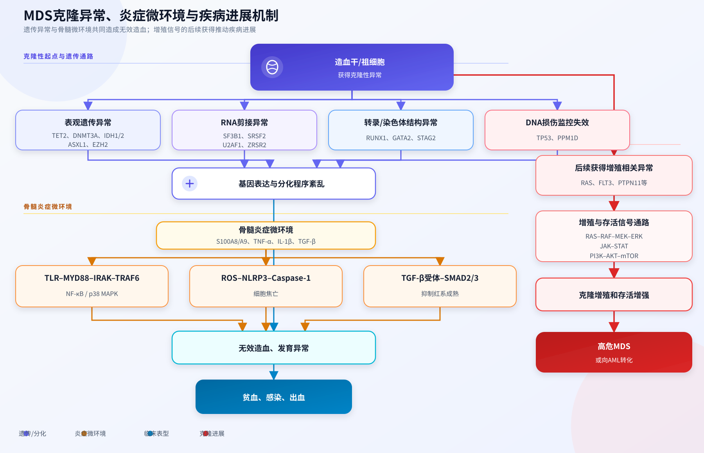
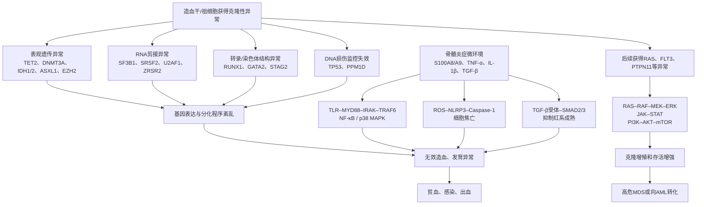
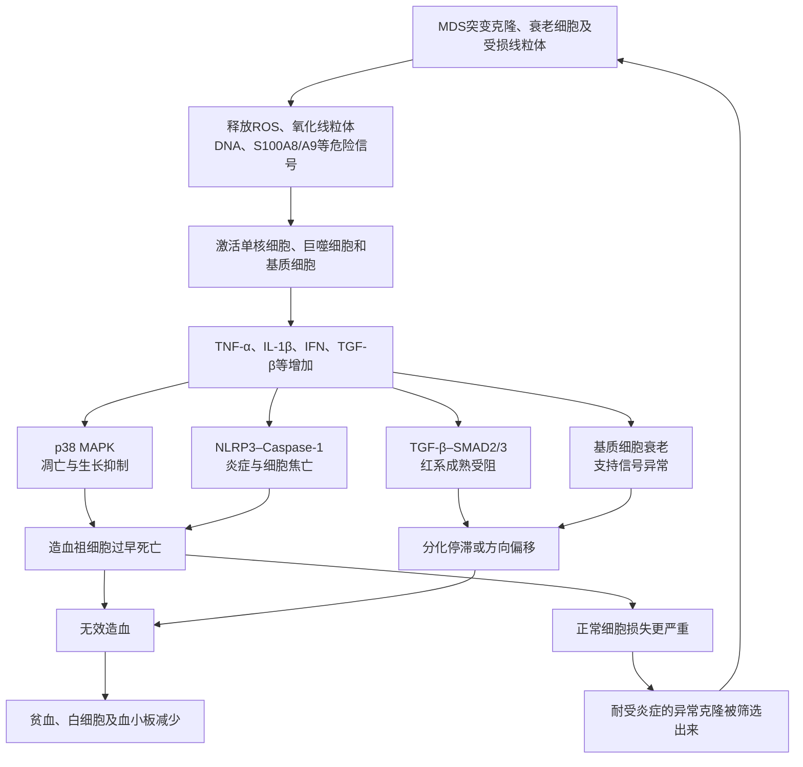

# MDS概述

> '分化障碍 & 异常克隆扩增'（同一个异常造血干细胞克隆造成的两类表现）

骨髓增生异常综合征，英文简称MDS。MDS是造血干细胞发生了克隆异常，进而导致的髓系祖细胞**异常克隆扩增**和**分化障碍**。突变细胞不断克隆扩增，占据了骨髓，却造不出合格的血细胞。主要的症状表现有贫血、淤血、免疫降低反复感染发热。

正常骨髓中，造血干细胞会分化成红细胞会增值分化成红细胞、白细胞（主要是中性粒细胞）和巨核细胞（血小板是其胞质碎片）。

其中红细胞负责运输氧气，缺少会造成贫血、乏力、面色苍白、心悸、气短。中性粒细胞负责人体免疫，缺少会造成易感染。血小板负责止血，缺少会造成易出血。

<svg viewBox="0 0 680 380" width="100%" role="img">
    <rect width="100%" height="100%" fill="#f2f2f2" />
    <title>血细胞家族与骨髓起源关系图</title>
    <desc>展示骨髓造血干细胞分化为红细胞、白细胞(含中性粒细胞)和血小板的过程，以及对应的临床检测指标</desc>
    <defs>
        <marker id="arrow" viewBox="0 0 10 10" refX="8" refY="5" markerWidth="6" markerHeight="6"
            orient="auto-start-reverse">
            <path d="M2 1L8 5L2 9" fill="none" stroke="context-stroke" stroke-width="1.5" stroke-linecap="round"
                stroke-linejoin="round" />
        </marker>
    </defs> <text x="340" y="26" text-anchor="middle" font-size="14" font-weight="500"
        fill="#2C2C2A">血液细胞的起源与对应检测指标</text>
    <g>
        <rect x="230" y="44" width="220" height="52" rx="8" fill="#EEEDFE" stroke="#534AB7" stroke-width="0.5" /> <text
            x="340" y="66" text-anchor="middle" font-size="13" font-weight="500" fill="#3C3489">骨髓造血干细胞</text> <text
            x="340" y="84" text-anchor="middle" font-size="11" fill="#7F77DD">所有血细胞的"种子"——骨髓中</text>
    </g>
    <line x1="280" y1="96" x2="140" y2="130" stroke="#5F5E5A" stroke-width="0.5" marker-end="url(#arrow)" />
    <line x1="340" y1="96" x2="340" y2="130" stroke="#5F5E5A" stroke-width="0.5" marker-end="url(#arrow)" />
    <line x1="400" y1="96" x2="540" y2="130" stroke="#5F5E5A" stroke-width="0.5" marker-end="url(#arrow)" />
    <g>
        <rect x="40" y="130" width="200" height="68" rx="8" fill="#FCEBEB" stroke="#A32D2D" stroke-width="0.5" /> <text
            x="140" y="152" text-anchor="middle" font-size="13" font-weight="500" fill="#791F1F">红细胞系</text> <text
            x="140" y="170" text-anchor="middle" font-size="11" fill="#E24B4A">红细胞 (RBC)</text> <text x="140" y="186"
            text-anchor="middle" font-size="10" fill="#E24B4A">携氧、运输CO₂</text>
    </g>
    <g>
        <rect x="240" y="130" width="200" height="68" rx="8" fill="#E6F1FB" stroke="#185FA5" stroke-width="0.5" /> <text
            x="340" y="152" text-anchor="middle" font-size="13" font-weight="500" fill="#0C447C">白细胞系</text> <text
            x="340" y="170" text-anchor="middle" font-size="11" fill="#378ADD">白细胞 (WBC)</text> <text x="340" y="186"
            text-anchor="middle" font-size="10" fill="#378ADD">免疫防御、抗感染</text>
    </g>
    <g>
        <rect x="440" y="130" width="200" height="68" rx="8" fill="#FAEEDA" stroke="#854F0B" stroke-width="0.5" /> <text
            x="540" y="152" text-anchor="middle" font-size="13" font-weight="500" fill="#633806">巨核细胞系</text> <text
            x="540" y="170" text-anchor="middle" font-size="11" fill="#EF9F27">血小板 (PLT)</text> <text x="540" y="186"
            text-anchor="middle" font-size="10" fill="#EF9F27">止血、凝血</text>
    </g>
    <line x1="340" y1="198" x2="340" y2="218" stroke="#5F5E5A" stroke-width="0.5" marker-end="url(#arrow)" />
    <g>
        <rect x="250" y="218" width="180" height="44" rx="8" fill="#B5D4F4" stroke="#185FA5" stroke-width="0.5" /> <text
            x="340" y="238" text-anchor="middle" font-size="12" font-weight="500" fill="#0C447C">中性粒细胞</text> <text
            x="340" y="254" text-anchor="middle" font-size="10" fill="#378ADD">白细胞中数量最多的一种</text>
    </g>
    <line x1="280" y1="240" x2="250" y2="240" stroke="#5F5E5A" stroke-width="0.5" marker-end="url(#arrow)"
        stroke-dasharray="3,2" /> <text x="340" y="288" text-anchor="middle" font-size="13" font-weight="500"
        fill="#2C2C2A">对应的临床检测指标</text>
    <line x1="140" y1="198" x2="140" y2="300" stroke="#5F5E5A" stroke-width="0.5" stroke-dasharray="3,2" />
    <line x1="340" y1="262" x2="340" y2="300" stroke="#5F5E5A" stroke-width="0.5" stroke-dasharray="3,2" />
    <line x1="540" y1="198" x2="540" y2="300" stroke="#5F5E5A" stroke-width="0.5" stroke-dasharray="3,2" />
    <g>
        <rect x="40" y="300" width="200" height="58" rx="8" fill="#FBEAF0" stroke="#993556" stroke-width="0.5" /> <text
            x="140" y="322" text-anchor="middle" font-size="12" font-weight="500" fill="#72243E">血红蛋白 Hb</text> <text
            x="140" y="340" text-anchor="middle" font-size="11" fill="#D4537E">红细胞携氧能力的核心指标</text> <text x="140" y="354"
            text-anchor="middle" font-size="10" fill="#D4537E">↓ = 贫血、缺氧</text>
    </g>
    <g>
        <rect x="240" y="300" width="200" height="58" rx="8" fill="#E1F5EE" stroke="#0F6E56" stroke-width="0.5" /> <text
            x="340" y="322" text-anchor="middle" font-size="12" font-weight="500" fill="#085041">中性粒细胞计数 ANC</text>
        <text x="340" y="340" text-anchor="middle" font-size="11" fill="#1D9E75">抗感染能力的核心指标</text> <text x="340" y="354"
            text-anchor="middle" font-size="10" fill="#1D9E75">↓ = 易感染、发热风险</text>
    </g>
    <g>
        <rect x="440" y="300" width="200" height="58" rx="8" fill="#FAEEDA" stroke="#854F0B" stroke-width="0.5" /> <text
            x="540" y="322" text-anchor="middle" font-size="12" font-weight="500" fill="#633806">血小板计数 PLT</text> <text
            x="540" y="340" text-anchor="middle" font-size="11" fill="#EF9F27">止血凝血能力的核心指标</text> <text x="540" y="354"
            text-anchor="middle" font-size="10" fill="#EF9F27">↓ = 出血风险</text>
    </g>
</svg>

检测血液中这三类细胞数量的指标分别是：血红蛋白 Hb（Hb >= 110，运氧能力正常）、绝对中性粒细胞计数ANC（ANC ≥ 1.0，感染抵抗力基本正常）、血小板计数PLT（PLT ≥ 100，止血功能基本正常）

<svg viewBox="0 0 680 576" width="100%" role="img">
    <rect width="100%" height="100%" fill="#f2f2f2" />
    <title>MDS一个克隆两张面孔悖论与疾病谱演变图</title>
    <desc>展示MDS不是两条独立通路而是同一克隆在干细胞层面扩增、前体层面凋亡的悖论，以及疾病谱中凋亡向增殖的演变</desc>
    <defs>
        <marker id="arrow" viewBox="0 0 10 10" refX="8" refY="5" markerWidth="6" markerHeight="6"
            orient="auto-start-reverse">
            <path d="M2 1L8 5L2 9" fill="none" stroke="context-stroke" stroke-width="1.5" stroke-linecap="round"
                stroke-linejoin="round" />
        </marker>
    </defs>
    <text x="340" y="28" text-anchor="middle" font-size="14" font-weight="500" fill="#2C2C2A">MDS的核心悖论：一个克隆，两张面孔</text>
    <rect x="230" y="48" width="220" height="56" rx="10" fill="#EEEDFE" stroke="#534AB7" stroke-width="0.5" />
    <text x="340" y="68" text-anchor="middle" dominant-baseline="central" font-size="13" font-weight="500"
        fill="#3C3489">MDS突变克隆（同一个细胞）</text>
    <text x="340" y="88" text-anchor="middle" dominant-baseline="central" font-size="11" fill="#534AB7">携带 TET2 / DNMT3A
        / SF3B1 等驱动突变</text>
    <path d="M 280 104 Q 235 128 180 150" fill="none" stroke="#185FA5" stroke-width="1.5" marker-end="url(#arrow)" />
    <rect x="50" y="140" width="245" height="86" rx="8" fill="#E6F1FB" stroke="#185FA5" stroke-width="0.5" />
    <text x="172" y="160" text-anchor="middle" dominant-baseline="central" font-size="13" font-weight="500"
        fill="#0C447C">干细胞层面 · 获得功能</text>
    <text x="172" y="178" text-anchor="middle" dominant-baseline="central" font-size="11" fill="#185FA5">自我更新增强 →
        克隆扩增</text>
    <text x="172" y="194" text-anchor="middle" dominant-baseline="central" font-size="11" fill="#185FA5">→ 排挤正常HSC →
        骨髓高增生</text>
    <text x="172" y="214" text-anchor="middle" dominant-baseline="central" font-size="12" font-weight="500"
        fill="#0C447C">"骨髓是满的"</text>
    <path d="M 400 104 Q 445 128 500 150" fill="none" stroke="#993C1D" stroke-width="1.5" marker-end="url(#arrow)" />
    <rect x="385" y="140" width="245" height="86" rx="8" fill="#FAECE7" stroke="#993C1D" stroke-width="0.5" />
    <text x="507" y="160" text-anchor="middle" dominant-baseline="central" font-size="13" font-weight="500"
        fill="#712B13">前体细胞层面 · 丧失功能</text>
    <text x="507" y="178" text-anchor="middle" dominant-baseline="central" font-size="11" fill="#993C1D">分化阻滞 →
        线粒体/炎症/核糖体缺陷</text>
    <text x="507" y="194" text-anchor="middle" dominant-baseline="central" font-size="11" fill="#993C1D">→ 前体细胞过度凋亡 →
        无效造血</text>
    <text x="507" y="214" text-anchor="middle" dominant-baseline="central" font-size="12" font-weight="500"
        fill="#712B13">"外周血是空的"</text>
    <rect x="120" y="248" width="440" height="40" rx="8" fill="#F1EFE8" stroke="#888780" stroke-width="0.5" />
    <text x="340" y="264" text-anchor="middle" dominant-baseline="central" font-size="12"
        fill="#444441">悖论：同一克隆同时"扩增"和"凋亡" → 骨髓满但血象空</text>
    <text x="340" y="278" text-anchor="middle" dominant-baseline="central" font-size="11" fill="#5F5E5A">stem cell:
        gain-of-function = precursor: loss-of-function</text>
    <rect x="40" y="305" width="600" height="68" rx="8" fill="#E1F5EE" stroke="#0F6E56" stroke-width="0.5" />
    <text x="340" y="323" text-anchor="middle" dominant-baseline="central" font-size="12" font-weight="500"
        fill="#085041">关键修正：这不是"两条独立通路"</text>
    <text x="340" y="340" text-anchor="middle" dominant-baseline="central" font-size="11"
        fill="#0F6E56">是同一个克隆在干细胞层面"赢了"（扩增）、在前体层面"输了"（凋亡）——两面同源</text>
    <text x="340" y="356" text-anchor="middle" dominant-baseline="central" font-size="11" fill="#0F6E56">"通路A vs
        通路B"是药理学评价工具，帮助理解为何HI和mCR可独立实现，但不是生物学现实</text>
    <line x1="40" y1="392" x2="640" y2="392" stroke="#B4B2A9" stroke-width="0.5" stroke-dasharray="4 3" />
    <text x="340" y="414" text-anchor="middle" font-size="13" font-weight="500" fill="#2C2C2A">疾病谱演变：凋亡与增殖的平衡偏移</text>
    <rect x="48" y="432" width="135" height="36" rx="4" fill="#E6F1FB" stroke="#85B7EB" stroke-width="0.5" />
    <text x="115" y="450" text-anchor="middle" dominant-baseline="central" font-size="12" fill="#0C447C">CHIP</text>
    <rect x="191" y="432" width="135" height="36" rx="4" fill="#EEEDFE" stroke="#AFA9EC" stroke-width="0.5" />
    <text x="258" y="450" text-anchor="middle" dominant-baseline="central" font-size="12" fill="#3C3489">低危MDS</text>
    <rect x="334" y="432" width="135" height="36" rx="4" fill="#FAECE7" stroke="#F0997B" stroke-width="0.5" />
    <text x="401" y="450" text-anchor="middle" dominant-baseline="central" font-size="12" fill="#712B13">高危MDS</text>
    <rect x="477" y="432" width="135" height="36" rx="4" fill="#FCEBEB" stroke="#E24B4A" stroke-width="0.5" />
    <text x="544" y="450" text-anchor="middle" dominant-baseline="central" font-size="12" fill="#501313">sAML</text>
    <text x="48" y="486" text-anchor="start" font-size="11" font-weight="500" fill="#185FA5">凋亡主导</text>
    <rect x="48" y="492" width="135" height="9" rx="2" fill="#378ADD" opacity="0.85" />
    <rect x="191" y="492" width="135" height="7" rx="2" fill="#7F77DD" opacity="0.55" />
    <rect x="334" y="492" width="135" height="4" rx="2" fill="#D85A30" opacity="0.3" />
    <rect x="477" y="492" width="135" height="2" rx="2" fill="#E24B4A" opacity="0.15" />
    <rect x="48" y="508" width="135" height="2" rx="2" fill="#378ADD" opacity="0.15" />
    <rect x="191" y="508" width="135" height="4" rx="2" fill="#7F77DD" opacity="0.3" />
    <rect x="334" y="508" width="135" height="7" rx="2" fill="#D85A30" opacity="0.55" />
    <rect x="477" y="508" width="135" height="9" rx="2" fill="#E24B4A" opacity="0.85" />
    <text x="48" y="530" text-anchor="start" font-size="11" font-weight="500" fill="#993C1D">增殖主导</text>
    <text x="340" y="558" text-anchor="middle" font-size="11" fill="#5F5E5A">MDS→AML转化的本质：凋亡主导 →
        增殖主导——不是"两条路"，是同一条路的此消彼长</text>
</svg>


| 维度         | 通路 A（无效造血）       | 通路 B（克隆增殖）       |
| :----------- | :----------------------- | :----------------------- |
| 核心病理     | 前体细胞凋亡/分化阻滞    | 原始细胞不受控增殖       |
| 分子驱动     | TGF-β/炎症/核糖体缺陷    | TP53/FLT3/表观遗传突变   |
| 临床表现     | 贫血/感染/出血           | 原始细胞比例↑ → AML 转化 |
| 检测指标     | Hb/ANC/PLT（外周血）     | 骨髓原始细胞 %           |
| 对应疗效终点 | **HI**                   | **mCR**                  |
| 致死路径     | 感染/出血/输血依赖并发症 | 白血病转化               |
| 药物靶点     | GDF11/IL-1β/端粒酶/TNF   | DNA甲基化/BCL-2/FLT3     |


| 修复通路 A（HI） | 修复通路 B（mCR）           |                                           |
| :--------------- | :-------------------------- | ----------------------------------------- |
| **直接后果**     | 血象恢复：Hb↑/ANC↑/PLT↑     | 原始细胞 < 5%                             |
| **感染风险**     | ↓ ANC 恢复 → 抗感染能力恢复 | 不变（如果 ANC 没恢复）                   |
| **出血风险**     | ↓ PLT 恢复 → 止血功能恢复   | 不变（如果 PLT 没恢复）                   |
| **输血依赖**     | ↓ 脱离输血 → 铁过载改善     | 不变（如果 Hb 没恢复）                    |
| **死亡驱动**     | ↓ 直接降低致死性并发症      | 间接（推迟 AML 转化，但不改善当前并发症） |


<svg viewBox="0 0 680 520" width="100%" role="img">
    <rect width="100%" height="100%" fill="#f2f2f2" />
    <title>骨髓原始细胞比例的临床意义与5%阈值由来</title>
    <desc>解释正常骨髓原始细胞范围、5%阈值的来源、不同比例对应的临床诊断</desc>
    <defs>
        <marker id="arrow4" viewBox="0 0 10 10" refX="8" refY="5" markerWidth="6" markerHeight="6"
            orient="auto-start-reverse">
            <path d="M2 1L8 5L2 9" fill="none" stroke="context-stroke" stroke-width="1.5" stroke-linecap="round"
                stroke-linejoin="round" />
        </marker>
    </defs> <text x="340" y="26" text-anchor="middle" font-size="14" font-weight="500"
        fill="#2C2C2A">骨髓原始细胞比例：从正常到白血病</text> <text x="340" y="44" text-anchor="middle" font-size="12"
        fill="#888780">同一条轴上，不同比例对应不同临床判断</text>
    <line x1="80" y1="100" x2="600" y2="100" stroke="#B4B2A9" stroke-width="2" />
    <line x1="80" y1="90" x2="80" y2="110" stroke="#B4B2A9" stroke-width="2" />
    <line x1="600" y1="90" x2="600" y2="110" stroke="#B4B2A9" stroke-width="2" />
    <rect x="80" y="80" width="170" height="40" rx="4" fill="#E1F5EE" stroke="#0F6E56" stroke-width="0.5" /> <text
        x="165" y="98" text-anchor="middle" font-size="12" font-weight="500" fill="#085041">正常范围</text> <text x="165"
        y="113" text-anchor="middle" font-size="11" fill="#1D9E75">0% – 5%</text>
    <rect x="250" y="80" width="90" height="40" rx="4" fill="#FAEEDA" stroke="#854F0B" stroke-width="0.5" /> <text
        x="295" y="98" text-anchor="middle" font-size="12" font-weight="500" fill="#633806">MDS</text> <text x="295"
        y="113" text-anchor="middle" font-size="11" fill="#EF9F27">5% – 19%</text>
    <rect x="340" y="80" width="260" height="40" rx="4" fill="#FCEBEB" stroke="#A32D2D" stroke-width="0.5" /> <text
        x="470" y="98" text-anchor="middle" font-size="12" font-weight="500" fill="#791F1F">AML（急性髓系白血病）</text> <text
        x="470" y="113" text-anchor="middle" font-size="11" fill="#E24B4A">≥ 20%</text>
    <line x1="250" y1="76" x2="250" y2="130" stroke="#5F5E5A" stroke-width="0.5" stroke-dasharray="3,2" />
    <line x1="340" y1="76" x2="340" y2="130" stroke="#5F5E5A" stroke-width="0.5" stroke-dasharray="3,2" /> <text x="250"
        y="142" text-anchor="middle" font-size="10" fill="#5F5E5A">5% 分界</text> <text x="340" y="142"
        text-anchor="middle" font-size="10" fill="#5F5E5A">20% 分界</text> <text x="340" y="166" text-anchor="middle"
        font-size="13" font-weight="500" fill="#2C2C2A">5% 这个数字怎么来的？</text>
    <g>
        <rect x="40" y="178" width="300" height="80" rx="8" fill="#E6F1FB" stroke="#185FA5" stroke-width="0.5" /><text
            x="56" y="200" font-size="12" font-weight="500" fill="#0C447C">正常骨髓的生理基线</text><text x="56" y="218"
            font-size="11" fill="#378ADD">造血干细胞持续分裂分化</text><text x="56" y="234" font-size="11"
            fill="#378ADD">正常时幼稚细胞占比极低</text><text x="56" y="250" font-size="11" fill="#378ADD">大样本统计：正常人 bl 多在
            1%–3%</text><text x="56" y="252" font-size="11" fill="#378ADD"> </text>
    </g>
    <g>
        <rect x="350" y="178" width="290" height="80" rx="8" fill="#FAEEDA" stroke="#854F0B" stroke-width="0.5" /><text
            x="366" y="200" font-size="12" font-weight="500" fill="#633806">流行病学拐点</text><text x="366" y="218"
            font-size="11" fill="#EF9F27">bl &gt; 5% 后，恶变风险陡升</text><text x="366" y="234" font-size="11"
            fill="#EF9F27">向白血病转化的概率显著增加</text><text x="366" y="250" font-size="11" fill="#EF9F27">5% 是统计学上的最佳分界点</text>
    </g> <text x="340" y="280" text-anchor="middle" font-size="13" font-weight="500" fill="#2C2C2A">是越小越好吗？</text>
    <g>
        <rect x="40" y="292" width="290" height="100" rx="8" fill="#E1F5EE" stroke="#0F6E56" stroke-width="0.5" /><text
            x="56" y="314" font-size="12" font-weight="500" fill="#085041">是的，越低越好</text><text x="56" y="332"
            font-size="11" fill="#1D9E75">0% 当然最好 = 完全没有异常幼稚细胞</text><text x="56" y="348" font-size="11"
            fill="#1D9E75">残留越少 → 复发风险越低</text><text x="56" y="364" font-size="11"
            fill="#1D9E75">MRD（微小残留病）阴性预后更好</text><text x="56" y="380" font-size="11" fill="#1D9E75">长期生存率越高</text>
    </g>
    <g>
        <rect x="350" y="292" width="290" height="100" rx="8" fill="#FBEAF0" stroke="#993556" stroke-width="0.5" /><text
            x="366" y="314" font-size="12" font-weight="500" fill="#72243E">但有重要细节</text><text x="366" y="332"
            font-size="11" fill="#D4537E">正常骨髓也不会是 0%</text><text x="366" y="348" font-size="11"
            fill="#D4537E">造血需要少量原始细胞维持再生</text><text x="366" y="364" font-size="11" fill="#D4537E">完全为 0
            反而说明骨髓衰竭</text><text x="366" y="380" font-size="11" fill="#D4537E">→ 再生障碍性贫血等</text>
    </g>
    <g>
        <rect x="40" y="404" width="600" height="104" rx="8" fill="#F1EFE8" stroke="#B4B2A9" stroke-width="0.5" /><text
            x="60" y="426" font-size="12" font-weight="500" fill="#2C2C2A">疗效标准中的 &lt; 5% 含义</text><text x="60" y="446"
            font-size="11" fill="#444441">mCR 要求 bl &lt; 5%，不是追求 0%，而是"回到正常范围"</text><text x="60" y="462" font-size="11"
            fill="#444441">= 把白血病从"异常增殖"拉回到"正常生理水平"</text><text x="60" y="478" font-size="11" fill="#444441">=
            骨髓恢复到健康人应有的造血秩序</text><text x="60" y="494" font-size="11" fill="#888780">更深层次：即使 bl &lt; 5%，若存在高危基因突变(如
            FLT3-ITD)，仍不算真正安全</text>
    </g>
</svg>

MDS的患病并非是一成不变的，早期分化障碍为主，后期异常克隆扩增为主。正常人体的骨髓原始细胞（Blasts）小于5%，MDS后期肿瘤细胞恶性扩增超过20%，疾病就会进展为sAML（继发性AML），也有写做AML的，但MDS进展成的AML和原发性AML治疗难度完全不同，前者生物学更耐药、缓解率更低、复发更快、预后更差。

分化障碍造成的贫血、免疫低、出血及并发症，往往是患者的主要死因，比如免疫力下降导致肺炎。


## 疗效评估

<svg viewBox="0 0 680 420" width="100%" role="img">
    <rect width="100%" height="100%" fill="#f2f2f2"/>
    <title>临床疗效评估两大维度</title>
    <desc>展示骨髓维度(原始细胞)和外周血维度(三大指标)如何组合形成疗效评价标准</desc>
    <defs>
        <marker id="arrow2" viewBox="0 0 10 10" refX="8" refY="5" markerWidth="6" markerHeight="6"
            orient="auto-start-reverse">
            <path d="M2 1L8 5L2 9" fill="none" stroke="context-stroke" stroke-width="1.5" stroke-linecap="round"
                stroke-linejoin="round" />
        </marker>
    </defs> <text x="340" y="26" text-anchor="middle" font-size="14" font-weight="500" fill="#2C2C2A">疗效评估 = 骨髓维度 +
        外周血维度</text> <text x="340" y="44" text-anchor="middle" font-size="12" fill="#888780">两个维度独立评估，组合后形成不同缓解等级</text>
    <line x1="340" y1="56" x2="340" y2="76" stroke="#5F5E5A" stroke-width="0.5" />
    <line x1="140" y1="76" x2="540" y2="76" stroke="#5F5E5A" stroke-width="0.5" />
    <line x1="140" y1="76" x2="140" y2="96" stroke="#5F5E5A" stroke-width="0.5" marker-end="url(#arrow2)" />
    <line x1="540" y1="76" x2="540" y2="96" stroke="#5F5E5A" stroke-width="0.5" marker-end="url(#arrow2)" />
    <g>
        <rect x="40" y="96" width="280" height="100" rx="8" fill="#EEEDFE" stroke="#534AB7" stroke-width="0.5" />
        <text x="180" y="120" text-anchor="middle" font-size="13" font-weight="500" fill="#3C3489">维度一：骨髓</text>
        <text x="180" y="140" text-anchor="middle" font-size="12" fill="#534AB7">核心指标：骨髓原始细胞比例</text> <text x="180"
            y="158" text-anchor="middle" font-size="11" fill="#7F77DD">需做骨髓穿刺(骨穿)</text> <text x="180" y="176"
            text-anchor="middle" font-size="11" fill="#7F77DD">评估"白血病负荷是否下降"</text> <text x="180" y="190"
            text-anchor="middle" font-size="10" fill="#AFA9EC">blasts &lt; 5% = 骨髓完全缓解(mCR)</text>
    </g>
    <g>
        <rect x="360" y="96" width="280" height="100" rx="8" fill="#E6F1FB" stroke="#185FA5" stroke-width="0.5" />
        <text x="500" y="120" text-anchor="middle" font-size="13" font-weight="500" fill="#0C447C">维度二：外周血</text>
        <text x="500" y="140" text-anchor="middle" font-size="12" fill="#185FA5">核心指标：ANC + PLT (+ Hb)</text> <text
            x="500" y="158" text-anchor="middle" font-size="11" fill="#378ADD">抽血化验即可(血常规)</text> <text x="500" y="176"
            text-anchor="middle" font-size="11" fill="#378ADD">评估"造血功能是否恢复"</text> <text x="500" y="190"
            text-anchor="middle" font-size="10" fill="#85B7EB">改善幅度达阈值 = 血液学改善(HI)</text>
    </g> <text x="340" y="222" text-anchor="middle" font-size="13" font-weight="500" fill="#2C2C2A">两维度组合 →
        疗效等级</text>
    <line x1="180" y1="196" x2="180" y2="232" stroke="#5F5E5A" stroke-width="0.5" stroke-dasharray="3,2" />
    <line x1="500" y1="196" x2="500" y2="232" stroke="#5F5E5A" stroke-width="0.5" stroke-dasharray="3,2" />
    <g>
        <rect x="40" y="232" width="150" height="52" rx="8" fill="#E1F5EE" stroke="#0F6E56" stroke-width="0.5" />
        <text x="115" y="252" text-anchor="middle" font-size="12" font-weight="500" fill="#085041">CR</text> <text
            x="115" y="268" text-anchor="middle" font-size="10" fill="#5DCAA5">骨髓✓ + 血象完全✓</text> <text x="115" y="280"
            text-anchor="middle" font-size="10" fill="#5DCAA5">ANC≥1.0, PLT≥100</text>
    </g>
    <g>
        <rect x="200" y="232" width="150" height="52" rx="8" fill="#EAF3DE" stroke="#3B6D11" stroke-width="0.5" />
        <text x="275" y="252" text-anchor="middle" font-size="12" font-weight="500" fill="#27500A">CRh</text> <text
            x="275" y="268" text-anchor="middle" font-size="10" fill="#97C459">骨髓✓ + 血象部分✓</text> <text x="275" y="280"
            text-anchor="middle" font-size="10" fill="#97C459">ANC≥0.5, PLT≥50</text>
    </g>
    <g>
        <rect x="360" y="232" width="150" height="52" rx="8" fill="#FAEEDA" stroke="#854F0B" stroke-width="0.5" />
        <text x="435" y="252" text-anchor="middle" font-size="12" font-weight="500" fill="#633806">CRi</text> <text
            x="435" y="268" text-anchor="middle" font-size="10" fill="#EF9F27">骨髓✓ + 血象未恢复</text> <text x="435" y="280"
            text-anchor="middle" font-size="10" fill="#EF9F27">ANC&lt;1.0 或 PLT&lt;100</text>
    </g>
    <g>
        <rect x="520" y="232" width="120" height="52" rx="8" fill="#FCEBEB" stroke="#A32D2D" stroke-width="0.5" />
        <text x="580" y="252" text-anchor="middle" font-size="12" font-weight="500" fill="#791F1F">mCR</text> <text
            x="580" y="268" text-anchor="middle" font-size="10" fill="#E24B4A">骨髓✓</text> <text x="580" y="280"
            text-anchor="middle" font-size="10" fill="#E24B4A">不评估血象</text>
    </g>
    <g>
        <rect x="40" y="306" width="600" height="100" rx="8" fill="#F1EFE8" stroke="#B4B2A9" stroke-width="0.5" />
        <text x="60" y="328" font-size="12" font-weight="500" fill="#2C2C2A">术语对应关系</text> <text x="60" y="348"
            font-size="11" fill="#444441">血象 / 外周血计数 / 外周血血细胞 = 同一概念</text> <text x="60" y="364" font-size="11"
            fill="#888780"> → 指血液中红细胞、白细胞、血小板的数量和状态（血常规即可获得）</text> <text x="60" y="384" font-size="11"
            fill="#444441">血液学改善 (HI) = 外周血指标的好转</text> <text x="60" y="400" font-size="11" fill="#888780"> →
            分红系(Hb↑)、粒系(ANC↑)、巨核系(PLT↑)三类，有各自改善阈值</text>
    </g>
</svg>
**IWG 2023降低了严格CR的血红蛋白门槛，同时取消mCR，并新增“血象未完全恢复的CR亚型”**，以更细致地描述骨髓缓解但血象恢复不足的患者。取消mCR的原因是：单纯骨髓原始细胞下降、但没有血象改善的mCR，其生存获益并不稳定。


| 条件                   | IWG 2006 CR            | IWG 2023 CR                                                  |
| ---------------------- | ---------------------- | ------------------------------------------------------------ |
| 适用人群               | 所有MDS                | 主要针对高危MDS                                              |
| 治疗前骨髓原始细胞要求 | 未明确限制             | 原则上治疗前须 **≥5%**，才可评价普通CR                       |
| 骨髓原始细胞           | **≤5%**                | **<5%**                                                      |
| 骨髓发育异常           | 可以持续存在，但需注明 | 可以持续存在                                                 |
| 外周血原始细胞         | 0%                     | 0%                                                           |
| 血红蛋白Hb             | **≥11 g/dL**           | **≥10 g/dL**                                                 |
| 血小板                 | ≥100×10⁹/L             | ≥100×10⁹/L                                                   |
| ANC                    | ≥1.0×10⁹/L             | ≥1.0×10⁹/L                                                   |
| 近期输血/生长因子      | 2006定义不如2023具体   | 评价前2周不得接受红细胞或血小板输注、ESA、TPO受体激动剂或G-CSF |

## 缓解层级
MDS=异常造血干细胞的增殖+分化障碍，用药和检测病情也从这两方面入手。


## 检测和临床指标预测OS


先说检测两个检测维度，一个是看原始骨髓比例是否缩小到5%以下（Blasts<5%），一个是看血象，即红细胞、白细胞和血小板的数量和状态（Hb↑、ANC↑、PLT↑），即血液改善（Hematologic Improvement，HI）的状态。临床常见组合：

- CR：骨髓✓ + 血液完全改善（HI）✓ （ANC≥1.0, PLT≥100）
- CRh：骨髓✓ + 血液部分改善（ANC≥0.5, PLT≥50）
- CRi：骨髓✓ + 血液状态未恢复（ANC < 1.0 或 PLT < 100）
- mCR：骨髓✓ + 不评估血液是否改善 


## 预测指标

一份来自Komrokji et al. 2021 — MDS Clinical Research Consortium 验证研究（n=597 + 验证队列 n=539）给出了各指标与OS之间的相关性。

<svg viewBox="0 0 680 460" width="100%" role="img">
    <rect width="100%" height="100%" fill="#f2f2f2" />
    <title>MDS各疗效终点与中位OS的关系</title>
    <desc>基于Komrokji 2021 MDS Clinical Research Consortium数据，展示CR、mCR with HI、HI、mCR without HI、SD、PD对应的中位OS</desc>
    <defs>
        <marker id="arrow5" viewBox="0 0 10 10" refX="8" refY="5" markerWidth="6" markerHeight="6"
            orient="auto-start-reverse">
            <path d="M2 1L8 5L2 9" fill="none" stroke="context-stroke" stroke-width="1.5" stroke-linecap="round"
                stroke-linejoin="round" />
        </marker>
    </defs> <text x="340" y="24" text-anchor="middle" font-size="14" font-weight="500" fill="#2C2C2A">MDS 各疗效终点与中位 OS
        的关系</text> <text x="340" y="42" text-anchor="middle" font-size="11" fill="#888780">数据来源：Komrokji et al. 2021,
        MDS Clinical Research Consortium, n=597 高危 MDS</text> <text x="50" y="72" font-size="11" fill="#888780">中位
        OS（月）</text> <text x="630" y="72" text-anchor="end" font-size="11" fill="#888780">数值越大 = 生存越长</text>
    <line x1="160" y1="80" x2="160" y2="420" stroke="#D3D1C7" stroke-width="0.5" /> <text x="160" y="432"
        text-anchor="middle" font-size="10" fill="#888780">0</text>
    <line x1="240" y1="80" x2="240" y2="420" stroke="#D3D1C7" stroke-width="0.5" /> <text x="240" y="432"
        text-anchor="middle" font-size="10" fill="#888780">5</text>
    <line x1="320" y1="80" x2="320" y2="420" stroke="#D3D1C7" stroke-width="0.5" /> <text x="320" y="432"
        text-anchor="middle" font-size="10" fill="#888780">10</text>
    <line x1="400" y1="80" x2="400" y2="420" stroke="#D3D1C7" stroke-width="0.5" /> <text x="400" y="432"
        text-anchor="middle" font-size="10" fill="#888780">15</text>
    <line x1="480" y1="80" x2="480" y2="420" stroke="#D3D1C7" stroke-width="0.5" /> <text x="480" y="432"
        text-anchor="middle" font-size="10" fill="#888780">20</text>
    <line x1="560" y1="80" x2="560" y2="420" stroke="#D3D1C7" stroke-width="0.5" /> <text x="560" y="432"
        text-anchor="middle" font-size="10" fill="#888780">25</text>
    <g>
        <rect x="160" y="96" width="368" height="32" rx="4" fill="#E1F5EE" stroke="#0F6E56" stroke-width="0.5" /> <text
            x="170" y="117" font-size="12" font-weight="500" fill="#085041">CR 完全缓解</text> <text x="540" y="117"
            text-anchor="end" font-size="12" font-weight="500" fill="#085041">23.3 月</text>
    </g>
    <g>
        <rect x="160" y="136" width="336" height="32" rx="4" fill="#EAF3DE" stroke="#3B6D11" stroke-width="0.5" /> <text
            x="170" y="157" font-size="12" font-weight="500" fill="#27500A">CRh（伴部分血液学恢复）</text> <text x="508" y="157"
            text-anchor="end" font-size="12" font-weight="500" fill="#27500A">21.0 月</text>
    </g>
    <g>
        <rect x="160" y="176" width="272" height="32" rx="4" fill="#FAEEDA" stroke="#854F0B" stroke-width="0.5" /> <text
            x="170" y="197" font-size="12" font-weight="500" fill="#633806">HI 血液学改善</text> <text x="444" y="197"
            text-anchor="end" font-size="12" font-weight="500" fill="#633806">17.0 月</text>
    </g>
    <g>
        <rect x="160" y="216" width="275" height="32" rx="4" fill="#E6F1FB" stroke="#185FA5" stroke-width="0.5" /> <text
            x="170" y="237" font-size="12" font-weight="500" fill="#0C447C">mCR with HI（骨髓缓解+血象改善）</text> <text x="447"
            y="237" text-anchor="end" font-size="12" font-weight="500" fill="#0C447C">17.2 月</text>
    </g>
    <g>
        <rect x="160" y="256" width="208" height="32" rx="4" fill="#F1EFE8" stroke="#5F5E5A" stroke-width="0.5" /> <text
            x="170" y="277" font-size="12" fill="#444441">SD 稳定病情</text> <text x="380" y="277" text-anchor="end"
            font-size="12" fill="#444441">13.0 月</text>
    </g>
    <g>
        <rect x="160" y="296" width="160" height="32" rx="4" fill="#FAECE7" stroke="#993C1D" stroke-width="0.5" /> <text
            x="170" y="317" font-size="12" font-weight="500" fill="#4A1B0C">mCR without HI（仅骨髓缓解）</text> <text x="382"
            y="317" text-anchor="end" font-size="12" font-weight="500" fill="#4A1B0C">10.0 月</text>
    </g>
    <g>
        <rect x="160" y="336" width="112" height="32" rx="4" fill="#FCEBEB" stroke="#A32D2D" stroke-width="0.5" /> <text
            x="170" y="357" font-size="12" font-weight="500" fill="#791F1F">PD 疾病进展</text> <text x="284" y="357"
            text-anchor="end" font-size="12" font-weight="500" fill="#791F1F">7.0 月</text>
    </g>
    <line x1="100" y1="392" x2="600" y2="392" stroke="#5F5E5A" stroke-width="0.5" stroke-dasharray="3,2" />
</svg>

HI是更强的预测因子，仅仅是缓解肿瘤（mCR）带来的OS获益很少。这也很好理解，大部分患者致死往往是因为血液（红细胞、白细胞和血小板）恶化导致，血液的功能恢复了，生存期自然就延长了。在对比mCR without HI的10个月和mCR with HI的17.2个月也能得到印证。故后续在看GLORA-4临床时，HI是比mCR更有效的观察指标。


> 为什么HI比mCR更能改善OS？

抑制造血干细胞分化，mCR↑ 和 改善HI，哪个好？

mCR压到5%，可能是正常造血干细胞和异常造血干细胞一起干掉，未必会增加正常造血能力。MDS患者死亡往往是因为严重感染（中性粒细胞低）、出血（血小板低）、血红蛋白低。

出现HI通常意味着以下至少一项成立：

- 正常残余干细胞恢复生产；
- 异常克隆的无效造血有所改善；
- 骨髓微环境仍有恢复能力；
- 治疗没有把正常祖细胞一起长期压制；
- 患者具有更好的骨髓储备

清楚异常细胞后，正常细胞也可能不那么容易恢复，正常细胞的恢复需要满足：

- 仍有足够的正常造血干细胞；
- 骨髓微环境未被严重破坏；
- 药物没有持续抑制正常祖细胞；
- 异常上游克隆得到真正控制；
- 感染、炎症和纤维化没有持续压制造血；
- 有足够时间让干细胞重新生成成熟血细胞。

| 疗效状态  | 含义                           | 与OS关系                       |
| --------- | ------------------------------ | ------------------------------ |
| mCR、无HI | 原始细胞下降，但造血没恢复     | 较弱                           |
| HI、无mCR | 血象改善，但异常克隆仍较明显   | 有临床价值，但疾病控制可能不深 |
| mCR＋HI   | 疾病负荷下降，同时功能恢复     | 更有意义                       |
| CR或CRh   | 原始细胞低，并有较充分血象恢复 | 通常与更好生存最相关           |

并不是HI在生物学上一定比清除异常干细胞重要。而是现行mCR指标**没有证明异常干细胞真的被清除**，只证明原始细胞比例下降。最有价值的结果是：**异常克隆真正减少＋正常有效造血恢复＋这种状态足够持久。**


## 用药

再说用药，主要是两类，一个恢复造血干细胞的分化能力，另一个是促进肿瘤细胞凋亡。前者用去甲基化药物，如阿扎胞苷（AZA），后者用BCL-2抑制剂，如维奈克拉（Ven），亚盛的Lisaftoclax也属于这一类。需要注意的是，MDS的治疗应当以AZA为骨架，而非BCL-2抑制剂，正如前文所述，血象的改善远比肿瘤的缩小重要。

**MDS很难成药**，近30年只有7款药物获批，高危MDS领域自去甲基化药物（HMA）之后几乎没有突破性新疗法获批。

主要有三原因，一是**疾病异质性高**，不像CLL/SLL有明确的BCL-2靶点，MDS多路突变共存，缺乏单一靶点；二是**患者普遍高龄**，骨髓本来就很差，且常伴心血管、肾功能和感染等问题；三是**药效冲突**，既要恢复造血，又要清除恶性克隆，两者存在冲突。MDS患者本来就有贫血、中性粒细胞减少和血小板减少。许多抗肿瘤药进一步抑制骨髓，肿瘤的细胞少了，但正常的造血干细胞也少了，造血功能减弱，就进一步加剧了上述症状。缓解率也没有转为生存获益（mCR≠OS）。

本文仅简单介绍MDS，后续临床及用药放到GLORA-4相关文章详述。


# 通信链路

## 目录

1. [MDS有哪些分型](#二mds有哪些分型)
2. [MDS细胞涉及哪些信号和调控通路](#三mds细胞涉及哪些信号和调控通路)
3. [什么是表观遗传](#四什么是表观遗传)
4. [表观遗传、RNA剪接、转录与染色体结构异常的异同](#五表观遗传rna剪接转录与染色体结构异常的异同)
5. [什么是骨髓炎症微环境](#六什么是骨髓炎症微环境)
6. [为什么DNA选择甲基作为重要标记](#七为什么dna选择甲基作为重要标记)
7. [谁在控制表观遗传](#八谁在控制表观遗传)
8. [参考资料](#九参考资料)


```
造血干细胞获得异常
        │
        ├─ 染色体5q大片段缺失
        │       └─ 多个基因剂量下降
        │              └─ 贫血为主、低原始细胞、典型MDS-5q生物学
        │
        ├─ SF3B1基因突变
        │       └─ RNA剪接异常
        │              └─ 线粒体铁代谢异常、环形铁粒幼红细胞
        │
        └─ TP53两个等位基因均失活（biTP53）
                └─ DNA损伤监控失灵
                       └─ 染色体异常积累、复杂核型、高风险生物学
```


需要特别注意：**MDS分型不等于危险分层。**治疗决策还需结合IPSS-R或IPSS-M评分。


## 三、MDS细胞涉及哪些信号和调控通路

MDS并不是由一条固定信号通路驱动，而是多个层面共同失控：

- DNA表观遗传；
- RNA剪接；
- 转录调控；
- 染色体与染色质结构；
- 炎症与先天免疫；
- 细胞分化；
- 细胞增殖、凋亡和焦亡。






### 1. 表观遗传调控通路

常见基因包括：

- **TET2、DNMT3A**：调节DNA甲基化；
- **IDH1/IDH2**：突变后产生异常代谢物2-HG，抑制正常去甲基化和细胞分化；
- **ASXL1、EZH2、BCOR**：调节组蛋白和染色质状态。

这些异常把造血干细胞的“基因开关”调乱，使其获得克隆优势，却不能正常成熟。

### 2. RNA剪接通路

常见基因包括SF3B1、SRSF2、U2AF1和ZRSR2。

突变后会造成大量RNA错误剪接，影响：

- 红细胞成熟和铁代谢；
- 线粒体功能；
- DNA修复；
- 细胞周期与凋亡。

SF3B1突变与环形铁粒幼红细胞密切相关。

### 3. 炎症与先天免疫信号

典型主轴为：

> S100A8/A9或IL-1 
> → TLR/IL-1R 
> → MYD88 
> → IRAK1/4 
> → TRAF6 
> → NF-κB与p38 MAPK

结果包括炎症因子释放、正常造血抑制以及祖细胞异常死亡。

### 4. NLRP3炎症小体与焦亡

典型过程为：

> S100A9/TLR4或ROS 
> → NLRP3炎症小体 
> → Caspase-1 
> → IL-1β、IL-18及Gasdermin D 
> → 细胞焦亡

焦亡会释放更多危险信号，形成“炎症—焦亡—更多炎症”的正反馈，并可能通过Wnt/β-catenin增强异常干细胞的自我更新。

### 5. TGF-β超家族—SMAD2/3通路

典型过程为：

> TGF-β/Activin等配体 
> → 相应受体 
> → SMAD2/3磷酸化 
> → 抑制晚期红细胞成熟

这条通路尤其与贫血和无效红系造血有关。

### 6. 增殖和存活通路

疾病进展时，异常克隆可能进一步获得NRAS、KRAS、PTPN11、CBL、FLT3或KIT等改变，激活：

- RAS–RAF–MEK–ERK；
- PI3K–AKT–mTOR；
- JAK–STAT。

这些通路使细胞从“分化异常、容易死亡”逐渐转变为“持续增殖、逃避死亡”。

### 7. TP53与DNA损伤通路

正常TP53会在DNA严重受损时促使细胞停滞、修复或凋亡。TP53双等位基因失活后：

- DNA损伤细胞仍能存活；
- 染色体不稳定性增加；
- 容易出现复杂核型；
- 治疗耐受和克隆进化能力增强。

可将疾病演变概念化为：

> 早期或部分低危MDS：表观遗传/剪接异常，加上炎症和过度细胞死亡，造成无效造血和血细胞减少。  
> 高危MDS：累积TP53、RUNX1、RAS/FLT3等异常，异常克隆逃避死亡并增强增殖，逐渐接近或转化为AML。

这只是总体模型，并非每位患者都按照相同顺序发展。

---

## 四、什么是表观遗传

表观遗传是指：**不改变DNA“字母顺序”，但改变基因什么时候开启、关闭以及表达多少。**

可以用书本作比喻：

- DNA序列像一本书的正文；
- 基因突变像正文中的字被改了；
- 表观遗传像书签、批注或封条——正文没有改变，但细胞读取哪些内容发生了变化。

### 1. DNA甲基化

在DNA特定位置添加甲基化标记。启动子区域甲基化增加时，相关基因通常更难被读取，相当于把基因“调暗或关闭”。

### 2. 组蛋白修饰

DNA缠绕在组蛋白上，类似线绕在线轴上：

- 缠得松，基因比较容易被读取；
- 缠得紧，基因比较难被读取。

组蛋白乙酰化、甲基化等化学标记会调节这种松紧状态。

### 3. 染色质重塑

重排DNA与组蛋白的位置，使某些基因区域暴露或隐藏。

### 4. 非编码RNA调控

部分不制造蛋白质的RNA可以调节其他基因的表达，并参与表观遗传复合物的定位。

### 5. 为什么同样的DNA能形成不同细胞

红细胞、神经细胞和皮肤细胞基本具有相同的DNA，但开启的基因不同：

- 红细胞开启血红蛋白等相关基因；
- 神经细胞开启神经信号相关基因；
- 暂时不需要的基因则被表观遗传机制关闭。

因此，表观遗传决定了细胞“如何使用DNA”。

### 6. 表观遗传在MDS中的意义

MDS造血干细胞常出现调控表观遗传的基因异常：

- **DNMT3A**：负责添加DNA甲基化标记；
- **TET2**：参与甲基化标记的氧化和清除；
- **IDH1/IDH2**：突变后产生2-HG，间接阻碍正常去甲基化；
- **ASXL1、EZH2**：影响组蛋白和染色质状态。

结果可能是：

> 错误基因被开启，正常造血基因被关闭 
> → 造血细胞不能正常成熟 
> → 发育异常和无效造血 
> → 贫血、白细胞或血小板减少。

例如，TET2基因本身发生DNA突变后，可导致整个细胞的表观遗传标记异常：

- TET2突变是“调控机器坏了”；
- 大量基因甲基化紊乱是“机器损坏造成的结果”。

阿扎胞苷和地西他滨等去甲基化药物并不是修复原始DNA突变，而是通过调整异常甲基化状态，使部分被错误关闭的造血和分化程序重新表达。

---

## 五、表观遗传、RNA剪接、转录与染色体结构异常的异同

先说明术语：这里通常称为**RNA剪接异常（splicing）**。“RNA剪切”更多指RNA被核酸酶直接切开，两者不完全相同。


实际情况不是完全单向的，这些环节会相互影响并形成反馈。

### 1. 核心比较

| 类型           | 通俗比喻                     | 发生环节                | MDS常见基因或异常                  | 主要后果                         |
| -------------- | ---------------------------- | ----------------------- | ---------------------------------- | -------------------------------- |
| 表观遗传异常   | 书本上的书签、封条           | 决定DNA是否容易被读取   | TET2、DNMT3A、IDH1/2、ASXL1、EZH2  | 正常分化基因被错误开启或关闭     |
| 转录异常       | 抄书的人抄错章节或抄多、抄少 | DNA→前体RNA             | RUNX1、GATA2、ETV6、CUX1           | 造血基因表达量和表达时机异常     |
| RNA剪接异常    | 剪辑影片时把片段拼错         | 前体RNA→成熟mRNA        | SF3B1、SRSF2、U2AF1、ZRSR2         | 产生错误或异常版本的mRNA和蛋白质 |
| 染色体结构异常 | 书页整段缺失、增加或装订错位 | DNA数量、排列和三维折叠 | del(5q)、-7、+8、复杂核型、STAG2等 | 大批基因剂量或空间调控同时改变   |

### 2. 表观遗传异常

表观遗传决定“哪些DNA可以被读取”，但标记本身不改变DNA字母顺序。

需要区分两层：

- TET2、DNMT3A等调控基因发生突变，属于DNA序列改变；
- 由这些突变引起的甲基化和染色质异常，属于表观遗传改变。

### 3. 转录异常

转录是RNA聚合酶以DNA为模板制造前体RNA的过程。

RUNX1、GATA1、GATA2、PU.1等转录因子决定：

- 哪个基因开始转录；
- 什么时候转录；
- 转录多少；
- 细胞向红系、粒系还是巨核细胞方向分化。

表观遗传和转录的区别可简化为：

- 表观遗传决定“书能否打开”；
- 转录因子决定“打开后抄哪一段、抄多少”。

### 4. RNA剪接异常

一个基因刚转录出来的是前体mRNA，其中包含：

- 外显子：通常需要保留；
- 内含子：通常需要删除。

剪接体会去掉内含子，把外显子重新连接。剪接因子突变后可能出现：

- 内含子没有被正确删除；
- 外显子被错误跳过；
- 选择了错误的剪接位点；
- 形成提前终止密码子；
- mRNA被细胞降解；
- 产生结构异常的蛋白质。

区别在于：

- 转录异常是RNA“制造多少、何时制造”不正常；
- 剪接异常是RNA已经制造出来，但“后期剪辑拼装”出错。

### 5. 染色体结构异常

这一概念包括两个尺度。

#### 大尺度染色体异常

- del(5q)：5号染色体长臂一段缺失；
- -7：整条7号染色体缺失；
- del(7q)：7号染色体长臂部分缺失；
- +8：多一条8号染色体；
- 复杂核型：同时存在多种染色体异常；
- 易位、倒位等重新排列。

这种异常可一次性改变许多基因的数量或位置。

#### 三维染色质结构异常

DNA在细胞核中折叠成许多环，使远距离增强子能够接触相应基因的启动子。

STAG2、RAD21、SMC1A和SMC3构成黏连蛋白复合体，参与：

- 染色体三维折叠；
- 增强子—启动子接触；
- 姐妹染色单体黏连；
- DNA修复和转录调控。

因此，STAG2突变虽然可归入染色体结构或黏连蛋白异常，最终表现之一仍是转录异常。

### 6. 它们之间的关系

四者常形成连续因果链：

> 染色体折叠或表观遗传状态改变 
> → 转录因子不能在正确位置工作 
> → 基因转录量异常
> → RNA又被错误剪接 
> → 正常蛋白减少、异常蛋白增加 
> → 造血细胞不能成熟。

共同点：

- 最终都会改变基因表达和造血细胞分化；
- 多数由后天获得的克隆性异常引起；
- 可以同时存在并相互协同；
- 单独一个突变通常不能解释全部病情。

不同点：

- 表观遗传改变DNA的可读性；
- 转录改变RNA制造的开关和数量；
- RNA剪接改变RNA的拼接版本；
- 染色体结构改变DNA片段数量、排列或三维空间关系。

表观遗传标记理论上相对可逆；但染色体缺失、基因突变等DNA层面的改变不会被去甲基化药物直接修复。

---

## 六、什么是骨髓炎症微环境

骨髓炎症微环境是指：骨髓内部长期存在异常的炎症细胞、细胞因子和支持组织变化，使造血干细胞周围的“生长环境”从正常状态变成带有慢性炎症和抑制造血的状态。

这里的炎症多数是**无菌性炎症**，不等于骨髓感染，也不一定伴随发热或血液炎症指标明显升高。

### 1. 骨髓微环境包括什么

造血细胞生活在“造血生态位”中，包括：

- 间充质基质细胞；
- 血管内皮细胞；
- 成骨细胞和脂肪细胞；
- 单核细胞和巨噬细胞；
- T细胞、NK细胞及髓源抑制性细胞；
- 细胞外基质；
- 细胞因子、生长因子和趋化因子。

正常情况下，这些成分会告诉造血干细胞：

- 什么时候休息；
- 什么时候增殖；
- 向哪类血细胞分化；
- 什么时候进入血液。

MDS中，这套指挥系统发生紊乱。



### 2. 为什么会导致无效造血

无效造血不一定是骨髓完全不制造细胞，而是：

> 骨髓启动了造血，但大量细胞在成熟前死亡或停滞，最终进入外周血的成熟细胞很少。

因此，患者可能出现“骨髓细胞很多，但外周血细胞很少”。

#### 炎症因子让祖细胞过早死亡

TNF-α、IFN-γ、IL-1β和TGF-β等持续存在，可激活p38 MAPK等压力通路，导致：

- 细胞周期停止；
- 红系和粒系集落形成减少；
- 凋亡增加；
- 正常造血细胞对生长因子的反应下降。

#### NLRP3炎症小体造成焦亡

MDS突变细胞、ROS和S100A8/A9等危险信号可激活：

> TLR4/NF-κB 
> → NLRP3炎症小体 
> → Caspase-1 
> → Gasdermin D 
> → 细胞焦亡

焦亡后细胞膜形成小孔、细胞破裂，并释放IL-1β、IL-18和更多危险物质，继而形成“细胞死亡—炎症增强—更多细胞死亡”的正反馈。

#### 红细胞成熟受到抑制

TGF-β超家族配体持续激活SMAD2/3，会抑制晚期红系祖细胞成熟：

- 骨髓中可见较多红系前体；
- 但成熟红细胞产量不足；
- 出现贫血和输血依赖。

### 3. 为什么会出现发育异常

MDS的发育异常主要由异常克隆自身的基因、剪接和表观遗传改变造成，炎症微环境会进一步放大这些异常。

#### 分化指令受到持续干扰

慢性炎症信号长期存在，可能导致：

- 红系成熟受阻；
- 粒细胞核分叶及颗粒形成异常；
- 巨核细胞成熟和血小板生成异常；
- 造血偏向单核或髓系方向；
- 干细胞长期处于压力性增殖状态。

#### 炎症改变基因表达和表观遗传

NF-κB、p38、SMAD等信号进入细胞核后，可改变转录因子活性和染色质状态，进一步影响：

- 细胞周期基因；
- 分化基因；
- 线粒体与铁代谢基因；
- 凋亡及DNA修复基因。

#### 支持造血的“土壤”也会衰老

S100A9可通过TLR4–NLRP3–IL-1β通路使骨髓间充质基质细胞进入衰老状态。衰老基质细胞不能正常支持造血，反而会继续释放炎症因子。

### 4. 为什么炎症会选择出MDS异常克隆

- 正常造血干细胞受到慢性炎症时，容易耗竭、停止增殖或死亡；
- 部分携带TET2、DNMT3A、TP53等异常的克隆，对炎症压力的耐受性相对更强；
- 当正常细胞不断受损时，异常克隆获得相对竞争优势。

炎症不一定直接制造全部MDS突变，但可以像筛子一样逐渐筛选和扩大适应炎症的异常克隆。

### 5. 低危与高危MDS可能不同

概念上：

- 部分低危MDS表现出较强的炎症、凋亡和焦亡，因此以血细胞减少为主；
- 高危MDS中，异常克隆逐渐获得抗凋亡、免疫逃逸和增殖优势，原始细胞增加，更接近AML。

但这不是所有患者都遵循的固定规律。不同基因亚型的炎症状态存在明显差异。

最准确的理解是：

> 基因异常是异常克隆的内因；炎症微环境是与克隆相互作用的外部推动力。二者形成恶性循环，共同导致无效造血和发育异常。


---

## 九、参考资料

### MDS概述、诊断与治疗

1. [NCI：Myelodysplastic Syndromes Treatment—Patient Version](https://www.cancer.gov/types/myeloproliferative/patient/myelodysplastic-treatment-pdq)
2. [NCI：Myelodysplastic Syndromes Treatment—Health Professional Version](https://www.cancer.gov/types/myeloproliferative/hp/myelodysplastic-treatment-pdq)
3. [Leukemia & Lymphoma Society：Myelodysplastic Syndromes](https://www.lls.org/myelodysplastic-syndromes/myelodysplastic-syndromes)
4. [Leukemia & Lymphoma Society：MDS Treatment](https://www.lls.org/myelodysplastic-syndromes/treatment)

### MDS分型

5. [WHO第5版髓系肿瘤分类原文](https://www.nature.com/articles/s41375-022-01613-1)
6. [NCI/NCBI：WHO MDS分类表](https://www.ncbi.nlm.nih.gov/books/NBK602705/table/CDR0000810727__2177/?report=objectonly)
7. [ICC髓系肿瘤与急性白血病分类](https://doi.org/10.1182/blood.2022015850)

### MDS基因、剪接与克隆演化

8. [Frequent pathway mutations of splicing machinery in myelodysplasia](https://www.nature.com/articles/nature10496)
9. [Clinical and biological implications of driver mutations in MDS](https://pubmed.ncbi.nlm.nih.gov/24030381/)
10. [Dynamics of clonal evolution in MDS](https://www.nature.com/articles/ng.3742)
11. [Chronic loss of STAG2 alters chromatin structure and transcription](https://pubmed.ncbi.nlm.nih.gov/32883299/)
12. [Combined cohesin–Runx1 deficiency perturbs chromatin looping](https://pmc.ncbi.nlm.nih.gov/articles/PMC7269820/)

### 炎症微环境与无效造血

13. [p38 MAPK与MDS造血抑制](https://pubmed.ncbi.nlm.nih.gov/16204077/)
14. [p38α MAPK与MDS骨髓炎症正反馈](https://pmc.ncbi.nlm.nih.gov/articles/PMC2735641/)
15. [NLRP3炎症小体驱动MDS表型](https://pmc.ncbi.nlm.nih.gov/articles/PMC5179338/)
16. [S100A9通过NLRP3诱导骨髓基质细胞衰老](https://pubmed.ncbi.nlm.nih.gov/31727865/)
17. [人类克隆造血中突变干细胞的炎症选择优势](https://pmc.ncbi.nlm.nih.gov/articles/PMC11512683/)
18. [低危MDS中的炎症异质性](https://www.nature.com/articles/s41375-023-01949-2)

### 表观遗传与DNA甲基化

19. [NHGRI：Epigenomics Fact Sheet](https://www.genome.gov/about-genomics/fact-sheets/Epigenomics-Fact-Sheet)
20. [MeCP2连接DNA甲基化与组蛋白去乙酰化](https://www.nature.com/articles/30764)
21. [UHRF1识别半甲基化DNA的结构基础](https://www.nature.com/articles/nature07273)
22. [DNMT1维持DNA甲基化的结构基础](https://pubmed.ncbi.nlm.nih.gov/21163962/)

---

## 核心总结

MDS可理解为一个相互联系的系统性过程：

1. 造血干细胞获得基因或染色体异常；
2. 表观遗传、转录和RNA剪接程序发生紊乱；
3. 造血细胞不能正常成熟，并出现形态异常；
4. 骨髓炎症微环境促进凋亡、焦亡和基质衰老；
5. 正常造血被抑制，异常克隆获得竞争优势；
6. 部分克隆继续获得TP53、RAS、FLT3等进展性异常；
7. 疾病可能从低危MDS演变为高危MDS，甚至AML。

因此，MDS既是**异常造血干细胞的克隆性疾病**，也是**基因调控、细胞信号与骨髓微环境相互作用的疾病**。


