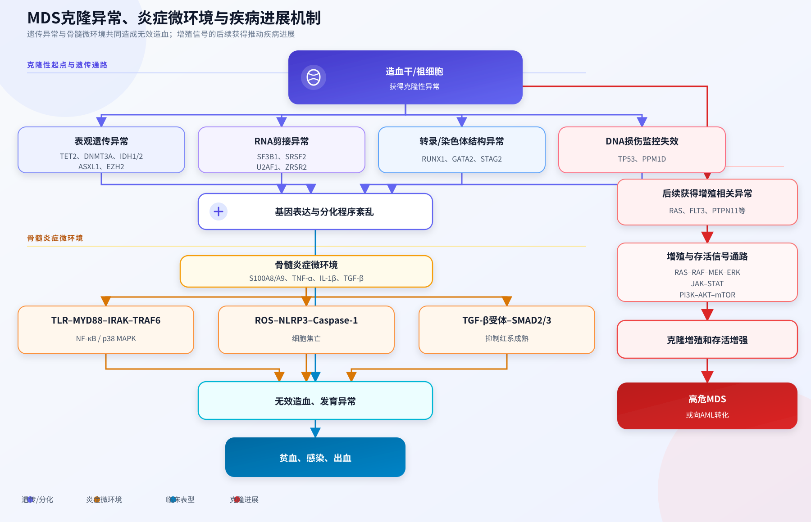

MDS并不是由一条固定信号通路驱动，而是多个层面共同失控：

- DNA表观遗传；
- RNA剪接；
- 转录调控；
- 染色体与染色质结构；
- 炎症与先天免疫；
- 细胞分化；
- 细胞增殖、凋亡和焦亡。

1. [MDS细胞涉及哪些信号和调控通路](#三mds细胞涉及哪些信号和调控通路)
2. [表观遗传、RNA剪接、转录与染色体结构异常的异同](#五表观遗传rna剪接转录与染色体结构异常的异同)

1. **基因与染色体决定哪些克隆容易扩增。** 随年龄增长，造血干细胞会积累体细胞变异。`DNMT3A`、`TET2`、`ASXL1` 等变异可以先出现在尚未达到 MDS 诊断标准的人群中。有人长期停留在克隆性造血（CHIP），有人出现不明原因的血细胞减少（CCUS），其中一部分才进展为 MDS。细胞毒治疗既可造成损伤，也能选择原本就存在的耐受克隆。少数患者有 `DDX41` 等胚系易感。后续演化通常有多个分支，变异顺序因人而异。 [CHIP 人群研究](https://www.nejm.org/doi/full/10.1056/NEJMoa1408617) · [CCUS 随访](https://ashpublications.org/blood/article/129/25/3371/107625/Clinical-significance-of-somatic-mutation-in) · [治疗相关克隆选择](https://www.nature.com/articles/nature13968)
2. **RNA 剪接把一个基因变异放大成一批错误转录本。** `SF3B1`、`SRSF2`、`U2AF1` 等编码剪接因子。以 `SF3B1` 为例，突变会让细胞使用异常的剪接位点，降低 `ABCB7` 和 `TMEM14C` 的正常蛋白产量，干扰线粒体铁利用和血红素合成。铁于是积在幼红细胞核周围，形成环状铁粒幼细胞。患者来源细胞模型中，同时补回这两种蛋白几乎消除了环状表型。 [SF3B1 病因实验](https://ashpublications.org/blood/article/139/13/2038/482886/Coordinated-missplicing-of-TMEM14C-and-ABCB7)
3. **表观遗传决定造血细胞能否启动下一阶段的分化程序。** `DNMT3A`、`TET2` 影响 DNA 甲基化，`ASXL1`、`EZH2` 等影响染色质调控。突变可改变哪些基因在何时表达，进而影响干细胞自我更新和后代分化。RNA 层也能反过来改变染色质，例如突变 `SRSF2` 可使 `EZH2` 转录本错误剪接并被降解，影响组蛋白标记 `H3K27me3`。突变 `IDH1/2` 则从代谢层切入，产生 2-HG，干扰包括 TET 在内的酶，促成分化阻滞。 [MDS 突变机制综述](https://pmc.ncbi.nlm.nih.gov/articles/PMC8370479/) · [SRSF2–EZH2 实验](https://doi.org/10.1016/j.ccell.2015.04.006)
4. **染色体缺失也能直接影响蛋白生产。** `del(5q)` 是一段染色体缺失。少一份 `RPS14` 会损害前体核糖体 RNA 加工和 40S 核糖体组装，尤其影响红系成熟。同一缺失还常使细胞少一份 `CSNK1A1`。这两条支路分别解释了**为什么会贫血**，以及**为什么来那度胺能选择性压制这类克隆**。 [RPS14 病因实验](https://www.nature.com/articles/nature06494) · [来那度胺与 CK1α 机制](https://www.nature.com/articles/nature14610)
5. **到了细胞层，要同时看干细胞扩增和后代成熟。** 异常干细胞可以持续自我更新，而其后代可能停在祖细胞阶段、过早死亡，或产生成熟但功能异常的血细胞。骨髓炎症和免疫反应能进一步压制造血，也能改变不同克隆的竞争。多打击 `TP53` 与复杂核型、基因组不稳定和较高的 AML 进展风险密切相关。部分患者进展时还会出现或扩增 `NRAS`、`FLT3`、`PTPN11` 等信号通路亚克隆。 [炎症及细胞死亡研究](https://doi.org/10.1182/blood-2016-07-730556) · [TP53 人群研究](https://www.nature.com/articles/s41591-020-1008-z) · [MDS 向 AML 演化研究](https://pmc.ncbi.nlm.nih.gov/articles/PMC8210656/)

### 3. 表观遗传

MDS造血干细胞常出现调控表观遗传的基因异常：

- **DNMT3A**：负责添加DNA甲基化标记；
- **TET2**：参与甲基化标记的氧化和清除；
- **IDH1/IDH2**：突变后产生2-HG，抑制正常去甲基化和细胞分化；
- **ASXL1、EZH2**：影响组蛋白和染色质状态。

### 2. RNA剪接通路

常见基因包括SF3B1、SRSF2、U2AF1和ZRSR2。

突变后会造成大量RNA错误剪接，影响：

- 红细胞成熟和铁代谢；
- 线粒体功能；
- DNA修复；
- 细胞周期与凋亡。

SF3B1突变与环形铁粒幼红细胞密切相关。

### 4. 贫血和无效红系造血 TGF-β超家族—SMAD2/3通路

典型过程为：

> TGF-β/Activin等配体 
> → 相应受体 
> → SMAD2/3磷酸化 
> → 抑制晚期红细胞成熟

这条通路尤其与贫血和无效红系造血有关。

### 6. 增殖和存活通路

疾病进展时，异常克隆可能进一步获得NRAS、KRAS、PTPN11、CBL、FLT3或KIT等改变，激活：

- RAS–RAF–MEK–ERK；
- PI3K–AKT–mTOR；
- JAK–STAT。

这些通路使细胞从“分化异常、容易死亡”逐渐转变为“持续增殖、逃避死亡”。

### 7. TP53与DNA损伤通路

正常TP53会在DNA严重受损时促使细胞停滞、修复或凋亡。TP53双等位基因失活后：

- DNA损伤细胞仍能存活；
- 染色体不稳定性增加；
- 容易出现复杂核型；
- 治疗耐受和克隆进化能力增强。

可将疾病演变概念化为：

> 早期或部分低危MDS：表观遗传/剪接异常，加上炎症和过度细胞死亡，造成无效造血和血细胞减少。  
> 高危MDS：累积TP53、RUNX1、RAS/FLT3等异常，异常克隆逃避死亡并增强增殖，逐渐接近或转化为AML。

这只是总体模型，并非每位患者都按照相同顺序发展。

# 三期药物｜压制异常克隆、促分化或改变免疫清除

| 作用链路                     | 药物与三期项目                                               | 试验验证了什么                                               |
| ---------------------------- | ------------------------------------------------------------ | ------------------------------------------------------------ |
| **表观遗传、RNA**            | **注射阿扎胞苷**。掺入 RNA，也经转化进入 DNA，使 DNA 甲基转移酶 DNMT1 被捕获并耗竭 | **AZA-001** 是历史上的生存基准。按当时分类入组的较高危人群，OS **24.5 vs 15.0 个月**，对照为常规治疗。 [原始试验](https://pubmed.ncbi.nlm.nih.gov/19230772/) |
| **DNA 甲基化**               | **地西他滨**。主要经 DNA 掺入作用于 DNMT1                    | 较早三期对支持治疗的总体应答率 **17% vs 0%**。后续 **EORTC 06011** 改善无进展生存期，OS **10.1 vs 8.5 个月**，差异未达显著。 [早期三期](https://pubmed.ncbi.nlm.nih.gov/16532500/) · [EORTC 06011](https://pubmed.ncbi.nlm.nih.gov/21483003/) |
| **去甲基化药的递送**         | **地西他滨＋西达尿苷**、**阿扎胞苷＋西达尿苷 ASTX030**。西达尿苷抑制胞嘧啶脱氨酶，减少口服药物被降解 | **ASCERTAIN** 达到口服对静脉地西他滨的暴露等效。**AZTOUND** 的 2026 年三期结果显示，口服对皮下注射阿扎胞苷 AUC 比为 **95.2%**，达到药代等效，属于 MDS/CMML 混合研究。 [ASCERTAIN](https://pubmed.ncbi.nlm.nih.gov/38135371/) · [AZTOUND 2026 披露](https://www.taiho.co.jp/en/release/2026/20261105.html) |
| **去甲基化药的递送**         | **Guadecitabine**，提高地西他滨活性成分对降解的耐受          | **ASTRAL-3** 在去甲基化药失败后的 MDS/CMML 中，OS **277 vs 252 天**，未达主要终点。 [三期结果](https://clinicaltrials.gov/study/NCT02907359) |
| **突变蛋白与代谢**           | **艾伏尼布 ivosidenib**，抑制突变 IDH1，减少 2-HG，解除部分分化阻滞 | FDA 于 **2023 年**批准其用于特定 **IDH1 突变的复发/难治 MDS**，依据是Ⅰ期亚组，18 人中 CR **38.9%**。未接受过去甲基化药的 MDS 人群另有三期 **PyramIDH**，仍在进行。 [FDA](https://www.fda.gov/drugs/cancer-approvals/fda-approves-ivosidenib-myelodysplastic-syndromes) · [PyramIDH](https://clinicaltrials.gov/study/NCT06465953) |
| **损伤检查点与氧化还原**     | **Eprenetapopt（APR-246）＋阿扎胞苷**，试图恢复突变 p53 的功能，药物也影响细胞氧化还原 | 在 **TP53 突变** MDS 中，三期主要分析 CR **33.3% vs 22.4%**，P＝0.13，未达终点。 [三期登记与结果](https://www.clinicaltrialsregister.eu/ctr-search/trial/2019-002782-35/results) |
| **分化转录程序**             | **Tamibarotene＋阿扎胞苷**。激动视黄酸受体 RARα，以 **RARA 高表达**筛选患者 | **SELECT-MDS-1** 的 CR **23.8% vs 18.8%**，未达主要终点。RARA 表达是这个试验的入组标志。 [原始试验](https://ashpublications.org/bloodadvances/article/9/16/4090/537145/Pivotal-results-of-SELECT-MDS-1-phase-3-study-of) |
| **线粒体凋亡**               | **维奈克拉＋阿扎胞苷**，抑制 BCL-2，降低细胞启动凋亡的门槛   | **VERONA** 的复合应答率 **76.2% vs 57.7%**，其中包含骨髓完全缓解。主要终点 OS **22.2 vs 21.7 个月**，P＝0.38。同靶点的 **Lisaftoclax＋阿扎胞苷**三期仍在开展。 [VERONA](https://doi.org/10.1016/S2152-2650(25)02083-X) · [GLORA-4](https://clinicaltrials.gov/study/NCT06641414) |
| **细胞周期、复制与蛋白周转** | **Rigosertib** 有微管去稳定化证据，开发中曾提出多个作用靶点。**Pevonedistat** 抑制 NEDD8 激活酶，影响 Cullin 蛋白降解系统及复制调控 | Rigosertib 的 **ONTIME、INSPIRE** 均未改善主要 OS 终点。Pevonedistat＋阿扎胞苷的 **PANTHER** 在 MDS/CMML/低原始细胞 AML 混合人群中未改善主要 EFS 终点。 [ONTIME](https://pubmed.ncbi.nlm.nih.gov/26968357/) · [INSPIRE](https://clinicaltrials.gov/study/NCT02562443) · [微管研究](https://pubmed.ncbi.nlm.nih.gov/32619469/) · [PANTHER](https://pubmed.ncbi.nlm.nih.gov/35728048/) |
| **生长信号**                 | **Lonafarnib** 抑制法尼基转移酶，影响 RAS 等蛋白的加工       | 输血小板依赖的 MDS/CMML 三期入组 47 人后终止，两组均无人达到方案定义的脱离血小板输注终点。 [欧盟试验结果](https://www.clinicaltrialsregister.eu/ctr-search/trial/2004-004685-32/results) |
| **免疫清除**                 | **Magrolimab、lemzoparlimab** 阻断 CD47，试图恢复巨噬细胞吞噬。**Sabatolimab** 靶向 TIM-3，涉及免疫细胞及髓系干／祖细胞 | Magrolimab **ENHANCE** 未达 CR 或 OS 终点，OS **15.9 vs 18.6 个月**。Lemzoparlimab 三期入组 10 人后因开发策略调整终止。Sabatolimab **STIMULUS-MDS2** 在 MDS/CMML-2 中也未达 OS 终点。 [ENHANCE](https://pubmed.ncbi.nlm.nih.gov/42441929/) · [Lemzoparlimab](https://clinicaltrials.gov/study/NCT05709093) · [STIMULUS-MDS2](https://clinicaltrials.gov/study/NCT04266301) |

# 三期药物｜恢复红细胞、血小板或骨髓造血

这部分主要看血细胞应答或**脱离输血**。表中的 8 周、12 周和 26 周是各试验各自设定的门槛，入组人群、既往治疗和输血负担也不同。

| 作用链路                       | 药物                                                         | 三期结果                                                     |
| ------------------------------ | ------------------------------------------------------------ | ------------------------------------------------------------ |
| **利用染色体缺失造成的脆弱性** | **来那度胺**经 CRBN 促使 CK1α 降解。`del(5q)` 克隆原本就常少一份编码 CK1α 的 `CSNK1A1` | `del(5q)` 输血依赖的 **MDS-004** 中，≥26 周脱离红细胞输注率为 **56.1%、42.6%、5.9%**，分别对应两个剂量和安慰剂。非 `del(5q)` 的 **MDS-005** 也有较小的绝对获益，≥8 周脱输血 **26.9% vs 2.5%**。 [MDS-004](https://pubmed.ncbi.nlm.nih.gov/21753188/) · [MDS-005](https://pubmed.ncbi.nlm.nih.gov/27354480/) |
| **早期红系祖细胞存活与增殖**   | **Epoetin alfa、darbepoetin alfa** 激活 EPO 受体。早期也有 EPO 联合 G-CSF 的方案 | Epoetin 的红系应答 **31.8% vs 4.4%**。Darbepoetin 的输血发生率 **36.1% vs 59.2%**。历史 EPO±G-CSF 试验改善红系应答，OS 和 AML 转化率相近。 [Epoetin](https://www.nature.com/articles/s41375-018-0118-9) · [Darbepoetin](https://www.nature.com/articles/leu2017192) · [E1996](https://doi.org/10.1182/blood-2009-03-211797) |
| **红系晚期成熟**               | **罗特西普 luspatercept** 捕获部分 TGF-β 超家族配体，减弱 SMAD2/3 信号，促进红系成熟 | **MEDALIST** 的环状铁粒幼细胞人群，≥8 周脱输血 **38% vs 13%**。**COMMANDS** 的初治 ESA、输血依赖人群，≥12 周脱输血且血红蛋白上升 ≥1.5 g/dL，**60% vs 35%**，对照为 epoetin alfa。非输血依赖人群的 **ELEMENT-MDS** 仍在随访。 [MEDALIST](https://doi.org/10.1056/NEJMoa1908892) · [COMMANDS](https://pubmed.ncbi.nlm.nih.gov/39038479/) · [ELEMENT-MDS](https://clinicaltrials.gov/study/NCT05949684) |
| **红系成熟与多谱系造血**       | **Elritercept**，另一种配体捕获剂。较广的红系阶段及血小板活性主要来自临床前证据 | 较低危、输血依赖 MDS 的 **RENEW** 对安慰剂、**ELRiSE MDS** 对 epoetin alfa，两个三期仍在开展。 [RENEW](https://clinicaltrials.gov/study/NCT06499285) · [ELRiSE MDS](https://clinicaltrials.gov/study/NCT07422480) |
| **端粒 RNA、复制寿命**         | **Imetelstat** 直接结合端粒酶的 RNA 模板 `TERC`，抑制端粒延伸 | **IMerge** 在 ESA 失败、不耐受或不适用的较低危输血依赖人群，≥8 周脱输血 **40% vs 15%**，≥24 周 **28% vs 3%**。FDA 2024 年批准特定人群。三期获益依据是脱输血。 [IMerge](https://pubmed.ncbi.nlm.nih.gov/38048786/) · [FDA](https://www.fda.gov/drugs/drug-trials-snapshots/drug-trials-snapshots-rytelo) |
| **内源性 EPO 与铁利用**        | **罗沙司他 roxadustat** 抑制 HIF 脯氨酰羟化酶，稳定 HIF，增强缺氧应答 | **MATTERHORN** 的 ≥8 周脱输血 **47.5% vs 33.3%**，P＝0.217，未达主要终点。 [原始试验](https://doi.org/10.1002/ajh.27410) |
| **DNA 甲基化与 RNA**           | **口服阿扎胞苷 CC-486**。这一制剂另有 AML 维持治疗用途       | 较低危、红细胞输注依赖且血小板减少的 **AZA-MDS-003** 中，≥56 天脱输血 **31% vs 11%**。前 56 天死亡 **16 vs 6 人**，多数与感染有关。要同时读疗效和早期安全性。 [原始试验](https://doi.org/10.1200/JCO.20.02619) |
| **巨核细胞与血小板生成**       | **艾曲泊帕 eltrombopag** 激活血小板生成素受体 MPL            | **SUPPORT** 在血小板减少的中危至高危 MDS 中与阿扎胞苷联用，前 4 个周期脱离血小板输注 **16% vs 31%**，因无效和安全性问题提前终止。较低危单药的 **EQOL-MDS** 属于Ⅱ期。 [SUPPORT](https://pubmed.ncbi.nlm.nih.gov/30305280/) · [EQOL-MDS](https://doi.org/10.1200/JCO.22.02699) |
| **免疫介导的造血抑制**         | **抗胸腺细胞球蛋白 ATG＋环孢素**，减少或抑制 T 细胞。历史上也探索过免疫调节药**沙利度胺** | **SAKK 33/99** 六个月血液学应答 **13/45 vs 4/43**，未见 OS 或无转化生存获益。沙利度胺的历史三期登记为完成，可核实的公开结果有限。 [SAKK 33/99](https://doi.org/10.1200/JCO.2010.31.2686) · [沙利度胺登记](https://clinicaltrials.gov/study/NCT00050843) |
| **输血后的铁过载**             | **地拉罗司 deferasirox**，螯合过量铁                         | MDS 单臂三期观察到铁蛋白下降。经常引用的随机 **TELESTO** 最终以Ⅱ期发表，研究的是铁过载相关临床事件。 [单臂三期](https://doi.org/10.1111/ejh.12300) · [TELESTO](https://doi.org/10.7326/M19-0916) |

**Rigosertib、Pevonedistat、吉妥珠单抗奥唑米星、Magrolimab、 Lemzoparlimab、Sabatolimab、罗特西普、艾曲泊帕、   各自的药物机理是什么，它们想通过这种机制，如何影响hr-mds适应症？失败的为什么失败了？**

这 8 款药在 HR-MDS 中想解决三类问题：**杀伤异常髓系细胞、让免疫系统清除异常细胞、恢复成熟血细胞产量**。其中，**Magrolimab 和艾曲泊帕的三期还观察到明确的安全性问题**。其余阴性试验主要证实了预期获益没有实现，具体在哪一步失效，往往没有人体证据。

## 1. 直接杀伤异常髓系细胞

**Rigosertib｜想在去甲基化治疗失败后压制仍在增殖的异常细胞。** 早期开发提出过激酶和 RAS 信号机制。后续用药用级化合物的研究显示，它可使**微管失稳、阻断有丝分裂**，进而诱导细胞死亡。人体内各种机制分别贡献多少，仍未厘清。ONTIME 三期总生存期 **8.2 对 5.9 个月**，P＝0.33。后续 INSPIRE 为 **6.4 对 6.3 个月**，也未改善生存。两次随机试验都未验证早期信号，公开数据尚无法判断是靶点作用不足、耐药克隆持续存在，还是其他原因。 [微管机制](https://pubmed.ncbi.nlm.nih.gov/32619469/) · [ONTIME](https://pubmed.ncbi.nlm.nih.gov/26968357/) · [INSPIRE](https://clinicaltrials.gov/study/NCT02562443)

**Pevonedistat｜想在阿扎胞苷基础上增加异常细胞的复制压力，推迟 AML 转化或死亡。** 它抑制 **NEDD8 激活酶**，使一组负责蛋白降解的 Cullin-RING 泛素连接酶活性下降。细胞模型中，复制调控蛋白 **CDT1** 等随之累积，导致 DNA 异常重复复制、损伤和细胞死亡。PANTHER 三期混合队列的无事件生存期为 **17.7 对 15.7 个月**，P＝0.557。较高危 MDS 亚组也未显示显著改善，**19.2 对 15.6 个月**，P＝0.431。较大的随机试验没有确认早期获益信号，两组常见的严重血液学不良事件也大致相近。事后只看能完成较多疗程的患者，容易把本来就能继续治疗、预后较好的患者选进去。 [靶点机制](https://doi.org/10.1038/nature07884) · [PANTHER 三期](https://pubmed.ncbi.nlm.nih.gov/35728048/)

**吉妥珠单抗奥唑米星（GO）｜想利用 CD33 把细胞毒药送进异常髓系细胞。** 这是**抗体偶联药物**。抗体结合细胞表面的 CD33，内吞后释放卡利奇霉素衍生物，造成 **DNA 双链断裂**。开发目标是在诱导化疗中加深对 CD33 阳性异常细胞的清除，降低复发。AML16 三期的 1,115 人中有 115 名高危 MDS 患者。**混合总体**的三年复发率为 **68% 对 76%**，三年总生存率为 **25% 对 20%**，初始应答率相近。研究观察到的信号主要是复发减少，HR-MDS 单独的疗效尚未确立。 [AML16 原始论文](https://doi.org/10.1200/JCO.2012.42.2964) · [高危 MDS 入组数据](https://ashpublications.org/blood/article/118/21/582/81898/The-Addition-of-Gemtuzumab-Ozogamicin-to-Intensive)

## 2. 让免疫系统清除异常细胞

**Magrolimab｜想解除异常细胞对巨噬细胞的吞噬抑制。** 异常髓系细胞表面的 **CD47** 与巨噬细胞上的 **SIRPα** 结合，发出抑制吞噬的信号。Magrolimab 阻断这一路径。联合阿扎胞苷的临床前依据是，后者可增加钙网蛋白等促吞噬信号。ENHANCE 三期的完全缓解率为 **21.3% 对 23.6%**，总生存期为 **15.9 对 18.6 个月**，两个主要终点均未达到。**≥3 级不良事件为 92.8% 对 79.2%，因不良事件停药为 24.0% 对 12.1%。** 正常红细胞也表达 CD47，阻断后发生的红细胞清除可以解释部分早期贫血。研究也观察到更多重度感染等事件，各因素对生存结果的贡献仍未确定。 [ENHANCE 原始论文](https://pubmed.ncbi.nlm.nih.gov/42441929/) · [安全性数据](https://ascopost.com/articles/2026/07-july/phase-iii-trial-finds-no-benefit-for-magrolimab-combination-in-higher-risk-mds/)

**Lemzoparlimab｜想保留抗 CD47 的吞噬效果，同时降低对红细胞的影响。** 它也阻断 **CD47–SIRPα**，但结合 CD47 的表位不同，设计上希望减少对正常红细胞的结合。这个差别有临床前依据，比较安全性仍待随机试验验证。中国 HR-MDS 三期仅入组 **10 人**，登记的终止原因为**公司开发策略调整**，未公布可判断疗效的数据。这里能确定的是项目为何停止，药物在该人群的疗效仍未知。 [NCI 机制说明](https://www.cancer.gov/publications/dictionaries/cancer-drug/def/lemzoparlimab) · [三期登记](https://clinicaltrials.gov/study/NCT05709093)

**Sabatolimab｜想同时增强抗肿瘤免疫，并干预部分异常干／祖细胞。** 它靶向 **TIM-3**。TIM-3 出现在部分免疫细胞和异常髓系干／祖细胞上，因此开发时提出两个假设：解除免疫抑制，以及削弱 TIM-3 阳性异常细胞的存活或自我更新。STIMULUS-MDS2 三期纳入 530 名中危至极高危 MDS 或 CMML-2 患者，总生存期为 **22.31 对 18.83 个月**，HR **0.847**，95% CI **0.671–1.070**，未达主要终点。此前随机Ⅱ期的完全缓解率和无进展生存期也未达标。研究尚未确定哪些患者真正依赖 TIM-3，也无法判断是效应太小，还是只有一部分患者可能受益。 [机制与设计](https://pubmed.ncbi.nlm.nih.gov/37083373/) · [随机Ⅱ期](https://pubmed.ncbi.nlm.nih.gov/38065203/) · [三期结果](https://clinicaltrials.gov/study/NCT04266301)

## 3. 恢复红细胞或血小板产量

**罗特西普｜想让更多幼红细胞完成晚期成熟，改善贫血和输血依赖。** 它捕获部分 **TGF-β 超家族配体**，减弱 **SMAD2/3** 信号，作用于红系成熟的后段。HR-MDS 联合方案的设想是由阿扎胞苷控制疾病，同时由罗特西普改善红细胞产量。中国随机三期纳入 **86 名初治 HR-MDS 患者**，主要终点是第 3、6 个月总体应答率。该试验已完成，已核对的公开登记尚未公布结果。较低危 MEDALIST 三期的脱输血获益已有证据，HR-MDS 联合方案的疗效仍待读出。 [药理说明](https://www.accessdata.fda.gov/drugsatfda_docs/label/2026/761136s017lbl.pdf) · [HR-MDS 三期](https://clinicaltrials.gov/study/NCT06927232) · [MEDALIST](https://doi.org/10.1056/NEJMoa1908892)

**艾曲泊帕｜想增加血小板产量，帮助患者度过阿扎胞苷治疗早期的低谷。** 它结合血小板生成素受体 **MPL** 的跨膜区，激活下游信号，促进巨核细胞分化和血小板生成。SUPPORT 三期中，前四个疗程脱离血小板输注的比例反而更低，**16% 对 31%**。总体应答率也更低，**20% 对 35%**。FDA 说明书记录的 AML 进展为 **21/179 对 10/177**。试验因无效和安全性问题提前停止。研究确认了**该联用方案的临床净效果不利**，AML 进展增加的分子原因仍不明确。较低危 MDS 单药Ⅱ期曾显示血小板应答，属于不同人群和用药场景。 [SUPPORT 三期](https://pmc.ncbi.nlm.nih.gov/articles/PMC6337824/) · [FDA 药品说明书](https://dailymed.nlm.nih.gov/dailymed/search.cfm?query=promacta) · [较低危 EQOL-MDS](https://doi.org/10.1200/JCO.22.02699)

## 五、表观遗传、RNA剪接、转录与染色体结构异常的异同

| 类型           | 通俗比喻                     | 发生环节                | MDS常见基因或异常                  | 主要后果                         |
| -------------- | ---------------------------- | ----------------------- | ---------------------------------- | -------------------------------- |
| 表观遗传异常   | 书本上的书签、封条           | 决定DNA是否容易被读取   | TET2、DNMT3A、IDH1/2、ASXL1、EZH2  | 正常分化基因被错误开启或关闭     |
| 转录异常       | 抄书的人抄错章节或抄多、抄少 | DNA→前体RNA             | RUNX1、GATA2、ETV6、CUX1           | 造血基因表达量和表达时机异常     |
| RNA剪接异常    | 剪辑影片时把片段拼错         | 前体RNA→成熟mRNA        | SF3B1、SRSF2、U2AF1、ZRSR2         | 产生错误或异常版本的mRNA和蛋白质 |
| 染色体结构异常 | 书页整段缺失、增加或装订错位 | DNA数量、排列和三维折叠 | del(5q)、-7、+8、复杂核型、STAG2等 | 大批基因剂量或空间调控同时改变   |

### 2. 表观遗传异常

表观遗传决定“哪些DNA可以被读取”，但标记本身不改变DNA字母顺序。

需要区分两层：

- TET2、DNMT3A等调控基因发生突变，属于DNA序列改变；
- 由这些突变引起的甲基化和染色质异常，属于表观遗传改变。

### 3. 转录异常

转录是RNA聚合酶以DNA为模板制造前体RNA的过程。

RUNX1、GATA1、GATA2、PU.1等转录因子决定：

- 哪个基因开始转录；
- 什么时候转录；
- 转录多少；
- 细胞向红系、粒系还是巨核细胞方向分化。

表观遗传和转录的区别可简化为：

- 表观遗传决定“书能否打开”；
- 转录因子决定“打开后抄哪一段、抄多少”。

### 4. RNA剪接异常

一个基因刚转录出来的是前体mRNA，其中包含：

- 外显子：通常需要保留；
- 内含子：通常需要删除。

剪接体会去掉内含子，把外显子重新连接。剪接因子突变后可能出现：

- 内含子没有被正确删除；
- 外显子被错误跳过；
- 选择了错误的剪接位点；
- 形成提前终止密码子；
- mRNA被细胞降解；
- 产生结构异常的蛋白质。

区别在于：

- 转录异常是RNA“制造多少、何时制造”不正常；
- 剪接异常是RNA已经制造出来，但“后期剪辑拼装”出错。

### 5. 染色体结构异常

这一概念包括两个尺度。

#### 大尺度染色体异常

- del(5q)：5号染色体长臂一段缺失；
- -7：整条7号染色体缺失；
- del(7q)：7号染色体长臂部分缺失；
- +8：多一条8号染色体；
- 复杂核型：同时存在多种染色体异常；
- 易位、倒位等重新排列。

这种异常可一次性改变许多基因的数量或位置。

#### 

DNA在细胞核中折叠成许多环，使远距离增强子能够接触相应基因的启动子。

表观遗传标记理论上相对可逆；但染色体缺失、基因突变等DNA层面的改变不会被去甲基化药物直接修复。

**表观遗传与代谢层**
TET2、DNMT3A、ASXL1、EZH2及IDH产生的2-HG。
成功：阿扎胞苷；地西他滨及口服地西他滨/西达尿苷有临床活性。

**核糖体、线粒体和蛋白翻译层——原链路缺失**
del(5q)→RPS14不足→核糖体应激→p53激活；SF3B1→线粒体铁代谢异常。
对应来那度胺、罗特西普及支持治疗。

---

基因/染色体异常 → 表观遗传与代谢 → RNA剪接 → 蛋白翻译/核糖体 → 分化、增殖、凋亡和自我更新 → 骨髓微环境/免疫选择 → 克隆扩增 → 无效造血、细胞减少或AML转化

DNA

RNA

表观遗传

清除克隆

- 免疫
- 抗凋亡

https://codebuddy.work/agents/tasks/share/qTxi8IJTn2?platform=workbuddy

| 失败药物                    | 年份  | 机制          | 失败的直接原因                |
| --------------------------- | ----- | ------------- | ----------------------------- |
| Rigosertib (ONTIME)         | 2016  | RAS通路抑制剂 | OS无差异                      |
| Guadecitabine (ASTRAL-3)    | ~2018 | DNMT抑制剂    | OS无差异                      |
| Eprenetapopt/APR-246        | 2020  | p53再激活剂   | CR率未达统计学意义            |
| Rigosertib (INSPIRE)        | 2020  | RAS通路抑制剂 | OS无差异（第二次失败）        |
| Pevonedistat                | 2021  | NAE抑制剂     | EFS无差异，早期停药率高       |
| Magrolimab (ENHANCE)        | 2023  | 抗CD47单抗    | OS+CR双失败，毒性增加死亡风险 |
| Sabatolimab (STIMULUS-MDS2) | 2024  | 抗TIM-3       | OS无显著差异                  |
| Tamibarotene (SELECT-MDS-1) | 2024  | RARα激动剂    | CR率未达统计学意义            |
| Venetoclax (VERONA)         | 2025  | BCL-2抑制剂   | OS无差异                      |

近30年来，仅7个药物获得FDA/EMA批准用于MDS（阿扎胞苷、来那度胺、地西他滨、地西他滨/cedazuridine、luspatercept、imetelstat、ivosidenib），而大多数 MDS 患者在诊断后3年内没有有效治疗选择。**未来方向**已明确指向：基于分子分型的富集设计、更精准的终点选择（IWG 2023标准）、以及适应性试验设计。