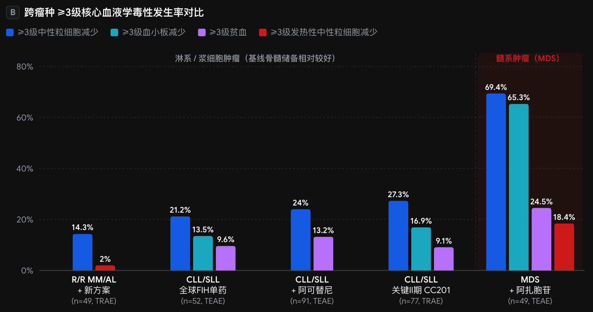
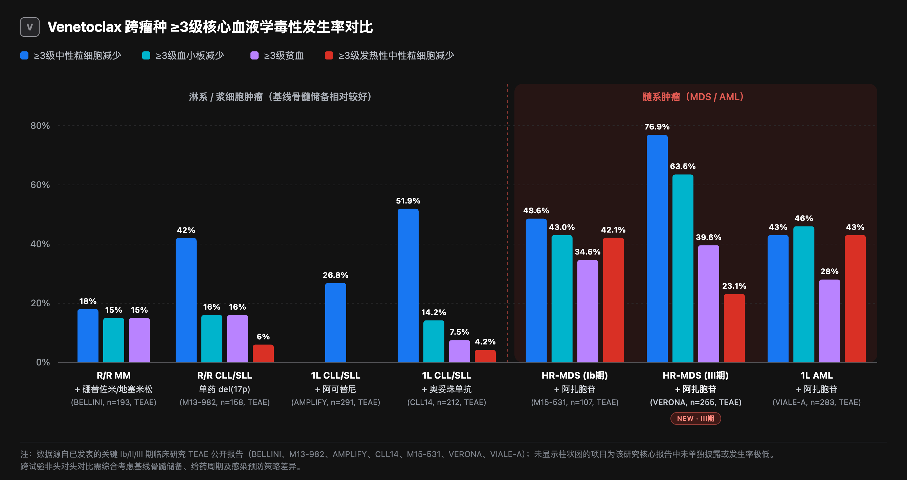

先理一下逻辑链（很多只有定性，没有定量，所以最后结果也没办法）

- NCCN把VEN+AZA作为HR-MDS治疗选项，故存在一定的off-label用药（可靠性？）
- 同类机制药物在现实世界的效果，以此验证药物机制可行性
- 同类机制药物为何临床失败，以此呈现Ven毒性（安全性）损害获益
- Lisaftoclax（APG-2575）的优势=>半衰期短+DDI少 带来的安全性，以此展望GLORA-4
- CR到OS的传导是否顺畅
- 变量
  - Tp53：（野生型/单等位）和双等位（15~25%）
    - 同为高危 MDS，TP53 野生型高危患者因为凋亡下游通路完好，联用维奈克拉后能把深度缓解转化为显著的生存获益（OS HR = 0.47）；而 TP53 突变型高危患者由于 p53 失活导致凋亡通路瘫痪，加用维奈克拉往往徒增骨髓抑制毒性却无法延长生存（OS HR = 0.96）
  - 移植率：移植后随访不删失，可享受OS红利
- GLORA-4对VERONA的优化
  - 入组门槛
    - 排除MF ≥3 级患者
  - 给药方式
  - 药物
  - 终点：完全缓解率（CR 率）+ 总生存期（OS）的双主要终点（Dual Primary Endpoints） vs Ven 单一OS终点
  - VERONA
    - 减量率vs
    
      - 剂量中断：78.8% vs. 67.9%
    
        维奈克拉/安慰剂减量：12.5% vs. 6.9%
    
        阿扎胞苷减量：48.6% vs. 27.2%
    
        因严重 AE 停药：41.6% vs. 55.3%
    - 移植率vs
    - Tp53(双等位）人数vs，ven整体 ven的tp53率 实验组vs对照组 49 vs 38 24.5% vs 18.7% +5.8%
      - 入组的 509 例 IPSS-R > 3 患者中仍有接近四分之一（约 25%）携带 TP53 突变
      - 推算双等位 \TP53\ 占比约 17%–21%：VERONA 公开摘要尚未单独公布单等位 vs 双等位的精确拆分比例，但结合多项大队列规律（全谱 TP53 突变 MDS 中双等位占 68%，而在高危 MDS 中单等位很少、70%–85% 以上确诊时即已进入双等位失活）（[PMC12983017](https://pmc.ncbi.nlm.nih.gov/articles/PMC12983017/)；[OncoDaily 2026](https://oncodaily.com/hematology/10-heme-onc-posts-638221)），VERONA 人群中双等位 TP53 患者大致占 17%–21%
    - 
- 数据证明
  - CR->OS off-label数据
  - Venetoclax 美国off-label数据，看现实世界（精细化医疗）下的CR、OS，对应BCL-2i的天花板
  
- 其他专家对2575、Venetoclax 的评论

> AI check:
>
> Off-label data: 
>
> ​	渗透率不高，美国 COTA 一线仅 2%、VALIDATE 一线仅 7.0%
>
> ​	临床效果一般，全人群严格 CR（17.1% vs 11.7%, P=0.16）和全人群 OS（HR=0.83, P=0.15）依然双双不显著
>
> IWG 2023：降低血红蛋白门槛，会提高2575的CR率，但也会提高AZA的CR
>
> 移植率：亚洲患者移植率低于欧美
>
> Venetoclax 当年在 Ib 期（M15-531，n=107）中 CR 率同样高达 ~30%，进到双盲 III 期 VERONA 后直接跌至 18.0%

我的反驳：

> 你提出的核心矛盾：
>
> 1、毒性毁掉OS，icMDS n=1907那个队列未必是精细化管理，只能说是现实世界用药
>
> 2、Lisaftoclax的TRAE不低，是Cmax影响，但AUC低，映射到临床就是，白细胞、粒细胞、血小板是减少幅度很大，但恢复同样很快，比Venetoclax快；至于食物效应，提示患者合理饮食即可，高危患者这点都做不到，那就是放弃自己的生命；FN调升的，n=17，人群入组太低，不具备统计学价值
>
> 3、你说的对，CR将血红蛋白门槛降低同样对AZA对照组有利；当前方案是CR/OS 双终点
>
> 逻辑漏洞与证据断层
>
> 1、NCCN收录推断off-label有效，这个确实只看了美国的，但不能说明证据力度倒挂，渗透率低是因为需要精细化医疗，能提供的地方不多，加上本身的毒性问题不好管理，渗透率低正常（COTA和VALIDATE是什么）
>
> 2、GLORA-4无法解决TP53是对的，所以这个部分看运气，入组太多会影响实验结果
>
> 3、CR一致，但血象不一致是否会影响移植？给我GLORA-4世界各地区患者分布比例
>
> 4、把 Ven 的 Ib 期数据拉出来同阶段并列对比，也无法判断 2575 的 30.4%–40.0% 究竟是药物更优，还是精细化管理带来的治疗红利
>
> 5、停药，是指三期临床的时候，医生做双盲，不知道哪个药是哪个，所以停了Venetoclax，这个不做讨论

「Cmax 导致血象降幅大、AUC 低导致恢复快」：药理推演方向成立，但目前在临床证据链上还是“缺环的假设”。

- 如果你要在文章里把这条作为核心论点，必须点明目前还没有公开的“恢复速度”硬数据（比如 2575+AZA 组 4 级粒缺的中位持续天数、中位周期是否稳在 28 天而非拖到 35–42 天、以及 AZA 的减量率）。把它写成“药理机制推导出的核心待验证假设”，比直接当既定事实写要稳健得多。
- n=17 的 FN 同意你的判断，样本太小不具统计效力，可删去或降级为个案观察；但食物效应（4.4–7.9 倍）我不建议归结为“患者自己不配合”——HR-MDS 中位年龄 70 岁，伴随食欲波动和饮食结构差异（欧美日常早餐很容易在无意间从低脂变成高脂），在 464 人的双盲三期里，它是客观存在的 PK 变异噪声，写一句“需依赖临床依从性管理”即可，不必完全忽略。

正如 VERONA 与 GLORA-4 共同核心研究者 Guillermo Garcia-Manero 所言，Lisaftoclax 相比维奈克拉半衰期更短、药物相互作用（DDI）更少，早期数据中因 AE 导致的治疗延迟（22.4%）和发热性中性粒细胞减少（12.2%）明显低于维奈克拉既往经验。

Jacqueline Garcia（Dana-Farber 癌症研究所，Ven+AZA Ib 期及 VERONA 核心研究者）

- 目前全网对 VERONA 失败原因拆解最深的一位专家。她在 [ASH The Hematologist（2025 年 10 月）](https://ashpublications.org/thehematologist/article/doi/10.1182/hem.V22.6.2025617/547782/VERONA-and-the-Future-of-High-Risk-Myelodysplastic) 和 [ASH 2025 VJHemOnc 专访](https://www.vjhemonc.com/video/jsoei7ebpa4-interpreting-findings-from-the-verona-trial-in-mds-factors-influencing-the-lack-of-survival-benefit/) 中指出，VERONA 没赢 OS 不是单一原因，而是四个因素叠加：
  1. 双盲方案被迫“先砍基石药 AZA”：因为是双盲试验，方案规定出现骨髓抑制时必须优先减量阿扎胞苷（AZA）而非 Ven/安慰剂，这导致实验组可能出现了基石药欠量（underdose）；
  2. 对照组出组后严重交叉（Crossover）：她透露，安慰剂+AZA 组患者出组后最终用上 off-label Venetoclax 的比例是实验组的 2 倍（尤其在美国），直接把两条 OS 曲线拉近了；
  3. 人群稀释：纳入了中危（IPSS-R >3）及原始细胞 ≤5% 的患者，稀释了真正高危人群的获益；
  4. 临床定性：她明确呼吁不要再对所有 HR-MDS 无差别使用 Ven+AZA（"I would not be blanketly giving combination therapy for higher-risk MDS until we have further analyses"），目前 AZA 单药仍是标准治疗，Ven+AZA 仅可能在 MDS/AML 交界型或特定分子亚型（如剪接因子突变、继发白血病相关突变）中保留价值。

Amer Zeidan（耶鲁大学癌症中心，IWG 2023 第一作者、VALIDATE 牵头人）

- 明确反对“一刀切”大三期设计：他在 [OncLive（2025 年 5 月）](https://www.onclive.com/view/novel-agents-and-personalized-biomarkers-may-propel-a-new-era-of-mds-management) 和 [VJHemOnc MDS Sessions](https://www.vjhemonc.com/event/mds-sessions-novel-agents-being-explored-in-lower-and-higher-risk-mds-from-ash-2023-and-beyond/) 中指出，VERONA 存在诸多试验设计层面的历史包袱，HR-MDS 未来必须告别“one-size-fits-all（所有患者一锅炖）”，转向基于基因分型（分子定义）的精准分层入组。

为什么 VERONA 里 AZA 减量率高达 48.6%？ 不是医生乱减，而是双盲方案强制规定先砍 AZA、再动 Ven/安慰剂（[The Hematologist 2025](https://ashpublications.org/thehematologist/article/doi/10.1182/hem.V22.6.2025617/547782/VERONA-and-the-Future-of-High-Risk-Myelodysplastic)）。GLORA-4 同样是双盲，如果它没改掉“先砍 AZA”的规则，那 2575 能否保住 AZA 剂量就全靠自身短半衰期带来的血象恢复速度。

对照组出组后“2 倍交叉用 Ven”的隐形杀手：VERONA 在美国中心入组比例高，对照组进展后大量患者直接 off-label 用上了 Venetoclax（[ASH 2025 VJHemOnc](https://www.vjhemonc.com/video/jsoei7ebpa4-interpreting-findings-from-the-verona-trial-in-mds-factors-influencing-the-lack-of-survival-benefit/)）。这对 GLORA-4 是一把双刃剑——一方面，后 VERONA 时代欧美医生对 Ven 的 off-label 使用降温了，对照组交叉污染可能比 VERONA 轻；另一方面，GLORA-4 的 CR 双主要终点刚好避开了后线交叉对 OS 的稀释。

双盲为什么先减AZA

原因其实非常直白，是双盲试验的底层安全逻辑逼出来的（Dana-Farber 的 Jacqueline Garcia 在 [ASH The Hematologist 2025](https://ashpublications.org/thehematologist/article/doi/10.1182/hem.V22.6.2025617/547782/VERONA-and-the-Future-of-High-Risk-Myelodysplastic) 里也明确提到了这一点）：

1. 减“安慰剂”救不了对照组患者（安全底线） 在双盲试验中，患者出现重度 4 级粒缺或血小板减少时，主治医生不知道他吃的是 Venetoclax 还是安慰剂。如果方案规定“出现骨髓抑制先减盲态口服药（Ven/安慰剂）、保留全量 AZA”，那么对分在安慰剂组的患者来说，减安慰剂等于什么都没减，下一周期继续打全量 AZA 会直接面临致命感染或出血风险。因此，为了让同一套盲态规则在两个组都能真正起到“降毒救命”的作用，方案被迫优先去减那个两组都有、且确定具有骨髓抑制毒性的基石药——AZA。
2. 避免“功能性破盲”（方法学底线） 如果医生先减盲态口服药，发现患者血象立刻好转（大概率是 Ven）或毫无变化（大概率是安慰剂），就会在临床上造成间接破盲，破坏双盲试验的统计严谨性。
3. 这在 VERONA 里造成了致命的“双盲税”
   - 非盲真实世界 / Ib 期：医生明知患者吃了 Ven，血象掉太狠时会优先把 Ven 从 14 天砍到 7–10 天，尽量保住 AZA 的剂量强度。
   - 双盲 VERONA：实验组叠加 Ven 后更容易触发骨髓抑制阈值，而规则又强制先砍 AZA，结果就是你草稿里那组悬殊的数字——AZA 减量率 48.6% vs 27.2%，而 Ven/安慰剂减量率仅 12.5% vs 6.9%。Jacqueline Garcia 在 [ASH 2025 专访](https://www.vjhemonc.com/video/jsoei7ebpa4-interpreting-findings-from-the-verona-trial-in-mds-factors-influencing-the-lack-of-survival-benefit/) 里直言，这很可能导致实验组患者的基石药 AZA 被迫欠量（underdose），把原本该转化成 OS 的获益给砍掉了。

这一条直接把你的 GLORA-4 逻辑链扣得更紧了：GLORA-4 同样是双盲试验，天然要面对同样的调量困境。如果 2575 的短半衰期（5 小时无蓄积）+ 低 DDI 真能让患者在 28 天周期内更快恢复血象、少触发“先砍 AZA”的红线，它就能实打实地避开 VERONA 吃过的这笔“双盲税”。

交叉治疗？

双盲治疗期间不能交叉：患者只要还在 VERONA 研究方案里吃安慰剂+AZA，就不能换药。且出组后不删失

> 出组后是否删失
>
> 只要患者完成随机分组、没有失访或撤回生存随访同意，不管他出组后用了什么后续治疗（交叉用 Venetoclax、做异基因移植、还是上其他靶向药），只要人还在，就一直随访到死亡，所有生存时间都记在最初随机分到的那个组账上。
>
> 统计学原因：能活到出组并顺利交叉用上 Venetoclax 的患者，通常体能更好、所在中心医疗条件更强（极快进展死亡的弱势患者根本来不及交叉）。如果把交叉患者在换药那一刻删失，等于人为剔除了一批非随机人群，会破坏随机化平衡、制造严重的信息性删失偏倚（informative censoring），监管机构绝对不认。
>
> 安慰剂+AZA 组患者出组后如果大量用上了 Venetoclax，他们因此多活出来的几个月，全部算成了对照组的 OS 成绩。对照组 OS 被拉高，两组曲线自然收拢、HR 向 1 靠拢——这就是 Jacqueline Garcia 说 VERONA 对照组 2 倍交叉用 Ven 可能掩盖了生存差异的原因。

出组后完全自由：一旦对照组患者因为疾病进展、疗效不佳或转化为 AML 退出研究治疗，出于医学伦理，试验方无权限制主治医生在后续治疗中给患者开什么药。这时候患者有两条路直接用上 Venetoclax：

1. 直接按 AML 适应症合规（on-label）用上：HR-MDS 进展后，大量患者骨髓原始细胞跨过 20% 转化为继发 AML，此时用 Ven+AZA 本身就是 FDA 获批的标准方案，连超适应症都不算；
2. 还没转白（仍是 MDS）时超适应症（off-label）用上：就像 Jacqueline Garcia 在 [ASH 2025 专访](https://www.vjhemonc.com/video/jsoei7ebpa4-interpreting-findings-from-the-verona-trial-in-mds-factors-influencing-the-lack-of-survival-benefit/) 里说的，VERONA 对照组出组后最终用上 Venetoclax 的比例是实验组的 2 倍，直接把两条 OS 曲线拉近了。

这一机制对 GLORA-4 其实是一好一坏——坏处是对照组出组后转白或 off-label 用上 Ven（甚至在中国用上已获批 CLL 的 2575）的风险依然存在，仍可能稀释 OS；好处是 后 VERONA 时代欧美医生对 Ven 的 off-label 使用降温了，而且 GLORA-4 设有 CR 双主要终点，CR 评在出组交叉之前，完全不受后线交叉用药的污染。

acqueline Garcia 在 [ASH 2025 专访](https://www.vjhemonc.com/video/jsoei7ebpa4-interpreting-findings-from-the-verona-trial-in-mds-factors-influencing-the-lack-of-survival-benefit/) 中只给出了定性倍数——安慰剂+AZA 组出组后最终用上 Venetoclax 的患者比例是实验组的 2 倍；Guillermo Garcia-Manero 在 [OncLive（2026 年 1 月）](https://www.onclive.com/view/venetoclax-plus-azacitidine-misses-os-end-point-in-newly-diagnosed-higher-risk-mds) 中也同样将“失败后自然交叉加用 BCL-2i”列为影响 OS 的重要混杂因素。

根据 VERONA III 期在 SOHO 2025 发布的官方主分析海报（[Abstract MDS-1497, SOHO 2025 Poster](https://epostersonline-2.s3.amazonaws.com/soho2025/soho2025.00e001b.NORMAL.pdf)），在基线完成分子测序的患者中（Ven+AZA 组 n = 200；安慰剂+AZA 组 n = 203），核心不良基因的入组分布如下：

| 基线基因突变      | Ven + AZA 实验组（n=200） | 安慰剂 + AZA 对照组（n=203） | 组间差值                |
| ----------------- | ------------------------- | ---------------------------- | ----------------------- |
| TP53 突变（总计） | 49 例（24.5%）            | 38 例（18.7%）               | 实验组多 11 例（+5.8%） |
| RUNX1 突变        | 29 例（14.5%）            | 49 例（24.1%）               | 对照组多 20 例（+9.6%） |
| ASXL1 突变        | 60 例（30.0%）            | 68 例（33.5%）               | 对照组多 8 例（+3.5%）  |
| EZH2 突变         | 5 例（2.5%）              | 13 例（6.4%）                | 对照组多 8 例（+3.9%）  |

随机后出现了 TP53 在实验组偏高（24.5% vs 18.7%）、而 RUNX1/ASXL1/EZH2 在对照组偏高的交叉分布

P53 突变亚组在 VERONA 中对维奈克拉毫无生存获益（OS HR = 1.064），全人群最终 OS HR 为 0.908（P = 0.3772），说明即便校正这一基线小幅失衡，也仍不足以逆转 VERONA 全人群 OS 阴性的结论。

国外off-label用药情况（IDH1、IDH2突变覆盖人群低于5%，这里不考虑）

国外有明确实际使用记录的 HR-MDS 超说明书方案，主要是去甲基化药（HMA）＋维奈克拉。 美国队列里，一线使用较少，二线更常见。欧洲有移植前桥接的实际病例。英国则在 2026 年 9 月 10 日终止了这个组合用于初治 HR-MDS 的 NICE 专项评估。 [美国 COTA 队列](https://doi.org/10.1200/JCO.2023.41.16_suppl.e19077) · [西班牙桥接队列](https://doi.org/10.1186/s40164-025-00652-5) · [英国 NICE 决定](https://www.nice.org.uk/guidance/discontinued/gid-ta11368)

| 地区或研究                       | 实际用药情况                                                 | 能说明什么                                                   |
| -------------------------------- | ------------------------------------------------------------ | ------------------------------------------------------------ |
| 美国 COTA 电子病历队列           | 640 名 IPSS-R 中危、高危或极高危患者。含维奈克拉方案占一线 10/532（约 2%），二线 20/170（约 12%）。 | 这个队列里，维奈克拉更多出现在后线。数据截点是 2022 年 6 月，反映的是 VERONA 读出前的实践。 [COTA 会议摘要](https://doi.org/10.1200/JCO.2023.41.16_suppl.e19077) |
| 西班牙 GESMD，8 家医院           | 30 名患者以 HMA＋维奈克拉做移植前桥接，其中 22 人是 HR-MDS。最终 25/30 接受移植，其中 2 人还用了第二种桥接方案。 | 证明欧洲确有这个用药场景。患者事先经过移植筛选，研究也缺少对照，因此尚不能估计加维奈克拉能提高多少移植率。 [原始研究](https://doi.org/10.1186/s40164-025-00652-5) |
| 2026 年 VALIDATE，9 国 31 家中心 | 1,907 名接受这两类一线方案的 HR-MDS 患者中，134 人（7.0%）用了 HMA＋维奈克拉。复合完全缓解率 48.8% 对 27.7%，调整后总生存 HR 0.83，95% CI 0.64–1.07。 | 联合组的复合缓解更多，整体生存差异未达显著。7.0% 是这项研究入组患者的用药比例。 [VALIDATE 原始研究](https://doi.org/10.1038/s41408-026-01543-6) |

早期数据不适合直接对比，因为非双盲下，精细化管理可以调整剂量，减少毒性问题。那么还能从哪里对比ven和2575的安全性，可以看药物说明书，虽然不是mds适应症的，但药物的半衰期和ddi可以从其他适应症看出。

| 对比维度                       | 利沙托克拉（利生妥）                                         | 维奈克拉（唯可来）                                           | 索托克拉（百悦达）                     |
| ------------------------------ | ------------------------------------------------------------ | ------------------------------------------------------------ | -------------------------------------- |
| 联用强效 CYP3A 抑制剂 AUC 增幅 | 约 2.4–2.6 倍                                                | 约 11 倍（官方对比口径）                                     | 约 7.9 倍                              |
| 临床减量幅度                   | 爬坡期避免合用；维持期调量（暴露增幅仅 2.6 倍，真实世界常配合血药浓度监测微调） | 暴力减量：联用伏立康唑/伊曲康唑减量 75%（400→100 mg）；联用泊沙康唑减量 82.5%（400→70 mg） | 爬坡期禁用强效抑制剂，维持期需大幅减量 |
| 联用 P-gp / BCRP 抑制剂        | 非底物，无需调整剂量                                         | 需减量不少于 50%                                             | 需调整剂量                             |

说明书明确限制：在初始给药及 5 天剂量梯度递增期（爬坡期）应避免合用强效 CYP3A 抑制剂（如伊曲康唑、泊沙康唑、伏立康唑等），以防暴露量骤增触发肿瘤溶解综合征（TLS）；进入维持期后如必须合用，需按说明书调整剂量。   

说明书实测药代数据：健康受试者联用强效 CYP3A 抑制剂伊曲康唑（200 mg，每日一次）时，利沙托克拉的血浆峰浓度（Cmax）增加 82%（约 1.8 倍），总暴露量（AUC）增加 161%（约 2.6 倍）

由于Venetoclax+AZA的组合被纳入了NCCN指南，因此在off-label用药较多，这也让我们得以窥见bcl-2i在现实世界的效果。

GLORA-4 明确直接采用 IWG 2023 标准，以 完全缓解率（CR 率）+ 总生存期（OS）的双主要终点（Dual Primary Endpoints）

1、2575能否CR

2、CR能否传导到OS

主要变量

- 入组Tp53人群数量
- 移植率

对比ven的特点：半衰期更短、药物相互作用（DDI）更少，早期数据中因 AE 导致的治疗延迟（22.4%）和发热性中性粒细胞减少（12.2%）明显低于维奈克拉既往经验

VEN作为同类bcl-2i，它的临床数据对2575有很好的指引作用。先来看一下VEN的主要数据（Ven+HMA vs vs HMA）

| 研究与评估标准                                               | 严格 CR 率（Ven+HMA vs 对照）                                | 显著提升的缓解指标                                           | 总生存期（OS）                                               |
| ------------------------------------------------------------ | ------------------------------------------------------------ | ------------------------------------------------------------ | ------------------------------------------------------------ |
| VERONA III 期（NCT04401748，n=509，IWG 2006 改良标准）       | 18.0% vs 20.2%（数值反而略低，无获益）（[OncLive 2025](https://www.onclive.com/view/venetoclax-plus-azacitidine-fails-to-provide-os-advantage-in-treatment-naive-higher-risk-mds)） | mOR：76.2% vs 57.7%（P < 0.0001）；增量主要来自 mCR（57.8% vs 37.5%） 及 mCR+HI（27.3% vs 18.2%）（[OncLive 2025](https://www.onclive.com/view/venetoclax-plus-azacitidine-fails-to-provide-os-advantage-in-treatment-naive-higher-risk-mds)；[Blood ASH 2025](https://ashpublications.org/blood/article/146/Supplement 1/235/552343/Subgroup-analyses-from-the-randomized-Phase-3)） | 22.18 vs 21.68 个月（无统计学差异）（[Cure Today 2025](https://www.curetoday.com/view/venclexta-and-azacitidine-fail-to-improve-mds-survival)） |
| icMDS VALIDATE 队列（Blood Cancer J 2026，n=1,907，IWG 2023 中心双人评估） | 17.1% vs 11.7%（P = 0.16，无统计学差异）（[Blood Cancer J 2026](https://www.aamds.org/research-article/outcomes-patients-higher-risk-myelodysplastic-syndromesneoplasms-treated)） | IWG 2023 复合完全缓解（cCR = CR + CR_L + CR_h）：48.8% vs 27.7%（P < 0.001，校正 OR = 2.49）（[Blood Cancer J 2026](https://www.aamds.org/research-article/outcomes-patients-higher-risk-myelodysplastic-syndromesneoplasms-treated)） | 全人群 HR = 0.83（P = 0.15） 无差异；仅 TP53 野生型亚组显著获益（HR = 0.47，P = 0.002）（[Blood Cancer J 2026](https://www.aamds.org/research-article/outcomes-patients-higher-risk-myelodysplastic-syndromesneoplasms-treated)；[PubMed 42373605](https://pubmed.ncbi.nlm.nih.gov/42373605/)） |

维奈克拉+AZA 能迅速把骨髓原始细胞清到 <5%（因此大幅拉高了 IWG 2006 的 mCR 和 IWG 2023 的 cCR/CR_L），但持续的骨髓抑制毒性（VERONA 中中性粒细胞减少 77.3% vs 60.2%、阿扎胞苷减量率 48.6% vs 27.2%）阻碍了外周血象完全恢复（[OncLive 2025](https://www.onclive.com/view/venetoclax-plus-azacitidine-fails-to-provide-os-advantage-in-treatment-naive-higher-risk-mds)），导致大量缓解停留在“不完全血象恢复”层面，既没能转化为统计学显著的严格 CR 优势，也没能在全人群中转化为 OS 获益

对移植有实际帮助，但不是靠“严格 CR”，而是靠“快速清瘤（cCR）”来抢出移植门槛

**移植前核心诉求是“降原始细胞”，而非“血象完全恢复”**：IWG 2023 的严格 CR 要求外周血三系完全达标，而 VEN 叠加的骨髓抑制恰恰会压制血象恢复，导致严格 CR 率被低估。但移植科医生最看重的是把骨髓原始细胞压到 5% 以下——血象恢复可以留给供者的造血干细胞去完成。在 VALIDATE 队列中，包含不完全血象恢复的复合完全缓解率（cCR）高达 48.8% vs 27.7%（p < 0.001），这才是它能提高移植桥接率（allo-HCT）的直接原因

**抢出移植时间窗**：HMA 单药通常需要 4–6 个周期才能起效，高危患者极易在等待期进展为 AML 或发生致命感染；VEN+HMA 往往 1–2 个周期就能完成减瘤，缩短了进入移植舱的等待时间。

VALIDATE 是真实世界回顾性队列，医生天然倾向于给更年轻、体能更好、原本就以移植为目标的患者上 VEN+HMA，这会放大该组的移植率和移植后生存优势

VERONA的VEN+AZA 组与安慰剂+AZA 组的移植率分别为 **17%（43/256）vs 13%（33/253）**，感觉也没差多少，cCR（

# 疗效证明

2575早期数据

| 维度                 | 国内研究（NCT04501120）ASH 2024 公布                         | 海外/全球研究（APG2575AU101 / NCT04964518）ASCO 2025 / ASH 2025 公布 |
| -------------------- | ------------------------------------------------------------ | ------------------------------------------------------------ |
| 入组人群             | 共 49 例 HR-MDS（IPSS-R > 3.5，原始细胞 > 5%）：41 例初治（TN）、8 例 R/R | 共 103 例髓系肿瘤，含 40 例 HR-MDS/CMML：15 例初治（ND）、25 例 R/R（含维奈克拉经治） |
| 一线疗效（IWG 2006） | • 全体可评估患者：ORR 77.5%，CR 25.0% • 600mg 初治队列（n=23）：ORR 73.9%，CR 30.4% | • 初治 HR-MDS/CMML（n=15）：ORR 80.0%，CR 40.0%（6/15），mCR 40.0%（6/15） |
| 一线疗效（IWG 2023） | • 600mg 初治队列（n=23）：复合 CR（cCR）69.6%，其中 CR 高达 52.2% | 未单独披露 IWG 2023 重算数据                                 |
| R/R 队列疗效         | 样本极小（n=8），未作为重点拆解                              | • R/R MDS/CMML（n=22）：ORR 50.0%，CR 27.3%，mOS 11.3 个月   |
| 核心安全性           | ≥3 级感染 46.9%（治疗相关 26.5%）；无 TLS，无 60 天死亡      | 全队列无 DLT，耐受性良好                                     |

> 按 IWG 2006 标准：CR 为 30.4%（7/23）
>
> 按 IWG 2023 标准：cCR 为 69.6%（16/23），具体拆分为 CR 52.2%（12/23）+ CRL（血象部分恢复的 CR）17.4%（4/23）
>
> 核心差异在于 IWG 2023 将 CR 的血红蛋白（Hb）门槛从 ≥11.0 g/dL 下调到了 ≥10.0 g/dL（同时维持中性粒细胞 ≥1.0×10⁹/L、血小板 ≥100×10⁹/L）：
>
> - 这 23 例患者中有 5 例（21.8%） 骨髓原始细胞已清零，且白细胞、血小板均完全恢复，但血红蛋白停留在 10.0～11.0 g/dL 之间。
>- 按 IWG 2006，这 5 人因 Hb 未满 11.0 g/dL 只能算作骨髓完全缓解（mCR），CR 仅为 7/23（30.4%）；
> - 切换为 IWG 2023 后，这 5 人全部直接晋升为 CR（7+5=12 例，即 52.2%），再加上 4 例血小板/中性粒细胞未完全达标的 CRL（17.4%），构成了 69.6% 的 cCR

患者移植

| 阶段 / 去向              | 占“医学达标患者”比例 | 核心驱动与阻碍因素                                           |
| ------------------------ | -------------------- | ------------------------------------------------------------ |
| 成功完成异基因移植       | 45% – 60%            | 异基因移植是 HR-MDS 唯一潜在治愈手段，欧美医生推荐力度极大，且 Medicare/商保覆盖成熟。 |
| 患者主动放弃（意愿流失） | 15% – 25%            | 经移植科详细风险告知后，部分高龄（65–75 岁）患者因顾虑 15%–25% 的非复发死亡率（NRM）及慢性移植物抗宿主病（cGVHD），宁愿选择门诊药物维持。 |
| 供体等待期疾病复发       | 10% – 15%            | 即使有非血缘（MUD）或半相合供体，配型与体检仍需 6–12 周；部分高危亚型（如伴 TP53 突变）在此窗口期快速复发而丧失机会。 |
| 体能下滑或照护条件不符   | 10% – 15%            | 诱导治疗期间发生严重感染导致器官功能不达标；此外，美国移植中心强制要求术后前 100 天有 24 小时全职照护者（Caregiver），独居或无家属陪护者会被直接拒收。 |

欧美入组更易兑现 OS 红利：欧美患者对移植的接受度及医保覆盖率显著高于国内（国内达标患者实际移植率往往低于 25%–30%）。GLORA-4 在欧美中心入组的患者，只要达成 IWG 2023 CR，约半数能顺利进入移植并转化为长期生存。

安全性决定“桥接窗口”留存率：早期数据显示 Lisaftoclax 联用 AZA 的 3 级以上感染和持续骨髓抑制负担相对可控，这有助于减少达标患者在等待供体期间因感染或体能恶化而掉队，从而放大试验组与对照组的实际移植率差值。

# 安全性证明

你的质疑非常准确。在非盲、小样本早期试验中，拿 Lisaftoclax 的 12.2% 发热性中性粒细胞减少（FN）去碰瓷维奈克拉早年的 42.1%，确实存在严重的跨试验偏倚和“医疗管理红利”滤镜。   

二、在缺乏 III 期数据时，直接/间接观测安全性的 5 种硬指标

要绕开“顶级中心滤镜”和“非盲报告偏倚”，可以通过以下五个维度交叉验真：

1. 剥离 AZA 干扰：看 CLL/SLL 单药大样本与“爬坡机制”
   - MDS 联用 AZA 本身就会导致极高的骨髓抑制，极难剥离 BCL-2 抑制剂的净毒性。CLL/SLL 单药是更好的纯度测试场。
   - 维奈克拉在 CLL 中必须采用繁琐的 5 周阶梯爬坡以防肿瘤溶解综合征（TLS）；而 Lisaftoclax 在全球汇总数据（PubMed 41109219）及中国获批上市的关键注册研究（n=77）中，直接采用 5 天每日快速爬坡，结果 TLS 发生率仅 0%–2.8%，≥3 级血细胞减少约 30.1%（低于维奈克拉历史单药常出现的 40%–50% ≥3 级粒缺）。能跑通“每日爬坡”且不炸雷，是目前证明其暴露量更可控、安全窗更宽的最强间接证据。   
2. 紧盯“给药行为指标”，而非主观的 AE 发生率
   - 非盲试验中，研究者可以通过积极打升白针（G-CSF）或将轻度感染归因于原发病来压低账面 AE，但以下三个客观操作指标极难粉饰：
     - 相对剂量强度（RDI）与周期实际给药天数（是否能稳住每周期吃满 14 天，而不像维奈克拉大量患者被迫缩减至 7–10 天）；
     - 中位周期长度（标准 28 天周期是否普遍被迫拖长至 35–42 天）；
     - 因 AE 导致的永久停药率与 30/60 天早期全因死亡率（早期死亡率是硬终点，不受分级主观性干扰）
3. 追踪中国商业化后的真实世界数据（RWD）
   - Lisaftoclax（利生妥）已于 2025 年 7 月在中国获批上市。脱离了临床试验严苛的入排标准和顶级中心的精细化管理后，普通三甲医院开始陆续产出真实世界超适应症（MDS/AML）回溯数据。
   - 重点观察这些真实世界队列中，严重感染率、粒缺持续天数、早期死亡率是否向维奈克拉的真实世界基线回归——例如上述 2026 年真实世界小样本中，FN 已跳升至 35.3%（MDS-IB 50.0%），尽管未出现治疗相关死亡和减量，但也说明早期临床 12.2% 的数字存在明显低估。   
4. 对比两国说明书与方案中对“抗真菌药联用”的减量幅度
   - 高危 MDS 粒缺期几乎绕不开三唑类抗真菌预防。维奈克拉联用泊沙康唑需暴力减量 75%–87.5%（400mg 降至 70–100mg），临床上极易因医生未及时调量引发灾难性骨髓抑制。
   - 持续跟踪利生妥说明书及 GLORA-4 最终执行细则：如果其联用泊沙康唑/伏立康唑时无需减量或仅需温和减量（如减半），那么即便细胞层面的毒性相似，其在真实临床中的操作安全性也会显著胜出。
5. 观察“维奈克拉耐药/不耐受”与高强度联合方案的耐受上限
   - 在海外 AU101 试验的 103 例患者（包含大量复发难治及维奈克拉经治人群）中，全队列未出现剂量限制性毒性（DLT），因中性粒细胞减少导致 Lisaftoclax 减量的比例仅 3%。如果后续公布明细能证实因毒性不耐受维奈克拉而换药的患者在 Lisaftoclax 上获得了更长的持续治疗时间，就能形成极强的个体自身对照证据。

一、利生妥说明书中的强效 CYP3A 抑制剂数据与减量规则   

先说明检索边界：利生妥（利沙托克拉片，2025 年 7 月 8 日核准）完整版说明书中【用法用量】项下的具体折算毫克数表在公开平台（如丁香园用药助手）处于登录权限折叠区，目前公开渠道未检索到针对泊沙康唑、伏立康唑分别单列的具体减量毫克数，因此这里不作臆测。   

但结合说明书已公开的联用原则和临床药理实测数据，已足以评估其 DDI 风险水平：

- 说明书明确限制：在初始给药及 5 天剂量梯度递增期（爬坡期）应避免合用强效 CYP3A 抑制剂（如伊曲康唑、泊沙康唑、伏立康唑等），以防暴露量骤增触发肿瘤溶解综合征（TLS）；进入维持期后如必须合用，需按说明书调整剂量。   
- 说明书实测药代数据：健康受试者联用强效 CYP3A 抑制剂伊曲康唑（200 mg，每日一次）时，利沙托克拉的血浆峰浓度（Cmax）增加 82%（约 1.8 倍），总暴露量（AUC）增加 161%（约 2.6 倍）。   
- 与同类药物的硬数据对比：

| 对比维度                       | 利沙托克拉（利生妥）                                         | 维奈克拉（唯可来）                                           | 索托克拉（百悦达）                     |
| ------------------------------ | ------------------------------------------------------------ | ------------------------------------------------------------ | -------------------------------------- |
| 联用强效 CYP3A 抑制剂 AUC 增幅 | 约 2.4–2.6 倍                                                | 约 11 倍（官方对比口径）                                     | 约 7.9 倍                              |
| 临床减量幅度                   | 爬坡期避免合用；维持期调量（暴露增幅仅 2.6 倍，真实世界常配合血药浓度监测微调） | 暴力减量：联用伏立康唑/伊曲康唑减量 75%（400→100 mg）；联用泊沙康唑减量 82.5%（400→70 mg） | 爬坡期禁用强效抑制剂，维持期需大幅减量 |
| 联用 P-gp / BCRP 抑制剂        | 非底物，无需调整剂量                                         | 需减量不少于 50%                                             | 需调整剂量                             |

#### 用这个指标判断“毒性”，需要注意什么？

CYP3A 减量幅度能证明“操作容错率高”，但不能直接等同于“药物本身骨髓毒性低”：

1. 利好面（DDI 安全窗确实更宽）：维奈克拉联用泊沙康唑时，血药浓度会暴涨数倍至十倍，临床上只要医生漏减量或停抗真菌药后衔接不当，极易引发致命骨髓抑制；利沙托克拉仅放大约 2.4–2.6 倍，且不经 P-gp/BCRP 转运，加上说明书【药效学】指出其 CLL/SLL 安全性与暴露量之间未见明显相关性，发生“意外过量中毒”的概率明显更低。   
2. 局限面（同靶点本底毒性仍在）：两者均抑制 BCL-2，一旦联用阿扎胞苷，正常粒细胞同样会受压制。2026 年发表的中国真实世界队列（n=17，联用唑类抗真菌药按血药浓度监测调量）中，全队列 3–4 级 FN 发生率仍达到 35.3%。
3. 容易被忽视的另一处风险（食物效应极强）：说明书显示，低脂餐和高脂餐可使利沙托克拉血浆暴露量分别飙升 4.4–5.0 倍和 7.5–7.9 倍（远超伊曲康唑带来的 2.6 倍增幅），因此必须严格低脂餐后服用。若患者在临床上饮食不规律（空腹或高脂饮食），血药浓度波动反而比合用抗真菌药更大。   

二、FN 读数是什么？

FN 是 Febrile Neutropenia 的缩写，即发热性中性粒细胞减少（临床简称“粒缺伴发热”）；FN 读数指临床试验中发生过 FN 的患者比例。

- 医学定义（须同时满足）：
  1. 重度粒缺：外周血中性粒细胞绝对计数（ANC）低于 0.5×10⁹/L（或低于 1.0×10⁹/L 且预计 48 小时内跌破 0.5×10⁹/L）。
  2. 发热：单次口腔体温达到或超过 38.3°C，或体温达到或超过 38.0°C 且持续超过 1 小时。
- 为什么它是 HR-MDS 的核心毒性试金石：
  - 在临床不良事件分级（CTCAE）中，只要确诊 FN，起步就是 3 级（严重）不良事件，通常需要立即住院并静脉使用广谱抗生素/抗真菌药。   
  - 高危 MDS 患者本身免疫极弱，FN 是败血症、停药减量以及 30/60 天早期死亡的最直接前兆；也是衡量“高骨髓抑制药物在真实世界里好不好管”的最敏感风向标。   

## DDI

主要代谢酶：CYP3A4 + CYP2C8 双通道代谢

ven：主要单一依赖 CYP3A4

和强效抑制剂联用：联用伊曲康唑

2575+伊曲康挫：$C_{\max}$ +82%，AUC +161%（约 2.6 倍）

强效 CYP3A 抑制剂使清除率下降 84%（AUC 飙升约 6 倍以上），需大幅减量 75%–82.5%

强效 CYP3A 诱导剂影响：lis（不是 P-gp、BCRP、OATP1B1/1B3 等的底物，对 P-gp 和 BCRP 也无明显抑制作用；对主要 CYP 酶系无时间依赖性抑制或诱导），ven：本身是 P-gp / BCRP 底物且具抑制作用

P-gp / BCRP 转运体

P-gp、BCRP、OATP1B1/1B3 等的底物是什么意思，Lisaftoclax是什么底物？Venetoclax是什么底物？有何区别

APG-2575 并非完全没有 CYP3A DDI（伊曲康唑仍使其 AUC 增加 161%，因此 GLORA-4 入排标准仍排除了入组前 14 天使用中效 CYP3A4 抑制剂/诱导剂者），只是波动幅度明显小于 Venetoclax；但在 P-gp / BCRP 维度上确实做到了基本干净

区分“预防性 DDI 调量”和“发生 AE 后的毒性减量”：临床试验 CRF 表中，按方案因为合用三唑类而提前下调维奈克拉剂量，一般不计入“因 AE 导致的减量”。从真实世界量级来看，这类主动 DDI 减量其实极高——例如 2026 年荷兰 15 家医院 209 例一线 HMA + 维奈克拉的多中心队列中，第 1 周期就有 74% 的患者因 CYP3A4 相互作用调低了维奈克拉剂量，其中 72%（151 例）明确源于三唑类抗真菌药（且规范调量后，首周期使用抗真菌药反而与更好的生存相关，HR 0.605, p=0.010）（[荷兰多中心 HMA+Ven 研究 2026](https://research.rug.nl/files/1566158665/Hypomethylating.pdf)）。真正棘手的是如果调量没拿捏准导致过曝，进而诱发重度粒缺和感染，最终迫使医生反复中断治疗或削减阿扎胞苷剂量。

为什么不一开始就用棘白菌素，而是要用三唑类？

核心原因就四个字：剂型、抗菌谱、证据等级，其中最直接卡脖子的是门诊给药可行性。

- 棘白菌素只能每天静脉输注，HR-MDS 门诊长期预防不现实：阿扎胞苷 ± BCL-2 抑制剂治疗 HR-MDS 属于门诊/日间主导方案，抗真菌预防通常要覆盖前 4 个周期（约 3–4 个月）（[ECIL-10 血液肿瘤抗真菌管理综述](https://pmc.ncbi.nlm.nih.gov/articles/PMC13540402/)）。目前主流棘白菌素（米卡芬净、卡泊芬净、阿尼芬净）都没有口服剂型，预防需要每日一次静脉滴注（[米卡芬净前瞻性预防研究](https://pmc.ncbi.nlm.nih.gov/articles/PMC6469030/)），让高龄 MDS 患者为了预防感染天天跑医院输液、叠加费用和静脉导管感染风险，临床上很难落地；而泊沙康唑缓释片每天口服一次就能在家完成（[ECIL-10 综述](https://pmc.ncbi.nlm.nih.gov/articles/PMC13540402/)）。
- 抗霉菌广度和保护力不如泊沙康唑：棘白菌素虽无 CYP3A4 相互作用，但对血液肿瘤患者最致命的侵袭性曲霉病保护力相对偏弱，文献报道棘白菌素预防期间的突破性 IFD（以曲霉为主）发生率普遍集中在 5%–7%（部分队列甚至更高）（[ECIL-10 综述](https://pmc.ncbi.nlm.nih.gov/articles/PMC13540402/)）；同时棘白菌素对毛霉天然无效，而泊沙康唑同时覆盖曲霉和毛霉（[ECIL-10 综述](https://pmc.ncbi.nlm.nih.gov/articles/PMC13540402/)）。
- 泊沙康唑有硬终点 OS 证据，指南地位不可替代：泊沙康唑在 AML/MDS 高危粒缺期经经典随机对照试验证实不仅降低 IFI，还明确改善总生存（OS），因此在指南中稳居 A-I 一线推荐（[2025 年血液病侵袭性真菌感染综述](https://pmc.ncbi.nlm.nih.gov/articles/PMC12738447/)；[ECIL-10 综述](https://pmc.ncbi.nlm.nih.gov/articles/PMC13540402/)）；而米卡芬净在白血病/MDS 预防中的前瞻性证据规模远不如泊沙康唑扎实（[米卡芬净前瞻性预防研究](https://pmc.ncbi.nlm.nih.gov/articles/PMC6469030/)）。

临床上的实际折中做法：并不是不用棘白菌素，而是把它当作住院期/爬坡期的短程“桥接药”——例如维奈克拉 + AZA 的 1b 期研究在第 1 周期明确禁止中/强效 CYP3A 抑制剂，期间就允许用棘白菌素这类非 CYP3A 抗真菌药顶上（[Garcia 等 Blood 2025](https://pmc.ncbi.nlm.nih.gov/articles/PMC11923426/)）；同样，当患者住院出现重度肝损、严重消化道黏膜炎无法口服、或合并高危 DDI 无法安全调量时，医生也会先用米卡芬净过渡，待度过最危险的住院粒缺期再视情况转口服方案。

你对比的 APG-2575+ 伊曲康唑 200 mg QD vs 维奈克拉+泊沙康唑 300 mg，在给药方式、剂量上一致吗？如果不一致，有可比性吗

不一致，你抓得很准——这两个试验不能做 1:1 的精确倍数对比。

| 对比项       | APG-2575 + 伊曲康唑                                          | 维奈克拉 + 泊沙康唑                                          | 维奈克拉 + 酮康唑（更接近的参照）                            |
| ------------ | ------------------------------------------------------------ | ------------------------------------------------------------ | ------------------------------------------------------------ |
| 受试人群     | 健康受试者                                                   | AML 患者（NCT02203773）                                      | NHL 患者                                                     |
| 给药方式     | 说明书未披露 APG-2575 具体给药天数（健康人探针 DDI 常规为单次给药 + 抑制剂多日预处理） | 连续 8 天多日稳态合用（第 21–28 天）                         | 单次给药（单剂 50 mg + 酮康唑预处理）                        |
| 抑制剂与剂量 | 伊曲康唑 200 mg QD                                           | 泊沙康唑 300 mg QD                                           | 酮康唑 400 mg QD                                             |
| 结果计算方式 | 直接实测比值（$C_{\max}$ 1.82 倍，AUC 2.61 倍）              | 减量至 50/100 mg 实测后，经剂量与非线性模型校正推算（$C_{\max}$ 7.1 倍，AUC 8.8 倍） | 直接实测比值（$C_{\max}$ 2.3 倍，AUC 6.4 倍）                |
| 来源         | [利沙托克拉片说明书](https://drugs.dxy.cn/pc/drug/pqnJ_r1SOXKgVae3dOPtPVQ?ky=Lisaftoclax) | [Agarwal 等 NCT02203773](https://www.researchgate.net/publication/313269127_Management_of_Venetoclax-Posaconazole_Interaction_in_Acute_Myeloid_Leukemia_Patients_Evaluation_of_Dose_Adjustments) | [Agarwal 等酮康唑研究](https://colab.ws/articles/10.1097%2FCAD.0000000000000522)；[Venclexta 说明书](https://chemoinfo.ipmc.cnrs.fr/MOLDB/labels/208573.pdf) |

### 那两者还有没有可比性？

不能当“2.6 倍 vs. 8.8 倍”的精确头对头结论，但拉齐到更接近的口径后，仍具有方向和量级上的可比性：

- 拉齐口径看单次探针试验（伊曲康唑 vs. 酮康唑）：酮康唑（早年 FDA 标准探针）和伊曲康唑（近年监管标准探针）都是强效 CYP3A4 + P-gp 抑制剂。拿这两个口径最接近的试验比，$C_{\max}$ 差距其实不大（1.82 倍 vs. 2.3 倍），但反映药物总清除受阻程度的 AUC 依然差了两倍多（2.61 倍 vs. 6.4 倍）。
- 这背后的机制差异是客观存在的：APG-2575 走 CYP3A4 + CYP2C8 双代谢通道且非 P-gp/BCRP 底物，同时半衰期短（约 5 小时，多次给药无蓄积）（[利沙托克拉片说明书](https://drugs.dxy.cn/pc/drug/pqnJ_r1SOXKgVae3dOPtPVQ?ky=Lisaftoclax)）；维奈克拉高度单一依赖 CYP3A4 且是 P-gp/BCRP 底物，半衰期长达 14–18 小时（[Venetoclax PK 综述](https://pmc.ncbi.nlm.nih.gov/articles/PMC11112299/)）。因此即便都做成连续多日稳态给药，APG-2575 的蓄积放大效应在药理上也应明显低于维奈克拉。
- 必须保留的严谨边界：在 APG-2575 真正做出并公开MDS/AML 患者连续多日合用泊沙康唑 300 mg 的稳态 PK 数据之前，不能直接把健康人伊曲康唑的 2.61 倍等同于真实世界泊沙康唑稳态增幅，更不能据此推导出“联用泊沙康唑完全不需要调量”。

维奈克拉 + 泊沙康唑还有其他接近2575+APG-2575 + 伊曲康唑 的给药方式的数据看Cmax和AUC的吗？

直接说结论：没有公开的“健康人单次维奈克拉 + 泊沙康唑（或伊曲康唑）”临床实测 DDI 研究。

因为维奈克拉当年在研发早期已经用酮康唑和利托那韦完成了标准强效 CYP3A 抑制剂的单次探针 DDI 试验，所以后续针对泊沙康唑、伏立康唑、伊曲康唑没有再回头做健康人单次试验，而是直接上 AML/血液肿瘤患者稳态 PK 或 PBPK 模型来定减量方案（[PBPK 研究 2021](https://www.researchgate.net/publication/348215263_Dose_adjustment_of_venetoclax_when_co-administered_with_posaconazole_clinical_drug-drug_interaction_predictions_using_a_PBPK_approach)）。

目前公开文献里，最接近“APG-2575 + 伊曲康唑”给药方式（单剂受试药 + 强效抑制剂多日预处理）以及可供交叉印证的维奈克拉数据如下：

| 组合与试验口径                                               | Cmax 变化             | AUC 变化              | 说明与来源                                                   |
| ------------------------------------------------------------ | --------------------- | --------------------- | ------------------------------------------------------------ |
| APG-2575 + 伊曲康唑 200 mg QD  （健康人，强效三唑）          | 1.82 倍（+82%）       | 2.61 倍（+161%）      | 基准参照（[利沙托克拉片说明书](https://drugs.dxy.cn/pc/drug/pqnJ_r1SOXKgVae3dOPtPVQ?ky=Lisaftoclax)） |
| 维奈克拉 + 酮康唑 400 mg QD  （NHL 患者，单次 50 mg + 强效唑类预处理） | 2.3 倍（+130%）       | 6.4 倍（+540%）       | 给药方式最接近（单剂 + 唑类强抑制剂）（[Agarwal 等](https://colab.ws/articles/10.1097%2FCAD.0000000000000522)；[Venclexta 说明书](https://chemoinfo.ipmc.cnrs.fr/MOLDB/labels/208573.pdf)） |
| 维奈克拉 + 利托那韦 50 mg QD  （健康人，强效 CYP3A 抑制剂 14 天预处理） | 2.4 倍（+140%）       | 7.9 倍（+690%）       | 人群与给药方式最接近（健康人 + 强效抑制剂）（[Venclexta FDA 说明书](https://www.accessdata.fda.gov/drugsatfda_docs/label/2019/208573s013lbl.pdf)；[PBPK 研究 2021](https://www.researchgate.net/publication/348215263_Dose_adjustment_of_venetoclax_when_co-administered_with_posaconazole_clinical_drug-drug_interaction_predictions_using_a_PBPK_approach)） |
| 维奈克拉 100 mg + 伏立康唑  （血液肿瘤患者稳态 PopPK，强效三唑） | 较 400 mg 单药仍 +43% | 较 400 mg 单药仍 +77% | 减量 75% 后仍显著超标，等剂量推算 AUC 增幅约 7 倍（[PopPK 研究 2025](https://www.researchgate.net/publication/391480372_A_Population_Pharmacokinetics_Study_of_Venetoclax_Concomitant_with_Voriconazole_in_Patients_with_Hematologic_Malignancies)） |
| 维奈克拉 + 氟康唑  （中效三唑类抑制剂）                      | —                     | 2.4–2.9 倍            | 最直观的锚点：中效抑制剂对维奈克拉的放大倍数，已等同于强效抑制剂对 APG-2575 的放大倍数（[AML 泊沙康唑 PK 研究 2023](https://www.researchgate.net/publication/371426591_Pharmacokinetics_of_Venetoclax_Co-Administered_with_Posaconazole_in_Patients_with_Acute_Myeloid_Leukemia)） |

总结来说：即便没有“健康人单剂维奈克拉 + 泊沙康唑”的直接实测值，把健康人利托那韦（AUC 7.9 倍）、单剂酮康唑（AUC 6.4 倍）和中效氟康唑（AUC 2.4–2.9 倍）拼在一起看，维奈克拉对 CYP3A 抑制剂的敏感度确实明显高于 APG-2575（强效伊曲康唑 AUC 2.61 倍），这一点在量级上是站得住脚的。

代谢是否随适应症变化？

小分子药在肝脏里的代谢酶通路（比如 CYP3A4/CYP2C8），本身不会因为患者得的是 CLL、AML 还是 MDS 就改变。

但不同适应症人群的实测 $C_{\max}$ 和 AUC 仍可能出现明显差异，不同适应症背后的患者状态不同

HR-MDS 患者高龄多、易合并低白蛋白血症和肝功能波动，而维奈克拉和 APG-2575 的血浆蛋白结合率都 >99%，重度肝损可直接让维奈克拉暴露量翻倍；此外，严重感染时的炎症因子本身也会下调肝脏 CYP3A4 活性。

最关键的区别其实不在 PK（血药浓度），而在 PD（骨髓耐受阈值）：哪怕健康人、CLL 患者和 HR-MDS 患者体内的 $C_{\max}$ 和 AUC 完全一样，HR-MDS 患者的骨髓造血储备极差——同等暴露量下，健康人可能毫无反应，CLL 患者只是轻度粒缺，而 HR-MDS 患者就可能直接掉进持续 4 级粒缺和重症感染。这也是为什么健康人 DDI 数据只用来量化代谢风险倍数的底线，到了 HR-MDS 患者身上仍必须靠临床减量规则或血药浓度监测（TDM）来兜底

如果主要是持续抑制的问题，是不是安全性主要看AUC，AUC升高越高，持续骨髓抑制越严重，Cmax只是瞬发的现象？

针对“持续性骨髓抑制”这个核心毒性，你的判断非常准确

为什么维奈克拉减量后配唑类仍容易骨髓抑制？ TDM 研究观察到，维奈克拉 100 mg 联用唑类时，峰浓度（$C_{\max}$）可能和 400 mg 单药差不多，但因为清除变慢、半衰期拉长，谷浓度（$C_0$）反而显著高于 400 mg 单药——血药曲线从“高尖快落”变成了“持续高平台”，骨髓一直喘不过气（[Agarwal 等 / Gao 等研究](https://www.researchgate.net/publication/313269127_Management_of_Venetoclax-Posaconazole_Interaction_in_Acute_Myeloid_Leukemia_Patients_Evaluation_of_Dose_Adjustments)）。一旦暴露冲破安全窗（例如 100 mg + 泊沙康唑的暴露甚至可超过 1200 mg 单药的最大安全剂量），持续骨髓抑制风险就会明显放大（[JHOP 2026 综述](https://www.jhoponline.com/issue-archive/2026-issues/april-2026-vol-16-no-2/reconsidering-venetoclax-dosing-with-azole-antifungals)）。

为什么 APG-2575 的短半衰期（约 5 小时）在 MDS 里被反复强调？ 正是因为它每天快速清除、不产生跨日高谷浓度蓄积，哪怕达峰时完成了对 BCL-2 的脉冲式抑制，后半天血药浓度很快回落，给本就脆弱的 MDS 正常骨髓留出了“喘息窗口”

### 测量时、人群、剂量、给药方式是否一致？不一致如何对比数据

### AZA

阿扎胞苷完全不经过细胞色素 P450（CYP450）酶系代谢，也不涉及 P-gp/BCRP 转运体 DDI，其体内消除仅依靠两条非 CYP 途径

- 自发水解（spontaneous hydrolysis）；
- 胞苷脱氨酶（CDA）介导的脱氨基失活，代谢产物主要经肾脏排泄。

就两药直接相互作用（APG-2575 ↔ AZA）而言：2575没有额外受益（ AZA 本身不走 CYP3A4 或 P-gp/BCRP）

真正的收益来自于多药联用：

- 抗真菌预防/治疗药（核心痛点）：HR-MDS 联用 BCL-2i + AZA 后粒缺感染风险高，临床频繁联用三唑类抗真菌药（泊沙康唑、伏立康唑、伊曲康唑等强/中效 CYP3A 抑制剂）
- 老年基础病用药：HR-MDS 患者多在 70 岁以上，常合并服用心血管/抗凝药（如地高辛、达比加群、他汀类、维拉帕米等 P-gp/BCRP 或 CYP3A 相关药物），APG-2575 不碰 P-gp/BCRP 能显著减少合并用药顾虑

https://epostersonline-2.s3.amazonaws.com/soho2025/soho2025.00e001b.NORMAL.pdf

HMA + BCL-2 中，唑类/三唑类使用比例约 55% – 75%，单药 HMA 治疗 约 30% – 60%。

棘白菌素类替代问题：

联合方案骨髓抑制更深，回顾性队列中 Ven + HMA 的 IFI 发生率约 13%（未缓解者更高）。因强效 CYP3A4 抑制剂（泊沙康唑/伏立康唑）会大幅抬高维奈克拉暴露，联用泊沙康唑时维奈克拉需减量 ≥75%（标准 400 mg 降至 70–100 mg），联用氟康唑需减量 50%；部分中心为规避 DDI 会改用棘白菌素（如米卡芬净），但棘白菌素突破性 IFD 率约 5%–7%

底物与代谢

| 维度                            | Venetoclax（维奈克拉）                 | Lisaftoclax（利沙托克拉 / APG-2575）             |
| ------------------------------- | -------------------------------------- | ------------------------------------------------ |
| 主要代谢酶底物                  | CYP3A4                                 | CYP3A4                                           |
| 外排转运体底物（P-gp / BCRP）   | 是（同时为 P-gp 和 BCRP 的底物）       | 不是（均非 P-gp 和 BCRP 的底物）                 |
| 摄取转运体底物（OATP1B1 / 1B3） | 非主要底物                             | 不是（亦非 OATP1B1、OATP1B3、OCT1、BSEP 的底物） |
| 对转运体的抑制作用              | 抑制 P-gp、BCRP，且为 OATP1B1 弱抑制剂 | 对转运体介导的双向干扰负担显著更轻               |

Venetoclax：因为是 P-gp 底物，FDA 说明书明确要求：只要联用 P-gp 抑制剂（即使对方不抑制 CYP3A4），Venetoclax 剂量必须至少减半（降低 50%），以防肠道外排受阻导致血药浓度飙升、诱发重度骨髓抑制或肿瘤溶解综合征（TLS）。

Venetoclax 自身还是 P-gp 和 BCRP 的抑制剂。如果患者同时服用治疗窗极窄的 P-gp 底物（如心血管常用药地高辛、抗凝药达比加群），Venetoclax 会反向抬高这些合并用药的血药浓度，增加中毒风险，临床常需避免联用或错开至少 6 小时给药。

部分血液肿瘤细胞在长期治疗后会高表达 P-gp 或 BCRP，通过主动将药物“泵出”胞外来产生多药耐药（MDR）。非 P-gp/BCRP 底物的分子特征，在理论上有助于降低转运体外排介导的细胞内药物浓度下降。

| 对比维度                        | 维奈克拉（Venetoclax）                                       | APG-2575（利沙托克拉）                                       |
| ------------------------------- | ------------------------------------------------------------ | ------------------------------------------------------------ |
| 主要代谢/转运途径               | 高度依赖 CYP3A4，同时是 P-gp / BCRP 底物和抑制剂（[FDA 说明书](https://www.accessdata.fda.gov/drugsatfda_docs/label/2019/208573s013lbl.pdf)） | CYP3A4 + CYP2C8 双通路代谢，非 P-gp / BCRP 底物或抑制剂（[利沙托克拉片说明书](https://drugs.dxy.cn/pc/drug/pqnJ_r1SOXKgVae3dOPtPVQ?ky=Lisaftoclax)） |
| 联用强效三唑类的暴露增幅        | 联用泊沙康唑（300 mg）时，剂量校正后 $C_{\max}$ 升至 7.1 倍、$\text{AUC}_{0\text{-}24}$ 升至 8.8 倍（[Agarwal 等 PK 研究](https://www.researchgate.net/publication/313269127_Management_of_Venetoclax-Posaconazole_Interaction_in_Acute_Myeloid_Leukemia_Patients_Evaluation_of_Dose_Adjustments)） | 联用伊曲康唑（200 mg QD）时，$C_{\max}$ 增加 82%（1.82 倍）、AUC 增加 161%（2.61 倍）（[利沙托克拉片说明书](https://drugs.dxy.cn/pc/drug/pqnJ_r1SOXKgVae3dOPtPVQ?ky=Lisaftoclax)） |
| 临床联用策略与调量幅度          | 必须大幅减量 ≥75%：在 AML/MDS 中，联用泊沙康唑须从 400 mg 降至 70 mg，联用伏立康唑/伊曲康唑等其他强效抑制剂降至 100 mg，联用氟康唑（中效）降至 200 mg；停用三唑类 2–3 天后才可恢复原剂量（[FDA 说明书](https://www.accessdata.fda.gov/drugsatfda_docs/label/2019/208573s013lbl.pdf)） | 仍需关注 DDI，但不必剧烈砍量：国内真实世界 MDS-IB/AML 联用阿扎胞苷的研究中，允许在合并强效 CYP3A 抑制剂（如三唑类）时结合血药浓度监测（TDM）酌情调整剂量（[Aza+Lisaftoclax 临床研究](https://pmc.ncbi.nlm.nih.gov/articles/PMC13156405/)） |
| 消除半衰期（$T_{1/2}$）与容错性 | 较长，一旦过曝，骨髓抑制恢复慢、易拖尾                       | 约 5 小时，即使合并用药出现过曝或感染，停药洗脱更快（[利沙托克拉片说明书](https://drugs.dxy.cn/pc/drug/pqnJ_r1SOXKgVae3dOPtPVQ?ky=Lisaftoclax)） |

维奈克拉的核心痛点是“减了 75% 仍可能过曝”：PK 研究显示，即使把维奈克拉从 400 mg 砍到 100 mg 联用泊沙康唑 300 mg，其 $\text{AUC}_{0\text{-}24}$ 仍比 400 mg 单药高出 155%，甚至可能超过 1200 mg 单药的暴露水平（[Agarwal 等 PK 研究](https://www.researchgate.net/publication/313269127_Management_of_Venetoclax-Posaconazole_Interaction_in_Acute_Myeloid_Leukemia_Patients_Evaluation_of_Dose_Adjustments)；[JHOP 2026 综述](https://www.jhoponline.com/issue-archive/2026-issues/april-2026-vol-16-no-2/reconsidering-venetoclax-dosing-with-azole-antifungals)）。因此 FDA 对泊沙康唑把剂量压到了 70 mg，且中国人群研究提示联用伏立康唑时按 100 mg 给药也常偏高、可能需要进一步下调（[Frontiers in Pharmacology 2025](https://www.frontiersin.org/journals/pharmacology/articles/10.3389/fphar.2025.1539233/full)）。这在骨髓储备本来就差的 HR-MDS 患者中，很容易直接转化为持续性重度粒缺和感染。

# 痊愈

MDS 唯一治愈手段是移植，而 Ven+AZA 的价值在于把患者快速推入足够深的缓解以降低移植后发

血象不恢复（持续粒缺、低血小板）会在两个环节直接伤到移植结局：一是等待供体期间因感染或体能恶化被迫推迟/取消移植（[OncoDaily 2026](https://oncodaily.com/hematology/myelodysplastic-syndromes-630359)）；二是移植前血小板偏低本身就是移植后生存更差的预测因子（[OncoDaily 2026](https://oncodaily.com/hematology/myelodysplastic-syndromes-630359)），且未进仓人群中，单纯 mCR 的中位 OS（17.2 个月）明显短于伴血象恢复的 CR/CRh（23.3–25.0 个月，[PMC9666661](https://pmc.ncbi.nlm.nih.gov/articles/PMC9666661/)）。

对你的逻辑是加分项：如果 2575 真能带来更快的血象恢复，它在“保住桥接移植窗口”上确实优于只清原始细胞的 mCR。

# NCCN & 临床医生

NCCN 将其纳入推荐的核心理由主要有三点：   

- 早期临床显示高缓解率与快速起效：基于 Ib 期临床研究（如 Garcia 等人的队列）及单中心数据，VEN+AZA 在初治 HR-MDS 中展现出远高于 HMA 单药的缓解率，且起效更快；在复发/难治（R/R）MDS 中也取得了约 39% 的改良总缓解率（mORR）和 12.6 个月的中位总生存期（OS）。   
- 异基因造血干细胞移植（allo-HSCT）前的桥接减瘤：NCCN 明确指出，当作为移植前的减瘤治疗（cytoreduction）与 HMA 联用时，采用每周期 14 天的维奈克拉给药方案可有效清除骨髓原始细胞，帮助适合移植的患者（尤其是原始细胞比例高、处于 MDS/AML 交界区 10%–19% 的患者）快速达到移植条件。   
- 现有标准疗法局限性大：HMA 单药的完全缓解（CR）率仅约 15%–20%，真实世界中位 OS 仅约 13–18 个月；一旦 HMA 治疗失败，患者中位 OS 骤降至约 6 个月，临床缺乏标准二线方案，迫切需要更强效的联合策略。

欧美血液科医生在真实世界中超适应症（off-label）使用 VEN+AZA，核心驱动力并非盲目用药，而是诊断边界融合、移植时间窗压力、临床无药可用以及医保合规通道四重因素叠加的结果：

- 生物学与诊断标准的“AML 化”：2022 年更新的 ICC 分类已打破传统的“20% 原始细胞”硬门槛，直接设立了 MDS/AML 类别（原始细胞 10%–19%）。在欧美医生眼中，这部分高原始细胞 HR-MDS 本质上就是早期 AML，因此自然倾向于直接套用 AML 的一线金标准（VEN+AZA）。
- 抢夺异基因移植（allo-HSCT）窗口期：AZA 单药起效极慢（通常需 4–6 个周期），高危患者极易在等待起效期间进展为 AML 或死于感染。VEN+AZA 能在 1–2 个周期内快速实现骨髓减瘤，帮助医生抢出宝贵的移植窗口。
- 近二十年无新药获批的临床现实：HR-MDS 领域近年来多个重磅 III 期研究（如 CD47、TIM-3、NEDD8 抑制剂等）接连折戟。面对 HMA 单药极差的真实世界预后，医生在缺乏更好选择时，倾向于采用“在 AML 中已被充分验证、机制明确且手头可得”的联合方案。
- 美国医保的 NCCN 报销通道：在美国，只要药物组合被纳入 NCCN 指南（即便是 2B 类推荐），Medicare 和主流商业保险通常就会批准报销。这直接扫清了医生超适应症处方的支付与合规障碍。
- 特定分子亚群的精准博弈：对于携带 IDH1/2、NPM1、SRSF2 等已知对 BCL-2 抑制剂高度敏感突变的患者，欧美学术中心医生仍倾向于主动联用 VEN。

VERONA III 期试验失败后，欧美医生的 off-label 处方行为并未完全停止，而是从过去的“广泛尝试”明显收缩为精准筛选——仅针对高原始细胞比例、拟行移植或携带敏感突变的体能较好患者，且在临床上普遍采取更保守的给药策略（如每周期 7–14 天短疗程 + 强力抗感染预防）来规避致命的骨髓抑制。

# 数据

## off-label

有没有真的顶级中心顶级医院顶级医生，带来的off-label用药分析，我样本不需要太大，20人以上即可，我只想看最顶级的精细化治疗，在真实世界是如何表现的

| 顶级中心与核心专家                                           | 队列性质与样本量                                             | 精细化管理特征                                               | 缓解率（CR / ORR）                                           | 生存（OS）与移植表现                                         | 毒性与剂量管理现实                                           |
| ------------------------------------------------------------ | ------------------------------------------------------------ | ------------------------------------------------------------ | ------------------------------------------------------------ | ------------------------------------------------------------ | ------------------------------------------------------------ |
| Moffitt 癌症中心单中心（Rami Komrokji / David Sallman，Blood Cancer J 2022，[PMC9633639](https://pmc.ncbi.nlm.nih.gov/articles/PMC9633639/)） | 一线 HR-MDS：n=35（对比同院一线单药 HMA n=1,158）；另含二线挽救 n=31 | 统一按 D1–14 给药，按指南联用抗真菌药并调量；Komrokji 明确强调第 1 周期末即做骨穿，骨髓低增生立刻停两药等血象恢复（[TargetedOnc 2022](https://www.targetedonc.com/view/mds-setting-looking-to-bcl2-inhibitors-for-improved-survival-sequencing-options)） | 一线 ORR 77% vs 40%（P<0.005）；ASXL1 突变组 CR 44% vs 8%（P<0.005）；TP53 组 ORR 75% vs 44% | 全人群中位 OS 仅 21 vs 20 个月（P=0.86，无差异）；但桥接移植人群 2 年 OS 达 91% vs 51%（中位 OS NR vs 38 个月） | 靠极早骨穿介入和主动停药控毒，一线中位仅打 4 个周期即转移植或停药 |
| MD Anderson 单中心（Alex Bataller / Guillermo Garcia-Manero，[EHA 2026](https://library.ehaweb.org/eha/2026/eha-2026/4208312/alex.bataller.hypomethylating.agents.with.or.without.venetoclax.in.html?f=listing%3D0browseby%3D8sortby%3D2topic%3D1574search%3Dazacitidine)） | 一线 MDS-EB（原始细胞 ≥5%）：n=113（对比同院单药 HMA n=245，共 358 例，含试验外及试验内患者） | 全球最大 MDS 中心（也是 VERONA 和 GLORA-4 的核心 PI 团队），完整 NGS 分层 + 成熟移植通道 | 特定亚组显著获益：高危 MDS、\ASXL1\ 突变、骨髓原始细胞 ≥10%  | Ven 显著提高了向异基因移植（HSCT）的转化率，成为驱动生存改善的核心路径 | 全人群同样呈现亚组分化，并非所有 MDS-EB 均获益               |
| 美国顶级五中心纯 Off-Label 队列（MSKCC n=11、Moffitt n=23、宾大 n=5、耶鲁 n=3、Hackensack n=2，Blood Advances 2020，[PMC7362378](https://pmc.ncbi.nlm.nih.gov/articles/PMC7362378/)） | n=44（100% 走医保审批的纯 off-label；73% 为 HMA 经治，27% 为初治） | 均按唑类抗真菌药下调 Ven 起始剂量（400mg 42%、200mg 37%、≤100mg 21%）；早期习惯第 1 周期给 28 天（77%） | 总 ORR 59%，但严格 CR 仅 14%（mCR+HI 27%、单纯 mCR 18%）；中位起效仅 1.6 个月 | 应答者中 63% 成功进入异基因移植，移植后显著延长生存；HMA 失败人群中位 OS 达 11.4 个月（历史仅 4–6 个月） | 即便顶级中心毒性仍极重：周期延迟 >7 天 67%、Ven 中断 >7 天 29%、非 TLS 住院 32%、因 AE 停药 20%、60 天死亡率 11% |

顶级中心管 Ven 也非常吃力，这反而是 2575 最好的切入点：MSKCC+Moffitt 队列里即便规范做了唑类减量，周期延迟仍高达 67%、因 AE 停药 20%；Komrokji 甚至直言，用 Ven+HMA 绝不能像单药 HMA 那样连打 3–4 个周期，必须第 1 周期末就骨穿、一空就停。

但即便在 Moffitt 这种单中心天花板手里，全人群 OS 依然没拉开：Moffitt 一线全人群中位 OS 是 21 个月 vs 20 个月（P=0.86），几乎提前三年复刻了 VERONA（22.18 vs 21.68 个月）。真正赚到 OS 的，高度集中在顺利桥接移植的人群，以及 ASXL1\ 突变、原始细胞 ≥10%、\TP53\ 野生型这几个亚组。

顶级中心能把“快速清原始细胞 → 桥接移植”做到极致
