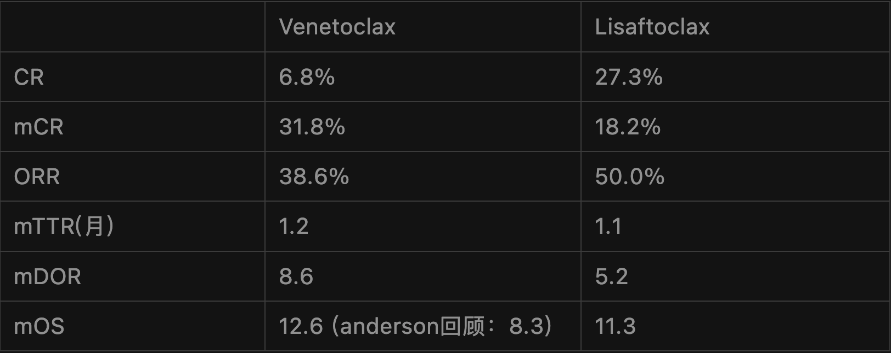

# 行文结构

+ BCL-2抑制剂
  + 细胞凋亡的信号通路
  + Cmax/AUC 各自特点
  + PK/PD代谢的影响
  + 不同bcl-2抑制剂的比较
+ MDS适应症
  + 特点：骨髓抑制严重、患者高龄、需要缓解（CR）
  + 对药的要求：安全性>疗效
+ 历史上MDS药物失败原因
  + 安全性差（magrolimab、verona）
+ bcl-2+aza在mds适应症的疗效天花板预期
  + off-label数据：ven+aza的精细化管理，CR 30%（肿瘤缩小+血象改善）

---

- cr-os的转换链路是否通畅（类似实体瘤PFS->OS），拆成mCR±HI -> OS传导，证明血象改善放在第一位
- VEN+AZA Ⅰb期 初治较高危 MDS mos 26.0个月，CR 30%，AZA-001 mos 24.5个月 CR 17%，血液学改善（HI）约49% 是否有代际差，最重要的好处是为了移植
- tp53突变OS很短拉低整体获益
- verona的失败，但bcl-2本身治疗mds的路径没有问题
- PANTHER（二期数据很好），pevonedistat，失败归因：不推荐6周期因血液毒性减少AZA（剂量+周期）
- 对glora-4的分析：
  - 安全性：骨髓细胞小于5%患者
  - CR率：CR+ mCR with HI
  - TP53
  - 微骨髓环境
  - DDI：2575 代谢不是只有cyp3a4，也不是P-gp或BCRP底物

> AZA 属于去甲基化药物，可抑制 DNA 甲基转移酶，使部分被异常甲基化压制的基因重新表达，从而帮助细胞分化、减少异常克隆的生存优势

---

1351+2575+aza **[NCT04501120](https://clinicaltrials.gov/study/NCT04501120)**；方案编号 APG2575AC101 三联方案，已在复发／难治 AML（R/R AML）中开展早期临床探索

**2575阻断 BCL-2；1351抑制多条激酶信号，并可能降低 MCL-1 等替代性抗凋亡机制；AZA 提供去甲基化治疗。**研究希望同时压制白血病细胞的生存信号和逃避凋亡的路径，尤其针对 VEN 耐药。

[2025 AACR 临床前结果](https://www.prnewswire.com/apac/zh/news-releases/aacr-2025apg-2575-302439867.html)显示，1351＋2575在 VEN 耐药 AML 细胞及小鼠模型中有协同作用，涉及 FLT3、AKT、MCL-1 等通路。**这些结果支持开展临床，但尚不能证明人体三联方案已克服 VEN 耐药。**

普通医疗中心的评价

1. 报告提到，有5例治疗前CRi或MRD阳性的低危患者，有2例获得更深层次的缓解，提示2575不仅能诱导初始缓解，还能进一步提升缓解质量，帮助患者获得更佳的长期预后。在治疗前，能到CRi或MRD阳性，切换成2575，大概率，要么是骨髓原始细胞杀得差不多了但因为安全性问题无法抗住新的治疗周期(CRi)，要切换更安全性的bcl-2抑制剂但疗效也不能太拉跨，这体现了安全性特征；要么是持续无法MRD阳转阴，那很可能是有残留的非bcl-2依赖白血病细胞，可能是2575能应对Ven耐药的机制发挥作用，当然这里肯定bcl-xl或者mcl-1代偿通路还没有很大比例，不然2575的机制也是不够的。

2. 四个中心里：有一个是中西医结合血液病诊疗中心，临床患者以老年患者为主，普遍合并多种基础疾病，脏器功能储备较差，对化疗及靶向治疗的耐受性要求极高，教授表示直观感受到2575的疗效和安全性平衡较优，DDI低，不需要频繁调整剂量，也不需要复杂的预处理，大大简化治疗流程，血液学毒性可控，通过常规的支持治疗就能管理，患者生活质量得到明显保障；一个是地市级医疗机构，患者多来自周边县域，受经济条件和地域医疗资源限制，无法常规开展基因突变检测，且以高龄、合并多种基础疾病、无法耐受强化疗的患者为主，教授表示临床医生不用等待分子分型结果就可以用2575作为老年unfit aml和hr-mds的优选，无需复杂预处理和密集的住院监测，显著降低医疗成本和患者就医负担。

到这里，不管基于自己的认知理解是站哪一种逻辑，都会面临接下来的灵魂拷问：

1. 如果分析机制就能判断成功概率，那创新药临床阶段的“死亡之谷”还会存在吗？难道能进入临床三期的分子，是对机制不熟吗？普通投资者对机制的理解能超过创新药的科研人员吗？投资者也喜欢戏称民科。
2. 能看到的数据都是基于早期临床的，都是小样本，那大三期样本扩大之后，患者的复杂性也会体现出来，也早期临床可能没发现的问题，这个巨大的黑箱根本无法判断？

off-label真实世界数据

> 常规情况下， 未获批适应症是不会在真实世界推广的，超适应症off-label使用也可能只是少部分医生尝试。可2575只获批了CLL的情况下，AML、HR-MDS在指南和众多KOL的力挺下，出现了比较大规模的“系统性”的off-label使用，不仅如此，还在编写案例集，还在发论文，还在全球会议上发表。
>
> 本身这种现象就已经能对glora4有很大信心了，但这和gloar4的成功概率并不是直接相关的，因为glora4的终点是OS。所以，我们接下来思考，这些off-label数据和OS有什么关系？能否作为贝叶斯概率的证据呢？
>
> 目前简单能够获取到的数据包括：一篇西安交大二附院的论文、2026 EHA的两个数据、公众号持续更新的单个案例。我们就基于这些数据来讨论。(不具体讨论数值细节，数据肯定是OK的)
>
> 看到off-label数据第一反应：这么小样本的数据，没什么意义吧，就像早期临床那样？特别是看公众号的案例，会很自然的觉得就是一个所谓的成功个案而已，失败的肯定还有很多。
>
> 但如果你再想深一层，就会问一个问题，如果仅仅是这样，那为什么会发论文，为什么会去国际会议发布，为什么会公众号推广？毫无意义吧，就算阴谋论认为亚盛刻意搞的，那也没意义，毕竟这不会影响glora4本身。
>
> 
>
> 再仔细看数据，会发现模式：
>
> 1. 西安交大的论文是rr aml和hr-mds，正好有AML refractory to venetoclax数据；
> 2. eha一篇山东的报告，主要是aml少部分mds，患者群体基线表面看着还不错，但几家医院是区域医疗中心和基层医院，这些医院的支持治疗能力整体属于平均水平之下；
> 3. eha的另一篇报告，是tn mds和rr mds，tn mds正好tp53为主，rr mds正好骨髓原始细胞小于5%为主；
> 4. 公众号个案：里面有患者先用维奈克拉失败、骨髓抑制强烈没办法，在2575获批上市后换成2575顺利CR；
> 5. 公众号个案合体：覆盖全国各地区医院、可能涉及各种突变类型等。
>
> 这些模式怎么理解？
>
> 1. 医生一般会在什么情况off-label，应该是没有合适的药了吧，未被满足的需求情况下吧：比如rr aml特别是refractory to ven的怎么办？比如hr-mds只能用aza吗？比如rr hr-mds怎么办？比如支持治疗不行的医院没有条件用ven怎么办？比如用了ven+aza失败的hr-mds的咋办？
> 2. 这些模式，是否正好对应了在机制分析时，比较公认的失败问题合集？比如verona失败的一些原因？
>
> 大三期临床，我们可以认为是一场平均主义实验，它成功代表的是患者群体平均下是获益的，能推进到大三期基本上常规意义的患者整体都是ok的，但恰恰在于，有一些特别的亚组可能会击穿这个平均主义的结果导致大三期失败。
>
> 这些off-label数据并不是随意发表的，而是因为它们正好代表形成了在真实世界这些未被满足的需求下，这些前人的失败经验下，进行的特殊压力测试，去测试可以击穿平均主义的亚组会怎么样。
>
> 从这个角度我们去理解这些off-label数据就是这样的，它们恰好从数据层面支持了我们提到的机制理解：
>
> 1. 数据覆盖了全国各地的中心，是很散装的没有特殊的区域性，并且覆盖精英到基层医院，安全性问题得到极大确认；
>
> 2. 数据证明对于ven to rr aml，2575可能有不一样的机制作用；
>
> 3. 数据证明rr hr-mds，2575可能有比维奈克拉更好的疗效，并且也能证明安全性；
>
> 4. tp53和骨髓原始细胞小于5%的亚组，2575可能可以不那么拖后腿。

1. Occupancy-driven占据驱动范式：找口袋，设计分子，优化亲和力等性质，Ki、IC50等指标很重要，也就是通过持续占据靶点来达到目标，核心是药物+靶点的稳态组合
2. Event-driven事件驱动范式：触发什么事件，在什么情形下，事件会怎么影响细胞，核心是药物+环境的动态组合。

2575是偏向于事件驱动范式，ven和11417是占据驱动范式。

bcl-2抑制剂的疗效并不单纯由“占据”决定，还由“释放BIM”这个事件决定，药效不是来自于持续占据，而是来自触发一个事件(BIM释放——凋亡启动，这个过程还有很多环节就不说了)：

在ENHANCE大三期里，实验组的移植率只有20.5%，远远小于对照组的35.1%；margrolimab的毒性严重限制了移植比例；

在VERONA大三期里，实验组的移植率17%，对照组只有13%，算是运气比较好吧，不过可能也说明ven的毒性都不会特别拖累移植窗口。

glora4的风险就在于hr-mds的异质性患者比例在大三期分布会是什么样子。由于AZA的OS的已经在20个月这种高位了，任何影响最终os hr的患者比例如果多一点都可能造成很大的影响

比如TP53突变比例，PANTHER是15%左右，VERONA是20%左右，ENHANCE上升到了30%以上，这个波动范围很大，这个比例越大越会稀释OS的统计显著度，毕竟TP53双等位复杂核型突变目前接近无法治疗，OS都很短，1年以内吧。

接下来，3288的一期临床数据就是很关键的了(当然一期是单药，不联用，这

些数据只能证明'安全基线够不够宽'，不能证明'联用价值'；真正的联用信号要等二期或扩展队列)，比如我们期待的数据：

- BTK降解深度与持续时间（PD信号）
- ≥3级中性粒细胞减少、感染、出血发生率（单药安全基线）
- 房颤/高血压信号（传统BTKi标志毒性，PROTAC应消除）
- DLT/停药率（剂量可推多高）
- ORR（特别是BTKi耐药突变患者）——单药活性验证
- MCL/WM/DLBCL等CLL之外的数据——差异化空间

**奥雷巴替尼的散弹枪属性。亚盛官方是这么描述的：**

奥雷巴替尼是一款多激酶抑制剂，可靶向作用于AML发病及维奈克拉耐药相关的多种激酶，包括FLT3、cKIT、PDGFR、Src家族激酶、PI3K及FGFR。

很有意思的是，这个描述是在2025 aacr的新闻稿里。这里说的靶点远远不止覆盖FLT3-ITD → STAT5 → MCL-1这个通路，还覆盖了Ven耐药的经典通路RTK-RAS-MAPK-MCL-1的一些环节（这个通路也是2575耐药的经典通路，Anderson 2575 二期 EOT 数据显示耐药后 RTK-RAS-MAPK 通路激活，理论上如果 2575 单药或联合方案耐药，1351 也可能通过覆盖上游 RTK 节点来应对）。虽然这些激酶靶点不如主靶点BCR:ABL1那样强，但也不弱。

**所以，1351+2575+HHT/AZA这个组合，其实就是覆盖了多条通路：**

- 2575是凋亡启动，针对bcl-2靶点，释放BIM；
- HHT是凋亡执行，通过PI3K/AKT/GSK3β通路降解MCL-1（引用2022年2575+HHT临床前的结论，不过在TN中2575+HHT有这个协同，在RR中也是需要验证的，2023 ash有数据，8人RR aml，6人CR/CRi，信号数据比较积极），阻止BIM被重新扣押；
- 1351是上游信号层，通过靶向多条通路的环节，如FLT3、cKIT、PDGFR、Src、PI3K、FGFR等，切断驱动MCL-1的信号；（需要明确，作为打地鼠游戏，仍有很多通路1351一点办法都没有，比如RAS/PTPN11本身突变、STAT3/FOXM1转录驱动、TP53双等位/复杂核型等）
- AZA是表观遗传调控，通过DNA去甲基化，诱导分化（在tn aml里，aza的免疫调节作用对重塑部分骨髓微环境有作用，但rr aml估计意义不大了）。

ven和lis早期 rr mds数据

- mOS-mDOR，4 vs 6 month

- CR和mCR：差很大，ven毒性问题和精细化管理

  

亚盛的组织管理能力经常被诟病，比如大俊爱面子，市场沟通能力差，资本运作能力差。对于科研出身的夫妻档小作坊而言，一体两面：正面就是深耕细胞凋亡通路这个领域，不追热门，不盲目fast follow内卷已经验证的靶点；反面就是容易过度自信，甚至会有些自负，而那些诟病的问题很可能就是这个反面问题的具象化。

*我的两个管线都是很好的分子，我们也是第一个做细胞凋亡靶点的虽然AT101失败了，我们的2575相比维奈克拉疗效相当但安全性好很多很多，在这种理解基础上：花大价钱请了履历非常厉害的高管来负责BD，同时也全球化临床推进，两手抓两手都要硬，结果是1351被贱卖出去了，不仅仅是钱的问题，关键是选择权，BD了之后依然要自己支出现金流推进mrct，然后2575在商业世界并没有这么好BD不出去；过程中财务管理提前冗余度不够，现金流经常吃紧，本身分子属性并不是那种很容易得到市场认可的路线股价自然也不容易被看好，那二级市场融资难度也很大很不容易，每次融资都变成额背刺小股东；对自家管线很自信，就不够理解市场的共识为什么如此，在沟通过程中就容易更加强调自己，特别是股价表现好的时候会误以为市场认可自己，更加表现出来沟通能力的差；还有全球mrct难度对于biotech本身就是地狱级挑战，过程各种各样的问题就会出来，包括与监管沟通，包括入组难度，包括与CRO的合作等等，结果就是有可能miss，反而变成了信息披露问题，而外部投行和很多投资者又恰恰喜欢追问这些节点（因为可以用来辅助rNPV估计来进行交易估值锚定），摩擦进一步加深。*

2. 官网放出来的和美国医药分析师的采访，信息密度非常高，全程无废话，聚焦核心战略，差异化也阐述的非常清楚，核心的P1\P2\G4等入组节点也说得很清楚，至于G2/G3，不管是不是分析师引导，采访里并没有说太多，虽然也重要但其实当下没这么重要。从信息披露角度，其实该说的都说了。至于更多余的信息，就像很多走BD路线的公司一样，事无巨细，就不绝对了，只能说如果你是rNPV交易型选手（类似看PE投资)，那怎么披露都会觉得不够，如果你是看价值投资（不考虑波动），那公司的信息披露是没有问题的，实际上把年报、半年报、各大会议仔细看了，偶尔耍耍临床信息披露，是很OK的。
3. biotech融资是生命，而融资很多时候和故事有关，或者说管线不够硬也没什么毛病，但有一说一，所谓的硬的管线能有多少呢，康方伊沃西都可以这么大的分歧。当然，亚盛其实犯了致命错误，幸好有武田识货BD了1351，就算贱卖也是人家买了（反过来也说明1351是很硬的分子，只是cml近几年才被人注意到市场空间很大，特别是阿思尼布的销售额持续上涨、terns的BD非常大），续命了。说白了，多管线多适应症全球MRCT并不是biotech能够做的，这其实超出了biotech能力（对过去用好高骛远也不能否定什么，当然也会有被迫赶鸭子上架的成分），最开始其实大俊也想BD，所以找了Jeff。只能说上天眷顾吧，verona失败了，给了亚盛很大的机会，也在那个时候市场来了一次β，给了公司很好的融资机会，那个时段很多创新药企都配股了，没有任何问题，就算上半年强调资金足够也都可以无视，特别是亚盛，维奈克拉给了机会，大三期也开始了，必须要备足子弹。现在看，即使如此，现金流依然紧张，那ATM自然就非常重要。如果从未来角度思考，ATM绝对是需要的，至于什么时候发那要看市场情况和资金支配情况了。至少这一年多来，融资能力有提高的迹象，并且和战略的聚焦匹配很清晰。
4. 还是聚焦，如果说以前的问题是不够聚焦，特别是2575，维奈克拉后面，什么适应怎都想试试。现在很清晰了，从入组来看，现在就是P1\P2\G4，后备就是400人的rr aml和180人的3288。CML\PH+ALL\CLL\HR-MDS\RR AML，就是当下的核心。

**二、无形资产**

这是一个非常有意思的问题，倒不是说无形资产有多大的价值，而是这是很重要的思考方式。我们说的无形资产不是财务报表里的，不如license in的公司把BD花出去的钱放在无形资产里。我们思考的是经营过程中，建立起来的不在财务报表上的对未来很重要的事情。比如我们说百济神州最强的能力，全球极高效率的MRCT能力，现在再鼎也在努力构建这个能力。

在亚盛的历史，有人诟病的信息披露问题有1351的入组问题，从1351的polaris1到2575的glora到2575的glora4，从监管沟通问题到入组难度问题，再到CRO的合作问题，这些都是需要一步一步过来的，为什么很少有biotech主动走着一条路，有太多不可控问题了，曾经亚盛踩过的坑都是很有价值的无形资产，也是因为曾经的踩过的坑，现在极其重要的GLORA4是不是进展还挺顺利，三大监管同一套方案批准，迅速入组，如果Glora4是第一个三期临床，那指不定会有什么问题。当然，1351的进度偏慢问题会导致武田行权问题的质疑，可能影响现金流，那确实是获得了无形资产也付出了代价。2025年年报沟通会，翟博对于卖方追着问入组进度表现出了很不舒服的一面，强调沟通有多麻烦，特别是欧洲这么多小国家。

1351+贝林妥欧单抗的PH+ALL的二期IIT是anderson中心发起的，GLORA4的PI也是VERONA的PI。记得翟博说过，公司最开始去anderson中心沟通，1351是敲门砖，很看好1351，后面2575的很多临床也跟随，到现在G4的PI和1351的IIT。这么多年，和anderson的关系沉淀成了良好的无形资产。当然，对于MNC们来说，这没什么，碎碎个事，但对于国内的Biotech而言，这不能说是很轻松简单的事。这个事情对商业化也是有好处的，血液瘤这么集中，KOL很关键，有anderson中心的KOL背书，对商业化有一定的加持。

国内的KOL也类似，三个BCL-2抑制剂，虽然都有站台的，但用词等各方面完全不一样。2575的站台密度、off-label案例披露都更多更强，这些不仅证明2575的价值，也能支持一旦获批进入医保，爬坡速度会无比的快，销售难度非常的小。

**还有一个更加关键的，管线的沉没成本是成本还是无形资产？**很多公司，广撒网，靶点一大堆，每个都fast follow工程化改造，管线之间没有什么关系，对于大创新药企，这是没问题的，也是风险管理的方式。但biotech，这种方式就显得少了点意思。每一个管线的失败，都是付出的过去时。亚盛的区别在于，所有管线都是围绕细胞凋亡的，这个问题前面有一篇文章讲到过，比如115的付出就在为4251铺路，而这些最后会成为辅助2575的资产，没有浪费，而且这些实验研究积累是无法轻易复制的。

亚盛医药思考系列（14）：通俗版HR-MDS的OS来源思考和VERONA/GLORA4理解

https://mp.weixin.qq.com/s/A0Nf0UkswX0CRsTUNAZ39A

2575号称安全很好，但不良事件发生率也不是特别低，比如大于三级的TEAE发生率也有89.5%，中性粒细胞减少也有40%等（unfit aml的早期临床数据），确实如此，2575也没有任何能力摆脱生物学制约。

但关键的地方在于造成了骨髓抑制之后是否能快速恢复，就是我们前面经常提到的靶点占据和事件驱动，2575的hit and run。CD47靶点是很典型的靶点占据大分子，半衰期也非常长，单位都不是小时，而是天/周，什么意思呢，就是这个骨髓抑制是持续发生的，没有时间恢复，这是需要精英支持治疗的关键，这才是核心问题。

bexmab的机制也是依靠巨噬细胞的，但与AK117不是同一条路径。巨噬细胞很有意思，它在人体内不同的微环境下，会有不一样的功能，原因在于肿瘤细胞本身也是由正常细胞发展来的，就是它本身有好人和坏人的一面，而巨噬细胞去区分好人和坏人的方式，会根据环境里肿瘤细胞的情况而变化，也就是它一会儿是帮凶，一会儿是警察。

在hr-mds里，微环境很恶劣，巨噬细胞更多的变成了免疫抑制的M2型，它成为了帮凶，会抑制免疫系统，为肿瘤细胞生长提供“土壤”。而bexmab的作用，就是通过阻断clever-1，把巨噬细胞从帮凶变成了警察，将免疫抑制的M2型巨噬细胞，重编程为具有抗肿瘤活性的M1型巨噬细胞，使其恢复促炎和免疫刺激功能。不仅如此，bexmab还能抑制肿瘤细胞的能量代谢（氧化磷酸化），改善造血功能，促进血细胞的恢复。

这个机制安全性非常高，都可以认为联合aza不怎么增加毒性了。但bexmab也有一个瑕疵，就是骨髓原始细胞越高，骨髓微环境的土壤越差，它发挥作用的能力就会下降。疗效数据显示，骨髓原始细胞<5%时，ORR能达到100%，骨髓原始细胞>5%时，ORR下降到75%。（不过这个瑕疵看着不严重，不影响它很优秀，只是不能确定这是不是小样本偏倚）

之前我们讨论2575的时候说过，骨髓原始细胞小于5%时，2575+aza很担心和aza单药拉不开差距。

所以从机制上，2575+bexmab+aza的组合很漂亮，2575弥补bexmab的瑕疵，bexmab弥补2575的瑕疵，这个三联组合说不定可以将OS很大提升，毕竟安全性理论上很不错。这个组合似乎可以完美实现了免疫+靶向的范式。

亚盛医药思考系列（20）：1351奥雷巴替尼的风险及为什么市场担心武田不行权

https://mp.weixin.qq.com/s/JJSbzRk0QYAB1cE6U5jV4g

在VIALE-A临床试验里，得到了中位OS  14.7个月的水平。但真实世界的结果却是非常尴尬，由于支持治疗的能力差别，OS并没有这么好。巴西最新真实世界研究数据，公立医院系统和私立医院用ven+aza，CCR率和MRD阴性率差不太多的情况下，OS是4.6个月和16.8个月的差别，也就是私立医院达到了VIALE-A的水平，公立医院惨目忍睹。很有意思的，结果分析，治疗中心是 OS 的独立预测因子（公立队列中57.4% 的死亡归因于多重耐药菌感染，加上 ICU 资源有限、新型抗菌药物可及性差、及时挽救性治疗受阻——患者达到缓解后，无法获得足够的支持治疗来度过整个疗程。）

可以认为，在支持治疗成为瓶颈的时候，OS 似乎不像一个"药物疗效指标Efficacy"，而更像一个"医疗系统质量指标Effectiveness"。在高收入国家，维奈克拉的 OS 数据是"药物在支持治疗保驾护航下的表现"；在资源有限的国家中，同样的药物实际上是在"裸奔"。

在中国，专家共识如果用ven+aza的话，最好有很多潜在先决条件，比如第1疗程必须住院，尤其是剂量爬坡期间，强烈建议住院治疗直至首次缓解且骨髓恢复、每日TLS检测、DDI方案强制执行、爬坡前WBC必须降低到一个标准、出现三级以上血液学建议置于无菌病房。

所以，每当我们在谈论unfit aml的ven+aza的时候，到底是在谈ven的药理作用，还是谈论ven+顶级支持治疗这个package的作用？

SLS009

销售峰值：

算美国每年新发用药人群4000人（6500-8500基数），年费用15w美金，DOT算1.5年，那美国的峰值毛估估就是9亿美金了。当然，可以敏感度分析调整上下波动，但这实际上并不重要。未来，随着发展，会有各种各样的可能性，不仅仅是多药联合，甚至会不会也有mm那样的移植后维持方案等等。

前面提到来那度胺，2015年来那度胺全球销售就50亿美金了，仅仅考虑二线mm的话大概估计在30亿美金左右，2015年之前新发病人群不到2.5w，考虑二线竞争和渗透率，那用药人数维度，可以认为是hr-mds适应症里2575的4倍样子中枢，而DOT方面，2575可能是来那度胺的1.5倍以上，再考虑价格增长因素，这样估计出来，15亿美金的全球中枢峰值也是有一定可参考性。

亚盛医药思考系列（26）：适应症体系价值——从奥雷巴替尼在CML说起

https://mp.weixin.qq.com/s/uWlaC39jwo_qWujgwd49ng

亚盛医药思考系列（27）：GLORA4的重新思考及成功率分析

https://mp.weixin.qq.com/s/ozGyyqmcaUXT2On-WxBD0w

主要数据：

- AZA-001：CR 17%、PR 12%、HI 49%，mOS 24.5个月，2年os率50.8%
- Verona： CR 18%（对照组20.2%）、mCR 57.8%（对照组37.5%）、ORR 76.2%（对照组 57.7%）、HI 49.4%（对照组41.2%）

Cmax和AUC越高，疗效就越强，但毒性也越强

百济神州11417索托克拉，Cmax非常高，半衰期很短，但AUC并不低，因此疗效比V药强很多；因此毒性不比V药小

两者（magrolimab、verona）的早期临床的不错疗效数据都是基于精细化临床管理支持治疗下得到的，但推迟减量的比例的非常高，在大三期模拟真实世界非精英医疗中心的情况下，标准化治疗就出问题了

推迟减量比例

Venetoclax off-label使用，最新的真实世界数据显示，有较好支持治疗的个性化治疗下，cr率在30%左右，2023 iwg 的crc在50%左右，mos在26个月附近，和早期临床的数据非常一致
