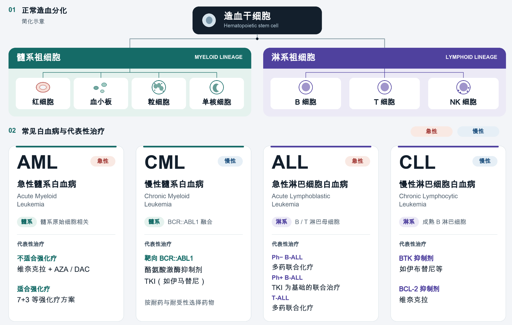
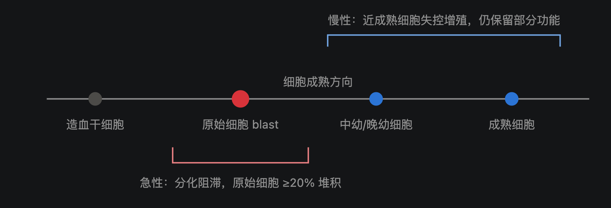
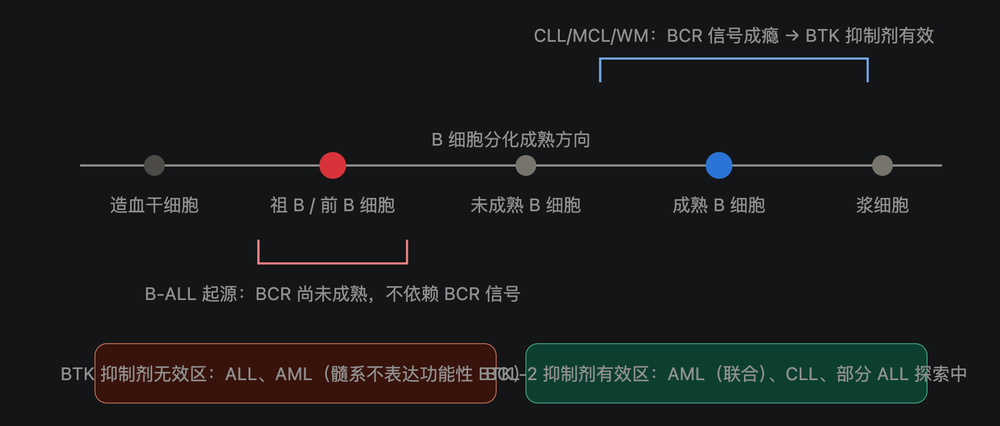

```

```

BTKi、BCL-2



对于AML、CLL，抗凋亡是依赖BCL-2，所以ven在这些适应症能成药。

对于CML、PH+ALL，BCR-ABL1 → STAT5 → 上调的是 BCL-XL 和 MCL1，BCL-2不是关键依赖，所以难成药。Ph+ ALL 的一线答案始终是 TKI：有明确驱动激酶的病，先打激酶永远是第一性原理。

> CML 的静息白血病干细胞（LSC）存在 BCL-2 依赖，Ven+TKI 联合清除 CML 干细胞确实有临床前和早期临床探索，但远未成为标准
>
> 复发/难治 ALL 中有 Ven+navitoclax（BCL-2/BCL-XL 双抑制）+化疗的试验信号

Ven 是"松开凋亡刹车"的药，只对**刹车踩在 BCL-2 上**的肿瘤有效（AML、CLL）；CML 和 Ph+ ALL 的油门卡在 BCR-ABL1 上，正确动作是断油门（TKI），不是松刹车


| 细胞阶段               | 生理性守门蛋白 | 对应肿瘤                       | Ven 是否有效              |
| :--------------------- | :------------- | :----------------------------- | :------------------------ |
| 造血干/早期祖细胞      | BCL-2（+MCL1） | **AML**（阻滞在原始粒细胞）    | ✅                         |
| 髓系末端（中性粒细胞） | MCL1           | ——（粒细胞短命，靠 MCL1 周转） | ——                        |
| 祖 B/前 B 细胞         | BCL-XL / MCL1  | **B-ALL**（同淋系！）          | ❌                         |
| 成熟 B 细胞            | **BCL-2**      | **CLL**                        | ✅                         |
| 浆细胞                 | MCL1           | 多发性骨髓瘤（同淋系！）       | ❌（仅 t(11;14) 亚型例外） |

成熟阶段决定“锁”的种类，和淋系、髓系、急性、慢性无关


| 维度           | 髓系                                                | 淋系                                        |
| :------------- | :-------------------------------------------------- | :------------------------------------------ |
| **功能**       | 先天免疫 + 携氧 + 凝血（执行层）                    | 适应性免疫（B/T/NK，识别层）                |
| **表面抗原**   | CD33、CD123、CD117——**与正常造血干/祖细胞高度共享** | CD19、CD20、CD22——**B 细胞特有谱系标志**    |
| **代谢弱点**   | 无特异性可利用弱点                                  | **不能自主合成天冬酰胺**、B 系依赖 BCR 信号 |
| **恶性转化后** | AML、CML、MDS、MPN                                  | ALL、CLL、各类淋巴瘤                        |
| 用药           | 髓系慢性：BCR-ABL1                                  | 淋系慢性：BTKi、BCL-2i                      |





（淋系）急性白血病和慢性白血病的一大区别是B细胞成熟度，急性的B细胞未成熟，不依赖BCR通路，所以BTKi无效。慢性白血病依赖BCR，故可以用BTKi

