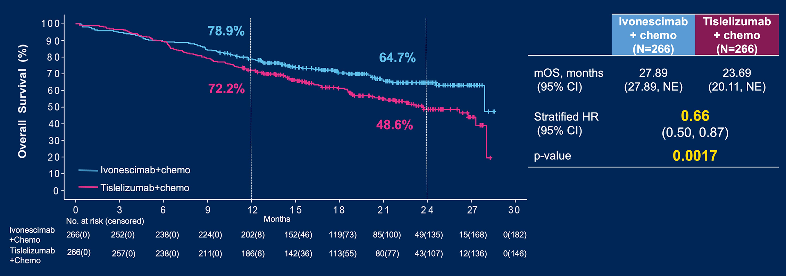
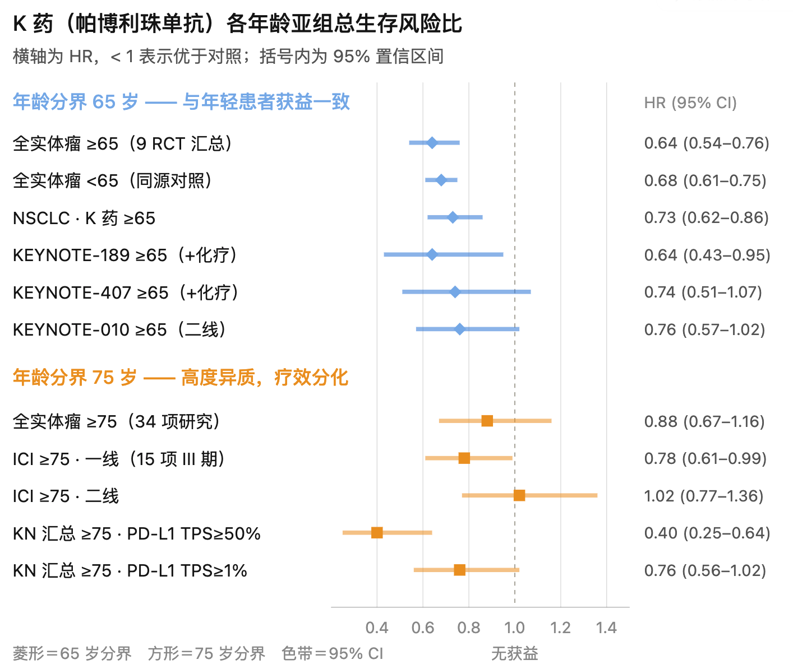
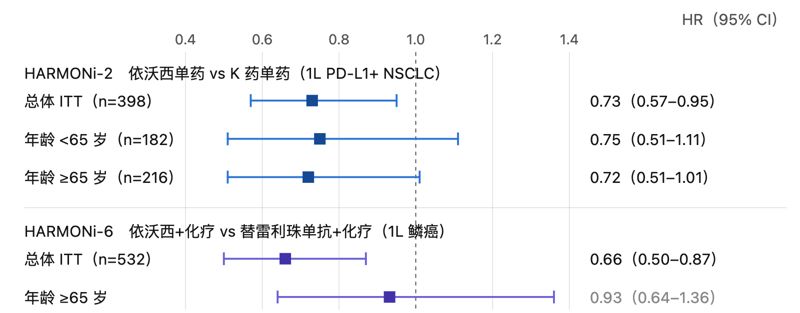
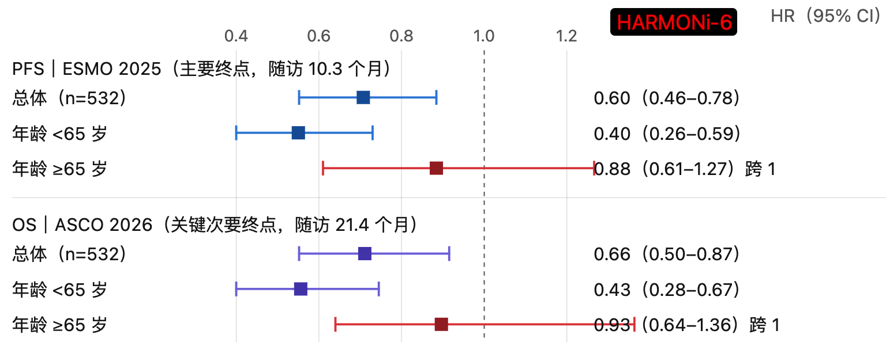

# 1. HARMONi-A

中国，EGFR-TKI 耐药非鳞 NSCLC

**入组人群标准**
- 18–75 岁；ECOG PS 0–1；预期生存 ≥3 个月
- 组织/细胞学确诊局晚（IIIB/IIIC）或转移（IV）**非鳞** NSCLC，不可手术、不可根治性放化疗
- 入组前确认存在 **EGFR 活化突变**
- **既往接受 EGFR-TKI 治疗且失败（未限定 TKI 代际）** — 实际入组中三代 TKI 占 86.3% vs 85.1%
- ≥1 个可测量的非脑部病灶（RECIST v1.1）
- 关键排除：含小细胞成分或以鳞癌为主；其他有获批药物的驱动基因突变；**既往任何肿瘤免疫治疗**；除 EGFR-TKI 外的系统抗肿瘤治疗；**肿瘤包绕重要血管、明显坏死/空腔、侵犯周围重要器官血管**；有症状 CNS 转移；2 年内需系统治疗的活动性自身免疫病；6 个月内胃肠穿孔/瘘；既往胸部放疗；需频繁引流的浆膜腔积液；IBD
- 分层因子：是否用过三代 EGFR-TKI；有无脑转移

**方案**：依沃西 20 mg/kg（n=161）或安慰剂（n=161）+ 培美曲塞 500 mg/m² + 卡铂 AUC 5，Q3W × 4 周期 → 维持（依沃西+培美 / 安慰剂+培美）。55 家中国中心，2022/1/25–2022/11/2 入组 322 例。

**基线**：中位年龄 59.6 vs 59.4 岁；女性 52.2% vs 50.9%；脑转移 21.7% vs 23.0%。

**整体数据**

| 终点 | 依沃西+化疗 | 安慰剂+化疗 | HR / p |
|---|---|---|---|
| mPFS（IRRC，中位随访 7.89 月） | 7.06 月 (5.85–8.74) | 4.80 月 (4.21–5.55) | HR 0.46 (0.34–0.62), p<0.001 |
| ORR | 50.6% (42.6–58.6) | 35.4% (28.0–43.3) | Δ15.6%, p=0.006 |
| mOS（最终分析，cutoff 2025/4/12，中位随访 **32.5 月**） | **16.8 月** | **14.1 月** | **HR 0.74 (0.58–0.95), p=0.02** |
| 30 个月 OS 率 | 29.1% (22.1–36.4) | 18.4% (12.8–24.8) | — |

> 发表：PFS → JAMA 2024;332(7):561-570；最终 OS → SITC 2025 LBA（Xiuning Le 报告）+ JAMA 2026。这是**唯一一次预设的正式 OS 分析**（2024/5 那次是 NMPA 要求的描述性分析）。

**亚组数据**
- PFS：三代 TKI 进展 HR 0.48 (0.35–0.66)；脑转移 HR 0.40 (0.22–0.73)；19del HR 0.48 (0.32–0.73)；T790M 阳性 HR 0.22 (0.09–0.54)
- OS：脑转移 HR 0.61 / 无脑转移 HR 0.77；19del HR 0.83 / L858R HR 0.60

**安全毒性**
- 期中分析：G≥3 TEAE 61.5% vs 49.1%（最常见为化疗相关）；G≥3 irAE 6.2% vs 2.5%；**G≥3 VEGF 相关 AE 仅 3.1% vs 2.5%**
- 最终分析（随访 32.5 月）：G≥3 TEAE 67.1% vs 54.7%；无新安全信号，常见 TRAE 两组无显著差异

**监管**：2024/5 NMPA 批准（首个适应症）；2024/11 纳入医保（2025/1/1 生效）。

---

# 2. HARMONi-2

（AK112-303，NCT05499390）— 中国，一线 PD-L1+ NSCLC，单药头对头 K 药

**入组人群标准**

- ≥18 岁（**无年龄上限**）；ECOG PS 0–1；预期生存 ≥3 月
- 组织/细胞学确诊 NSCLC，AJCC **IIIB/C 或 IV** 期
- **无 EGFR 敏感突变、无 ALK 易位**
- **肿瘤组织 PD-L1 阳性（TPS ≥1%）**，需提供 FFPE 组织
- 局晚/转移期**无任何既往系统抗肿瘤治疗**
- 可测量病灶（RECIST 1.1）；器官功能达标
- 关键排除：任何小细胞成分；2 年内免疫缺陷诊断或系统激素治疗；30 天内大手术；**已知活动性 CNS 转移**；2 年内需系统治疗的活动性自身免疫病；活动性 HBV/HCV；12 个月内心梗/不稳定心绞痛/心衰
- 分层因子：组织学、临床分期、PD-L1 表达

**方案**：依沃西 20 mg/kg（n=198）vs 帕博利珠单抗 200 mg（n=200），Q3W **单药**。55 家中国医院，2022/11/9–2023/8/26，筛选 879 例入组 398 例（45%）。样本量设计：约 388 例、264 个 PFS 事件，90% power 检测 HR 0.67；PFS 期中在 185 个（70%）事件时进行。

**整体数据（PFS 期中，中位随访 8.67 月）**

| 终点 | 依沃西 | 帕博利珠 | HR / p |
|---|---|---|---|
| mPFS（IRRC） | **11.14 月** (7.33–NE) | **5.82 月** (5.03–8.21) | 分层 HR **0.51** (0.38–0.69), 单侧 p<0.0001 |
| 9 个月 PFS 率 | 56% (47–64) | 40% (32–48) | — |
| ORR | 50.0% (43–57) | 38.5–39% (32–46) | — |
| DCR | 89.9–90% (85–94) | 70.5–71% (64–77) | — |
| 中位 TTR | 1.5 月 | 2.5 月 | — |

**OS 进展（关键）**
- 2025/4：NMPA 审评要求的**描述性期中 OS** → HR **0.777**，数据成熟度仅 39%，名义 α 0.0001，未达统计学显著
- **2026/9/2（一天前）**：康方公告 IDMC 评估的**预设期中 OS 分析达到关键次要终点**，依沃西相比帕博利珠**统计学显著且临床有意义**。**具体数值（mOS、HR、CI、p）尚未披露**，将在后续学术会议 + 同行评议期刊公布。

**亚组数据（PFS）**

| 亚组 | mPFS 依沃西 vs 帕博 | HR |
|---|---|---|
| PD-L1 TPS ≥50% | 11.1 vs 8.2 月 | 0.48 (0.29–0.79)｜WCLC 口径 0.46 (0.28–0.75) |
| PD-L1 TPS 1–49% | 8.0 vs 5.4 月 | 0.54 (0.37–0.79) |
| 鳞癌 | 9.7 vs 5.8 月 | 0.50 (0.33–0.76)｜WCLC 口径 0.48 (0.31–0.74) |
| 非鳞癌 | 11.1 vs 6.7 月 | 0.55 (0.36–0.84)｜WCLC 口径 0.54 (0.36–0.82) |
| 肝转移 | 7.1 vs 2.7 月 | 0.47 (0.23–0.98) |
| 脑转移 | 8.0 vs 5.0 月 | 0.55 (0.28–1.05) |

> 注意方向：H2 中**高表达（≥50%）HR 略优于低表达**，与后来 HARMONi-6 里"PD-L1 阴性获益更大"的方向相反 —— 单药场景与联合化疗场景中 VEGF 臂的作用机制不同。

**安全毒性**

| 项目 | 依沃西 | 帕博利珠 |
|---|---|---|
| 任何级别 TRAE | 90% | 82% |
| G≥3 TRAE | **29%**（最常见高血压 5%） | 16%（最常见高血糖 1%） |
| 严重 TRAE | 21% | 16% |
| G≥3 irAE | 7% (14/197) | 8% (16/199) |
| 因 TRAE 停药 | 2% | 3% |
| 蛋白尿（任何级别） | **32%** | 10% |
| AST 升高 / ALT 升高 | 20% / 15% | 16% / 12% |
| 高胆固醇 | 16% | 10% |
| 死亡 | 1 例（疾病进展） | 2 例（原因不明、呼吸衰竭） |

研究者结论：**鳞癌亚组中 G≥3 TRAE 两组相当**（对"抗 VEGF 不能用于鳞癌"的第一次正面回应）。

**发表/监管**：Lancet 2025;405(10481):839-849；WCLC 2024 总统研讨会首发。2025/4 NMPA 批准第二个适应症（一线 PD-L1+ NSCLC 单药）。

---

# 3. HARMONi-6

（AK112-306，NCT05840016）— 中国，一线鳞状 NSCLC，头对头替雷利珠+化疗



**入组人群标准**
- 18–75 岁；ECOG PS 0–1；预期生存 ≥3 月
- **组织学确诊鳞状 NSCLC**；IIIB/C 或 IV 期不可切
- 局晚/转移期无既往系统抗肿瘤治疗；可测量病灶；器官功能达标
- 关键排除：非鳞组织学；**EGFR 敏感突变或 ALK 易位**；已知 ROS1 重排、MET ex14 跳跃、RET 融合；活动性 CNS 转移；2 年内需系统治疗的自身免疫病；活动性 HBV/HCV；12 个月内心梗等
- **⚠️ 关键点：并未排除中央型、空腔、大血管包绕、咯血史** —— 这是该研究最重要的设计特征
- 分层因子：分期（IIIB/IIIC vs IV）、PD-L1 TPS（≥1% vs <1%）

**方案**：依沃西 20 mg/kg 或替雷利珠 200 mg + 紫杉醇 175 mg/m² + 卡铂 AUC 5，Q3W × 4 → 单药维持至 24 个月。50 家中国中心，2023/8/17–2025/1/21，筛 761 例入组 532 例（266/266）。

**基线（真实世界高危富集）**
- 男性 93%（494 例），中位年龄 64 岁（IQR 59–69），IV 期 92.3%
- **中央型 63.2%**（66.9% vs 59.4%）；**肿瘤空腔 8.8%**（9.0% vs 8.6%）；**大血管包绕 17.5%**（18.4% vs 16.5%）；**咯血史 约 31%**（32.3% vs 29.7%）
- PD-L1 TPS <1% 各组 39%（105/105）

**整体数据**

| 终点 | 依沃西+化疗 | 替雷利珠+化疗 | HR / p |
|---|---|---|---|
| **mPFS**（IRRC，cutoff 2025/2/28，中位随访 10.28 月，221 事件，边界单侧 P=0.0094） | **11.14 月** (9.9–NE) | **6.90 月** (5.8–8.6) | 分层 HR **0.60** (0.46–0.78), p<0.0001 |
| PFS（研究者评估） | — | — | HR 0.64 (0.50–0.84) |
| 9 / 12 月 PFS 率 | 62% / 48% | 43% / 35% | — |
| ORR | 75.6–75.9% | 66.5% | p=0.008 |
| 中位 DoR | 11.2 月 | 8.4 月 | p=0.0219 |
| **mOS**（期中，cutoff 2026/2/27，中位随访 21.4 月，204 死亡，边界单侧 P=0.0049） | **27.89 月** (27.89–NE) | **23.69 月** (20.11–NE) | **HR 0.66** (0.50–0.87), 单侧 p=0.0017 |
| 死亡事件 | 84 (32%) | 120 (45%) | — |
| 12 / 24 月 OS 率 | 78.9% / **64.7%** | 72.2% / **48.6%** | — |

> OS 期中原计划在约 225 个事件时触发，**为满足监管期限提前在 204 个事件时触发**。
> 发表：PFS → Lancet 2025;406(10515):2078-2088（ESMO 2025 总统研讨会）；OS → Lancet 2026（2026/5/31 在线）+ ASCO 2026 全体大会 LBA4（本届唯一入选全会的中国研究）。

**亚组数据**

PFS 亚组：

| 亚组 | mPFS 依沃西 vs 替雷利珠 | HR |
|---|---|---|
| **PD-L1 TPS <1%** | 9.9 vs 5.7 月 | **0.55** (0.37–0.82) |
| PD-L1 TPS ≥1% | 12.6 vs 8.6 月 | 0.66 (0.46–0.95) |
| PD-L1 TPS 1–49% | 12.6 vs 6.9 月 | 0.63 (0.41–0.98) |
| PD-L1 TPS ≥50% | 12.6 vs 9.7 月 | 0.71 (0.37–1.33) |
| 肝转移 / 无肝转移 | — | 0.53 / 0.64 |
| ≥3 个基线转移灶 / <3 个 | — | 0.46 / 0.64 |
| 年龄 ≥65 岁 | — | 存在基线不平衡（靶病灶大小、脑转移），**校正协变量后 HR 0.69** |

OS 亚组：

| 亚组 | mOS 依沃西 vs 替雷利珠 | HR |
|---|---|---|
| **PD-L1 TPS <1%** | **NE vs 18.6 月** | **0.64** (0.43–0.96) |
| PD-L1 TPS ≥1% | **NE vs 27.3 月** | 0.68 (0.46–0.99) |

> 关键读法：对照臂被 PD-L1 强烈分层（≥1% ~27 月 vs <1% ~18.6 月），而依沃西臂两档 mOS 均未达到 —— **VEGF 臂在"冷肿瘤"上补齐了 PD-1 单抗的短板**。

**安全毒性（两个时点口径）**

| 项目 | PFS 分析时（依沃西 vs 替雷利珠） | OS 分析时（依沃西 vs 替雷利珠） |
|---|---|---|
| 任何级别 TRAE | — | 99.2% vs 99.2% |
| G≥3 TRAE | 63.9–64% vs 54.3% | **69.2% vs 58.9%**（184/266 vs 156/265） |
| 治疗相关 SAE | 32.3% vs 30.2% | 41.4% vs 34.3% |
| 因 TRAE 停药 | 3% vs 4% | 5.3% vs 4.5% |
| TRAE 致死 | 8 (3%) vs 10 (4%) | 10 (3.8%) vs 11 (4.2%) |
| G≥3 irAE | 9.0% vs 10.2% | irAE 总体 14% vs 14% |
| **G≥3 出血** | **1.9%（5 例）vs 0.8%（2 例）** | **2.6%（7 例）vs 0.8%（2 例）** |
| VEGF 相关 AE（任何级别） | — | **约 60% vs 26%**；G≥3 **12% vs 3%** |
| 蛋白尿 | — | 任何级别 **42.5% vs 12.8%**；G≥3 6.8% vs 0% |
| G≥3 中性粒细胞降低 / 白细胞降低 / 贫血 | — | 32% vs 26% / 11% vs 9% / 7% vs 5% |

**出血信号的细节（最值得盯）**：PFS 分析时 5 例 G≥3 出血中，**4 例有咯血史、大血管包绕或中央型病灶**。ESMO 讨论嘉宾 Myung Ju Ahn 的评价：在约 30% 有咯血史的高危富集人群里，G≥3 出血率"低到令人意外"，但"不能完全忽视出血风险"，真实世界应用需对中央型/空腔患者多学科警惕。ASCO 讨论嘉宾 Julie Brahmer 追加了两条限制：**结果目前仅来自中国患者**；**试验排除了 >75 岁人群**。

**监管**：2026/8 NMPA 批准第三个适应症（一线鳞状 NSCLC）。首个在随机双盲 III 期中对"PD-1 单抗+化疗"实现 PFS 与 OS 双阳的方案。


需要注意一点：HARMONi-6 入组年龄上限就是 75 岁（18–75 岁），所以大概率没有"75 岁以上"的亚组——会议报告里通常按 **<65 vs ≥65 岁** 分层。我去核实 ASCO 2026 公布的 OS 亚组分析具体口径和数据。
先纠正口径：**HARMONi-6 入组年龄上限就是 75 岁，所以不存在"75 岁以上"亚组**——大会公布的年龄亚组是按 **<65 岁 vs ≥65 岁** 分的。这个数据来自 ASCO 2026 全体大会官方幻灯（数据截止 2026-02-27，中位随访 21.4 个月），如下：


# 4. HARMONi

（全球，AK112-301(HARMONi)，NCT06396065）— EGFRm 三代 TKI 进展后非鳞 NSCLC

**入组人群标准**
- ≥18 岁；**中国段 ≤75 岁，北美/欧洲段无年龄上限**；ECOG PS 0–1；预期生存 ≥3 月
- 组织/细胞学确诊局晚（IIIB/IIIC）或转移（IV）**非鳞** NSCLC，不可完全切除、不能接受根治性同步/序贯放化疗
- EGFR 活化突变（18 外显子点突变、19 外显子缺失、20 外显子点突变、21 外显子点突变）
- **EGFR-TKI 治疗失败，满足任一：**
  - **三代 EGFR-TKI（奥希替尼、阿美替尼、伏美替尼）进展 — 北美/欧洲患者仅限此路径**
  - 一/二代 EGFR-TKI 进展且进展后确认 **T790M 阴性 — 仅限中国患者**
- **任何 PD-L1 表达**均可；≥1 个可测量非脑病灶
- 关键排除：小细胞成分或以鳞癌为主；**既往任何免疫检查点抑制剂**（抗 PD-1/L1、CTLA-4、LAG-3）；既往系统化疗、抗血管治疗，或晚期阶段超过 1 线抗肿瘤治疗（EGFR 抑制剂除外）；**筛选期影像显示肿瘤包绕重要血管，或肺实质内病灶明显坏死和/或空腔**；肿瘤侵犯心脏/心包、气管、食管、主动脉、上腔静脉，或有食管气管瘘/食管胸膜瘘风险；有症状 CNS 转移
- 分层因子：地理区域、脑转移（有/无）

**方案**：依沃西 20 mg/kg（n=219）或安慰剂（n=219）+ 卡铂 AUC 5 + 培美曲塞 500 mg/m² Q3W × 4 → 维持。**114 家中心，横跨亚洲、欧洲、北美**。FPI 2022/1；亚洲 LPI 2022/11；北美+欧洲 LPI 2024/10。

**基线（依沃西 vs 安慰剂）**

| 特征 | 依沃西+化疗 (219) | 安慰剂+化疗 (219) |
|---|---|---|
| 中位年龄（范围） | 62 (32–84) | 60 (36–84) |
| ≥65 岁 | 83 (37.9%) | 88 (40.2%) |
| 女性 | 130 (59.4%) | 127 (58.0%) |
| **北美+欧洲 / 亚洲** | **83 (37.9%) / 136 (62.1%)** | 82 (37.4%) / 137 (62.6%) |
| 亚裔 / 白人 | 153 (69.9%) / 51 (23.3%) | 153 (69.9%) / 54 (24.7%) |
| ECOG 1 | 162 (74.0%) | 157 (71.7%) |
| 从不吸烟 | 143 (65.3%) | 155 (70.8%) |
| IV 期 | 215 (98.2%) | 214 (97.7%) |
| **脑转移** | 54 (24.7%) | 54 (24.7%) |
| 肝转移 | 32 (14.6%) | 23 (10.5%) |
| 用过三代 TKI | **219 (100%)** | 218 (99.5%) |
| 也用过一/二代 TKI | 95 (43.4%) | 92 (42.0%) |
| 19del / L858R / 其他 | 59.8% / 33.8% / 6.8% | 53.9% / 41.1% / 5.0% |

**整体数据（双主要终点 PFS + OS）**

| 终点 | 依沃西+化疗 | 安慰剂+化疗 | HR / p |
|---|---|---|---|
| **mPFS**（IRRC，主分析 N=345，中位随访 22.3 月） | **6.8 月** (5.7–7.1) | **4.4 月** (4.1–5.5) | **HR 0.52** (0.41–0.66), p<0.0001 |
| 6 / 12 月 PFS 率 | 54.0% / 25.4% | 34.7% / 8.3% | — |
| PFS（研究者评估） | — | — | HR 0.58 (0.45–0.73) |
| PFS 长期随访（全 438 例，中位随访 29.7 月） | — | — | HR 0.57 (0.46–0.71) |
| ORR（IRRC） | 44.7% | 34.2% | — |
| **mOS 主分析**（2025/4，中位随访 29.7 月） | **16.8 月** | **14.0 月** | **HR 0.79 (0.62–1.01), p=0.057**（需 p≤0.0448）→ **未达统计学显著** |

**OS 三次数据切点的演进（核心争议点）**

| 数据切点 | ITT HR | 西方亚组 HR (n=83/82) | 西方中位随访 |
|---|---|---|---|
| 2025/4（主分析） | 0.79 (0.62–1.01), p=0.057 | **0.98** | 9.2 月 |
| 2025/9 | 0.78 (0.62–0.98), 名义 p=0.0332 | **0.84**（西方 mOS 17.0 vs 14.0；北美 NR vs 14.0，HR 0.70） | 13.7 月 |
| 2026/6 | **0.76** | **0.76** | 23.2 月 |

> 亚洲患者在 2025/4 主分析时即已锁定，中位随访 32.7 月。主分析时西方患者中位随访（9.2 月）**短于中位 OS 本身**，这是主分析 OS 未达显著的关键结构性原因。随访补齐后西方与亚洲的 OS 获益幅度趋于一致（0.76 vs 0.76），且与中国 HARMONi-A 的 0.74 高度吻合。

**亚组数据（PFS）**
- **脑转移 HR 0.34 (0.20–0.57)**；无脑转移 HR 0.59 (0.45–0.77)；颅内 PFS 亦改善
- 长期随访：北美+欧洲 HR 0.67 (0.45–1.00, n=165)；亚洲 HR 0.55 (0.43–0.71, n=273)
- PD-L1（仅北美/欧洲患者强制检测，n=160）：**PD-L1 ≥1% HR 0.55 (0.33–0.91, n=106)；PD-L1 <1% HR 0.62 (0.32–1.18, n=54)** —— PD-L1 阳性/阴性获益相当
- 其余预设亚组（年龄、性别、吸烟史、ECOG、19del/L858R/T790M、肝转移）均一致favor 依沃西

**安全毒性**

| 项目 | 依沃西+化疗 | 安慰剂+化疗 |
|---|---|---|
| 任何级别 TRAE | 95.0% | 93.1% |
| G≥3 TRAE | **50.0%** | 42.2% |
| 严重 TRAE | **28.0%** | 15.1% |
| 因 TRAE 停药 | 7.3% | 5.0% |
| TRAE 致死 | 1.8% | 2.3% |
| 贫血（任何/G≥3） | 49.1% / 10.1% | 56.4% / 12.4% |
| 白细胞降低 | 45.0% / 12.8% | 44.0% / 11.0% |
| 中性粒细胞降低 | 42.7% / 19.3% | 42.2% / 16.5% |
| 血小板降低 | 32.6% / 12.4% | 28.0% / 6.4% |
| **G≥3 irAE** | 9.6% | 6.0% |
| **G≥3 VEGF 相关 TRAE** | **7.3%** | 3.2% |
| — 蛋白尿（任何/G≥3） | 13.8% / 0.9% | — |
| — 高血压（任何/G≥3） | 13.3% / 3.7% | — |
| — 出血（任何/G≥3） | 10.6% / 0.9% | — |
| **治疗相关 G3–5 出血** | **<1%** | — |
| irAE 明细（任何/G≥3） | 甲减 8.3%/0.5%、甲亢 4.1%、ALT升 2.8%/0.9%、AST升 3.2% | — |

**发表/监管**：WCLC 2025 总统研讨会（Goldman 报告）；**Lancet Oncology 2026;27:1094-1109（2026/8/25 发表）**。BLA 2025Q4 递交，2026/1 FDA 受理，**PDUFA 2026/11/14**。更新 OS 数据将于 **WCLC 2026（2026/9/15，OA14 session）** 报告。

**HARMONi 与 HARMONi-A 的关系（易混淆点）**
核心差异只在 **TKI 代际**：HARMONi-A 允许一/二代 TKI 进展入组（86% 实际用过三代），HARMONi 的北美/欧洲段严格限"三代 TKI 进展"。HARMONi 把 HARMONi-A 中三代 TKI 进展的中国患者并入（约占 HARMONi 总 438 例的 62%），再补 38%（165 例）欧美新患者构成全球多中心。因此 NMPA 批文写"EGFR-TKI 治疗后进展"，递交 FDA 的写"第三代 EGFR-TKI 治疗后进展"。**"HARMONi-A 三代亚组 HR 0.48" 与 "HARMONi 整体 HR 0.52" 不能直接横比**——人群、基线年份、随访不同。


**二、已顶线但未公布数据**

# 5. HARMONi-GI1

（AK112-309，NCT06591520）— 中国，一线晚期胆道癌

- 设计：依沃西 + 吉西他滨/顺铂 **vs 度伐利尤单抗（PD-L1）+ 吉西他滨/顺铂**（TOPAZ-1 全球金标准）；不可切局晚或转移 BTC；ECOG 0–1；N=**682（实际）**，四重盲；2024/10/20 启动，2025/9 完成入组；**主要终点 OS**
- **2026/8/25 顶线**：IDMC 评估的预设期中分析**达到主要终点 OS，统计学显著且临床有意义**；同时**达到全部关键次要终点 PFS 与 ORR**。**具体数值全部未披露。**
- 意义：全球首个在 BTC 中头对头战胜"PD-L1 单抗+化疗"标准方案的 III 期；依沃西在**消化道肿瘤**的首个 III 期阳性
- 支撑该研究的 II 期数据：ORR 63.6%、DCR 100%、mPFS 8.5 月、mOS 16.8 月；已获 CDE 突破性疗法认定

# 6. HARMONi-3

（SMT112-3003，NCT05899608）— 全球，一线转移性 NSCLC，头对头 K 药+化疗

**这是目前最关键的未读出研究，也是唯一一次"分析未达门槛"的事件。**

**入组人群标准**

纳入（鳞癌和非鳞癌13 条全部相同）：年龄 ≥18；ECOG 0–1；预期寿命 ≥3 个月；IV 期 NSCLC（AJCC 8th）；组织学/细胞学确诊鳞状或非鳞状；随机化前须有 PD-L1 TPS/TC 记录，但不限表达水平；≥1 个可测量非脑病灶（RECIST 1.1）；转移期未经系统治疗（辅助/新辅助完成 ≥6 个月后进展可入）；器官功能达标（ANC ≥1.5×10⁹/L、PLT ≥100×10⁹/L、Hb ≥9.0 g/dL、CrCl ≥50 mL/min、TBIL ≤1.5×ULN 等）

鳞癌和非鳞癌不一致的地方：鳞癌队列对（EGFR/ALK/ROS1/BRAF V600E）基因突变无强制检测（本身鳞癌基因突变罕见），非鳞强制排除

**排除（27 条中 26 条完全相同，几条关键需注意）**：

- 小细胞肺癌组织学
- **有症状 CNS 转移 / 出血性 CNS 转移 / CNS 病灶 ≥1.5 cm / 软脑膜病变**（放疗后需稳定）
- **大血管侵犯或包裹、器官侵犯（心/心包/气管/食管/中央支气管）、瘤内空洞坏死致出血风险显著升高**
- 出血倾向/凝血障碍/临床显著出血症状（含**咯血 ≥0.5 茶匙**）
- 活动性自身免疫病或需系统治疗的肺病（2 年内）
- 未控制高血压（≥150/100 mmHg 反复）；≥2 级周围神经病变

**其中"出血风险"类排除条款，虽然文字上对两队列一致，但对鳞癌的实操约束显著更强**——因为依沃西含抗 VEGF 成分，而鳞癌中央型病灶易侵犯血管。这不是标准差异，而是**同一标准在两个人群中的实际过滤强度不同**，读数据时必须意识到这点。


**方案**：依沃西 20 mg/kg 或帕博利珠 200 mg Q3W + 含铂双药（鳞：紫杉醇或白蛋白紫杉醇 + 卡铂；非鳞：培美曲塞 + 卡铂）× 最多 4 周期 → 维持（鳞：单药；非鳞：+ 培美）至 24 个月。
**规模**：鳞癌队列 N=600、非鳞队列 N=1000，共约 **1600 例**（早期 TPS 登记为 1080），**两个组织学队列独立效力、独立分析**。亚洲、欧洲、北美，>15 国。
**双主要终点**：OS + PFS（研究者评估 RECIST v1.1）。次要：ORR、DCR、DoR、安全性、PK、免疫原性。

**进展与那次"未达门槛"**
- 2026/2：Summit 修改 SAP，为鳞癌队列**新增**一次 2026Q2 的 PFS 期中分析，目的是争取比最终分析更早与 FDA 沟通/递交；由于分配的 α 极少，**该次期中的显著性门槛显著高于最终分析**
- 2026Q2：该早期期中 PFS 分析由 iDMC 独家审阅，**未达到该次分析的统计学门槛**；iDMC 建议**按计划继续**，**无安全性问题**，**维持双盲**。Summit 美股当日盘前一度跌超 25%
- 性质澄清：这不等于试验失败，也不等于趋势转负——外界不知道具体统计设计细节，且未解盲
- 后续时间表（2026/7/23 Q2 财报确认）：**两个队列入组均已完成**；鳞癌队列**最终 PFS 事件数预计 2026H2 达到**，届时同步做一次**早期 OS 期中**；**独立于 PFS 的 OS 期中预计 2027H1**；**非鳞队列 PFS 事件预计 2027H1 达到**
- 登记表主要完成日 2028/12/31，研究完成 2029/12/31

---

# 已启动、无数据读出的 III 期

（设计要点）

全球（Summit / 合作组织）

| 研究 | 编号 | 人群与对照 | N | 主要终点 | 状态/时点 |
|---|---|---|---|---|---|
| **HARMONi-7** | SMT112-3007 / NCT06767514 | 一线 IV 期 NSCLC，**PD-L1 高表达 TPS>50%（22C3）**；**依沃西单药 vs 帕博单药** | 780 | **OS + PFS** 双主要 | 2025/2/27 启动，主要完成 2028/4 |
| **HARMONi-GI3** | SMT112-3005 / NCT07228832 | 一线转移性 CRC（MSS/pMMR）；依沃西+FOLFOX **vs 贝伐+FOLFOX** | 600 | PFS (IRRC) | 2025/11/18 启动，主要完成 2028/5 |
| **HARMONi-GU1** | — | 一线局晚/转移尿路上皮癌；依沃西+**EV（enfortumab vedotin）vs 帕博+EV**（EV-302 全球标准） | ~800（II/III） | PFS + OS（III 部分） | 2026/8 宣布，站点激活 2026Q4；II 部分先定 RP3D |
| **ILLUMINE** | GORTEC 2024-04 / NCT07264075 | 一线 PD-L1+ R/M HNSCC；**三臂**：依沃西单药 / 依沃西+莱法利单抗（AK117, CD47）/ 帕博单药 | 780 | **OS** | 2026/5/5 启动（首例 2026Q2），主要完成 2030/5；欧洲多国+中国 |
| ECOG-ACRIN | NCT07765433 | 晚期 BTC；依沃西+吉西他滨/顺铂 vs SOC 化免 | 336（II/III） | — | 预计 2027/1 启动 |

**HARMONi-7 入组标准细节**：≥18 岁；ECOG 0–1；IV 期；鳞或非鳞；TPS>50%；可测量非脑病灶；转移期无系统治疗。排除：小细胞；已知可靶向变异（非鳞需驱动基因检测结果）；**有症状 CNS 转移、CNS 病灶 ≥1.5 cm、随机前 7 天内 CNS 放疗、首周期内可能需 CNS 放疗、脑膜病**；3 年内其他恶性肿瘤；活动性自身免疫或肺部疾病；**≥2 级既存周围神经病**；4 周内严重感染/大手术；需系统激素的非感染性肺炎史或现有 ILD。

**ILLUMINE 的支撑 II 期数据（ESMO 2024）**：依沃西+莱法利单抗 ORR 60%（20 例），中位 PFS 7.1 月（中位随访 4.1 月），OS 未成熟；截止时无患者因 TRAE 永久停药。

> 注：中国的 AK117-302 是**两臂**（依沃西+AK117 vs 帕博），全球 ILLUMINE 是**三臂**（加了依沃西单药臂）—— 后者能拆清 AK117 的贡献，前者不能。这是"中国先行、全球确认"的分阶段设计，而非设计缺陷。

中国（康方，共 10 项 III 期，其中 3 项已读出、1 项已顶线）

| 研究 | 编号 | 人群与对照 | N | 主要终点 | 时点 |
|---|---|---|---|---|---|
| **HARMONi-8A** | AK112-305 / NCT06928389 | **PD-(L)1 治疗后进展**的局晚/转移 NSCLC；依沃西 **vs 安慰剂 + 多西他赛** | 536 | **OS** | 2025/7/8 首例给药；主要完成 2027/5 |
| **HARMONi-BC1** | AK112-308 / NCT06767527 | 一线不可切局晚/转移 **TNBC**；依沃西 or 安慰剂 + 白蛋白紫杉醇 | 416 | **PFS (IRRC) + OS** | 2025/2/7 启动；主要完成 2026/12；**2025/11 获 CDE 突破性疗法（第 4 个 BTD）** |
| 胰腺癌 | AK112-310 / NCT06953999 | 一线转移性胰腺癌；**三臂**：依沃西+化疗 / 依沃西+AK117+化疗 / 安慰剂+化疗（白蛋白紫杉醇+吉西他滨） | 999 | OS | 2025/6/11 启动；主要完成 2027/5 |
| 局限期 SCLC | AK112-311 / NCT07010263 | **同步化放疗后未进展的局限期 SCLC 巩固治疗**；依沃西 vs 安慰剂 | 560 | **PFS (BICR) + OS** | 2025/6/13 启动；主要完成 2028/12 |
| CRC（中国） | AK112-312 / NCT06951503 | 一线转移性 CRC；依沃西+**FOLFOXIRI** vs **贝伐+化疗**（诱导后 5-FU/LV+依沃西维持） | 560 | PFS (BICR) | 2025/5/27 启动；主要完成 2027/1 |
| HNSCC（中国） | AK117-302 / NCT06601335 | 一线 **PD-L1+（CPS≥1）R/M HNSCC**；依沃西+AK117 **vs 帕博+安慰剂** | 510 | **OS** | 2024/10/30 启动；主要完成 2027/1 |

---

四、横向对读：几条值得记住的结构性事实

**1. 五个已读出的 III 期全部阳性，其中三个拿到了 OS 统计学显著**
- HARMONi-A：OS HR 0.74（vs 单纯化疗）
- HARMONi-6：OS HR 0.66（vs **PD-1 单抗 + 同一套化疗**）
- HARMONi-2：OS 期中达标（2026/9/2，数值待公布，vs **帕博单药**）
- HARMONi-GI1：OS 达标（vs **度伐利尤 + 化疗**，数值待公布）
- HARMONi（全球）：PFS 显著（HR 0.52），OS 主分析 HR 0.79 p=0.057 未达门槛，随访补齐后 ITT/西方均为 0.76

**2. OS/PFS 获益比的差别揭示机制**
- 对**不含免疫的化疗**（HARMONi-A）：PFS HR 0.46 → OS HR 0.74。瘤缩得快、PFS delta 大，但换成生存的转化率打了折
- 对**已含 PD-1 的化疗**（HARMONi-6）：PFS HR 0.60（成熟后回到 0.72 口径）→ **OS HR 0.66 优于 PFS**。化疗的共同影响减弱后差别仍在，且 mOS delta（27.9 vs 23.7 = 4.2 月）与 PFS delta（4.24 月）等量，24 月 OS 率差 16.1 个百分点
- 这个多出来的好处只能来自 VEGF 臂及其与 PD-1、化疗的配合

**3. PD-L1 方向在单药与联合场景相反**
- HARMONi-2（单药）：TPS≥50% HR 0.48 略优于 1–49% 的 0.54
- HARMONi-6（联合化疗）：TPS<1% HR 0.55 优于 ≥1% 的 0.66；OS 层面 0.64 vs 0.68
- HARMONi（全球）：PD-L1 ≥1% 0.55 与 <1% 0.62 基本相当

**4. 剂量在所有 III 期中都是 20 mg/kg Q3W**（无一例外）

**5. 安全性的三条恒定规律**
- **VEGF 类毒性显著增加但以低级别为主**：蛋白尿是最高频信号（H2 单药 32% vs 帕博 10%；H6 联合 42.5% vs 12.8%），G≥3 蛋白尿 0–6.8%
- **G≥3 TRAE 相比对照普遍高 8–12 个百分点**（H2 29% vs 16%；H6 69% vs 59%；HARMONi 50% vs 42%），但**因 AE 停药率和 TRAE 致死率与对照相当**
- **鳞癌出血是唯一需要真正盯的信号，但幅度远低于贝伐历史**：H6 在 63% 中央型、31% 咯血史、17.5% 大血管包绕的高危富集人群里，G≥3 出血 1.9%→2.6%（对照 0.8%）；全球 HARMONi 中治疗相关 G3–5 出血 <1%。H6 的 5 例 G≥3 出血中 4 例有咯血史/大血管包绕/中央型

**6. 三条待验证的外部效度问题**
- 除 HARMONi 一项外，**所有 OS 阳性数据均来自纯中国人群**；HARMONi 的西方 OS HR 从 0.98→0.84→0.76 的演进是"随访不足"而非"人群差异"的最好证据，但仍需 HARMONi-3/7 独立确认
- **>75 岁人群在 HARMONi-A / HARMONi-2（无上限）/ HARMONi-6 / HARMONi 中国段均被排除或几无代表**；HARMONi 欧美段与 HARMONi-3/7 无年龄上限
- **HARMONi-3 是唯一直接对标 K 药+化疗的全人群试验**（不分 PD-L1、鳞与非鳞均做），也是决定依沃西能否在西方替代 K 药+化疗的那一仗。它至今唯一一次分析（2026Q2 鳞癌早期期中 PFS）未达门槛

---

**数据来源**：JAMA 2024;332(7):561-570（HARMONi-A PFS）；JAMA 2026（HARMONi-A 最终 OS）；SITC 2025 LBA；Lancet 2025;405(10481):839-849（HARMONi-2）；Lancet 2025;406(10515):2078-2088（HARMONi-6 PFS）；Lancet 2026, doi:10.1016/S0140-6736(26)00966-9（HARMONi-6 OS）；ASCO 2026 Abstract LBA4；Lancet Oncology 2026;27:1094-1109（HARMONi）；WCLC 2024/2025 演示文稿；ESMO 2025 Annals of Oncology LBA4；ClinicalTrials.gov（各 NCT 原始入排标准）；Summit Therapeutics 8-K/新闻稿（2025/4/25、2025/9/7、2026/2/23、2026/7/22、2026/7/23、2026/8/5、2026/8/25）；康方新闻稿（2025/10/19、2025/11/03、2025/11/07、2026/8/25、2026/8/28、2026/9/2）。

**两项数据将在两周内更新**：HARMONi 更新 OS 详情（WCLC 2026，2026/9/15，OA14 session）；HARMONi-2 期中 OS 具体数值（会议+期刊，时间待定）。


# 一般性解析


## 1、年龄（老年鳞癌亚组获益问题）








HARMONi-6 的 PFS 年龄亚组数据（ESMO 2025 LBA4 / Lancet 2025，主要终点）：


| 亚组          | 依沃西+化疗     | 替雷利珠+化疗    | HR（95% CI）          | 是否显著            |
| :------------ | :-------------- | :--------------- | :-------------------- | :------------------ |
| 总体（n=532） | 94/266（35.3%） | 127/266（47.7%） | **0.60（0.46–0.78）** | **显著** ✓ p<0.0001 |
| **<65 岁**    | 37/135（27.4%） | 69/139（49.6%）  | **0.40（0.26–0.59）** | **显著** ✓          |
| **≥65 岁**    | 57/131（43.5%） | 58/127（45.7%）  | **0.88（0.61–1.27）** | **跨 1** ✗          |

|              | 总体  | <65 岁    | ≥65 岁    |
| :----------- | :---- | :-------- | --------- |
| 对照组事件率 | 47.7% | 49.6%     | 45.7%     |
| 试验组事件率 | 35.3% | **27.4%** | **43.5%** |

对照组从 49.6% 到 45.7%，只降了 3.9 个百分点（老年对照反而略好）。试验组从 27.4% 跳到 43.5%，升了 16.1 个百分点。和 OS 完全相同的结构：对照组在老年段很稳定，掉下来的是依沃西。

申办方针对 ≥65 岁做了协变量校正分析：

- 校正前 **0.88（0.61–1.27）** → 校正后 **0.69**
- 校正原因：老年亚组基线失衡 —— 依沃西组**靶病灶更大、脑转移比例更高**
- 相对下调幅度：0.69/0.88 = **0.784**（约 21.6%）


HARMONi-2身体状况

| 高危鳞癌特征 | 依沃西臂（n=90）   | 全鳞癌（n=181） | K药臂（n=91，推算） |
| :----------- | :----------------- | :-------------- | :------------------ |
| 中央型       | **72.2%**（65/90） | 67.4%           | 62.6%（57/91）      |
| 空洞/坏死    | **10.0%**（9/90）  | 8.8%            | 7.7%（7/91）        |
| 大血管包绕   | **6.7%**（6/90）   | 3.9%            | 1.1%（1/91）        |
| 咯血史       | **19.2%**          | —               | —                   |

**HARMONi-2 是在"依沃西臂身体底子更差"的情况下去打平的** 

**HARMONi-2 未单独披露鳞癌亚组的 ECOG、脑转移、肝转移分布**


HARMONi-6身体状况

| 特征           | 依沃西+化疗（n=266） | 替雷利珠+化疗（n=266） | 差值     |
| :------------- | :------------------- | :--------------------- | :------- |
| **ECOG PS 0**  | 15.8%                | 15.8%                  | 0.0      |
| **ECOG PS 1**  | 84.2%                | 83.5%                  | +0.7     |
| 年龄 ≥65       | 49.2%                | 47.7%                  | +1.5     |
| 男性           | **96.2%**            | 89.5%                  | +6.7     |
| **中央型**     | **66.9%**            | 59.4%                  | +7.5     |
| **大血管包绕** | **18.4%**            | 16.5%                  | +1.9     |
| 空洞           | 9.0%                 | 8.6%                   | +0.4     |
| **咯血史**     | **32.3%**            | 29.7%                  | +2.6     |
| ≥3 转移灶      | 15.8%                | 14.7%                  | +1.1     |
| 肝转移         | 10.5%                | 16.9%                  | **−6.4** |
| 脑转移         | 3.4%                 | 6.4%                   | **−3.0** |
| PD-L1 ≥50%     | 18.4%                | 23.3%                  | −4.9     |

全人群脑转移：依沃西 3.4%（9/266）反而低于替雷 6.4%（17/266），但官方明确说，≥65 岁亚组里依沃西组脑转移更多（Summit 投资者电话会（2026 ASCO 后）：承认 ≥65 亚组基线不平衡 —— 依沃西组脑转移比例更高、肿瘤负荷更大，故原始结果受影响；引校正后 PFS HR 0.69，称"与整体研究结果基本一致"。）

**Julie Brahmer 教授（Johns Hopkins，ASCO 讨论嘉宾）**的三点质疑：

1. 试验**排除了严重血管侵犯、严重咯血史患者**，且"血管包绕"与"血管侵犯"评估标准不同、界限不规范；
2. **女性仅约 7%**（国际同类鳞癌研究通常约 20%）；
3. 中位年龄 64 岁且**排除 75 岁以上**，而美国肺癌诊断中位年龄接近 70 岁、大量患者 >75 岁并伴心血管病/慢性肺病 —— 她直言目前结果"不适用于全球患者群体"。


HARMONi-6 OS 中期分析：年龄亚组

| 亚组       | 依沃西+化疗（事件/例数） | 替雷利珠+化疗（事件/例数） | **HR (95% CI)**      |
| ---------- | ------------------------ | -------------------------- | -------------------- |
| 全体       | 84/266                   | 120/266                    | 0.66 (0.50–0.87)     |
| **<65 岁** | 31/135（死亡 23%）       | 63/139（死亡 45%）         | **0.43 (0.28–0.67)** |
| **≥65 岁** | 53/131（死亡 40%）       | 57/127（死亡 45%）         | **0.93 (0.64–1.36)** |

- 这是 ASCO 2026 讨论环节 **Brahmer 教授提出的首要质疑**：美国肺鳞癌诊断中位年龄约 70 岁，而本研究中位年龄仅 64 岁、且排除了 >75 岁人群，≥65 亚组无获益严重限制向美国老年人群的外推。
- 反方观点（梁斐教授从统计学角度的解读）值得同时参考：① 亚组 CI 跨 1 ≠ 亚组间疗效有差异（无交互检验支持）；② **KEYNOTE-407 和 RATIONALE-307 的 65 岁上下亚组也呈现同样的数值趋势**（≥65 岁 HR 更接近 1），这是免疫+化疗在老年鳞癌中的普遍现象，而非依沃西独有；③ 老年患者合并症和耐受性是独立混杂因素。Lancet 原文结论仍是"OS 获益在各关键亚组一致"。
- 另外注意一个细节：**≥65 岁对照组（替雷利珠）死亡比例 45% 与全体对照组（45%）几乎相同，差异主要来自依沃西组在老年段"没拉开"**（40% vs 45%）——获益消失是依沃西组老年段表现变差驱动的，而不是对照组老年段表现变好。

这个亚组信号正是 HARMONi-3 需要回答的核心问题之一：其鳞癌队列（2026H2 最终 PFS 分析窗口）覆盖欧美人群、年龄无上限，届时 ≥65 岁亚组的体量会大得多，是验证这一信号真伪的关键数据。

```
TfR1lyxxx快乐鼠鼠 06-03 01:50

回应一下大家对 Brahmer 教授所提出观点的疑问吧。首先第一个我们要明白，也是我这里要提到的一个核心的问题就是，一项临床试验不管是康方生物在国内做的，还是 Summit 在海外、在全球做的，它最重要的不是每一个细节有多么的完美，而是能否得到监管的认可。
带着这样的一个前提，我们看一下 Brahmer 教授对康方生物 HARMONi 6 所提出的一些观点吧。我不按他讲的顺序来，而是挑几个重点来。

首先第一点，也就是很多人提到的，就是关于患者年龄的问题。关于入组的患者年龄呢，我们先去看一个问题，那就是大年龄的患者，或者说所谓的，他认为的老年的患者，是否是真的效果比较差。关于这个问题，其实之前我也简单写过，包括康方生物本身也做过纠正性分析。我认为目前看起来比较差是因为其并没有做到完美的随机分组，导致 112 组的入组的患者基线比替雷利珠组的可能稍差了那么一些。根据 PFS 之前的纠正性的这样一个分析，可以看到在调整之后，这个数据应该和年龄没那么高的，所谓的就是年轻一点的那样的亚组是接近一致的。那么我们退一步讲，如果说，就算是真的高龄组稍微差一点，那又怎样呢？对此我们可以参考 Keynote 407 的分组。我们可以看到 Keynote 407 的分组实际上高龄组也是差一些。然而当它以和 HARMONi 6 近似比例的高龄组和低龄组的分配时。取得了最后的阳性成果，而这样的阳性成果监管也是认可的。我认为只要 HARMONi 3 能够重复大部分 HARMONi 6 的结果，那么即使在某些亚组中稍微差一点，只要不太差，一样也是会受到 FDA 的认可的。而只要受到 FDA 的认可，那么对于后续的上市以及转化成营收就有了保障。这才是最关键的。

那么第二点则是所谓的对血管侵犯的入组排除。这个首先我们要知道，康方生物 HARMONi 6 和 Summit 海外的 HARMONi 3 的入组排除条件是不一样的。我认为这两种入组排除条件都受到了监管的认可，而且执行的也非常好，没有任何问题。它实际上是模糊了大血管侵犯和普通的血管侵犯的边界。所以说这是一个我认为一定程度上他不应该质疑的一个点。或者说至少在当时，他可能是没有理解。

第三点则是所谓的用 HARMONi 6 推到全球 HARMONi 3 的一个推广的问题。首先我们要知道， Summit 也不可能用康方生物的 HARMONi 6 去申请 FDA 的上市，那么最后决定它能否上市的肯定是 HARMONi 3 这个临床试验。而康方生物的 HARMONi 6 已经完美的体现出了 112 这款药物本身的强大，那么其并没有走出了贝伐可能会出现的纺锤形曲线。而是分开的这个口子越来越大，这无疑证明了这款药本身的一个强大的一个有效性，这个有效性是相对于 PD1 单抗的，那么这种优势我们认为推广到全球范围的 HARMONi 3 临床上是很难不重现的。我认为 HARMONi 3 不出现这种曲线的概率是非常低的。顶多是程度问题和时间问题罢了。当然，就像我很早就提到的，这本身也是一种大家不同的预期。那么最终决定预期的一个进展，下一步的落地的一定是 HARMONi 3 的数据。我对 HARMONi 3 数据还是比较有信心的。就像我前面提到的，我认为鳞癌这部分失败的可能性真的已经非常低了。那么就算是像 Brahmer 教授这样的 KOL 暂时不认可，我觉得等未来数据落地之后，那么一切将水落石出。至于还有一些问题，像随访时间不够这些，我认为虽然随访时间不够可能会造成最末端的曲线有一定失真，但是曲线本身开口越来越大的这样一个曲线的形状，就已经强有力的支持了。康方生物 AK112 相较于 PD1 单抗的优势，我认为这些质疑只是一种挑刺罢了。那么在最后不得不说的就是，作为 KOL，实际上大部分 KOL 都无法做到完全的客观，一定是带有一定的主观的。而这种主观又与其过往的临床的成果有关。像 Brahmer 教授实际上就是 PD1 单抗当时走向上市的重要 KOL 之一。因此也不难理解他会对康方生物和 Summit 的 AK112 有着诸多的所谓的挑刺吧。但是归根到底，一定程度上还是两家公司在国际上的话语权不够。关于这一点，如果引入一家 MNC 就会好很多。不过这些也没有那么重要了，因为一旦获得 FDA 的认可。实际上 KOL 也会慢慢认可，只不过是 MNC 去让 KOL 认可可能会比较快，而 Summit 去让 KOL 认可可能需要的时间比较长而已。但最终一款好药就一定会被大部分人认可
```


这个问题正好是关键——我去检索 HARMONi（全球 EGFRm 经治）、HARMONi-2（PD-L1 阳性一线单药头对头 K 药）、HARMONi-A（中国 EGFR-TKI 经治）这几项已读出数据的试验中，年龄亚组的具体 HR。
HARMONi-A 和 HARMONi-2 的年龄亚组数据已拿到，再补一下全球 HARMONi 的年龄亚组具体数值。
数据齐了。直接回答：**老年获益消失目前只在 HARMONi-6 出现，不是依沃西的普遍现象**——而且同为鳞癌人群的 HARMONi-2 里，老年患者获益完全保留。横向对比如下：

各 HARMONi 试验 ≥65 岁亚组数据

| 试验                | 场景 / 方案                               | 终点   | <65 岁 HR         | **≥65 岁 HR**        | 老年获益                                 |
| ------------------- | ----------------------------------------- | ------ | ----------------- | -------------------- | ---------------------------------------- |
| **HARMONi-6**       | 鳞癌一线，依沃西+化疗 vs 替雷利珠+化疗    | OS     | 0.43 (0.28–0.67)  | **0.93 (0.64–1.36)** | ❌ 基本消失                               |
| **HARMONi-2**       | PD-L1+ 一线**单药** vs K药单药（鳞+非鳞） | OS     | 0.75 (0.51–1.11)  | **0.72 (0.51–1.01)** | ✅ 保留，甚至略优于年轻组                 |
| **HARMONi-A**       | EGFRm TKI 经治，依沃西+化疗 vs 化疗       | PFS    | 0.45 (0.31–0.64)  | **0.54 (0.31–0.95)** | ✅ 保留                                   |
| **HARMONi**（全球） | EGFRm TKI 经治，依沃西+化疗 vs 化疗       | PFS/OS | 未单独披露年龄 HR | 未披露               | 亚组一致性主要按地区（亚洲 vs 西方）报告 |

关键细节：

- **HARMONi-2（WCLC 2026）**：≥65 岁 mOS 30.2 vs 22.1 个月（HR=0.72），绝对延长 8.1 个月；<65 岁是 32.8 vs 25.0（HR=0.75）。两组获益几乎对称。更重要的是，HARMONi-2 里**鳞癌亚组整体 OS HR=0.65**——说明"鳞癌+老年"本身不是问题。
- **HARMONi-A**：≥65 岁 PFS HR=0.54，获益保留（但这是 PFS 终点，不是 OS）。
- **全球 HARMONi** 的已发表报道未突出年龄亚组 HR（主要按亚洲/西方队列和脑转移分层，分别为 HR 0.55/0.67 和 0.34），年龄数据需要查 Lancet Oncology 原文森林图才能确认——这点我标注为**未核实**。

真正值得注意的规律

把 HARMONi-2 和 HARMONi-6 放在一起看，浮现出一个比"鳞癌"更有解释力的变量——**是否叠加化疗**：

1. **单药场景（HARMONi-2）**：老年获益完整保留（HR 0.72）。
2. **联合紫杉醇+卡铂场景（HARMONi-6）**：老年获益消失（HR 0.93）。

这支持"老年 OS = 药物抗肿瘤活性 × **化疗耐受性 × 治疗暴露时间** × 非肿瘤死亡 × 后续治疗能力"的乘积假说——老年段掉链子的环节更可能在**化疗暴露和竞争死亡**，而非依沃西本身的抗肿瘤活性失效。KEYNOTE-407 和 RATIONALE-307 的 ≥65 亚组也呈现同样的 HR 向 1 靠拢趋势，说明这是**"鳞癌+化疗"场景的普遍现象**，不是依沃西独有。

另外两个混杂因素要记住：① HARMONi-6 ≥65 亚组**基线不平衡**（依沃西组靶病灶更大、脑转移更多，2025 ESMO 时陆舜已指出）；② 亚组无多重性控制，CI 跨 1 不等于"无获益"的统计学证明。

对 HARMONi-3 的含义：其鳞癌队列同样叠加化疗、且覆盖欧美更老年人群（无年龄上限），**2026H2 读出时 ≥65 岁亚组的 PFS 和 OS 是验证"化疗耐受假说" vs "药物失效假说"的关键鉴别数据**——若 HARMONi-3 老年段 PFS 保留而 OS 衰减，则支持化疗耐受假说。


- **HARMONi-2 老年亚组（OS HR 0.72）为什么比 HARMONi-6 老年亚组（0.93）好？** 除了前几轮讲的对照组门槛差异外，还有一层：**HARMONi-2 是单药、无年龄上限、无化疗毒性叠加，入组的是"体能好到能单药长程治疗"的老年患者；HARMONi-6 是联合化疗、上限 75 岁，门槛完全不同。** 两个"老年亚组"根本不是在比同一群人。
- **为什么两项研究的鳞癌数据都值得采信？** 因为试验臂的高危鳞癌特征比例都**不低于甚至高于**对照臂 —— 这不是被基线优势美化出来的结果。
- **为什么 HARMONi-6 老年亚组要求基线校正？** 因为试验臂在中央型/大血管包绕上更重、又叠加了化疗毒性，老年患者的耐受性差异被放大。


药理机制上，ici对老龄患者有效：

|            | <65 事件率 | ≥65 事件率 | 变化        |
| :--------- | :--------- | :--------- | ----------- |
| PFS 对照组 | 49.6%      | 45.7%      | −3.9pp      |
| PFS 试验组 | 27.4%      | 43.5%      | **+16.1pp** |
| OS 对照组  | 45.3%      | 44.9%      | −0.4pp      |
| OS 试验组  | 23.0%      | 40.5%      | **+17.5pp** |

两臂都含 PD-1 阻断。 如果机制是"老年免疫衰老削弱免疫治疗"，两臂应该同步变差，HR 几乎不动（分子分母一起涨）。

三项旁证都指向相反方向：

1. HARMONi-2（单药，无年龄上限，实际入组至 85 岁）：≥65 岁 OS HR 0.72，点估计甚至优于 <65 岁的 0.75 —— 单药场景完全没有老年衰减
2. HARMONi-A / HARMONi：<65 vs ≥65 岁 HR 为 0.80 vs 0.61、0.82 vs 0.71 —— 老年组反而更优
3. KEYNOTE-407（同为鳞癌一线 + 化疗骨架）：老年 OS HR 0.71（0.58–0.88） —— 老年鳞癌患者确实能从 IO+化疗获益

如果"AK112 对老年鳞癌无效"成立，那它必须同时推翻同一药物在另外三项研究中的老年获益，以及整个 PD-(L)1+化疗在老年鳞癌的类药物效应。 这是一个非常强的断言，需要非常强的证据 —— 而 0.93 这样一个 CI 跨 1、事后、未预设效能的亚组点估计，承载不了这个重量。


我也不同意化疗毒性放大了老龄患者耐受，对k药也是同样化疗，从＞65的事件率并没有衰减
