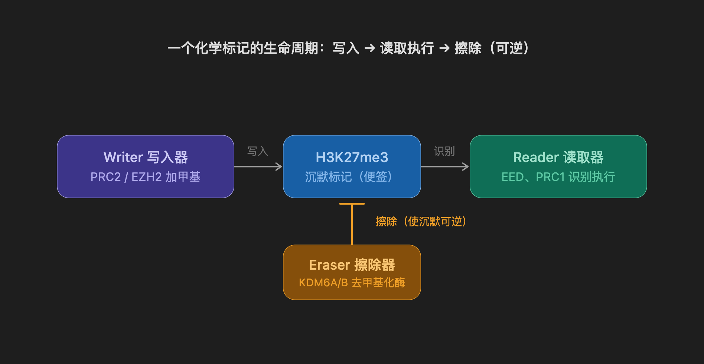
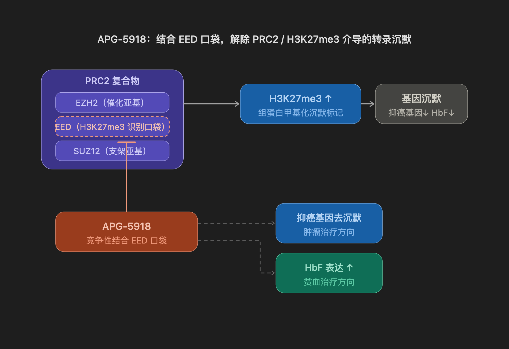
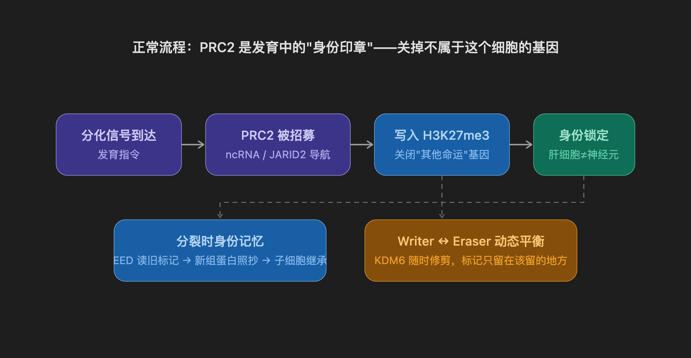
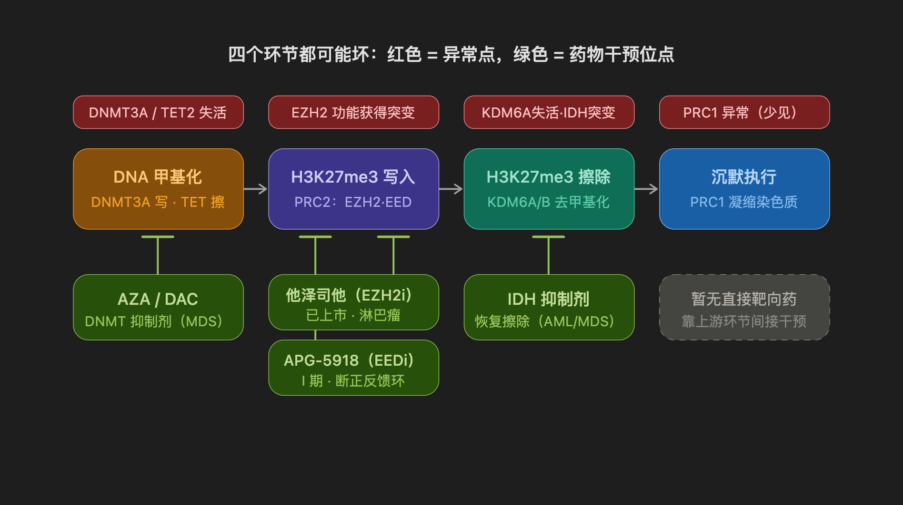
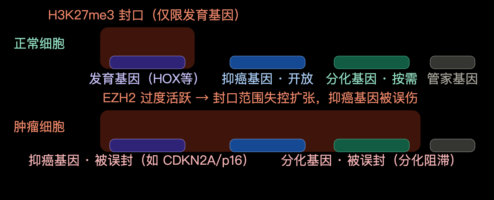

把化学标记想象成**贴在基因上的便签**，三类蛋白各司其职：

| 色                   | 干什么                          | 类比           | 代表分子                                                     |
| :------------------- | :------------------------------ | :------------- | :----------------------------------------------------------- |
| **Writer（写入器）** | 把化学标记**加到**组蛋白/DNA 上 | 贴便签的人     | **PRC2/EZH2**（写 H3K27me3）、DNMT（写 DNA 甲基化）          |
| **Reader（读取器）** | **识别**标记并执行它的含义      | 看便签办事的人 | **EED**（识别 H3K27me3 并激活 PRC2）、PRC1（识别后压缩染色质） |
| **Eraser（擦除器）** | 把标记**去掉**，使沉默可逆      | 撕便签的人     | KDM6A/B（UTX、JMJD3，专门擦掉 H3K27me3）                     |

**PRC2 这个复合物的工作就是给组蛋白 H3K27 位点贴上"关闭"便签**，它不直接关基因——它只负责"写"，关基因是下游 reader（PRC1）执行的结果

EED 在**结构上是 PRC2（writer）的亚基，功能上却是个 reader**。它读取已有的 H3K27me3 便签，然后通知搭档 EZH2"这里有封条，在旁边继续贴"，驱动正反馈扩散。**APG-5918 占住 EED 口袋，相当于同时废了"读"和"写"两个环节**

**PRC2（EZH2+EED+SUZ12）催化 H3K27me3 → 转录沉默**

1. **发育定型**：受精卵 → 各种组织，每一步分化都由 PRC2 把"不属于这个命运的基因"贴上 H3K27me3 封条。肝细胞关掉神经基因，神经元关掉肝基因——这就是"身份印章"功能。
2. **身份记忆**：细胞分裂时，旧组蛋白上的标记由 **EED 读取**、指导新组蛋白照抄，子细胞不会"失忆"。这就是为什么成熟组织能长期稳定。
3. **动态平衡**：写入（PRC2）和擦除（KDM6）像油门和刹车，标记边界被不断修剪。正常组织里 H3K27me3 只待在该待的位置。

1. **异常的核心逻辑都是"沉默过度"或"沉默错位"**：写入太猛（EZH2 GOF）、擦除失灵（KDM6A/IDH）、或甲基化版图乱掉（DNMT3A/TET2）——殊途同归，结果都是**该表达的基因（抑癌基因、分化基因）被锁死**。
2. **药物策略分两类**：堵 writer（他泽司他、APG-5918、AZA/DAC）或**修复擦除**（IDH 抑制剂）。注意 AZA/DAC 和 IDH 抑制剂严格说不是"激活基因"，而是**把失衡的天平扳回来**——这也是为什么这类表观遗传药起效慢（需要细胞分裂几代才能把标记代谢掉）、单药力度温和、常需联用。
3. **和你 MDS 致病级联的对应**：MDS 的"基因突变 → 表观遗传失调 → 分化阻滞"这一层，落点就在这张图的第一、三格——DNMT3A/TET2/IDH 突变先把表观平衡打乱，AZA 单药有效正是因为它在修第一层；而 BCL-2 抑制剂处理的是级联最末端的"凋亡逃逸"，**这从机制上解释了为什么 MDS 需要"表观遗传药 + 凋亡药"的纵向联合**（AZA + Lisaftoclax 的组合逻辑）。

