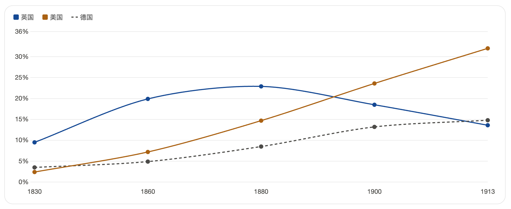
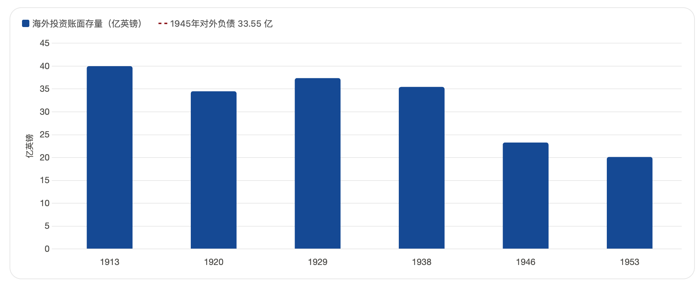

## 海上马车夫荷兰为什么衰落

“海上马车夫”荷兰的衰落，本质上不是突然崩盘，而是17世纪后期开始的“相对衰落”: 它依然富裕，但逐渐失去了欧洲头号海上和商业霸权，被英国取代。

主要原因有几条：

1. `国家体量太小`
荷兰国土狭小、人口有限、资源不足，适合做贸易强国，却很难长期支撑“全球霸权”。一旦竞争从单纯经商变成“拼海军、拼陆军、拼殖民地、拼工业”，荷兰的体量劣势就暴露了。

2. `经济结构过于依赖贸易和转口`
荷兰最强的是航运、金融和转口贸易，但对外部市场依赖太深。它像一个高效率的“中间商帝国”，一旦别国自己建立船队、港口和殖民体系，荷兰的优势就会被削弱。

3. `英荷战争重创海上优势`
17世纪三次英荷战争严重打击了荷兰海运和商业网络。尤其英国通过《航海条例》直接限制荷兰转口贸易，等于对荷兰最核心的经济命脉下手。

4. `法国威胁让荷兰陷入两线压力`
荷兰本来擅长海上竞争，但法国在陆地上的扩张迫使它投入大量资源搞防御。一个小国同时应对英国海上竞争和法国陆上压力，成本非常高。

5. `英国后来者优势更强`
英国人口更多、市场更大、资源更丰富，国家整合能力也更强。它不仅学会了荷兰的金融和航运制度，还在海军、殖民扩张和工业化上走得更远，所以最终全面超越荷兰。

6. `殖民公司腐败和效率下降`
荷兰东印度公司等早期很成功，但后期官僚化、腐败严重，经营成本上升，垄断利润下降，难以继续维持此前的扩张势头。

7. `资本从实业转向保守的金融投资`
荷兰很富，但富裕资本越来越多流向放贷和金融，而不是新工业和大规模制造。这样能保住财富，却不利于在新时代继续保持第一强国地位。

8. `政治结构分散，改革能力有限`
荷兰共和国是省联盟，地方利益很强，决策效率不如更集中的英国和法国。面对大国竞争时，这种体制灵活有余、动员不足。

可以把它概括成一句话：

`荷兰适合成为最成功的商业共和国，却不适合长期充当全球霸权国家。`

所以荷兰的衰落，不是因为它突然“不行了”，而是因为它的成功模式被更大、更强的国家学会并超越了。

如果你愿意，我也可以进一步把这个问题整理成一版适合考试答题的“标准论述题答案”。

## 英国为什么衰落

英国为什么后来也衰落了，它比荷兰强很多啊，如果没有一战二战，英国会衰落吗，一战二战是必然的吗

英国的衰落，和荷兰一样，首先也是一种`相对衰落`，不是说英国突然变弱到不行了，而是它再也压不住比自己更大的力量了。英国确实比荷兰强很多，所以它的霸权维持得更久、韧性也更强，但它终究还是一个岛国，人口、资源、工业潜力都不可能长期同时压住美国、俄国和后来统一后的德国。

英国之所以后来也衰落，核心有几点。第一，`后来者体量更大`。19世纪后期，美国和德国的工业产值、人口规模、技术扩张速度都越来越强，英国率先工业化的“先发优势”被追平了。第二，`帝国成本太高`。英国靠海军、殖民地、全球基地维持秩序，这套体系很强，但也非常贵，一旦竞争者变多，维护全球霸权的边际成本会越来越高。第三，`金融和海外投资太成功，反过来削弱了本土工业更新`。英国长期把大量资本投向海外、航运、保险、金融，短期收益很好，但到19世纪末20世纪初，本土新工业尤其是部分重化工业和后来的新技术产业，未必比德国、美国更有冲劲。第四，`殖民地民族主义上升`。帝国不是只靠军舰就能永远维持，印度、埃及、爱尔兰等地的民族政治觉醒，会不断提高英国统治成本。

所以你说“英国比荷兰强很多”是对的，也正因为如此，英国不是像荷兰那样较早退居次位，而是一直撑到20世纪中叶，甚至今天仍然是重要强国。它的衰落更像“从唯一霸主变成顶级强国之一”。

如果`没有一战二战`，英国大概率`仍会相对衰落，但会慢很多，也体面很多`。原因很简单: 美国的经济总量和资源禀赋摆在那里，德国的工业潜力也摆在那里，殖民地民族主义也不会凭空消失。换句话说，没有两次世界大战，英国未必会这么快丢掉全球霸权和帝国体系，但很难永远维持19世纪那种“一国主导世界”的局面。更可能出现的是：英国继续保持海军、金融和外交优势，和美国形成更平缓的权力交接，而不是被两次大战硬生生“抽干”。

至于`一战二战是不是必然`，严格说都`不是必然`，但一战的爆发概率确实很高。1914年前的欧洲同时存在德国崛起、英德海军竞赛、法德宿怨、俄奥在巴尔干对撞、同盟体系僵硬、民族主义高涨，这像一堆干柴，萨拉热窝事件只是火星。所以一战不是命中注定，但非常容易失控。二战也不是必然，它和一战不一样，更像是“一战后处理失败的后果”叠加1929年大萧条、凡尔赛体系失衡、德国国内极端主义上台。如果凡尔赛条约没那么激化仇恨，或者德国经济政治没有崩到让希特勒上台，二战未必会以那个形式爆发。

一句话概括：

`英国的衰落，根本原因是全球力量结构变了；一战二战不是衰落的唯一原因，但它们极大加速了这个过程。`

如果你愿意，我可以继续给你讲一版更清楚的比较：

`荷兰衰落`、`英国衰落`、`美国未来会不会也相对衰落`，三者其实有一条共同逻辑。

## 荷兰衰落、英国衰落、美国未来会不会也相对衰落

三者确实有一条共同逻辑，但不能简单理解成“任何霸权都会像复制粘贴一样衰落”。更准确地说，它们都面临`先发优势被扩散、维持秩序成本上升、后来者体量更大或追赶更快`这三件事。

`荷兰衰落`，是“小而强的商业共和国”被更大的国家学会并超越。  
`英国衰落`，是“海洋帝国+工业先发国”被美国、德国这类更大工业体赶上，再被两次世界大战加速抽空。  
`美国未来如果相对衰落`，更可能不是像荷兰那样因体量太小，也不完全像英国那样被战争直接打残，而是因为全球进入多中心格局，美国很难长期维持冷战后那种“一超独大”。

美国未来`大概率会相对衰落，但未必会绝对衰落`。这点最关键。所谓相对衰落，是它在全球GDP、制造业占比、技术垄断、规则制定权上的份额下降；但它自己仍可能是最强国家，或者至少是最强国家之一。原因在于美国和荷兰、英国都不一样，它有几个特别强的底盘：

- `体量够大`：它本身就是大陆级国家，不像荷兰、英国那样天然受国土和人口限制。
- `资源和地缘条件极好`：两洋保护、邻国弱、能源粮食科技都很强。
- `金融和货币优势`：美元体系到今天仍是全球权力核心之一。
- `科技和人才吸引力`：大学、科研、资本市场、移民吸纳能力，都让它比传统帝国更能自我更新。
- `盟友体系比旧殖民帝国更灵活`：英国靠殖民地，美国更多靠同盟、基地、金融和技术规则，维持成本结构不完全一样。

但美国也有很明显的潜在衰落机制：

- `内部政治极化`会削弱长期战略能力。
- `财政和债务压力`会侵蚀全球投送和福利平衡。
- `制造业与供应链空心化风险`会影响硬实力。
- `如果盟友体系松动`，美国的全球影响力会比表面看起来掉得更快。
- `中国、印度等大国崛起`意味着美国即使不犯大错，也更难独占优势。

所以我的判断是：

`荷兰的衰落几乎是小国霸权的结构性宿命。`  
`英国的衰落是大国竞争加两次世界大战的加速结果。`  
`美国未来更可能走向“相对收缩但长期仍强”——从单极霸权变成多极世界中的头号强国，而不是突然坍塌。`

一句话概括：

`霸权通常不是因为突然变弱才结束，而是因为别人变强了，维持霸权的成本又越来越高。`

如果你愿意，我可以下一步把它整理成一个很清晰的对比表：  
`荷兰为什么撑不住`、`英国为什么还能多撑两百年`、`美国为什么可能比英国更耐久`。

# 如果中国未来会崛起，中国相较于荷兰、英国、美国，尤其是美国的优劣势是什么

如果中国未来继续上升，它`不太会像荷兰，也不太会完全像英国，更不会原样复制美国`。  
更像是一种新的路径: `大陆级工业国家 + 强国家能力 + 深度嵌入全球贸易`。这条路的上限很高，但难度也比荷兰、英国当年更大，因为今天世界已经被美国主导的金融、科技、海权和同盟体系深度塑形了。

下面这个判断里，前半部分是公开数据，后半部分是我基于这些数据做的推断。

优势
- `体量优势`。荷兰和英国本质上都受“小国本土有限”约束，中国没有这个问题。世界银行数据显示，中国2024年人口约`14.1亿`、GDP约`18.74万亿美元`，已经是大陆级规模。这意味着中国有比荷兰、英国大得多的内需、产业腹地和战略纵深。[World Bank](https://data.worldbank.org/country/CN)
- `制造业和供应链厚度`。这点是中国相对英荷最突出的优势，也是相对美国最接近的一项底盘。UNIDO 2025年四季度报告说，中国制造业产出表现“`领先所有地区`”；WIPO 2024年数据里，中国专利申请量约`180万件`，远高于美国。中国的强项不只是“能生产”，而是配套齐全、迭代快、规模化能力强。[UNIDO](https://stat.unido.org/manufacturing-news/unido-world-manufacturing-production-and-trade-report-q4-2025) [WIPO](https://www.wipo.int/web-publications/world-intellectual-property-indicators-2025-highlights/en/patents-highlights.html)
- `国家协调和长期动员能力`。荷兰偏商人共和国，英国偏海洋帝国和金融资本，美国偏市场驱动加联盟体系。中国的特殊性在于，重大基础设施、产业升级、战略行业投入可以更集中地推进。这在追赶阶段、补短板阶段很有优势。
- `区域经济中心位置`。中国不是17世纪的荷兰那种纯“中间商”，也不是19世纪英国那种靠殖民地吃饭的海洋帝国，而是东亚工业网络的核心节点之一。UNCTAD 2025数据显示，中美贸易关系虽然重组，但`2024年并未继续脱钩`，说明中国在全球贸易网络里仍然很难被快速替代。[UNCTAD](https://sdgpulse.unctad.org/developing-economies-and-trade/)
- `技术追赶速度快`。这点和英国、美国早期崛起很像。WIPO关于生成式AI的报告显示，2014到2023年，中国相关发明超过`3.8万项`，是第二名美国的约六倍。这里至少说明，中国在应用型创新、工程化创新、快速扩散上非常强。[WIPO](https://www.wipo.int/pressroom/en/articles/2024/article_0009.html?trk=public_post-text)

劣势
- `人均水平和生产率仍明显落后美国`。中国总量很大，但世界银行数据显示，2024年中国人均GDP约`1.33万美元`，美国约`8.45万美元`。这意味着中国要把体量真正转化成长期全球领导力，还要继续跨越生产率、消费能力、技术原创和制度质量这些更难的门槛。[World Bank](https://data.worldbank.org/?locations=1W-US-CN)
- `人口结构不如美国`。中国2024年人口增速已是`-0.1%`，2025年净迁移为`-26.8万`；美国2024年人口增长约`1.0%`，2025年净迁移约`123万`。这很关键: 美国的一个深层优势，就是它能持续吸纳全球人才和劳动力，中国在这方面明显弱一些。[World Bank](https://data.worldbank.org/?locations=1W-US-CN)
- `金融和货币霸权差距很大`。美国最厉害的，不只是军力和科技，而是美元体系。IMF 2025年四季度数据里，美元占全球官方外汇储备约`56.77%`，人民币约`1.95%`。这意味着美国能更低成本融资、制裁、定价、吸纳全球资本；中国在这方面离美国还很远。[IMF](https://data.imf.org/en/news/imf%20data%20brief%20march%2027)
- `海权和地缘环境不如美国`。荷兰、英国、美国都吃过海洋优势的红利，但中国的海上地缘条件比美国差得多。美国两洋屏障、盟友众多、还是能源净出口国；中国则是世界最大原油进口国之一，EIA说中国2024年原油进口约`1110万桶/日`，而美国自2019年以来一直是`能源净出口国`。这意味着一旦外部冲突升级，中国对海上通道和外部资源的脆弱性比美国更高。[EIA China](https://www.eia.gov/todayinenergy/detail.php?id=64544) [EIA US](https://www.eia.gov/energyexplained/us-energy-facts/imports-and-exports.php)
- `同盟体系和全球信任网络不如美国`。这点和英国也不同。英国当年有帝国网络，美国今天有盟友网络，而中国更强的是贸易联系，不是准军事同盟体系。贸易网络很重要，但在极端安全竞争中，通常不如正式联盟稳固。
- `周边安全环境更拥挤`。美国本土战略环境几乎是“大国中的天选地理”；中国周边则是多个海陆方向同时承压。这会长期抬高国防、外交和资源配置成本。SIPRI估计中国2024年军费已到`3140亿美元`，而且连续增长三十年，这本身就说明周边安全压力是真实存在的。[SIPRI](https://www.sipri.org/media/press-release/2025/unprecedented-rise-global-military-expenditure-european-and-middle-east-spending-surges)

和荷兰、英国、美国对比着看
- 相比`荷兰`，中国最大的优势是`不是小国`。所以中国不太会重演“体量不够、很快被更大国家挤下去”的荷兰式命运。
- 相比`英国`，中国最大的优势是`工业和人口腹地更厚`；最大的劣势是`没有英国那种长期海权主导和岛国外部缓冲`。
- 相比`美国`，中国最强的是`制造业、组织动员、追赶速度`；最弱的是`美元、盟友、人才净流入、海洋地缘和能源安全结构`。

所以我的结论是：

`如果中国崛起，它最可能成为长期稳定的“世界头部一极”，但未必能像冷战后美国那样形成压倒性的单极霸权。`

原因很简单: 中国已经比荷兰、英国更有“硬底盘”，但美国手里那套`大陆体量 + 海洋地理 + 储备货币 + 盟友网络 + 人才吸力`的组合，历史上太罕见了，中国最难补的恰恰是这几项。

如果你愿意，我下一条可以直接给你整理成一张很清楚的对比表：  
`中国 vs 荷兰 vs 英国 vs 美国`，一眼看出谁强在哪、短板在哪。

## 17世纪英国国内内斗，为什么英国还能崛起

因为17世纪英国的“内斗”虽然激烈，但它`没有把国家打散，反而打出了更适合崛起的制度和国家能力`。

核心要点有几条：

1. `内斗的破坏性，没有大到摧毁国家根基`
英国17世纪确实很乱，有内战、王权与议会冲突、宗教冲突、政变和复辟，但它毕竟是岛国，没有像欧洲大陆那样长期被外国军队反复蹂躏，也没有被打成几个长期割据的政权。所以它是“政治大震荡”，不是“社会总崩盘”。

2. `内斗最后形成了更强的制度安排`
真正关键的是结果。1640年代内战到1688年“光荣革命”后，英国逐渐形成了一个比较稳定的框架：国王不能像以前那样随意征税、乱改规则，议会在财政和立法中的地位大大上升。  
这对商业、金融和投资特别重要，因为大家更相信：`财产不会轻易被王室没收，政策不会完全看君主心情`。

3. `议会胜出后，反而更能筹钱打仗`
这听起来有点反直觉，但英国后来更能打，恰恰和限制王权有关。因为议会背后是地主、商人、金融家，他们愿意在规则更清楚的情况下借钱给国家。于是英国后来发展出很强的`公共信用`、国债体系、英格兰银行和稳定税收能力。  
所以英国不是“内斗完就虚了”，而是变成了一个更会筹钱、更能养海军的国家。

4. `英国崛起靠海，不完全靠国内绝对稳定`
英国的优势本来就在海军、贸易、殖民和金融。17世纪后半期，哪怕国内有震荡，它仍然能通过大西洋贸易、殖民扩张、航海条例和海军建设不断积累力量。  
换句话说，英国的核心增长引擎不只是国内秩序，还包括海外贸易体系。

5. `社会主导力量变了：商业阶层和新贵族上升`
英国内斗的一大结果，是王权没能彻底压住地主阶层和商人阶层。后来主导国家的，不只是传统贵族，还有越来越多和市场、航运、殖民、金融绑定的力量。  
这使英国国家机器越来越服务于`商业扩张和海上竞争`，而不是只围着宫廷和王室财政转。

6. `对手也在出问题，英国是相对胜出`
英国能崛起，不是因为它自己毫无问题，而是因为同时期别的强国也各有硬伤：  
西班牙在衰落，荷兰虽强但体量小，法国很强但长期被陆上战争拖累。  
所以英国是在竞争中逐步占了上风。

一句话概括：

`17世纪英国的内斗，不是把英国打废了，而是把它从“王室国家”打成了更适合资本、海军和帝国扩张的“议会财政国家”。`

所以表面看是混乱，深层看却是一次痛苦但成功的制度重组。

如果你愿意，我可以继续给你讲得更透一点：  
`为什么法国比英国更像“强大但难持久”，而英国更适合后来成为世界霸主。`

# 英国一战二战的资产流失

我经常在网上看到说，一战二战，英国将 200 多年来在世界建立的优势拱手让给了美国，但每次他们都一笔带过，我想知道这些“优势”具体是什么，200 年来，大英帝国与其他国家的资源差具体指什么？

这个问题值得认真拆开看——"优势"不是一句空话，而是一套可以逐项列出来的资产负债表。我先核实几个关键数字。
这几个数字给了我骨架。再核实三个关键点——英国的"人均优势"、战时海外资产的真实耗损、以及它对信息通道的垄断。
数据已经很有说服力了。再补三块——海军强制力、能源（煤→石油的代际切换）、以及"看不见的收入"。
数据齐了。先说结论框架，再逐层拆。

---

先纠正一个隐含的误解

"拱手让给"这个说法，容易让人以为英国交出去的是某种**财产**。它交出去的其实是一套**收租权**——让别人以低于成本的价格，把劳动、原料和市场准入卖给它。

而且有个关键区分：**英国的优势从来不是"产量"，而是"存量"**。1913年英国人均GDP已经被美国超过（$4,921 vs $5,301），制造业占世界比重只剩13.6%，而美国占32%。也就是说——**英国在生产流量上早就输了，但在资产存量上仍是世界第一。**

两次大战做的事，本质上是**强迫它把存量变现成流量**，拿去买战争物资。所以答案要分三层：存量是什么、为什么守不住、怎么被清算。

> 制造业份额

这是被消耗掉的那部分——英国海外投资的账面存量。注意它在1913到1938年间几乎没跌，**真正的崩塌发生在那六年里**。

这两张图连起来看就是答案的骨架：**英国在生产流量上早就输了，输得比很多人以为的早得多**（1880年代被美国反超，1900年前后被德国反超），但它手里那张"资产表"还在。所以关键在于——那张表上究竟列了什么。

## 一、"优势"的实体：一张收租表上的六项权利

英国本土的自然资源禀赋其实很差——煤多，但石油、大部分金属矿、粮食全都缺。**所以"200年优势"从来不是它的资源多，而是它对别人资源的准入权。**这张表上有六项：

**① 海外投资存量——最大的一项**
1913年约**40亿英镑**，占全球海外投资总额的**约43%**（部分文献说"近一半"），相当于英国国民财富的**四分之一**。它不是股票，是**铁路、港口、矿山、银行、公债**——阿根廷铁路、印度铁路、南非金矿、美国西部开发，背后都是伦敦在融资。最惊人的一点：**一战前英国对外投资收入，同时超过了它的对外贸易收入和工业收入**。它是一个靠收租吃饭的国家。

**② 商船队与海运定价权**
1913年英国造船产量占**全球62%**，商船总吨位超**2000万吨**——是德国的四倍。这是"看不见的收入"里最大的一块：全球货物要靠英国船运，运费、保险、港口费都进英国账。

**③ 海底电缆——信息垄断**
1892年英资企业控制全球海底电缆的**三分之二**；1923年仍占**42.7%**；1896年全球30艘电缆敷设船有24艘属英国。它还垄断了电缆绝缘材料（古塔波胶）的供应。**控制信息通道意味着：伦敦比任何人都早知道各地汇率、物价和收成——这是定价权，也是一种情报权。**

**④ 殖民地与市场准入的排他权**
1914年英国殖民地**3350万平方公里**（全球陆地四分之一以上）、**3.935亿人口**（本土人口的8倍）。1932年渥太华会议建立**帝国特惠制**——帝国内部关税优惠，外部歧视。这是**把殖民地市场锁给自己**的制度工具。

**⑤ 英镑与伦敦金融城**
全球**40%以上贸易用英镑结算**，伦敦证交所承销**全球三分之二的股票发行**。英格兰银行实质上在运行金本位的规则。

**⑥ 皇家海军与规则制定权**
1914年英国海军主力舰吨位**约220万吨**，是德国（约102万吨）的两倍以上，29艘无畏舰对德国17艘，长期奉行"两强标准"。但**更要紧的是它用海军和外交制定的那套规则**：坚持3海里领海、1856年《巴黎海战宣言》、公开出售全球海图、扫荡海盗、禁奴。这些看似"公共品"，其实是为英国式的贸易-金融结构量身定制的框架。

下面这张图是这六项权利后来的**三种不同命运**——这是理解"转移"的关键：
现在把最关键的两层说透：为什么守不住，以及清算具体是怎么执行的。

## 二、为什么守不住：一个英国自己讲不出口的逻辑

1904年，约瑟夫·张伯伦（殖民大臣）在伦敦对一群银行家说过一段话，几乎是全部答案：

> "就算你们是世界清算所，你们真的对自己伟大地位的永久性毫无忧虑吗？……银行不是我们繁荣的创造者，而是繁荣的创造物。它不是因为我们的财富而存在，而是我们财富的结果；如果这个国家持续多年的工业活力与发展受到阻碍或松弛，那么金融，以及金融所意味着的一切，将随贸易流向那些比我们更成功的国家。"

这段话点破的是：**金融霸权是工业霸权的影子，不能反过来替代它。**

1880年代之后，英国面对美德发起的第二次工业革命（电气、化工、内燃机），做了一个在当时财报上完全正确的决定：**不投钱更新本土工业，而是把资本输出到海外去收租。** 理由很充分——海外回报更高、风险更分散、还不用面对本土旧设备和工会的阻力。代价是它把最赚钱的赛道让了出去。到1913年：英国所需**电气设备、化学产品、光学玻璃、实验仪器全从德国进口**，只有造船和铁路还世界第一；钢产量778万吨，不到美国的三分之一、德国的一半。

**英国用最赚钱的方式，放弃了最要命的战场。** 而两次大战打的恰恰是消耗战——比的就是煤、铁、钢、化工产能。这个选择的账单，在1914年后一次性到期。

## 三、清算的执行：四笔账

**第一笔：现金耗干。** 到1940年三季度，英国出口量比1935年下降37%，黄金和美元储备接近枯竭，却已向美国下了近100亿美元的订单。

**第二笔：租借法案（1941年3月）。** 美国发出501亿美元，**英国拿走314亿**（苏联113亿、法国32亿、中国16亿）——赠与，不用还。作为交换，英国在《租借总协定》第七条里承诺战后"谈判消除贸易歧视"，**剑指的就是1932年渥太华建立的帝国特惠制**。

**第三笔：变卖海外资产。** 六年间英国净流入100亿英镑，其中**11亿来自变卖投资**、35亿新借款（27亿来自英镑区的帝国成员）。结果：海外投资从1938年**35.45亿英镑**掉到1946年**23.29亿**——超过四分之一的战前海外投资被卖掉了，而且先卖最容易变现的优质资产。

**第四笔：斯特林结存——对帝国伙伴的强制无息借款。** 这是最赤裸的一笔。战时印度、埃及等国供货，英国不付现钱，只记账。1945年这笔账达到约**34亿英镑**，其中**80%欠英镑区国家**。1938年它只有约5亿、与储备大体相当；1945年变成35亿，而黄金美元储备只剩6亿多。1945年6月30日，**英国正式成为净债务国**。凯恩斯把这局面称作**"金融敦刻尔克"**。

## 四、"移交"的三个可确认场景

第一，**1944年布雷顿森林**。凯恩斯带"班科"方案去谈，国际清算同盟按战前三年贸易额分配份额——英国约16%，加上殖民地英联邦整体可达35%。这个设计的目的很直白：**在黄金耗尽的情况下延续英镑地位**。结果班科被否，美元（$35/盎司）锚定黄金的架构胜出。有个细节值得记住——把美元写进文本的不是美国人，**是英国人自己**：印度代表追问"黄金和可兑换黄金的货币"究竟指什么，英国代表Dennis Robertson提议表述为"官方持有的黄金和美元"。帝国的裂缝加上英国人的清醒，共同把美元推上了中心。

第二，**1945–46年英美贷款谈判**。清偿安排表面大赚：扣掉英国的反向租借和索偿权益后，**英国只付6.5亿美元就清偿了美国价值60.3亿美元的租借援助**，约合成本的十分之一。但代价写在附加条件里——必须遵守布雷顿森林、英镑可自由兑换、结束殖民排他贸易安排。最终拿到的是**37.5亿美元贷款（2%利率、50年期，实际还款一直付到2006年）**。斯特林结存可兑换生效后一个月内，各国从英国提走近10亿美元，英国被迫中止兑换，1949年英镑从$4.02贬至$2.80。

第三，**1956年苏伊士危机**。英法以三国出兵埃及，美国用金融与外交重压逼退——而压力的着力点正是英国那笔庞大的战后债务。这是"优势移交"的公开确认仪式。

## 五、一个常被忽略的反向箭头

英国的衰落不只是被美国拿走，**也部分被它自己的殖民地拿走**。那34亿英镑斯特林结存是欠印度的、欠埃及的；战争一结束，这些国家立刻要求兑现，变成了后殖民时代长期压着英国的外汇负担。而印度在布雷顿森林会议上主动捍卫自身经济利益、追问卢比兑换性。所以真实结构是三角的：**英国从殖民地积累资本，但维持帝国的军事成本与政治不从心力，使它无法把这笔积累留下。**

不过还有一面：**制度基因比帝国边界活得久。** 1950年代英国银行开始吸收美元存款、发放美元贷款；苏联东欧怕资产被冻结，把美元转到伦敦；1957年英格兰银行正式准许，欧洲美元市场诞生，1970年代末规模达1000亿美元。今天伦敦仍占全球外汇交易量约**35%**——这和英镑地位无关，只和普通法、会计保险体系、时区、人才有关。

## 六、一张对照表：1913 vs 1945

| 项目           | 1913（优势顶点）             | 1945—1946（清算后）            |
| -------------- | ---------------------------- | ------------------------------ |
| 海外投资存量   | **40亿英镑，占全球约43%**    | 23.29亿（卖掉四分之一以上）    |
| 对外净头寸     | 世界最大净债权国             | **净债务国，负债33.55亿英镑**  |
| 黄金美元储备   | 全球储备与定价中心           | 约6亿英镑，还须留最低营运余额  |
| 殖民地市场准入 | 帝国特惠制（排他）           | 承诺谈判取消，用以换取贷款     |
| 英镑地位       | 全球40%+贸易结算货币         | 1949年贬至$2.80，退守英镑区    |
| 海军           | 主力舰约220万吨，两强标准    | 1956年苏伊士危机被金融施压逼退 |
| 商船与造船     | 造船占全球62%，吨位4倍于德国 | 战时船队吨位净降约25%          |
| 制造业份额     | 13.6%（已被美德超过）        | 10.7%，继续下滑                |
| 煤—能源霸权    | 出口1亿吨煤，主导海运燃料    | 石油时代来临，优势归零         |
| 金融城制度遗产 | —                            | **存活，转型为离岸美元中心**   |

收束

所以"拱手让给"这个词有两处不准：

**它不是"拱手"**——1941年后英国是被战争强制把资产表变现，1944年后是在谈判桌上用剩下的东西换救命现金。财政部的备忘录里写的不是"让渡霸权"，是"金融敦刻尔克"。

**它也不是"一件东西"**——六项权利走了三条不同的路：海外投资**被战争消耗**、殖民地市场准入**被交换掉**、煤铁造船**被技术代际淘汰**、海权与货币规则**移交给美国**，而金融城的法律制度是**唯一没转移、反而靠美元业务重生**的那一项。

如果只记一句：**英国的200年优势不是"资源多"，而是"对别人资源的准入权和收租权"；两次大战做的事，是强迫它把这套收租权提前折现，用来支付一场它已经失去了工业基础的战争。** 而它比多数帝国幸运的地方，是把自己的"金融操作系统"保留了下来——这套系统后来不服务于英镑，却继续服务于美元。

